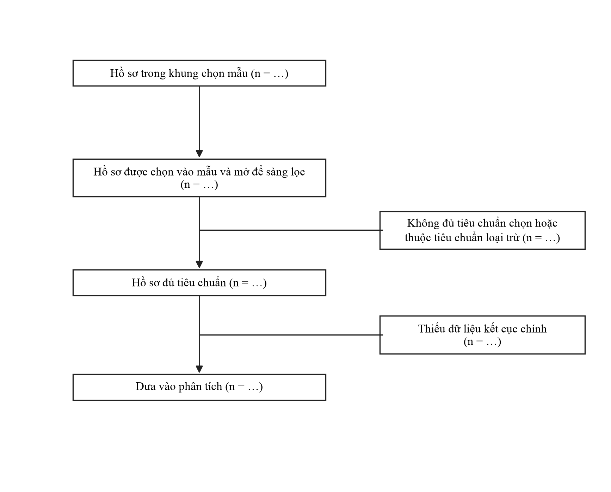
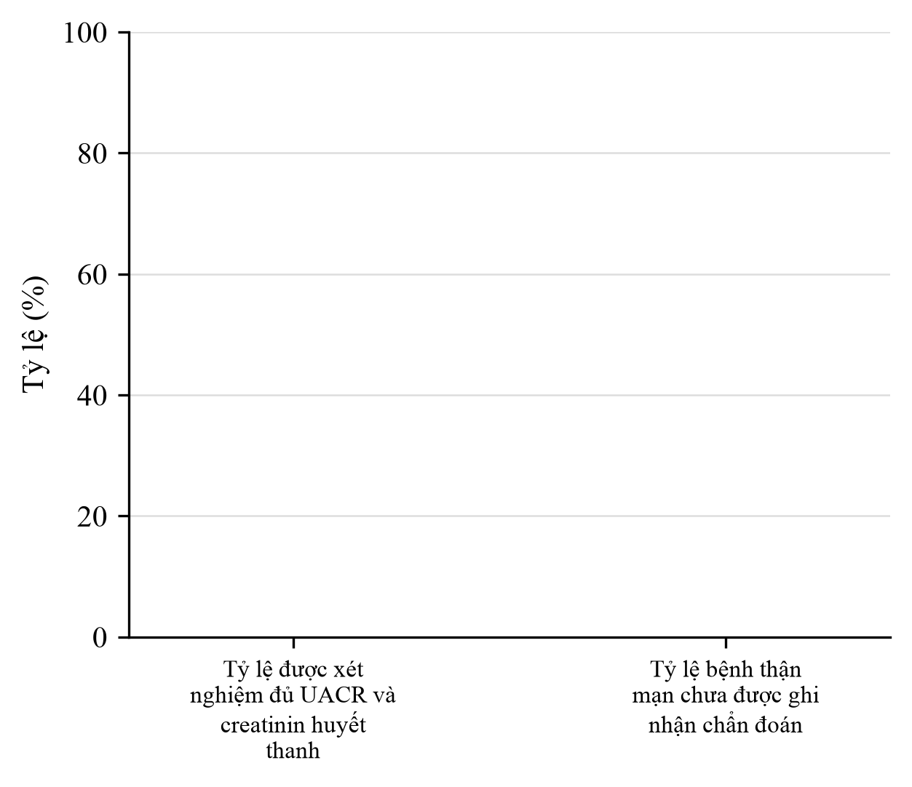
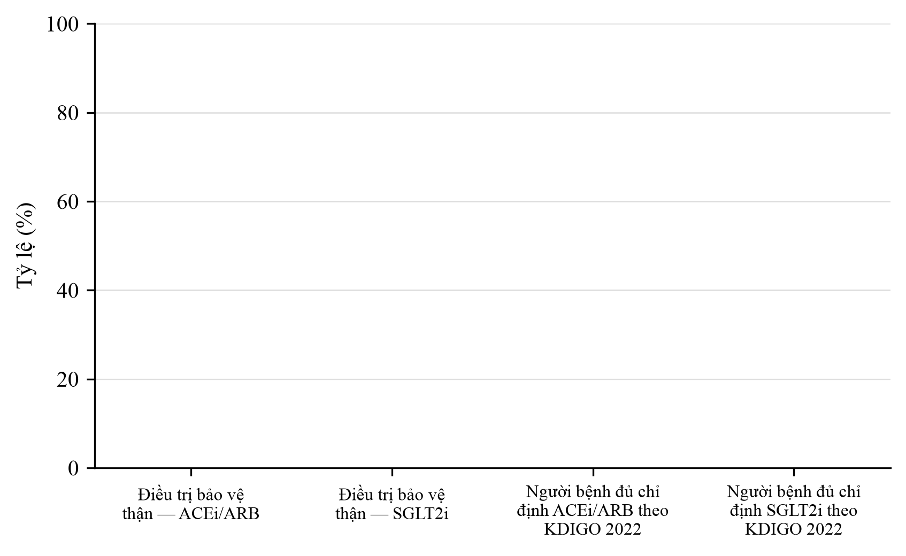
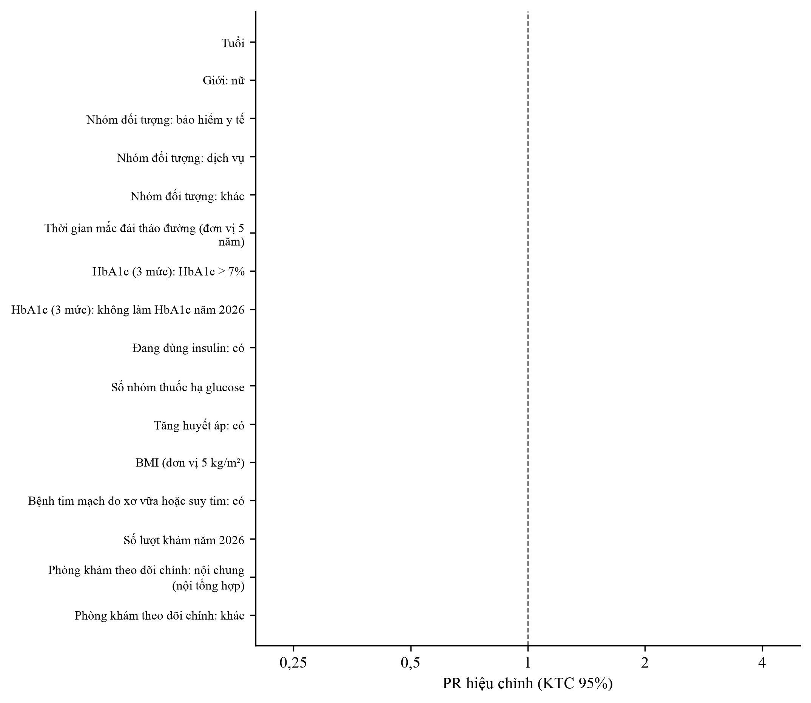
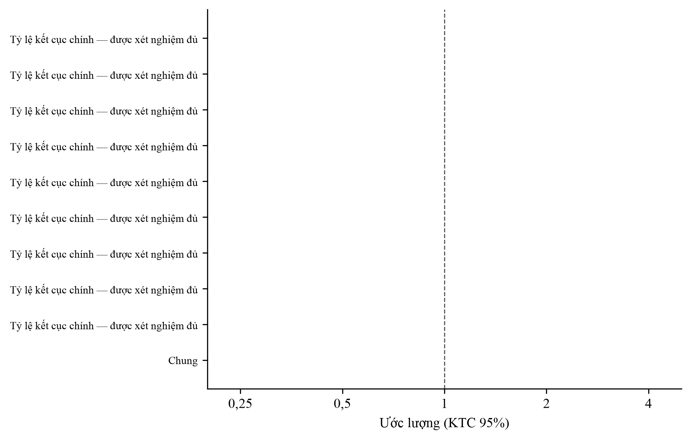

**BỆNH VIỆN QUÂN Y 175**
**KHOA KHÁM BỆNH**

**ĐỀ CƯƠNG NGHIÊN CỨU**

**ĐỀ TÀI KHOA HỌC VÀ CÔNG NGHỆ CẤP BỆNH VIỆN**

**THỰC TRẠNG PHÁT HIỆN VÀ ĐIỀU TRỊ BẢO VỆ THẬN Ở BỆNH NHÂN ĐÁI THÁO ĐƯỜNG TÍP 2 ĐIỀU TRỊ NGOẠI TRÚ TẠI BỆNH VIỆN QUÂN Y 175 THEO KDIGO 2022, KDIGO 2024 VÀ ADA 2026**

**Chủ nhiệm đề tài: ………**

**Phiên bản đề cương:** 1.0, ngày ……/……/……

**THÀNH PHỐ HỒ CHÍ MINH, 2026**

---

**BỆNH VIỆN QUÂN Y 175**
**KHOA KHÁM BỆNH**

**ĐỀ CƯƠNG NGHIÊN CỨU**

**ĐỀ TÀI KHOA HỌC VÀ CÔNG NGHỆ CẤP BỆNH VIỆN**

**THỰC TRẠNG PHÁT HIỆN VÀ ĐIỀU TRỊ BẢO VỆ THẬN Ở BỆNH NHÂN ĐÁI THÁO ĐƯỜNG TÍP 2 ĐIỀU TRỊ NGOẠI TRÚ TẠI BỆNH VIỆN QUÂN Y 175 THEO KDIGO 2022, KDIGO 2024 VÀ ADA 2026**

**Phiên bản đề cương:** 1.0, ngày ……/……/……

**CHỦ NHIỆM ĐỀ TÀI**

(Họ tên và chữ ký)

**CHỦ NHIỆM KHOA**

(Họ tên và chữ ký)

**VIỆN TRƯỞNG**

(Họ tên và chữ ký — nếu Khoa trực thuộc Viện)

**THÀNH PHỐ HỒ CHÍ MINH, 2026**

---

# DANH SÁCH CÁC CÁN BỘ THAM GIA THỰC HIỆN ĐỀ TÀI

| STT | Chức danh, họ và tên | Đơn vị công tác | Nhiệm vụ trong đề tài |
|---|---|---|---|
| 1 | ……… | Khoa Khám bệnh, Bệnh viện Quân y 175, Thành phố Hồ Chí Minh | Chủ nhiệm đề tài |
| 2 | ……… | ……… | Nhà phương pháp/thống kê |
| 3 | ……… | ……… | Quản lý dữ liệu |
| 4 | ……… | ……… | Người trích lại |
| 5 | ……… | ……… | Hội đồng chuyên gia |

Chủ nhiệm đề tài (ký và ghi rõ họ tên): ………

Đơn vị chủ trì đề tài (ký và ghi rõ họ tên): ………

Phòng Khoa học Quân sự (ký và ghi rõ họ tên): ………

---

# MỤC LỤC

- ĐẶT VẤN ĐỀ
- MỤC TIÊU NGHIÊN CỨU
- CHƯƠNG 1. TỔNG QUAN TÀI LIỆU
- 1.1. Chiến lược tìm kiếm tài liệu
- 1.2. Bệnh thận mạn ở người đái tháo đường típ 2: định nghĩa, phân loại và phát hiện
- 1.3. Điều trị bảo vệ thận theo khuyến cáo
- 1.4. Thực trạng phát hiện và điều trị bệnh thận mạn ở người ĐTĐ típ 2 trên thế giới
- 1.5. Tình hình nghiên cứu tại Việt Nam
- 1.6. Khoảng trống nghiên cứu và đóng góp của đề tài
- CHƯƠNG 2. ĐỐI TƯỢNG VÀ PHƯƠNG PHÁP NGHIÊN CỨU
- 2.1. Đối tượng nghiên cứu
- 2.2. Địa điểm và thời gian nghiên cứu
- 2.3. Thiết kế nghiên cứu
- 2.4. Câu hỏi và giả thuyết nghiên cứu
- 2.5. Cỡ mẫu và phương pháp chọn mẫu
- 2.6. Phương pháp nghiên cứu
- 2.7. Đạo đức trong nghiên cứu
- CHƯƠNG 3. DỰ KIẾN KẾT QUẢ VÀ BÀN LUẬN
- 3.1. Đặc điểm đối tượng nghiên cứu
- 3.2. Kết quả theo mục tiêu 1: Mô tả thực trạng phát hiện bệnh thận mạn ở người bệnh đái tháo đường típ 2 điều trị ngoại trú được theo dõi đều tại Khoa Khám bệnh, Bệnh viện Quân y 175 năm 2026
- 3.3. Kết quả theo mục tiêu 2: Mô tả thực trạng điều trị bảo vệ thận ở người bệnh đủ chỉ định theo KDIGO 2022 trong cùng quần thể
- 3.4. Kết quả theo mục tiêu 3: Phân tích một số yếu tố liên quan với việc không được xét nghiệm đủ UACR và creatinin
- 3.5. Phân tích nhóm nhỏ và phân tích độ nhạy
- 3.6. Dự kiến bàn luận
- 3.7. Hạn chế của nghiên cứu và phạm vi suy rộng kết quả
- TÀI LIỆU THAM KHẢO
- PHỤ LỤC A. TÓM TẮT KẾ HOẠCH PHÂN TÍCH THỐNG KÊ
- PHỤ LỤC B. ĐƠN ĐỀ NGHỊ MIỄN ĐỒNG THUẬN THAM GIA NGHIÊN CỨU
- PHỤ LỤC C. PHIẾU THU THẬP SỐ LIỆU
- PHỤ LỤC D. BẢNG BIẾN SỐ VÀ MÃ HOÁ
- PHỤ LỤC E. DANH MỤC MÃ DÙNG ĐỂ TRÍCH
- PHỤ LỤC F. KẾ HOẠCH THỰC HIỆN
- Nhân lực và phân công nhiệm vụ
- Tiến độ thực hiện
- Dự trù kinh phí
- Kế hoạch quản lý dữ liệu
- Đăng ký nghiên cứu và phổ biến kết quả
- PHỤ LỤC G. THÔNG TIN CHUNG VỀ ĐỀ TÀI

---

# DANH MỤC CÁC CHỮ VIẾT TẮT

| Viết tắt | Nghĩa |
|---|---|
| ACEi | Thuốc ức chế men chuyển angiotensin |
| ADA | Hiệp hội Đái tháo đường Hoa Kỳ (American Diabetes Association) |
| ARB | Thuốc chẹn thụ thể angiotensin II |
| ATC | Hệ thống phân loại thuốc theo giải phẫu – điều trị – hoá học (Anatomical Therapeutic Chemical) |
| BHYT | Bảo hiểm y tế |
| BMI | Chỉ số khối cơ thể (body mass index) |
| BTM | Bệnh thận mạn |
| BVQY175 | Bệnh viện Quân y 175 |
| CKD-EPI | Nhóm hợp tác dịch tễ học bệnh thận mạn (Chronic Kidney Disease Epidemiology Collaboration) |
| DPP-4 | Dipeptidyl peptidase-4 |
| ĐLC | Độ lệch chuẩn |
| ĐN | Phân tích độ nhạy (đánh số ĐN1–ĐN9) |
| ĐTĐ | Đái tháo đường |
| eGFR | Mức lọc cầu thận ước tính (estimated glomerular filtration rate) |
| EPV | Số biến cố trên mỗi tham số (events per variable) |
| GLP-1 | Peptide giống glucagon 1 (glucagon-like peptide-1) |
| GRRAS | Hướng dẫn báo cáo nghiên cứu độ tin cậy và đồng thuận (Guidelines for Reporting Reliability and Agreement Studies) |
| HbA1c | Huyết sắc tố gắn glucose (glycated haemoglobin) |
| HIS | Hệ thống thông tin bệnh viện (hospital information system) |
| I-CVI | Chỉ số giá trị nội dung mức mục (item-level content validity index) |
| ICC | Hệ số tương quan nội lớp (intraclass correlation coefficient) |
| ICD-10 | Bảng phân loại bệnh quốc tế lần thứ 10 |
| KDIGO | Tổ chức Cải thiện kết cục toàn cầu về bệnh thận (Kidney Disease: Improving Global Outcomes) |
| KTC | Khoảng tin cậy |
| KTPV | Khoảng tứ phân vị |
| MAR | Thiếu ngẫu nhiên (missing at random) |
| MCID | Mức thay đổi tối thiểu có ý nghĩa lâm sàng (minimal clinically important difference) |
| MI | Gán đa trị (multiple imputation) |
| MNAR | Thiếu không ngẫu nhiên (missing not at random) |
| MT | Mục tiêu nghiên cứu (MT1–MT3) |
| OR | Tỷ số chênh (odds ratio) |
| PR | Tỷ số tỷ lệ hiện mắc (prevalence ratio) |
| RAASi | Thuốc ức chế hệ renin–angiotensin–aldosteron |
| RECORD | Hướng dẫn báo cáo nghiên cứu dùng dữ liệu thu thập thường quy (REporting of studies Conducted using Observational Routinely-collected health Data) |
| S-CVI | Chỉ số giá trị nội dung mức phiếu (scale-level content validity index); S-CVI/Ave: trung bình các I-CVI; S-CVI/UA: tỷ lệ mục được mọi chuyên gia đánh giá phù hợp |
| SDC | Thay đổi nhỏ nhất phát hiện được (smallest detectable change) |
| SEM | Sai số chuẩn của phép đo (standard error of measurement) |
| SGLT2 | Đồng vận chuyển natri–glucose 2 |
| SGLT2i | Thuốc ức chế đồng vận chuyển natri–glucose 2 |
| STROBE | Hướng dẫn báo cáo nghiên cứu quan sát (Strengthening the Reporting of Observational Studies in Epidemiology) |
| T0 | Thời điểm Hội đồng Đạo đức BVQY175 phê duyệt — mốc sớm nhất được bắt đầu trích dữ liệu |
| TB | Trung bình |
| UACR | Tỷ số albumin/creatinin niệu (urine albumin-to-creatinine ratio) |
| VIF | Hệ số phóng đại phương sai (variance inflation factor) |
| WHO | Tổ chức Y tế Thế giới (World Health Organization) |

---

# DANH MỤC CÁC BẢNG, BIỂU ĐỒ, HÌNH

| Số thứ tự | Tên bảng, biểu đồ, hình |
|---|---|
| Bảng 1.1 | Một số nghiên cứu chính về chuỗi chăm sóc thận ở người ĐTĐ típ 2 |
| Bảng 2.1 | Các nguồn sai lệch và biện pháp khống chế |
| Hình 3.1 | Sơ đồ chọn hồ sơ nghiên cứu (theo STROBE/RECORD) |
| Bảng 3.1 | Đặc điểm chung của đối tượng nghiên cứu |
| Bảng 3.2 | Tỷ lệ được xét nghiệm đủ UACR và creatinin huyết thanh và các chỉ số mô tả liên quan (Mục tiêu 1) |
| Biểu đồ 3.1 | Tỷ lệ các chỉ số chính kèm khoảng tin cậy 95% (Mục tiêu 1) |
| Bảng 3.3 | Điều trị bảo vệ thận — ACEi/ARB và các chỉ số mô tả liên quan (Mục tiêu 2) |
| Biểu đồ 3.2 | Tỷ lệ các chỉ số chính kèm khoảng tin cậy 95% (Mục tiêu 2) |
| Bảng 3.4 | Phân tích đơn biến các yếu tố liên quan đến việc không được xét nghiệm đủ UACR và creatinin (Mục tiêu 3) |
| Bảng 3.5 | Mô hình đa biến các yếu tố liên quan đến việc không được xét nghiệm đủ UACR và creatinin (Mục tiêu 3) |
| Biểu đồ 3.3 | PR hiệu chỉnh và KTC 95% của các yếu tố liên quan đến việc không được xét nghiệm đủ UACR và creatinin (Mục tiêu 3) |
| Bảng 3.6 | Kết quả phân tích nhóm nhỏ và phân tích độ nhạy |
| Biểu đồ 3.4 | Tỷ lệ được xét nghiệm đủ UACR và creatinin năm 2026 theo nhóm nhỏ kèm KTC 95% |
| Bảng 3.7 | Hạn chế dự kiến và chiều hướng sai lệch |
| Bảng A.1 | Tóm tắt kế hoạch phân tích theo mục tiêu |
| Bảng D.1 | Danh mục biến số, mã biến và cách mã hoá |
| Bảng E.1 | Danh mục mã dùng để trích dữ liệu |
| Bảng F.1 | Dự trù kinh phí |

---

# ĐẶT VẤN ĐỀ

Bệnh thận mạn thường gặp ở người ĐTĐ típ 2 [28]; phát hiện sớm cần cả eGFR lẫn UACR — ADA 2026 khuyến cáo đánh giá UACR và eGFR ít nhất mỗi năm [13]; KDIGO 2024 định nghĩa và phân loại bệnh thận mạn theo eGFR và albumin niệu (A1–A3) [39]; hướng dẫn KDIGO 2022 về quản lý đái tháo đường trong bệnh thận mạn nêu chỉ định điều trị bảo vệ thận (ACEi/ARB, SGLT2i) ở người ĐTĐ có bệnh thận mạn [40]. Không làm UACR thì bệnh thận mạn giai đoạn sớm bị bỏ sót và người bệnh mất cơ hội dùng các thuốc bảo vệ thận đã được khuyến cáo [40]. Tại Khoa Khám bệnh BVQY175 chưa có số liệu về mức độ được xét nghiệm, ghi nhận và điều trị bệnh thận mạn ở người ĐTĐ típ 2 ngoại trú.

Ở Việt Nam, trong phạm vi đã tra (PubMed và Crossref, tháng 10/2026), chúng tôi chưa tìm thấy nghiên cứu đo đồng thời cả chuỗi chăm sóc thận (xét nghiệm, phát hiện, ghi nhận chẩn đoán và điều trị) ở người ĐTĐ típ 2 ngoại trú tại bệnh viện quân đội; tám nghiên cứu tìm được ước tính tỷ lệ bệnh thận mạn ở người đã được xét nghiệm, với định nghĩa không thống nhất — từ tiêu chuẩn KDIGO về thời gian tồn tại ít nhất 3 tháng [4, 7, 8] đến chỉ dùng eGFR [10], không nêu đủ tiêu chuẩn chẩn đoán [2, 5] hoặc chỉ đo albumin niệu một lần [6, 9]; năm nghiên cứu mô tả kê đơn, trong đó ba nghiên cứu ở người đã có bệnh thận mạn hoặc suy giảm chức năng thận [3, 11, 27] và hai nghiên cứu ở người ĐTĐ típ 2 nói chung [1, 2]. Trên thế giới, các mắt xích ghi nhận chẩn đoán và điều trị đã được đo riêng lẻ ở Tây Ban Nha [24], Đức [42], Hoa Kỳ [54] và chín quốc gia trong nghiên cứu REVEAL-CKD [58], nhưng chuỗi chăm sóc thận chưa được đo trọn tại bệnh viện quân đội ở Việt Nam.

Xuất phát từ thực tế trên, chúng tôi tiến hành đề tài “**Thực trạng phát hiện và điều trị bảo vệ thận ở bệnh nhân đái tháo đường típ 2 điều trị ngoại trú tại Bệnh viện Quân y 175 theo KDIGO 2022, KDIGO 2024 và ADA 2026**” với các mục tiêu sau:

## MỤC TIÊU NGHIÊN CỨU

**Mục tiêu chung:** Đánh giá thực trạng phát hiện bệnh thận mạn và điều trị bảo vệ thận ở người bệnh đái tháo đường típ 2 điều trị ngoại trú tại Bệnh viện Quân y 175 năm 2026 theo KDIGO 2022, KDIGO 2024 và ADA 2026.

**Mục tiêu cụ thể:**

1. ***MT1: Mô tả thực trạng phát hiện bệnh thận mạn ở người bệnh đái tháo đường típ 2 điều trị ngoại trú được theo dõi đều (từ 2 lượt khám trong năm) tại Khoa Khám bệnh, Bệnh viện Quân y 175 năm 2026 — tỷ lệ được xét nghiệm đủ UACR và creatinin huyết thanh (kết cục chính), tỷ lệ bệnh thận mạn theo KDIGO 2024 và tỷ lệ bệnh thận mạn chưa được ghi nhận chẩn đoán.***
2. ***MT2: Mô tả thực trạng điều trị bảo vệ thận (ACEi/ARB, SGLT2i) ở người bệnh đủ chỉ định theo KDIGO 2022 trong cùng quần thể.***
3. ***MT3: Phân tích một số yếu tố liên quan với việc không được xét nghiệm đủ UACR và creatinin (phân tích thăm dò, không kiểm định giả thuyết định trước).***

---

# CHƯƠNG 1. TỔNG QUAN TÀI LIỆU

## 1.1. Chiến lược tìm kiếm tài liệu

Tài liệu được tìm trên PubMed (MEDLINE và phần còn lại của PubMed) ngày 25/10/2026 với chiến lược tìm kiếm:

> ("Diabetes Mellitus, Type 2"[Mesh] OR "type 2 diabetes"[tiab]) AND ("Renal Insufficiency, Chronic"[Mesh] OR "Diabetic Nephropathies"[Mesh] OR "chronic kidney disease"[tiab] OR albuminuria[tiab]) AND ("Guideline Adherence"[Mesh] OR "Practice Patterns, Physicians'"[Mesh] OR "care gap"[tiab] OR "albuminuria testing"[tiab] OR "albuminuria screening"[tiab] OR undiagnosed[tiab] OR underdiagnos*[tiab] OR underuse[tiab] OR underutili*[tiab]) AND (outpatient*[tiab] OR "Ambulatory Care"[Mesh] OR "Primary Health Care"[Mesh] OR "primary care"[tiab]) AND 2019:2026[dp]

Theo loại xuất bản, chiến lược trên thu được 1 thử nghiệm ngẫu nhiên và 27 nghiên cứu quan sát; không có bài nào được PubMed đánh chỉ mục là tổng quan hệ thống, phân tích gộp hay hướng dẫn thực hành. Vì vậy, cùng ngày 25/10/2026, nhóm nghiên cứu tìm bổ sung theo bốn đường: (1) xét toàn bộ kết quả của cùng chiến lược khi bỏ bộ lọc loại xuất bản, để không sót các bài mới chưa được PubMed gán loại; (2) tìm trên PubMed với cụm “albuminuria testing” kết hợp đái tháo đường hoặc tăng huyết áp và các từ chỉ thiếu hụt chăm sóc; (3) tìm trên PubMed các nghiên cứu tại Việt Nam về bệnh thận mạn, albumin niệu hoặc SGLT2i ở người ĐTĐ típ 2; (4) tìm trên Crossref các bài đăng ở tạp chí trong nước với các cụm “bệnh thận mạn đái tháo đường típ 2 điều trị ngoại trú”, “albumin niệu bệnh nhân đái tháo đường típ 2 ngoại trú” và “ức chế SGLT2 bệnh thận mạn đái tháo đường típ 2 thực trạng sử dụng”. Các hướng dẫn thực hành KDIGO 2022, KDIGO 2024 và ADA 2026 được tra trực tiếp theo tên.

Mọi tài liệu được trích dẫn trong đề cương đã được đối chiếu thông tin thư mục với PubMed hoặc Crossref, kiểm tra tình trạng rút bài, và các số liệu dẫn trong đề cương được đối chiếu với toàn văn.

## 1.2. Bệnh thận mạn ở người đái tháo đường típ 2: định nghĩa, phân loại và phát hiện

ĐTĐ típ 2 là thể bệnh do mất dần khả năng tiết insulin đầy đủ của tế bào β, không do cơ chế tự miễn, thường trên nền kháng insulin; thể này được phân biệt với ĐTĐ típ 1 và các thể ĐTĐ đặc hiệu do nguyên nhân khác [14]. Bệnh thận mạn là biến chứng thường gặp: trong mẫu người ĐTĐ típ 2 ở tuyến chăm sóc ban đầu của năm nước châu Âu, 34,8% có bằng chứng bệnh thận do ĐTĐ [28].

Theo KDIGO 2024, bệnh thận mạn là bất thường cấu trúc hoặc chức năng thận kéo dài tối thiểu 3 tháng và có ảnh hưởng đến sức khỏe; bệnh được phân loại theo nguyên nhân, nhóm mức lọc cầu thận (G1–G5) và nhóm albumin niệu (A1–A3) [39]. Nhóm G dựa trên eGFR: G1 ≥ 90, G2 60–89, G3a 45–59, G3b 30–44, G4 15–29 và G5 < 15 mL/phút/1,73 m²; nhóm A dựa trên UACR: A1 < 30 mg/g, A2 30–300 mg/g và A3 > 300 mg/g [39]. KDIGO 2024 nêu cần xét nghiệm cả albumin niệu lẫn mức lọc cầu thận ở người có nguy cơ hoặc đã có bệnh thận mạn (điểm thực hành 1.1.1.1), lặp lại xét nghiệm khi phát hiện bất thường để khẳng định bệnh (điểm thực hành 1.1.1.2), và khuyến cáo dùng eGFR tính từ creatinin ở người lớn có nguy cơ (khuyến cáo 1.1.2.1, mức 1B) [39]. Các điểm thực hành của KDIGO không được phân hạng mức chứng cứ.

ADA 2026 khuyến cáo đánh giá chức năng thận bằng UACR và eGFR ít nhất mỗi năm ở mọi người ĐTĐ típ 2, bất kể đang điều trị gì (khuyến cáo 11.1a, mức B), và theo dõi 1–4 lần mỗi năm tùy giai đoạn ở người đã có bệnh thận mạn (khuyến cáo 11.1b, mức B) [13]. Hai khuyến cáo này là căn cứ để đề tài định nghĩa “được xét nghiệm đủ” trong năm 2026: có ít nhất một kết quả UACR và ít nhất một kết quả creatinin huyết thanh trong năm.

## 1.3. Điều trị bảo vệ thận theo khuyến cáo

KDIGO 2022 khuyến cáo khởi trị ACEi hoặc ARB ở người ĐTĐ có tăng huyết áp và albumin niệu, chỉnh đến liều cao nhất được phép mà người bệnh dung nạp (khuyến cáo 1.2.1, mức 1B); ở người ĐTĐ có albumin niệu nhưng huyết áp bình thường, ACEi hoặc ARB có thể được cân nhắc (điểm thực hành 1.2.1) [40]. Hướng dẫn này khuyến cáo dùng SGLT2i cho người ĐTĐ típ 2 có bệnh thận mạn và eGFR ≥ 20 mL/phút/1,73 m² (khuyến cáo 1.3.1, mức 1A), và đề nghị thêm thuốc đối kháng thụ thể mineralocorticoid không steroid có lợi ích đã được chứng minh khi eGFR ≥ 25 mL/phút/1,73 m², kali máu bình thường và albumin niệu ≥ 30 mg/g dù đã dùng liều tối đa dung nạp của thuốc ức chế hệ renin–angiotensin (khuyến cáo 1.4.1, mức 2A) [40].

ADA 2026 đi cùng hướng và mở rộng thêm. ACEi hoặc ARB được khuyến cáo ở người ĐTĐ không mang thai có tăng huyết áp kèm albumin niệu tăng vừa (UACR 30–299 mg/g; mức B) và được khuyến cáo mạnh khi albumin niệu tăng nặng (UACR ≥ 300 mg/g) và/hoặc eGFR < 60 mL/phút/1,73 m² (mức A) (khuyến cáo 11.6a) [13]; SGLT2i có lợi ích đã được chứng minh được khuyến cáo cho người ĐTĐ típ 2 có bệnh thận mạn, khởi trị khi eGFR ≥ 20 mL/phút/1,73 m² (khuyến cáo 11.7a, mức A) [13]; thuốc đồng vận thụ thể GLP-1 có lợi ích đã được chứng minh (khuyến cáo 11.7b, mức A) và thuốc đối kháng thụ thể mineralocorticoid không steroid ở người có bệnh thận mạn kèm albumin niệu khi eGFR ≥ 25 mL/phút/1,73 m² (khuyến cáo 11.8, mức A) cũng được khuyến cáo [13]. Mục điều trị hạ glucose máu của ADA 2026 nêu SGLT2i hoặc thuốc đồng vận thụ thể GLP-1 có lợi ích đã được chứng minh cần được dùng ở người ĐTĐ típ 2 có bệnh thận mạn (eGFR 20–60 mL/phút/1,73 m² và/hoặc có albumin niệu) để vừa kiểm soát glucose máu vừa làm chậm tiến triển bệnh thận và giảm biến cố tim mạch, không phụ thuộc HbA1c (khuyến cáo 9.10, mức A) [15]. Đề tài đo hai nhóm thuốc có chỉ định trong KDIGO 2022 là ACEi/ARB và SGLT2i (MT2); thuốc đối kháng thụ thể mineralocorticoid không steroid và thuốc đồng vận thụ thể GLP-1 nằm ngoài phạm vi đo.

Khoảng cách giữa khuyến cáo và thực hành đã được các nhóm chuyên gia nhận diện. Đồng thuận khu vực châu Á – Thái Bình Dương về SGLT2i ghi nhận tỷ lệ sử dụng nhóm thuốc này thấp hơn kỳ vọng ở nhiều nước, rõ hơn ở nơi nguồn lực hạn chế; các yếu tố cản trở gồm chưa quen với vai trò bảo vệ cơ quan và lo ngại tác dụng không mong muốn như tổn thương thận cấp, nhiễm khuẩn sinh dục – tiết niệu và nhiễm toan ceton với glucose máu bình thường [44]. Báo cáo hội nghị thượng đỉnh KDIGO về triển khai quản lý ĐTĐ trong bệnh thận mạn đề xuất đánh giá có cấu trúc định kỳ (mắt, bàn chân, xét nghiệm máu và nước tiểu) theo quy trình do điều dưỡng thực hiện dưới giám sát y khoa, với dữ liệu thu thập có hệ thống để bác sĩ ra quyết định kịp thời [45]. Một tổng quan khác nhấn mạnh việc triển khai chưa tối ưu diễn ra suốt chuỗi chăm sóc, từ thiếu xét nghiệm albumin niệu để phát hiện sớm đến chậm khởi trị phối hợp thuốc ức chế hệ renin–angiotensin, SGLT2i và thuốc đối kháng thụ thể mineralocorticoid không steroid [31].

## 1.4. Thực trạng phát hiện và điều trị bệnh thận mạn ở người ĐTĐ típ 2 trên thế giới

**Xét nghiệm.** Ở Hoa Kỳ, trong 316.234 người ĐTĐ típ 2 chưa biết có bệnh thận mạn, chỉ 24,9% được làm cả creatinin lẫn UACR trong 15 tháng quanh lượt khám chỉ mục, 56,5% chỉ được làm một trong hai xét nghiệm và 18,6% không được làm xét nghiệm nào [29]. Trong một cơ sở dữ liệu bảo hiểm Hoa Kỳ gồm 1.881.447 người ĐTĐ típ 2, 84,8% được chỉ định creatinin trong năm theo dõi nhưng chỉ 43,3% được chỉ định UACR [32]. Một tổng quan hệ thống và phân tích gộp 30 nghiên cứu (hơn 29 triệu người ĐTĐ và/hoặc tăng huyết áp) ước tính tỷ lệ làm UACR khoảng 22% theo mô hình hiệu ứng cố định (bị chi phối bởi một bộ dữ liệu lớn của Hoa Kỳ) và 49% (KTC 95%: 7–93%) theo mô hình hiệu ứng ngẫu nhiên, với độ không đồng nhất I² xấp xỉ 100% [12]. Thiếu hụt tương tự được ghi nhận ở tuyến chăm sóc ban đầu nước Úc, nơi chỉ 17% người có nguy cơ được xét nghiệm bệnh thận mạn đúng khuyến cáo [37]; ở chín quốc gia trong nghiên cứu REVEAL-CKD (435.971 người bệnh thận mạn giai đoạn 3 chưa được ghi nhận chẩn đoán), tỷ lệ làm UACR thấp ở mọi nước [58]; và ở một cộng đồng ven đô phía bắc Thái Lan, tỷ lệ xét nghiệm albumin niệu hằng năm tăng dần từ năm tài khóa 2013/14 đến 2021/22 nhưng vẫn chưa đạt mức 70% [17]. Trong khảo sát 1.236 nhân viên y tế tuyến chăm sóc ban đầu tại Hoa Kỳ, 90,0% ủng hộ xét nghiệm albumin niệu nhưng mức tuân thủ đúng loại xét nghiệm và tần suất chỉ đạt 52–68%, thấp hơn ở nơi không có hệ thống nhắc [47]. Tại Trinidad, 92% người mắc bệnh không lây nhiễm ở tuyến chăm sóc ban đầu có nguy cơ bệnh thận mạn, nhiều người chưa từng được xét nghiệm [46].

Các can thiệp nhắc chỉ định cải thiện được khâu này. Trong thử nghiệm ngẫu nhiên CKD-DETECT, cảnh báo điện tử gửi bác sĩ làm tỷ lệ chỉ định UACR trong 90 ngày tăng từ 11,5% lên 36,0% (OR 5,71; KTC 95%: 2,58–12,64) [34]; một dự án cải tiến chất lượng nâng tỷ lệ xét nghiệm albumin niệu hằng năm từ 69% lên 82% sau 6 tháng [38]; một can thiệp giáo dục cho bác sĩ tuyến chăm sóc ban đầu làm tỷ lệ làm UACR hằng năm tăng 44% [55].

**Ghi nhận chẩn đoán.** Trong nghiên cứu đa trung tâm DIAMOND2 tại tuyến chăm sóc ban đầu Tây Ban Nha (5.009 người ĐTĐ típ 2), tỷ lệ bệnh thận mạn theo KDIGO 2024 là 32,0%, trong đó 54% chưa được chẩn đoán [24]. Các trường hợp chưa được chẩn đoán chủ yếu chỉ có bất thường đơn độc của eGFR hoặc UACR [24]. Ở 113.996 người bệnh thận mạn ngoại trú tại phòng khám đa khoa ở Đức, chẩn đoán chỉ được ghi ở 46,9% (52,7% ở nhóm có ĐTĐ típ 2) [42]. Tại Đan Mạch, bác sĩ đa khoa xếp 19% người ĐTĐ típ 2 vào nhóm có bệnh thận mạn trong khi dữ liệu xét nghiệm gợi ý bệnh thận mạn ở 30% [25]. Ở người bệnh nội khoa ngoại trú tại một bệnh viện tuyến cuối ở Trung Âu, tỷ lệ bệnh thận mạn là 32,5% và cứ sàng lọc 5,2 người thì phát hiện một ca mới [62]. Tại một bệnh viện hạt ở Kenya, 39,0% (KTC 95%: 34,3–44,2) người ĐTĐ típ 2 ngoại trú có bệnh thận mạn giai đoạn 3–5 khi được xét nghiệm chủ động, và tác giả kết luận bệnh thận mạn giai đoạn 3–5 chưa được nhận biết gặp ở hơn 30% người bệnh [49].

**Điều trị.** Trong 7.199 người bệnh thận do ĐTĐ ở tuyến chăm sóc ban đầu tại Bronx (Hoa Kỳ), 80,3% chưa được kê SGLT2i và 42,0% chưa được kê RAASi [54]. Người đã đạt mục tiêu HbA1c dễ có khoảng trống kê SGLT2i hơn (aOR 2,32) và người đã đạt mục tiêu huyết áp dễ có khoảng trống kê RAASi hơn (aOR 1,34) [54]; theo tác giả, điều này gợi ý bệnh thận do ĐTĐ chưa được nhìn nhận như một chỉ định độc lập của hai nhóm thuốc này [54]. Trong 4.215 người có bệnh thận mạn kèm albumin niệu ở nghiên cứu Hoa Kỳ nêu trên, 78,0% được dùng ACEi hoặc ARB nhưng chỉ 4,6% được dùng SGLT2i [29]. Tỷ lệ kê SGLT2i còn thấp ở nhiều hệ thống y tế: 14,4% ở người ĐTĐ típ 2 có bệnh thận mạn tại tuyến chăm sóc ban đầu nước Úc [60]; 3,8% ở người chỉ có chỉ định SGLT2i do bệnh thận mạn tại tuyến chăm sóc ban đầu nước Anh [56]; dưới 21% ở chín quốc gia trong nghiên cứu REVEAL-CKD [58]; 14,9% ở người ĐTĐ có chỉ định tim – thận tại Canada, thấp hơn ở người không có chỉ định này (21,2%) [35]; và 42% ở người đủ chỉ định trong nghiên cứu tại bệnh viện tuyến cuối ở Trung Âu [62]. Tại Bỉ, chỉ 7,5% người ĐTĐ típ 2 đủ điều kiện được dùng SGLT2i hoặc thuốc đồng vận thụ thể GLP-1 vào năm 2023 [53]; tại ba vùng y tế của Tây Ban Nha, 60% người có bệnh tim mạch hoặc bệnh thận mạn được dùng một trong hai nhóm thuốc này nhưng chỉ 15% được phối hợp cả hai [16]. Với thuốc ức chế hệ renin–angiotensin, tỷ lệ kê ở người có cả bệnh thận mạn và ĐTĐ típ 2 tại Anh là 64,1% [50]; ở tuyến chăm sóc ban đầu của năm nước châu Âu, tỷ lệ này dao động 66,7–87,4% giữa các nước [28]; tại vùng y tế Girona Sud (Tây Ban Nha), thuốc bảo vệ thận chủ yếu được kê ở giai đoạn sớm và ít được dùng ở giai đoạn muộn [19]. Một khảo sát người cung cấp dịch vụ chăm sóc ban đầu tại một bệnh viện cộng đồng ở Hoa Kỳ ghi nhận tăng kali máu và eGFR dưới 30 mL/phút/1,73 m² là rào cản chính khi khởi trị RAASi, còn bảo hiểm y tế là rào cản chính khi khởi trị SGLT2i [55].

Ngoài một tổng quan hệ thống và phân tích gộp [12], một thử nghiệm ngẫu nhiên đơn trung tâm tại Hoa Kỳ [34] và hai can thiệp trước – sau [38, 55], các bằng chứng trên là nghiên cứu quan sát trên dữ liệu thường quy hoặc khảo sát, thực hiện ở Bắc Mỹ, châu Âu và Úc; ngoài các khu vực này chỉ có một nghiên cứu ở Đông Nam Á (Thái Lan) [17], một ở Trinidad [46], một ở Kenya [49] và nghiên cứu REVEAL-CKD ở chín quốc gia [58]. Khác biệt về quần thể (chưa biết hay đã có bệnh thận mạn), khung thời gian (12 hay 15 tháng) và cách xác định xét nghiệm làm các tỷ lệ khó so sánh trực tiếp; vì vậy đề tài định nghĩa cách đo theo năm lịch và theo khuyến cáo ADA 2026 để có thể đối chiếu khi bàn luận. Bảng 1.1 tóm tắt các nghiên cứu chính.

**Bảng 1.1. Một số nghiên cứu chính về chuỗi chăm sóc thận ở người ĐTĐ típ 2**

| Tài liệu | Bối cảnh | Cỡ mẫu | Kết quả chính |
|---|---|---|---|
| Edmonston và cộng sự, 2024 [29] | Hoa Kỳ, người ĐTĐ típ 2 chưa biết có bệnh thận mạn | 316.234 người | 24,9% được làm cả creatinin và UACR trong 15 tháng |
| Folkerts và cộng sự, 2021 [32] | Hoa Kỳ, dữ liệu bảo hiểm | 1.881.447 người | Creatinin 84,8% và UACR 43,3% trong năm theo dõi |
| Albekery và cộng sự, 2025 [12] | Tổng quan hệ thống và phân tích gộp 30 nghiên cứu | Hơn 29 triệu người | Tỷ lệ làm UACR gộp 22% (hiệu ứng cố định) và 49% (hiệu ứng ngẫu nhiên) |
| Cebrián Cuenca và cộng sự, 2026 [24] | Tây Ban Nha, tuyến chăm sóc ban đầu | 5.009 người | Bệnh thận mạn 32,0%, trong đó 54% chưa được chẩn đoán |
| Kostev và cộng sự, 2025 [42] | Đức, phòng khám đa khoa | 113.996 người bệnh thận mạn | Chẩn đoán được ghi ở 46,9% (52,7% ở người ĐTĐ típ 2) |
| Rikin và cộng sự, 2023 [54] | Hoa Kỳ, tuyến chăm sóc ban đầu | 7.199 người bệnh thận do ĐTĐ | Chưa được kê SGLT2i 80,3% và chưa được kê RAASi 42,0% |
| Goldhaber và cộng sự, 2026 [34] | Thử nghiệm ngẫu nhiên CKD-DETECT | 400 người | Cảnh báo điện tử: chỉ định UACR 36,0% so với 11,5% |
| Bui và cộng sự, 2026 [22] | Việt Nam, người tăng huyết áp điều trị nội trú | 315 người | UACR được làm ở 34,3% |

## 1.5. Tình hình nghiên cứu tại Việt Nam

Các nghiên cứu trong nước tìm được tập trung vào hai hướng. Hướng thứ nhất ước tính tỷ lệ bệnh thận mạn ở người ĐTĐ típ 2 đã được xét nghiệm, nhưng định nghĩa không thống nhất. Theo đủ tiêu chuẩn KDIGO (UACR ≥ 3 mg/mmol và/hoặc eGFR < 60 mL/phút/1,73 m², tồn tại ít nhất 3 tháng, xét nghiệm hai lần cách nhau ít nhất 3 tháng), tỷ lệ bệnh thận do ĐTĐ là 24,4% tại Trung tâm Y tế Phú Vang (381 người ĐTĐ típ 2, 2024–2025) [4]. Tại Bệnh viện Lê Văn Thịnh (341 người ĐTĐ típ 2, năm 2025), tỷ lệ bệnh thận mạn theo tiêu chuẩn KDIGO là 31,1% [8]; nghiên cứu này không nêu ngưỡng số và chỉ xét nghiệm lặp lại sau 3 tháng ở người chưa có chẩn đoán bệnh thận mạn trước đó [8]. Trong cộng đồng Thành phố Cần Thơ, theo KDIGO 2022 (UACR ≥ 3 mg/mmol hoặc eGFR ≤ 60 mL/phút/1,73 m² ở hai lần xét nghiệm cách nhau 3 tháng), 19,2% trong 791 người ĐTĐ, gồm cả người mới được chẩn đoán ĐTĐ khi khảo sát, mắc bệnh thận mạn [7]. Chỉ dựa trên eGFR < 60 mL/phút/1,73 m² ở hai lần đo cách nhau trên 3 tháng, không xét albumin niệu, tỷ lệ là 15,32% tại Bệnh viện Nguyễn Trãi (248 người, năm 2023) [10]. Hai nghiên cứu không nêu tiêu chuẩn chẩn đoán đủ để đối chiếu: bệnh thận mạn được ghi nhận như một bệnh đồng mắc ở 8,1% người bệnh tại Bệnh viện Nhân dân Gia Định (454 người, 2021–2022) [2], và biến chứng thận được phân giai đoạn theo KDIGO 2012 nhưng không nêu tiêu chuẩn thời gian ở 28,57% người bệnh tại Bệnh viện Đa khoa Cái Nước (399 người, 2022–2023) [5]. Hai nghiên cứu khác chỉ báo cáo albumin niệu ở một thời điểm, chưa đủ tiêu chuẩn chẩn đoán bệnh thận mạn: nồng độ microalbumin niệu ≥ 30 mg/L ở 24,3% người được xét nghiệm tại Bệnh viện Quân y 103 (136 người, năm 2021) [6] và UACR dương tính ở 21,4% người được xét nghiệm tại Bệnh viện Đại học Y Hà Nội (243 người, năm 2025) [9]. Do định nghĩa và cách chọn mẫu khác nhau, khoảng dao động rộng này cần được hiểu thận trọng; đề tài dùng đủ tiêu chuẩn KDIGO 2024, xác nhận bằng hai lần đo bất thường cách nhau ít nhất 90 ngày.

Hướng thứ hai mô tả kê đơn ở người đã có bệnh thận mạn. Tại Bệnh viện Nội tiết Trung ương (525 người ĐTĐ típ 2 có bệnh thận mạn, nửa cuối năm 2023), 42,09% được kê SGLT2i và 94,73% được kê ACEi/ARB [11]; tại Bệnh viện Đa khoa tỉnh Long An năm 2023, các phối hợp thuốc hạ huyết áp có ACEi/ARB chiếm 56,9% ở người suy thận mạn có ĐTĐ [3]; tại một bệnh viện ở Thành phố Cần Thơ, insulin đơn trị là phác đồ chủ yếu ở người ĐTĐ típ 2 có suy giảm chức năng thận [27]. Ở người ĐTĐ típ 2 nói chung, tỷ lệ kê SGLT2i còn thấp: 1,1% tại Bệnh viện Nhân dân Gia Định [2]; tại Bệnh viện Thanh Nhàn năm 2024, 16,7–69,2% người có chỉ định (bệnh tim mạch do xơ vữa, nguy cơ cao hoặc bệnh thận mạn) được kê SGLT2i ít nhất một lần [1].

Về khâu xét nghiệm, trong phạm vi đã tra chỉ có một nghiên cứu trong nước đo tỷ lệ được làm UACR: ở 315 người tăng huyết áp điều trị nội trú tại một bệnh viện tuyến cuối từ tháng 1 đến tháng 6 năm 2024, tỷ lệ này là 34,3% [22]. Chưa thấy nghiên cứu trong nước nào đo trên cùng một quần thể người ĐTĐ típ 2 ngoại trú cả ba khâu: tỷ lệ được xét nghiệm đủ UACR và creatinin, tỷ lệ bệnh thận mạn chưa được ghi nhận chẩn đoán và mức điều trị bảo vệ thận theo chỉ định.

## 1.6. Khoảng trống nghiên cứu và đóng góp của đề tài

Chuỗi chăm sóc thận ở người ĐTĐ típ 2 đã được nghiên cứu nhiều trên thế giới (mục 1.4). Khoảng trống của đề tài vì vậy không nằm ở chủ đề mà ở bối cảnh và cách đo: (1) các nghiên cứu trong nước tính tỷ lệ bệnh thận mạn hoặc albumin niệu trên những người đã được xét nghiệm, nên không cho biết bao nhiêu người chưa từng được xét nghiệm (mục 1.5); (2) chưa thấy nghiên cứu trong nước đo tỷ lệ bệnh thận mạn chưa được ghi nhận chẩn đoán; (3) chưa có số liệu tại Khoa Khám bệnh, BVQY175. Đóng góp của đề tài là đo trọn chuỗi chăm sóc thận (xét nghiệm, ghi nhận chẩn đoán, điều trị theo chỉ định) trên cùng một quần thể người ĐTĐ típ 2 ngoại trú được theo dõi đều tại một bệnh viện quân đội tuyến cuối, theo KDIGO 2022, KDIGO 2024 và ADA 2026, làm số liệu nền cho các biện pháp cải tiến chất lượng như cảnh báo nhắc chỉ định UACR đã được thử nghiệm [34].

Hạn chế của việc tìm tài liệu: mới tra PubMed và Crossref, chưa tra Google Scholar và thư viện luận văn trong nước; các nhận định về khoảng trống được giới hạn trong phạm vi đã tra.

Tra cứu ClinicalTrials.gov ngày 25/10/2026 với cùng chiến lược tìm kiếm không ghi nhận hồ sơ đăng ký nào, do đó không có nghiên cứu đang hoặc sắp tuyển người tham gia.

---

# CHƯƠNG 2. ĐỐI TƯỢNG VÀ PHƯƠNG PHÁP NGHIÊN CỨU

## 2.1. Đối tượng nghiên cứu

Người từ 18 tuổi, chẩn đoán đái tháo đường típ 2 (ICD-10 E11), quản lý ngoại trú tại Khoa Khám bệnh BVQY175, có ít nhất 2 lượt khám trong cửa sổ hồi cứu 01/01/2026–31/12/2026; loại trừ: lọc máu hoặc ghép thận, có thai, đái tháo đường típ 1 hoặc thể khác.

### 2.1.1. Tiêu chuẩn lựa chọn

- Từ 18 tuổi trở lên tại lượt khám đầu tiên trong cửa sổ.
- Có mã ICD-10 E11 (chẩn đoán chính hoặc kèm theo) ở ít nhất một lượt khám ngoại trú tại Khoa Khám bệnh BVQY175 trong cửa sổ 01/01/2026–31/12/2026.
- Có ít nhất 2 lượt khám ngoại trú tại Khoa Khám bệnh trong cùng cửa sổ.

### 2.1.2. Tiêu chuẩn loại trừ

- Đang lọc máu (thận nhân tạo hoặc lọc màng bụng) hoặc đã ghép thận — nhận diện qua mã ICD-10 (Z49, Z99.2, Z94.0, T86.1; danh mục mã ở Phụ lục E) hoặc chỉ định lọc máu trong HIS.
- Có thai trong cửa sổ (mã chương O hoặc Z33).
- Có mã ĐTĐ típ 1 (E10) hoặc thể khác (E12, E13) ở bất kỳ lượt khám nào trong cửa sổ; người chỉ có mã E14 (không xác định típ) không vào mẫu và được đếm trong sơ đồ chọn.

## 2.2. Địa điểm và thời gian nghiên cứu

- Địa điểm: Khoa Khám bệnh, Bệnh viện Quân y 175, Thành phố Hồ Chí Minh — bệnh viện quân đội tuyến cuối; người bệnh gồm quân nhân, người có BHYT và người khám dịch vụ, theo dõi ĐTĐ ở phòng khám nội tiết hoặc nội chung. Nguồn dữ liệu: hồ sơ bệnh án điện tử trên phần mềm eHospital (HIS của BVQY175) — lượt khám, mã ICD-10, kết quả xét nghiệm, đơn thuốc ngoại trú.
- Thời gian: Cửa sổ dữ liệu hồi cứu 01/01/2026–31/12/2026. Thời gian thực hiện dự kiến 11/2026–09/2027 (các mốc ở mục 2.6.2). Trích xuất dữ liệu chỉ bắt đầu sau khi Hội đồng Đạo đức BVQY175 phê duyệt (T0), kế hoạch phân tích thống kê đã khoá và cửa sổ đã khép (sớm nhất tháng 02/2027) — dự kiến 16/02–02/04/2027, gồm trích thử phiếu 16–19/02/2027.

## 2.3. Thiết kế nghiên cứu

Nghiên cứu cắt ngang mô tả có phân tích, trên dữ liệu y tế thu thập thường quy: chủ nhiệm mở và trích hồ sơ bệnh án điện tử trên phần mềm eHospital (HIS của BVQY175) của một mẫu ngẫu nhiên người ĐTĐ típ 2, đo tình trạng xét nghiệm, ghi nhận chẩn đoán và kê đơn trong cửa sổ 12 tháng (01/01/2026–31/12/2026). Câu hỏi nghiên cứu mang tính mô tả nên thiết kế cắt ngang là phù hợp; MT3 chỉ ước lượng mối liên quan (tỷ số tỷ lệ hiện mắc), không suy nhân quả. Các thiết kế đã cân nhắc nhưng không chọn: (1) đoàn hệ hồi cứu theo dõi kết cục thận — vượt nhu cầu câu hỏi (đề tài đo khoảng trống chăm sóc, không đo tiến triển bệnh) và cần dữ liệu nhiều năm; (2) cắt ngang thu mới bằng phỏng vấn/khám — tốn nguồn lực và không đo được hành vi xét nghiệm, kê đơn thực tế; (3) trích xuất tự động toàn bộ quần thể từ HIS — không dùng vì dữ liệu của từng người do chủ nhiệm mở hồ sơ và trích tay; danh sách người bệnh lấy từ HIS chỉ dùng làm khung mẫu, nên lấy một mẫu ngẫu nhiên đủ cỡ thay cho lấy toàn bộ. Khung đo tương tự [29] (đoàn hệ hồi cứu trên dữ liệu thường quy) và [24] (cắt ngang, dùng hồi quy Poisson phương sai vững). Chuẩn báo cáo: STROBE kèm phần mở rộng RECORD cho nghiên cứu dùng dữ liệu y tế thu thập thường quy [20].

## 2.4. Câu hỏi và giả thuyết nghiên cứu

### 2.4.1. Câu hỏi nghiên cứu

Trong năm 2026, bao nhiêu phần trăm người ĐTĐ típ 2 điều trị ngoại trú tại Khoa Khám bệnh BVQY175 được xét nghiệm đủ UACR và creatinin, bao nhiêu người có bệnh thận mạn (kể cả chưa được ghi nhận), bao nhiêu người đủ chỉ định đang được điều trị bảo vệ thận, và yếu tố nào liên quan với việc không được xét nghiệm đủ?

### 2.4.2. Giả thuyết nghiên cứu

Đây là nghiên cứu mô tả, không kiểm định giả thuyết thống kê; mục tiêu là ước lượng chỉ số nghiên cứu với độ chính xác định trước.

## 2.5. Cỡ mẫu và phương pháp chọn mẫu

### 2.5.1. Cỡ mẫu

Cỡ mẫu được tính theo công thức ước lượng một tỷ lệ: n = Z²(1−α/2) × p(1 − p) / d², với độ tin cậy 95%, tỷ lệ ước tính p = 0,5 (chọn p = 0,5 để có cỡ mẫu lớn nhất khi chưa có số liệu tại cơ sở) và sai số tuyệt đối cho phép d = 0,05. Cỡ mẫu tính được là 385 người.

Với mô hình đa biến của mục tiêu 3, cỡ mẫu được xem xét thêm theo số biến cố trên mỗi tham số (EPV); ngưỡng EPV ≥ 10 chỉ là mức tham khảo, không phải quy tắc cứng [59]; kế hoạch giảm tham số ở mục 2.6.5 dùng mức này làm điểm dừng định trước.

Cỡ mẫu được tính cho kết cục chính (MT1). Các kết cục phụ tính trên quần thể con (người đủ xét nghiệm để phân loại bệnh thận mạn, người có bệnh thận mạn theo xét nghiệm, người đủ chỉ định điều trị) nên có độ chính xác thấp hơn; các kết cục này được báo cáo kèm khoảng tin cậy 95% và không có cỡ mẫu tính riêng.

### 2.5.2. Phương pháp chọn mẫu

Chọn mẫu ngẫu nhiên đơn ở cấp người bệnh: (1) lập khung mẫu là danh sách người bệnh (mỗi người một dòng, theo mã người bệnh) có mã ICD-10 E11 khám ngoại trú tại Khoa Khám bệnh trong năm 2026, lấy từ chức năng tra cứu/danh sách của eHospital — gộp các lượt khám của cùng một người trước khi chọn để người khám nhiều lần không có xác suất được chọn cao hơn; (2) xếp danh sách theo thứ tự ngẫu nhiên do máy tính sinh, ghi lại hạt giống (seed); (3) mở lần lượt từng hồ sơ theo đúng thứ tự đó, kiểm tiêu chuẩn chọn vào và loại trừ; hồ sơ không đủ tiêu chuẩn ghi lý do và chuyển sang hồ sơ kế tiếp, cho tới khi đủ cỡ mẫu tính (385 hồ sơ đủ tiêu chuẩn; không hiệu chỉnh quần thể hữu hạn). Nếu eHospital không lập được danh sách khung mẫu thì dừng, chọn cách chọn mẫu khác và sửa đề cương trước khi trình Hội đồng. Sơ đồ chọn (STROBE, RECORD) báo số người trong khung mẫu, số hồ sơ đã mở, số bị loại theo từng lý do và số đưa vào phân tích.

## 2.6. Phương pháp nghiên cứu

### 2.6.1. Công cụ và kỹ thuật thu thập số liệu

- Công cụ: Phiếu thu thập số liệu (Phụ lục C) là phiếu trích hồ sơ do nhóm nghiên cứu tự xây dựng từ bộ biến số của đề tài. Mỗi trường của phiếu có định nghĩa vận hành, vị trí dữ kiện trên eHospital và quy tắc mã hoá được viết trước (Phụ lục D, danh mục mã ở Phụ lục E và quy trình trích hồ sơ viết sẵn). Phiếu chỉ ghi lại dữ kiện có sẵn trong hồ sơ (mã ICD-10, kết quả xét nghiệm, đơn thuốc, lượt khám); phiếu không phải thang đo hay bộ câu hỏi và các mục không được cộng thành điểm.
- Nguồn số liệu: Hồ sơ bệnh án điện tử trên phần mềm eHospital, trích theo quy trình trích hồ sơ.
- Thời điểm thu thập: Không áp dụng — cắt ngang hồi cứu, không theo dõi; mỗi người được quan sát một lần trên dữ liệu có sẵn trong cửa sổ 12 tháng.
- Kiểm định phiếu trích hồ sơ, gồm ba bước:
  1. Độ giá trị nội dung: trước khi nộp Hội đồng, một hội đồng 5 chuyên gia (tối thiểu 3 người; gồm bác sĩ nội tiết, bác sĩ thận học, dược sĩ lâm sàng, người phụ trách mã hoá bệnh tật và người làm phương pháp nghiên cứu hoặc thống kê; chủ nhiệm không chấm) chấm độc lập từng định nghĩa vận hành theo thang 4 mức về mức phù hợp với khái niệm cần đo theo KDIGO 2022, KDIGO 2024, ADA 2026 và mục tiêu đề tài, trên 43 trường nhập tay và 18 biến phái sinh định nghĩa kết cục. Chỉ số giá trị nội dung mức mục (I-CVI) được tính kèm kappa hiệu chỉnh cho đồng thuận ngẫu nhiên [52]; chỉ số mức phiếu được báo theo cả hai cách S-CVI/Ave và S-CVI/UA [51]. Mục có I-CVI dưới 0,78 [52] được sửa theo góp ý và chấm lại, tối đa hai vòng; hai câu hỏi mở thu nhận dữ kiện cần thiết mà phiếu còn thiếu.
  2. Thử nghiệm phiếu (trích thử): sau khi Hội đồng duyệt, chủ nhiệm và người trích lại trích độc lập 10 hồ sơ tập ở 10 vị trí cuối của danh sách đã xếp ngẫu nhiên (không thuộc mẫu nghiên cứu; thêm tối đa 10 hồ sơ tập nếu cần trích thử vòng hai), ghi nhật ký vấn đề theo từng trường (khó hiểu định nghĩa, khó tìm dữ kiện, phải phán đoán, khó mã hoá) và thời gian trích mỗi hồ sơ. Mục gặp vấn đề ở ≥ 10% lượt trích được viết lại quy tắc; nếu có từ 3 mục trở lên gặp vấn đề ở ≥ 20% lượt trích thì sửa phiếu rồi trích thử vòng hai. Quy tắc chưa rõ được viết bổ sung vào quy trình trích hồ sơ; phiếu và quy trình được khoá phiên bản sau trích thử, trước hồ sơ chính thức đầu tiên. Thay đổi về biến số (thêm, bỏ hoặc đổi định nghĩa) được báo Hội đồng Đạo đức trước khi áp dụng.
  3. Độ tin cậy giữa hai người trích, theo các tiêu chí phương pháp của nghiên cứu trích hồ sơ [33]: một người thứ hai độc lập với chủ nhiệm, không xem bản trích chính, trích lại 10% hồ sơ chọn ngẫu nhiên (39 hồ sơ, hai đợt: 10 hồ sơ chọn trong 100 hồ sơ đủ tiêu chuẩn đầu tiên và 29 hồ sơ khi trích xong) và sàng lọc lại 10 hồ sơ chọn ngẫu nhiên trong số hồ sơ bị loại. Đồng thuận được tính trên bản trích của chủ nhiệm trước khi hoà giải. Với mọi trường, tính tỷ lệ đồng thuận tuyệt đối kèm KTC 95% Wilson; với biến phân loại chính, tính thêm hệ số kappa Cohen kèm KTC 95%, tỷ lệ đồng thuận dương và âm, chỉ số tỷ lệ hiện mắc và chỉ số lệch [23, 26, 30]; với biến đếm, tính ICC hai chiều ngẫu nhiên, đồng thuận tuyệt đối, một người đo [41] và giới hạn đồng thuận 95% Bland–Altman [21]. Ngưỡng chấp nhận là đồng thuận ≥ 95% ở kết cục chính được xét nghiệm đủ UACR và creatinin năm 2026; nếu thấp hơn, dừng trích, tìm nguyên nhân, sửa quy tắc và rà lại biến bị ảnh hưởng ở mọi hồ sơ đã trích. Biến phân loại khác có đồng thuận dưới 90% thì xem lại quy tắc trích. Kết quả được báo cáo theo hướng dẫn GRRAS [43].
- Các đặc tính đo lường dành cho thang đo và bộ câu hỏi — độ giá trị cấu trúc bằng phân tích nhân tố khám phá hoặc khẳng định, độ tin cậy nội tại Cronbach's α, độ tin cậy lặp lại test–retest, độ giá trị hội tụ hoặc phân biệt, độ đáp ứng và MCID, sai số đo lường SEM/SDC, hiệu ứng sàn–trần — không thuộc phạm vi đề tài vì phiếu trích không tạo điểm thang đo.

### 2.6.2. Quy trình nghiên cứu

1. Chốt đề cương, cỡ mẫu và bộ biến số (11/2026).
2. Hội đồng 5 chuyên gia chấm độ giá trị nội dung của phiếu trích, sửa và chấm lại nếu cần (23/11–11/12/2026; mục 2.6.1).
3. Hồ sơ đạo đức và kế hoạch phân tích thống kê sẵn sàng (09/11–11/12/2026).
4. Nộp Hội đồng Khoa học, Đạo đức (14/12/2026); Hội đồng xét duyệt (14/12/2026–15/02/2027). Ngày Hội đồng Đạo đức BVQY175 phê duyệt là T0.
5. Khoá kế hoạch phân tích thống kê trước khi trích hồ sơ.
6. Cửa sổ dữ liệu khép 31/12/2026.
7. Lập khung mẫu, xếp ngẫu nhiên; trích thử 10 hồ sơ tập; khoá phiên bản phiếu và quy trình trích hồ sơ trước hồ sơ chính thức đầu tiên (16–19/02/2027; mục 2.6.1).
8. Chủ nhiệm trích hồ sơ trên eHospital, người thứ hai trích lại mẫu kiểm chứng, khoá dữ liệu (22/02–02/04/2027).
9. Phân tích (05–16/04/2027).
10. Bản thảo (19/04–07/05/2027).
11. Bình duyệt và liêm chính (10–28/05/2027).
12. Nộp Tạp chí Y Dược Thực hành 175 (từ 31/05/2027).

### 2.6.3. Biến số và chỉ số nghiên cứu

- Kết cục chính: Được xét nghiệm đủ UACR và creatinin huyết thanh trong cửa sổ 12 tháng, xác định bằng biến nhị phân: bằng 1 khi trong 01/01–31/12/2026 người bệnh có ít nhất một kết quả UACR (tỷ số albumin/creatinin niệu, mg/g hoặc mg/mmol) và ít nhất một kết quả creatinin huyết thanh (để tính eGFR) trong eHospital; bằng 0 khi thiếu một hoặc cả hai. Xét nghiệm albumin niệu không ở dạng tỷ số (nồng độ microalbumin niệu đơn thuần, que nhúng protein niệu) không tính là UACR ở phân tích chính — ghi riêng và đưa vào phân tích độ nhạy. Kết quả làm ở cơ sở khác chỉ được tính ở phân tích độ nhạy, và chỉ khi bệnh án ghi rõ ngày và kết quả. Kết cục được đánh giá trên toàn bộ cửa sổ hồi cứu 12 tháng (01/01/2026–31/12/2026), phù hợp khuyến cáo đánh giá UACR và eGFR ít nhất mỗi năm [13]; không theo dõi dọc.
- Kết cục phụ:
  - Phụ 1 — bệnh thận mạn theo KDIGO 2024 [39]: eGFR < 60 mL/phút/1,73 m² và/hoặc UACR ≥ 30 mg/g (3 mg/mmol), bất thường ở 2 lần đo cách nhau ít nhất 90 ngày; người chỉ có 1 lần bất thường được xếp nhóm “nghi bệnh thận mạn” và báo cáo riêng. eGFR tính từ creatinin bằng phương trình CKD-EPI 2021 không hệ số chủng tộc [36]. Mẫu số là người có đủ xét nghiệm để phân loại; báo cáo phân bố theo nhóm eGFR (G1–G5) và nhóm albumin niệu (A1–A3).
  - Phụ 2 — bệnh thận mạn chưa được ghi nhận: người thoả định nghĩa bệnh thận mạn theo xét nghiệm (Phụ 1) nhưng không có mã ICD-10 của bệnh thận mạn hoặc biến chứng thận do ĐTĐ ở bất kỳ lượt khám nào trong cửa sổ (danh mục mã ở Phụ lục E); mẫu số là người có bệnh thận mạn theo xét nghiệm.
  - Phụ 3 — điều trị bảo vệ thận ở người đủ chỉ định theo KDIGO 2022 [40]: (a) ACEi hoặc ARB ở người có tăng huyết áp và albumin niệu đã xác nhận (UACR ≥ 30 mg/g ở 2 lần đo cách nhau ít nhất 90 ngày; phân tích độ nhạy ĐN6 ở mục 2.6.5 chỉ cần một lần); (b) SGLT2i ở người có bệnh thận mạn và eGFR ≥ 20 mL/phút/1,73 m². “Đang dùng” là có đơn kê thuốc nhóm đó tại lượt khám cuối cùng trong cửa sổ; người có chống chỉ định hoặc không dung nạp ghi trong hồ sơ được loại khỏi mẫu số và báo cáo riêng.
  - Phụ 4 — yếu tố liên quan với việc không được xét nghiệm đủ (MT3, phân tích thăm dò): hồi quy Poisson phương sai vững, báo cáo tỷ số tỷ lệ hiện mắc (PR) kèm KTC 95%; biến giải thích là 12 yếu tố nêu ở mục 2.6.5.
- Các biến khác (đặc điểm chung, biến hiệu chỉnh): Nhóm eGFR theo KDIGO; nhóm albumin niệu theo KDIGO (A1–A3); người bệnh đủ chỉ định ACEi/ARB theo KDIGO 2022; người bệnh đủ chỉ định SGLT2i theo KDIGO 2022.
- Định nghĩa, loại biến và cách mã hoá của từng biến trình bày ở Phụ lục D.

### 2.6.4. Sai số và biện pháp khống chế sai số

Các nguồn sai số dự kiến, chiều ảnh hưởng và biện pháp khống chế được trình bày ở Bảng 2.1.

**Bảng 2.1. Các nguồn sai lệch và biện pháp khống chế**

| Nguồn sai lệch | Chiều ảnh hưởng dự kiến | Biện pháp khống chế |
|---|---|---|
| Sai lệch chọn do tiêu chí từ 2 lượt khám | Mẫu nghiêng về người theo dõi đều nên có thể ước lượng cao tỷ lệ được xét nghiệm so với mọi người ĐTĐ típ 2 từng đến khám. | Sơ đồ chọn đếm hồ sơ bị loại vì chỉ 1 lượt khám và so sánh tuổi, giới, nhóm đối tượng với mẫu nghiên cứu. |
| Sai lệch chọn mẫu | Chọn theo lượt khám làm người khám nhiều lần (thường được theo dõi kỹ hơn) dễ vào mẫu, dẫn đến ước lượng cao tỷ lệ được xét nghiệm. | Khung mẫu ở cấp người bệnh (gộp lượt khám trùng); thứ tự ngẫu nhiên do máy tính sinh, ghi seed; mở hồ sơ đúng thứ tự; ghi lý do mọi hồ sơ bị loại; người trích không tự chọn hồ sơ. |
| Sai lệch phân loại quần thể do mã ICD-10 | Mã E11 ghi nhầm làm lẫn người không ĐTĐ típ 2 vào mẫu; chiều lệch của kết cục không xác định trước. | Định nghĩa ca bằng E11, loại E10/E12/E13, đếm riêng người chỉ có E14; phân tích độ nhạy giới hạn người có E11 kèm ít nhất một đơn thuốc hạ glucose trong cửa sổ. |
| Sai lệch thông tin — xét nghiệm làm ngoài BVQY175 không có trong eHospital | Ước lượng thấp tỷ lệ được xét nghiệm đủ. | Khi mở hồ sơ, ghi riêng kết quả ngoài viện nếu bệnh án ghi rõ ngày và kết quả; báo tỷ lệ này và phân tích độ nhạy tính lại kết cục chính. |
| Sai lệch phân loại kết cục — UACR với nồng độ microalbumin niệu hoặc que nhúng | Loại dạng khác thì đếm thiếu xét nghiệm; gộp vào thì đếm thừa so với khuyến cáo. | Bảng ánh xạ mã xét nghiệm HIS do hai người duyệt trước khi trích; phân tích chính chỉ tính UACR dạng tỷ số, phân tích độ nhạy tính cả các dạng albumin niệu khác. |
| Sai lệch phân loại bệnh thận mạn khi chỉ có 1 lần đo | Dùng 1 lần đo sẽ ước lượng cao tỷ lệ bệnh thận mạn. | Xác nhận tính mạn bằng 2 lần đo bất thường cách nhau ít nhất 90 ngày theo KDIGO 2024; người chỉ có 1 lần bất thường xếp nhóm “nghi bệnh thận mạn”, báo cáo riêng. |
| Sai lệch thông tin — thuốc kê hoặc mua ngoài BVQY175 | Ước lượng thấp tỷ lệ đang dùng ACEi/ARB và SGLT2i. | Ghi riêng thuốc đang dùng mà bệnh án có ghi nhưng không có đơn trong eHospital; nêu rõ ở mục 3.7. |
| Thời gian quan sát không đều trong cửa sổ | Người bắt đầu khám muộn có ít thời gian được xét nghiệm nên kéo tỷ lệ xuống thấp. | Báo phân bố số tháng từ lượt khám đầu đến hết cửa sổ; phân tích độ nhạy giới hạn người có lượt khám đầu trước 01/07/2026. |
| Nhiễu và tương quan trong cụm ở phân tích yếu tố liên quan (MT3) | Không xác định trước; chỉ ảnh hưởng MT3, không ảnh hưởng ước lượng tỷ lệ của MT1–MT2. | Mô hình đa biến với tập biến đã chốt; phòng khám theo dõi chính là biến trong mô hình; sai số chuẩn vững; diễn giải là mối liên quan, không nhân quả. |
| Sai lệch báo cáo và phân tích có chọn lọc | Chỉ báo các chỉ số “đẹp” hoặc đổi định nghĩa sau khi thấy số liệu. | Khoá kế hoạch phân tích thống kê trước khi nhận dữ liệu; báo cáo đủ mọi kết cục đã định trước theo STROBE và RECORD. |
| Sai lệch người trích (chủ nhiệm vừa trích dữ liệu vừa là bác sĩ của khoa được đánh giá) | Có thể ghi nhận xét nghiệm hoặc thuốc ở chỗ không rõ ràng, dẫn đến ước lượng cao chất lượng chăm sóc. | Quy tắc trích và định nghĩa từng biến viết trước; chỉ ghi dữ kiện khách quan có trong hồ sơ (kết quả xét nghiệm, mã, đơn thuốc), không diễn giải; người thứ hai độc lập trích lại 10% hồ sơ chọn ngẫu nhiên, báo mức đồng thuận (kappa) ở từng biến chính; định nghĩa vận hành được hội đồng chuyên gia thẩm định độ giá trị nội dung và phiếu được trích thử trước khi khoá (mục 2.6.1); đồng thuận tính trên bản trích trước hoà giải. |
| Sai lệch phân loại do định nghĩa biến mơ hồ hoặc khó áp dụng trên eHospital | Không xác định trước; làm lệch các tỷ lệ của MT1–MT2. | Hội đồng chuyên gia chấm I-CVI cho từng định nghĩa; trích thử 10 hồ sơ tập có nhật ký vấn đề; quy tắc bổ sung viết vào quy trình trích hồ sơ trước khi trích chính thức (mục 2.6.1). |

### 2.6.5. Xử lý và phân tích số liệu

Kế hoạch phân tích thống kê (phiên bản 1.0) được khoá trước khi thu thập số liệu; tóm tắt các phân tích trình bày ở Phụ lục A.

**Quần thể phân tích.**

- Quần thể chính: Mọi hồ sơ đủ tiêu chuẩn chọn vào, lấy theo thứ tự ngẫu nhiên từ khung mẫu eHospital theo quy trình trích hồ sơ của đề tài (mục 2.6.2). Không tính 10 hồ sơ dùng để tập trích trước khi trích chính thức.
- Quần thể con theo từng kết cục:
  - Kết cục chính và MT3: toàn bộ N.
  - Phụ 1 (phân loại BTM): người có đủ xét nghiệm để phân loại bệnh thận mạn.
  - Phụ 2 (BTM chưa ghi nhận): người có bệnh thận mạn theo xét nghiệm (đã xác nhận ở 2 lần đo).
  - Phụ 3a (ACEi/ARB): người có đủ chỉ định ACEi/ARB theo KDIGO 2022, trừ người có hồ sơ ghi rõ chống chỉ định hoặc không dung nạp ACEi/ARB (báo cáo riêng).
  - Phụ 3b (SGLT2i): người có đủ chỉ định thuốc ức chế SGLT2 theo KDIGO 2022, trừ người có hồ sơ ghi rõ chống chỉ định hoặc không dung nạp thuốc ức chế SGLT2 (báo cáo riêng).
- Sơ đồ chọn (STROBE, RECORD): Số người trong khung mẫu, số người chỉ có E14, số hồ sơ đã mở, số bị loại theo từng lý do (phần A của phiếu), số hồ sơ tập và số đưa vào phân tích; đếm riêng người bị loại vì chỉ có 1 lượt khám và so sánh tuổi, giới, nhóm đối tượng khám của nhóm này với mẫu nghiên cứu (dòng “Sai lệch chọn do tiêu chí từ 2 lượt khám” ở Bảng 2.1) — trình bày n (%) hoặc trung vị [khoảng tứ phân vị] hai nhóm cạnh nhau, chỉ mô tả.

**Thống kê mô tả.**

- Biến liên tục: Trung bình ± độ lệch chuẩn nếu phân phối gần chuẩn, ngược lại trung vị [khoảng tứ phân vị]; quyết định theo biểu đồ và độ lệch, không theo kiểm định chuẩn.
- Biến phân loại: n (%), mẫu số ghi rõ ở từng dòng.
- Mọi tỷ lệ của kết cục (chính và phụ) được trình bày kèm KTC 95% theo phương pháp khoảng điểm Wilson (Wilson score interval).
- Báo cáo số và tỷ lệ thiếu dữ liệu của từng biến (Bảng 1).
- Mô tả thời gian quan sát: Phân bố số tháng từ lượt khám đầu đến 31/12/2026.

**Phân tích chính.**

- Phương pháp: Ước lượng tỷ lệ được xét nghiệm đủ UACR và creatinin năm 2026 trên toàn bộ N kèm KTC 95% Wilson; không kiểm định giả thuyết (thiết kế theo độ chính xác). Không áp hiệu chỉnh quần thể hữu hạn ở phân tích chính, cho thống nhất với cách tính cỡ mẫu; nếu biết kích thước khung mẫu thì báo thêm KTC có hiệu chỉnh quần thể hữu hạn như một thông tin phụ.
- Quần thể: Toàn bộ hồ sơ đủ tiêu chuẩn.
- Trình bày: Tỷ lệ (%) và KTC 95%; kèm hai thành phần: tỷ lệ có ít nhất một creatinin và tỷ lệ có ít nhất một UACR dạng tỷ số. Không báo giá trị p đơn độc.
- Kết cục phụ 1–3 (phụ 1–2: MT1; phụ 3: MT2): Tỷ lệ và KTC 95% Wilson trên đúng quần thể con; bảng chéo nhóm eGFR × nhóm albumin niệu (A1–A3) theo KDIGO 2024.

**Phân tích đa biến.**

- Mục tiêu: MT3 — phân tích thăm dò, không kiểm định giả thuyết định trước, không suy nhân quả.
- Mô hình: Hồi quy Poisson liên kết log với phương sai vững (sandwich) để ước lượng trực tiếp tỷ số tỷ lệ hiện mắc (PR) của việc không được xét nghiệm đủ (biến phụ thuộc của MT3) [18]. Báo PR thô (từng biến) và PR hiệu chỉnh (mô hình đầy đủ), kèm KTC 95%. Không dùng hồi quy logistic vì kết cục phổ biến, OR sẽ phóng đại PR.
- Biến độc lập đưa vào: 12 biến giải thích đã chốt — tuổi (mỗi 10 năm), giới, nhóm đối tượng (quân nhân / BHYT / dịch vụ / khác), thời gian mắc ĐTĐ (mỗi 5 năm), HbA1c dạng 3 mức (< 7% — mức tham chiếu / ≥ 7% / không làm HbA1c năm 2026), đang dùng insulin, số nhóm thuốc hạ glucose, tăng huyết áp, BMI (mỗi 5 kg/m²), bệnh tim mạch do xơ vữa hoặc suy tim, số lượt khám năm 2026, phòng khám theo dõi chính (nội tiết / nội chung / khác).
- Lý do mã hoá HbA1c 3 mức: Người không làm HbA1c thiếu giá trị vì không được xét nghiệm (thiếu có cấu trúc, liên quan trực tiếp tới kết cục), nên không thay bằng giá trị gán; mức “không làm” giữ thông tin đó.
- Phương pháp chọn biến: Đưa vào toàn bộ, không stepwise, không chọn theo giá trị p.
- Số tham số và EPV: Mô hình đầy đủ có 16 tham số (biến phân loại k mức tính k−1): tuổi 1, giới 1, nhóm đối tượng 3, thời gian mắc ĐTĐ 1, HbA1c 2, đang dùng insulin 1, số nhóm thuốc hạ glucose 1, tăng huyết áp 1, BMI 1, bệnh tim mạch 1, số lượt khám 1, phòng khám theo dõi chính 2. Số người ở nhóm kết cục ít hơn (được hoặc không được xét nghiệm đủ) chia cho số tham số là số biến cố trên mỗi tham số (EPV); ngưỡng sơ bộ EPV ≥ 10 chỉ là mức tham khảo, không phải quy tắc cứng [48, 59]. Nếu EPV < 10, giảm tham số theo thứ tự định trước, dừng ngay khi EPV ≥ 10: (1) gộp nhóm đối tượng thành 2 mức (quân nhân / khác); (2) gộp phòng khám thành 2 mức (nội tiết / khác); (3) bỏ số nhóm thuốc hạ glucose (giữ insulin). Nếu sau bước (3) EPV vẫn dưới 10, giữ mô hình sau bước (3) (12 tham số), báo EPV thực tế và diễn giải thận trọng; không giảm thêm biến vì EPV ≥ 10 chỉ là mức tham khảo [48, 59]. Báo cáo rõ mô hình nào được dùng và vì sao.
- Đa cộng tuyến: Tính VIF cho mọi biến; VIF > 5 được báo cáo, và cặp insulin – số nhóm thuốc được xử lý theo bước (3) ở trên.
- Giả định: Dạng tuyến tính của biến liên tục (tuổi, thời gian mắc, BMI, số lượt khám) được xem bằng đồ thị phần dư; nếu lệch rõ thì báo thêm mô hình với biến chia nhóm như phân tích độ nhạy, không đổi mô hình chính.
- Cụm: Phòng khám theo dõi chính là biến trong mô hình; sai số chuẩn vững.

**Dữ liệu thiếu.**

- Kết cục chính và kết cục phụ: Không thể thiếu theo định nghĩa (không có kết quả xét nghiệm thì mã 0, hoặc mã 9 = “không phân loại được”); không gán giá trị.
- Biến giải thích của MT3 có thể thiếu: Thời gian mắc ĐTĐ (hồ sơ không ghi năm chẩn đoán), BMI (hồ sơ không ghi cân nặng hoặc chiều cao), và các biến mà hồ sơ ghi không đọc được hoặc mâu thuẫn. HbA1c không gán (xử lý bằng mức “không làm”).
- Chiến lược: Gán đa trị bằng chuỗi phương trình (multiple imputation by chained equations) với m = 20 bộ dữ liệu, dùng so khớp trung bình dự đoán (predictive mean matching) cho biến liên tục; gộp kết quả theo quy tắc Rubin [57, 61].
- Giả định: Thiếu ngẫu nhiên (missing at random, MAR) có điều kiện trên các biến đưa vào mô hình gán; nêu rõ khả năng MNAR (người ít được theo dõi thì vừa thiếu BMI vừa ít được xét nghiệm) ở mục 3.7.
- Biến đưa vào mô hình gán: Biến phụ thuộc không được xét nghiệm đủ (biến phụ thuộc của MT3) và cả 12 biến giải thích (dạng như trong mô hình phân tích), cộng lượt khám đầu trước 01/07/2026.
- Phân tích ca đủ dữ liệu (complete case): Báo cáo song song với MI. Nếu mọi biến giải thích thiếu dưới 5% thì MI vẫn chạy cho nhất quán, kết luận dựa trên MI.
- Báo cáo: Số và tỷ lệ thiếu từng biến; so sánh đặc điểm người thiếu với người đủ dữ liệu.

**Phân tích nhóm nhỏ.**

- Nhóm nhỏ tiền định (chỉ cho kết cục chính, ghi trước khi xem dữ liệu): (1) phòng khám theo dõi chính (nội tiết / nội chung / khác); (2) nhóm đối tượng (quân nhân / BHYT / dịch vụ / khác); (3) nhóm tuổi (< 65 / ≥ 65).
- Cách trình bày: Tỷ lệ được xét nghiệm đủ UACR và creatinin năm 2026 và KTC 95% Wilson trong từng nhóm; mô tả, không kiểm định tương tác (mối liên quan của các biến này đã ước lượng ở MT3).
- Chọn mẫu: Chọn mẫu ngẫu nhiên đơn từ toàn bộ khung; không có phân tầng hay chọn chủ đích.

**Đa so sánh.**

- Kết cục phụ: Ước lượng tỷ lệ kèm KTC 95%, không kiểm định giả thuyết, không hiệu chỉnh.
- MT3: Thăm dò; báo PR và KTC 95% cho mọi biến định trước, không chọn biến theo giá trị p, không hiệu chỉnh đa so sánh. Nêu rõ trong bài rằng các khoảng tin cậy không được hiệu chỉnh cho số lượng ước lượng.

**Phân tích độ nhạy.**

- ĐN1 — dạng albumin niệu: Kết cục chính tính cả albumin hoặc protein niệu dạng khác.
- ĐN2 — xét nghiệm ngoài viện: Kết cục chính tính cả kết quả ngoài BVQY175 mà bệnh án ghi rõ ngày và kết quả.
- ĐN3 — thời gian quan sát: Kết cục chính chỉ trên người có lượt khám đầu trước 01/07/2026.
- ĐN4 — định nghĩa quần thể: Kết cục chính chỉ trên người có ít nhất một đơn thuốc hạ glucose ở bất kỳ lượt khám nào năm 2026.
- ĐN5 — BTM chưa ghi nhận: Phụ 2 với danh mục mã thận mở rộng (thêm N19, I12, I13, R80).
- ĐN6 — chỉ định ACEi/ARB: Phụ 3a với albumin niệu chỉ cần một lần UACR ≥ 30 mg/g.
- ĐN7 — thuốc ngoài đơn: Phụ 3 tính cả thuốc bệnh án ghi “đang dùng” nhưng không có trong đơn eHospital.
- ĐN8 — dữ liệu thiếu: MT3 trên ca đủ dữ liệu so với gán đa trị.
- ĐN9 — dạng biến liên tục: MT3 với tuổi, thời gian mắc, BMI, số lượt khám chia nhóm (chỉ khi đồ thị phần dư cho thấy lệch tuyến tính).

**Phần mềm.**

- Phần mềm dự kiến: Python 3.14.6 (statsmodels 0.14.6, pandas 2.3.3, numpy 2.4.6); script phân tích và phiên bản phần mềm thực tế dùng khi phân tích được lưu cùng gói tái lặp.

## 2.7. Đạo đức trong nghiên cứu

Nghiên cứu tuân thủ Tuyên bố Helsinki và các quy định hiện hành của Việt Nam về đạo đức trong nghiên cứu y sinh học; đề cương được trình Hội đồng Đạo đức xét duyệt và chỉ triển khai sau khi được chấp thuận.

- Mức nguy cơ: Nguy cơ tối thiểu; Hội đồng Đạo đức quyết định mức nguy cơ cuối cùng.
- Hình thức xét duyệt: Đề nghị xét duyệt theo quy trình rút gọn.
- Quy trình đồng thuận: Đề nghị miễn thủ tục đồng thuận (Phụ lục B).
- Bảo mật thông tin: Phiếu chỉ mang mã nghiên cứu, không ghi trường định danh nào của người bệnh; bảng nối mã nghiên cứu với mã người bệnh lưu riêng trong tệp mã hoá, chỉ chủ nhiệm giữ, huỷ sau khi khoá dữ liệu; chỉ phân tích bộ dữ liệu đã khử định danh.
- Đăng ký nghiên cứu: Nghiên cứu quan sát hồi cứu không bắt buộc đăng ký; đề tài không đăng ký trên hệ thống đăng ký công khai.
- Xung đột lợi ích: Nhóm nghiên cứu cam kết không có xung đột lợi ích liên quan đến đề tài; mọi thay đổi sẽ được khai báo với Hội đồng.

---

# CHƯƠNG 3. DỰ KIẾN KẾT QUẢ VÀ BÀN LUẬN

Kết quả được trình bày theo thứ tự đặc điểm đối tượng nghiên cứu, rồi lần lượt theo từng mục tiêu nghiên cứu. Các bảng, hình và biểu đồ dưới đây là khung trình bày đã xác định trước theo kế hoạch phân tích; số liệu được điền sau khi phân tích. Quy ước trình bày: biến định lượng mô tả bằng trung bình ± độ lệch chuẩn khi phân phối gần chuẩn, ngược lại bằng trung vị [khoảng tứ phân vị]; biến định tính bằng tần số và tỷ lệ phần trăm, ghi rõ mẫu số khi khác cỡ mẫu chung; tỷ lệ và các ước lượng hiệu ứng kèm khoảng tin cậy 95%; giá trị p ghi ba chữ số thập phân (p < 0,001 khi nhỏ hơn). Tên bảng đặt phía trên bảng, tên hình và biểu đồ đặt phía dưới; chữ viết tắt được giải thích ngay dưới mỗi bảng.

## 3.1. Đặc điểm đối tượng nghiên cứu

**Hình 3.1. Sơ đồ chọn hồ sơ nghiên cứu (theo STROBE/RECORD)**

*Ghi chú:* Số lượng ở từng bước và lý do loại được ghi đầy đủ khi kết thúc thu thập số liệu.

**Bảng 3.1. Đặc điểm chung của đối tượng nghiên cứu**

| Đặc điểm | Toàn mẫu (N = 385) | Số thiếu, n (%) |
| --- | --- | --- |
| Tuổi (năm), TB ± ĐLC hoặc trung vị [KTPV] | … ± … | … (…) |
| Giới: nam, n (%) | … (…) | … (…) |
| Nhóm đối tượng, n (%) |   | … (…) |
| – Quân nhân | … (…) |   |
| – Bảo hiểm y tế | … (…) |   |
| – Dịch vụ | … (…) |   |
| – Khác | … (…) |   |
| Thời gian mắc đái tháo đường (năm), TB ± ĐLC hoặc trung vị [KTPV] | … ± … | … (…) |
| HbA1c (3 mức), n (%) |   | … (…) |
| – HbA1c < 7% | … (…) |   |
| – HbA1c ≥ 7% | … (…) |   |
| – Không làm HbA1c năm 2026 | … (…) |   |
| Đang dùng insulin, n (%) | … (…) | … (…) |
| Số nhóm thuốc hạ glucose, TB ± ĐLC hoặc trung vị [KTPV] | … ± … | … (…) |
| Tăng huyết áp, n (%) | … (…) | … (…) |
| BMI (kg/m²), TB ± ĐLC hoặc trung vị [KTPV] | … ± … | … (…) |
| Bệnh tim mạch do xơ vữa hoặc suy tim, n (%) | … (…) | … (…) |
| Số lượt khám năm 2026, TB ± ĐLC hoặc trung vị [KTPV] | … ± … | … (…) |
| Phòng khám theo dõi chính, n (%) |   | … (…) |
| – Nội tiết | … (…) |   |
| – Nội chung (nội tổng hợp) | … (…) |   |
| – Khác | … (…) |   |

*Ghi chú:* Chữ viết tắt — TB: trung bình; ĐLC: độ lệch chuẩn; KTPV: khoảng tứ phân vị. Biến định lượng trình bày TB ± ĐLC khi phân phối gần chuẩn, ngược lại trung vị [KTPV].

## 3.2. Kết quả theo mục tiêu 1: Mô tả thực trạng phát hiện bệnh thận mạn ở người bệnh đái tháo đường típ 2 điều trị ngoại trú được theo dõi đều tại Khoa Khám bệnh, Bệnh viện Quân y 175 năm 2026

**Bảng 3.2. Tỷ lệ được xét nghiệm đủ UACR và creatinin huyết thanh và các chỉ số mô tả liên quan (Mục tiêu 1)**

| Chỉ số | n/N | Tỷ lệ (%) | KTC 95% |
| --- | --- | --- | --- |
| Tỷ lệ được xét nghiệm đủ UACR và creatinin huyết thanh | …/… | … | … – … |
| Tỷ lệ bệnh thận mạn theo KDIGO 2024, phân bố các mức |   |   |   |
| – Không BTM | …/… | … | … – … |
| – Nghi BTM | …/… | … | … – … |
| – BTM xác nhận | …/… | … | … – … |
| – Không đủ xét nghiệm để phân loại | …/… | … | … – … |
| Nhóm eGFR theo KDIGO (G1–G5), phân bố các mức |   |   |   |
| – G1 (eGFR ≥ 90) | …/… | … | … – … |
| – G2 (eGFR 60–89) | …/… | … | … – … |
| – G3a (eGFR 45–59) | …/… | … | … – … |
| – G3b (eGFR 30–44) | …/… | … | … – … |
| – G4 (eGFR 15–29) | …/… | … | … – … |
| – G5 (eGFR < 15) | …/… | … | … – … |
| Nhóm albumin niệu theo KDIGO (A1–A3), phân bố các mức |   |   |   |
| – A1 (UACR < 30) | …/… | … | … – … |
| – A2 (UACR 30–300) | …/… | … | … – … |
| – A3 (UACR > 300) | …/… | … | … – … |
| Tỷ lệ bệnh thận mạn chưa được ghi nhận chẩn đoán | …/… | … | … – … |

*Ghi chú:* Chữ viết tắt — KTC: khoảng tin cậy. Tỷ lệ kèm KTC 95% theo phương pháp đã nêu ở mục xử lý số liệu; mẫu số của từng chỉ số ghi ở cột n/N. Ngưỡng phân nhóm: eGFR tính bằng mL/phút/1,73 m²; UACR tính bằng mg/g.

**Biểu đồ 3.1. Tỷ lệ các chỉ số chính kèm khoảng tin cậy 95% (Mục tiêu 1)**

*Ghi chú:* Cột là ước lượng điểm; thanh sai số là KTC 95%.

## 3.3. Kết quả theo mục tiêu 2: Mô tả thực trạng điều trị bảo vệ thận ở người bệnh đủ chỉ định theo KDIGO 2022 trong cùng quần thể

**Bảng 3.3. Điều trị bảo vệ thận — ACEi/ARB và các chỉ số mô tả liên quan (Mục tiêu 2)**

| Chỉ số | n/N | Tỷ lệ (%) | KTC 95% |
| --- | --- | --- | --- |
| Điều trị bảo vệ thận — ACEi/ARB | …/… | … | … – … |
| Điều trị bảo vệ thận — SGLT2i | …/… | … | … – … |
| Người bệnh đủ chỉ định ACEi/ARB theo KDIGO 2022 | …/… | … | … – … |
| Người bệnh đủ chỉ định SGLT2i theo KDIGO 2022 | …/… | … | … – … |

*Ghi chú:* Chữ viết tắt — KTC: khoảng tin cậy. Tỷ lệ kèm KTC 95% theo phương pháp đã nêu ở mục xử lý số liệu; mẫu số của từng chỉ số ghi ở cột n/N.

**Biểu đồ 3.2. Tỷ lệ các chỉ số chính kèm khoảng tin cậy 95% (Mục tiêu 2)**

*Ghi chú:* Cột là ước lượng điểm; thanh sai số là KTC 95%.

## 3.4. Kết quả theo mục tiêu 3: Phân tích một số yếu tố liên quan với việc không được xét nghiệm đủ UACR và creatinin

**Bảng 3.4. Phân tích đơn biến các yếu tố liên quan đến việc không được xét nghiệm đủ UACR và creatinin (Mục tiêu 3)**

| Yếu tố | Nhóm / đơn vị | Có kết cục | Không có kết cục | PR thô (KTC 95%) | p |
| --- | --- | --- | --- | --- | --- |
| Tuổi | mỗi 10 năm tăng thêm | … ± … | … ± … | … (… – …) | … |
| Giới | Nam | … (…) | … (…) | 1 (nhóm tham chiếu) |   |
|   | Nữ | … (…) | … (…) | … (… – …) | … |
| Nhóm đối tượng | Quân nhân | … (…) | … (…) | 1 (nhóm tham chiếu) |   |
|   | Bảo hiểm y tế | … (…) | … (…) | … (… – …) | … |
|   | Dịch vụ | … (…) | … (…) | … (… – …) | … |
|   | Khác | … (…) | … (…) | … (… – …) | … |
| Thời gian mắc đái tháo đường | mỗi 5 năm tăng thêm | … ± … | … ± … | … (… – …) | … |
| HbA1c (3 mức) | HbA1c < 7% | … (…) | … (…) | 1 (nhóm tham chiếu) |   |
|   | HbA1c ≥ 7% | … (…) | … (…) | … (… – …) | … |
|   | Không làm HbA1c năm 2026 | … (…) | … (…) | … (… – …) | … |
| Đang dùng insulin | Không | … (…) | … (…) | 1 (nhóm tham chiếu) |   |
|   | Có | … (…) | … (…) | … (… – …) | … |
| Số nhóm thuốc hạ glucose | mỗi đơn vị tăng thêm | … ± … | … ± … | … (… – …) | … |
| Tăng huyết áp | Không | … (…) | … (…) | 1 (nhóm tham chiếu) |   |
|   | Có | … (…) | … (…) | … (… – …) | … |
| BMI | mỗi 5 kg/m² tăng thêm | … ± … | … ± … | … (… – …) | … |
| Bệnh tim mạch do xơ vữa hoặc suy tim | Không | … (…) | … (…) | 1 (nhóm tham chiếu) |   |
|   | Có | … (…) | … (…) | … (… – …) | … |
| Số lượt khám năm 2026 | mỗi đơn vị tăng thêm | … ± … | … ± … | … (… – …) | … |
| Phòng khám theo dõi chính | Nội tiết | … (…) | … (…) | 1 (nhóm tham chiếu) |   |
|   | Nội chung (nội tổng hợp) | … (…) | … (…) | … (… – …) | … |
|   | Khác | … (…) | … (…) | … (… – …) | … |

*Ghi chú:* Chữ viết tắt — KTC: khoảng tin cậy; PR: tỷ số tỷ lệ hiện mắc. Cột “Có kết cục” là những người không được xét nghiệm đủ UACR và creatinin; biến phân loại ghi n (%) theo hàng, biến định lượng ghi TB ± ĐLC. PR thô ước lượng bằng mô hình một biến cùng loại với mô hình chính; p ghi ba chữ số thập phân, “< 0,001” khi nhỏ hơn.

**Bảng 3.5. Mô hình đa biến các yếu tố liên quan đến việc không được xét nghiệm đủ UACR và creatinin (Mục tiêu 3)**

| Yếu tố | Nhóm / đơn vị | PR hiệu chỉnh (KTC 95%), gán đa trị | p | PR hiệu chỉnh (KTC 95%), ca đủ dữ liệu |
| --- | --- | --- | --- | --- |
| Tuổi | mỗi 10 năm tăng thêm | … (… – …) | … | … (… – …) |
| Giới | Nam | 1 (nhóm tham chiếu) |   | 1 (nhóm tham chiếu) |
|   | Nữ | … (… – …) | … | … (… – …) |
| Nhóm đối tượng | Quân nhân | 1 (nhóm tham chiếu) |   | 1 (nhóm tham chiếu) |
|   | Bảo hiểm y tế | … (… – …) | … | … (… – …) |
|   | Dịch vụ | … (… – …) | … | … (… – …) |
|   | Khác | … (… – …) | … | … (… – …) |
| Thời gian mắc đái tháo đường | mỗi 5 năm tăng thêm | … (… – …) | … | … (… – …) |
| HbA1c (3 mức) | HbA1c < 7% | 1 (nhóm tham chiếu) |   | 1 (nhóm tham chiếu) |
|   | HbA1c ≥ 7% | … (… – …) | … | … (… – …) |
|   | Không làm HbA1c năm 2026 | … (… – …) | … | … (… – …) |
| Đang dùng insulin | Không | 1 (nhóm tham chiếu) |   | 1 (nhóm tham chiếu) |
|   | Có | … (… – …) | … | … (… – …) |
| Số nhóm thuốc hạ glucose | mỗi đơn vị tăng thêm | … (… – …) | … | … (… – …) |
| Tăng huyết áp | Không | 1 (nhóm tham chiếu) |   | 1 (nhóm tham chiếu) |
|   | Có | … (… – …) | … | … (… – …) |
| BMI | mỗi 5 kg/m² tăng thêm | … (… – …) | … | … (… – …) |
| Bệnh tim mạch do xơ vữa hoặc suy tim | Không | 1 (nhóm tham chiếu) |   | 1 (nhóm tham chiếu) |
|   | Có | … (… – …) | … | … (… – …) |
| Số lượt khám năm 2026 | mỗi đơn vị tăng thêm | … (… – …) | … | … (… – …) |
| Phòng khám theo dõi chính | Nội tiết | 1 (nhóm tham chiếu) |   | 1 (nhóm tham chiếu) |
|   | Nội chung (nội tổng hợp) | … (… – …) | … | … (… – …) |
|   | Khác | … (… – …) | … | … (… – …) |

*Ghi chú:* Chữ viết tắt — KTC: khoảng tin cậy; PR: tỷ số tỷ lệ hiện mắc. PR hiệu chỉnh đồng thời cho mọi biến trong bảng; mô hình hồi quy Poisson với sai số chuẩn vững. Dữ liệu thiếu xử lý bằng gán đa trị (20 bộ dữ liệu); cột cuối là phân tích trên ca đủ dữ liệu (complete case), phân tích độ nhạy về dữ liệu thiếu.

**Biểu đồ 3.3. PR hiệu chỉnh và KTC 95% của các yếu tố liên quan đến việc không được xét nghiệm đủ UACR và creatinin (Mục tiêu 3)**

*Ghi chú:* Điểm là PR hiệu chỉnh, đoạn ngang là KTC 95%; đường dọc tại 1,0 là không có liên quan; trục hoành theo thang log. Chữ viết tắt — PR: tỷ số tỷ lệ hiện mắc; KTC: khoảng tin cậy.

## 3.5. Phân tích nhóm nhỏ và phân tích độ nhạy

**Bảng 3.6. Kết quả phân tích nhóm nhỏ và phân tích độ nhạy**

| Phân tích | Loại | n | Ước lượng (KTC 95%) | So với phân tích chính |
| --- | --- | --- | --- | --- |
| Phòng khám theo dõi chính: nội tiết | nhóm nhỏ | … | … (… – …) | chênh … điểm % |
| Phòng khám theo dõi chính: nội chung | nhóm nhỏ | … | … (… – …) | chênh … điểm % |
| Phòng khám theo dõi chính: khác | nhóm nhỏ | … | … (… – …) | chênh … điểm % |
| Nhóm đối tượng: quân nhân | nhóm nhỏ | … | … (… – …) | chênh … điểm % |
| Nhóm đối tượng: BHYT | nhóm nhỏ | … | … (… – …) | chênh … điểm % |
| Nhóm đối tượng: dịch vụ | nhóm nhỏ | … | … (… – …) | chênh … điểm % |
| Nhóm đối tượng: khác | nhóm nhỏ | … | … (… – …) | chênh … điểm % |
| Nhóm tuổi < 65 | nhóm nhỏ | … | … (… – …) | chênh … điểm % |
| Nhóm tuổi ≥ 65 | nhóm nhỏ | … | … (… – …) | chênh … điểm % |
| ĐN1 — kết cục chính tính cả albumin/protein niệu dạng khác | độ nhạy | … | … (… – …) | chênh … điểm % |
| ĐN2 — kết cục chính tính cả xét nghiệm ngoài viện có ghi ngày và kết quả | độ nhạy | … | … (… – …) | chênh … điểm % |
| ĐN3 — kết cục chính chỉ trên người có lượt khám đầu trước 01/07/2026 | độ nhạy | … | … (… – …) | chênh … điểm % |
| ĐN4 — kết cục chính chỉ trên người có đơn thuốc hạ glucose | độ nhạy | … | … (… – …) | chênh … điểm % |
| ĐN5 — Phụ 2 với danh mục mã thận mở rộng (N19, I12, I13, R80) | độ nhạy | … | … (… – …) | chênh … điểm % |
| ĐN6 — Phụ 3a với albumin niệu chỉ cần một lần UACR ≥ 30 mg/g | độ nhạy | … | … (… – …) | chênh … điểm % |
| ĐN7 — Phụ 3 tính cả thuốc bệnh án ghi “đang dùng” ngoài đơn | độ nhạy | … | … (… – …) | chênh … điểm % |
| ĐN9 — MT3 với biến liên tục chia nhóm | độ nhạy | … | … (… – …) | cùng chiều / khác chiều |

*Ghi chú:* Chữ viết tắt — KTC: khoảng tin cậy. Các phân tích đã định trước trong kế hoạch phân tích; phân tích nhóm nhỏ chỉ mang tính thăm dò. Cột cuối: với tỷ lệ ghi chênh lệch (điểm phần trăm) so với ước lượng của phân tích chính; với tỷ số ghi cùng chiều hay khác chiều với mô hình chính. Các dòng nhóm nhỏ: tỷ lệ được xét nghiệm đủ UACR và creatinin năm 2026 trong từng nhóm. Phân tích trên ca đủ dữ liệu so với gán đa trị (dữ liệu thiếu) trình bày ở cột cuối bảng mô hình đa biến.

**Biểu đồ 3.4. Tỷ lệ được xét nghiệm đủ UACR và creatinin năm 2026 theo nhóm nhỏ kèm KTC 95%**

*Ghi chú:* Mỗi hàng là một nhóm nhỏ đã định trước; hàng “Chung” là tỷ lệ trên toàn mẫu.

## 3.6. Dự kiến bàn luận

### 3.6.1. Bàn luận theo mục tiêu 1

Bàn luận lần lượt các kết quả trả lời mục tiêu 1 (Bảng 3.2, Biểu đồ 3.1): so sánh với các nghiên cứu trong nước và quốc tế đã tổng quan ở Chương 1, nêu điểm giống, điểm khác và lý giải sự khác biệt; diễn giải ý nghĩa của kết quả đối với thực hành tại đơn vị.

Các ý bàn luận chính do chủ nhiệm bổ sung: ………

### 3.6.2. Bàn luận theo mục tiêu 2

Bàn luận lần lượt các kết quả trả lời mục tiêu 2 (Bảng 3.3, Biểu đồ 3.2): so sánh với các nghiên cứu trong nước và quốc tế đã tổng quan ở Chương 1, nêu điểm giống, điểm khác và lý giải sự khác biệt; diễn giải ý nghĩa của kết quả đối với thực hành tại đơn vị.

Các ý bàn luận chính do chủ nhiệm bổ sung: ………

### 3.6.3. Bàn luận theo mục tiêu 3

Bàn luận lần lượt các kết quả trả lời mục tiêu 3 (Bảng 3.4, Bảng 3.5, Biểu đồ 3.3): so sánh với các nghiên cứu trong nước và quốc tế đã tổng quan ở Chương 1, nêu điểm giống, điểm khác và lý giải sự khác biệt; diễn giải ý nghĩa của kết quả đối với thực hành tại đơn vị.

Các ý bàn luận chính do chủ nhiệm bổ sung: ………

## 3.7. Hạn chế của nghiên cứu và phạm vi suy rộng kết quả

Các hạn chế dự kiến, chiều hướng sai lệch và biện pháp đã áp dụng được trình bày ở Bảng 3.7.

**Bảng 3.7. Hạn chế dự kiến và chiều hướng sai lệch**

| Hạn chế | Chiều hướng sai lệch dự kiến | Biện pháp đã áp dụng |
|---|---|---|
| Thiết kế cắt ngang trên dữ liệu thu thập thường quy | Không xác lập được trình tự thời gian; MT3 chỉ ước lượng mối liên quan, không cho phép suy luận nhân quả. | Diễn giải kết quả MT3 ở mức mối liên quan (tỷ số tỷ lệ hiện mắc); mô hình đa biến với tập biến đã chốt (mục 2.6.5). |
| Sai lệch chọn do tiêu chí từ 2 lượt khám | Mẫu nghiêng về người theo dõi đều nên có thể ước lượng cao tỷ lệ được xét nghiệm so với mọi người ĐTĐ típ 2 từng đến khám. | Sơ đồ chọn đếm số hồ sơ bị loại vì chỉ có 1 lượt khám và so sánh tuổi, giới, nhóm đối tượng của nhóm này với mẫu nghiên cứu (mục 2.6.4). |
| Xét nghiệm làm ngoài BVQY175 không có trong eHospital | Ước lượng thấp tỷ lệ được xét nghiệm đủ. | Ghi riêng kết quả ngoài viện khi bệnh án ghi rõ ngày và kết quả; báo tỷ lệ này và phân tích độ nhạy ĐN2 tính lại kết cục chính (mục 2.6.5). |
| Thuốc kê hoặc mua ngoài BVQY175 | Ước lượng thấp tỷ lệ đang dùng ACEi/ARB và SGLT2i. | Ghi riêng thuốc bệnh án ghi “đang dùng” nhưng không có đơn trong eHospital; phân tích độ nhạy ĐN7 tính cả các thuốc này (mục 2.6.5). |
| Dữ liệu thiếu không ngẫu nhiên ở biến giải thích của MT3 | Người ít được theo dõi thì vừa thiếu BMI vừa ít được xét nghiệm; gán đa trị dựa trên giả định thiếu ngẫu nhiên có thể không loại hết sai lệch. | Gán đa trị, kèm phân tích ca đủ dữ liệu báo cáo song song; so sánh đặc điểm người thiếu với người đủ dữ liệu (mục 2.6.5). |
| Kết cục phụ tính trên quần thể con | Khoảng tin cậy rộng hơn kết cục chính, nhất là ở nhóm nhỏ. | Báo cáo tỷ lệ kèm KTC 95% Wilson trên đúng quần thể con; diễn giải thận trọng (mục 2.5.1, 2.6.5). |
| Chủ nhiệm vừa trích dữ liệu vừa là bác sĩ của khoa được đánh giá | Có thể ước lượng cao chất lượng chăm sóc. | Quy tắc trích và định nghĩa biến viết trước, được hội đồng chuyên gia thẩm định và trích thử trước khi khoá; người thứ hai độc lập trích lại 10% hồ sơ chọn ngẫu nhiên, báo mức đồng thuận (mục 2.6.1, 2.6.4). |
| Độ chính xác hạn chế của ước lượng độ tin cậy giữa hai người trích (39 hồ sơ) | Hệ số kappa có KTC rộng; ngay cả khi đồng thuận 100% cũng chỉ loại trừ được mức đồng thuận dưới khoảng 91%. | Báo KTC 95% cho mọi chỉ số đồng thuận; ngưỡng 95% dùng như ngưỡng kiểm soát chất lượng, không phải phép chứng minh (mục 2.6.1). |

**Phạm vi suy rộng kết quả.** Kết quả áp dụng cho người từ 18 tuổi mắc đái tháo đường típ 2 được quản lý ngoại trú tại Khoa Khám bệnh BVQY175, có ít nhất 2 lượt khám trong năm 2026, không lọc máu, chưa ghép thận và không có thai. Nghiên cứu thực hiện tại một bệnh viện quân đội tuyến cuối, người bệnh gồm quân nhân, người có BHYT và người khám dịch vụ, nên kết quả không đại diện cho người đái tháo đường típ 2 được quản lý ở tuyến cơ sở hay ở các bệnh viện khác, cũng không đại diện cho người chỉ đến khám một lần trong năm.

---

# TÀI LIỆU THAM KHẢO

**Tài liệu tiếng Việt**

1. Nguyễn Thị Mai Anh, Nguyễn Thị Thu Nhung, Nguyễn Hữu Duy, Phạm Thị Hồng Nhung, Bùi Thị Kim Dung, Lại Thanh Hà. Phân tích thực trạng sử dụng thuốc trong điều trị đái tháo đường típ 2 tại Bệnh viện Thanh Nhàn 2024. Tạp chí Y Dược lâm sàng 108. 2025;20(Số đặc biệt):98-106. doi:10.52389/ydls.v20i0.2832.
2. Đinh Quốc Bảo, Nguyễn Văn Sĩ. Kiểm soát đường huyết trên người bệnh đái tháo đường type 2 điều trị ngoại trú tại Bệnh viện Nhân dân Gia Định. Tạp chí Y học Việt Nam. 2024;534(2):286-290. doi:10.51298/vmj.v534i2.8190.
3. Bùi Nguyễn Thy Dung, Nguyễn Thị Thu Thuỷ, Bùi Tùng Hiệp, Bùi Đặng Minh Trí, Bùi Đặng Phương Chi. Tỷ lệ các loại thuốc được kê cho bệnh nhân suy thận mạn có đái tháo đường điều trị ngoại trú tại Bệnh viện Đa khoa tỉnh Long An năm 2023. Tạp chí Y học Việt Nam. 2024;542(3):262-267. doi:10.51298/vmj.v542i3.11221.
4. Nguyễn Minh Hùng, Ngô Thị Khánh Trang, Hoàng Bùi Bảo. Nghiên cứu tỷ lệ, đặc điểm và các yếu tố liên quan của bệnh thận đái tháo đường ở bệnh nhân đái tháo đường típ 2 đang điều trị ngoại trú. Tạp chí Y Dược Huế. 2026;16(5):168-175. doi:10.34071/jmp.2026.5.914.
5. Trịnh Quốc Khởi, Dương Phúc Lam, Phạm Thị Nhã Trúc. Tỷ lệ đái tháo đường týp 2 có biến chứng thận và thực trạng phòng, chống biến chứng thận ở bệnh nhân đái tháo đường týp 2 tại Bệnh viện Đa khoa Cái Nước năm 2022–2023. Tạp chí Y học Việt Nam. 2023;531(1B):290-294. doi:10.51298/vmj.v531i1b.7074.
6. Phạm Đức Minh. Nồng độ microalbumin niệu và một số yếu tố liên quan ở bệnh nhân đái tháo đường týp 2 điều trị ngoại trú. Tạp chí Dinh dưỡng và Thực phẩm. 2022;18(5+6):55-61. doi:10.56283/1859-0381/390.
7. Nguyễn Như Nghĩa, Võ Hoàng Nghĩa. So sánh các phương pháp chẩn đoán bệnh thận mạn trên bệnh nhân đái tháo đường: nghiên cứu thực hiện trong cộng đồng. Tạp chí Y học Việt Nam. 2025;548(3):370-373. doi:10.51298/vmj.v548i3.13725.
8. Từ Kim Thanh, Võ Trần Minh Trí, Liêu Thị Trúc Thanh, Phan Trung Nguyên, H-Oan ByĂ. Khảo sát tỷ lệ bệnh thận mạn và các yếu tố liên quan ở bệnh nhân đái tháo đường típ 2 điều trị ngoại trú tại Bệnh viện Lê Văn Thịnh năm 2025. Tạp chí Y học Thành phố Hồ Chí Minh. 2025;28(11):172-177. doi:10.32895/hcjm.m.2025.11.21.
9. Nguyễn Thị Thảo, Đặng Thị Việt Hà, Hồ Thị Kim Thanh. Tỷ số albumin/creatinine niệu ở người bệnh đái tháo đường type 2 tại Bệnh viện Đại học Y Hà Nội 2025. Tạp chí Y học Việt Nam. 2025;556(1):160-164. doi:10.51298/vmj.v556i1.16273.
10. Huỳnh Quang Minh Trí, Nguyễn Thị Thu Thảo, Trang Thuỷ Tiên, Nguyễn Thị Ngọc Điệp. Khảo sát tỉ lệ bệnh nhân mắc bệnh thận mạn và yếu tố nguy cơ bệnh thận mạn ở bệnh nhân đái tháo đường típ 2 điều trị ngoại trú. Tạp chí Y học Việt Nam. 2025;556(3):363-366. doi:10.51298/vmj.v556i3.16531.
11. Lê Anh Tuấn, Lê Thị Kim Chi, Lê Thị Uyển, Lê Thị Thảo, Đỗ Thị Hiền. Khảo sát tình hình sử dụng thuốc trên bệnh nhân đái tháo đường typ 2 mắc kèm bệnh thận mạn tại Bệnh viện Nội tiết Trung ương. Tạp chí Y học Việt Nam. 2024;545(1):249-254. doi:10.51298/vmj.v545i1.12165.

**Tài liệu tiếng Anh**

12. Albekery MA, Alhomoud IS, Alabdulathim LS, Almajed MA, Alobaid AA, Alomair MK, et al. Underutilization of albuminuria screening in adults with diabetes mellitus or hypertension: a systematic review and meta-analysis. BMC Nephrol. 2025;27(1):18. doi:10.1186/s12882-025-04672-5. PMID: 41345917.
13. American Diabetes Association Professional Practice Committee for Diabetes. 11. Chronic Kidney Disease and Risk Management: Standards of Care in Diabetes-2026. Diabetes Care. 2026;49(Suppl 1):S246-S260. doi:10.2337/dc26-S011. PMID: 41358881.
14. American Diabetes Association Professional Practice Committee for Diabetes. 2. Diagnosis and Classification of Diabetes: Standards of Care in Diabetes-2026. Diabetes Care. 2026;49(Suppl 1):S27-S49. doi:10.2337/dc26-S002. PMID: 41358893.
15. American Diabetes Association Professional Practice Committee for Diabetes. 9. Pharmacologic Approaches to Glycemic Treatment: Standards of Care in Diabetes-2026. Diabetes Care. 2026;49(Suppl 1):S183-S215. doi:10.2337/dc26-S009. PMID: 41358900.
16. Arzuaga A, García-Casanovas A, Mas-Morán A, Megia-Colet A, Adam-Ruiz D, Barbazán-García E, et al. A cross-regional initiative for improving type 2 diabetes mellitus care quality measurement in Spain - The Diabetes Lighthouse project. Prim Care Diabetes. 2026;20(5):620-628. doi:10.1016/j.pcd.2026.07.013. PMID: 42575755.
17. Awiphan R, Kowatcharakul W, Ruengorn C, Noppakun K, Thavorn K, Nochaiwong S. Temporal trend in quality indicators of diabetes care performance among persons with type 2 diabetes in primary care practice: a serial cross-sectional analytical study, 2013/14 to 2021/22. Front Endocrinol (Lausanne). 2024;15:1359904. doi:10.3389/fendo.2024.1359904. PMID: 39507052.
18. Barros AJ, Hirakata VN. Alternatives for logistic regression in cross-sectional studies: an empirical comparison of models that directly estimate the prevalence ratio. BMC Med Res Methodol. 2003;3:21. doi:10.1186/1471-2288-3-21. PMID: 14567763.
19. Barrot-de la Puente J, Lopez Arpí C, Ramon Granes M, Escribà Planes M, Fernandez-Camins B, Vlacho B, et al. Chronic kidney disease screening in primary care: a descriptive analysis of the Girona Sud health region. BMC Prim Care. 2025;26(1):409. doi:10.1186/s12875-025-03117-0. PMID: 41276836.
20. Benchimol EI, Smeeth L, Guttmann A, Harron K, Moher D, Petersen I, et al.; RECORD Working Committee. The REporting of studies Conducted using Observational Routinely-collected health Data (RECORD) statement. PLoS Med. 2015;12(10):e1001885. doi:10.1371/journal.pmed.1001885. PMID: 26440803.
21. Bland JM, Altman DG. Statistical methods for assessing agreement between two methods of clinical measurement. Lancet. 1986;1(8476):307-10. PMID: 2868172.
22. Bui TD, Le PT, Dinh LNT, Nguyen THN, Doan TPT, Vo TTH, et al. Diagnostic Testing Patterns Influence the Detected Burden of Hypertension-Mediated Organ Damage in Hospitalized Hypertensive Patients. J Clin Hypertens (Greenwich). 2026;28(4):e70241. doi:10.1111/jch.70241. PMID: 41916900.
23. Byrt T, Bishop J, Carlin JB. Bias, prevalence and kappa. J Clin Epidemiol. 1993;46(5):423-9. doi:10.1016/0895-4356(93)90018-v. PMID: 8501467.
24. Cebrián Cuenca A, Cornejo Martin J, Álvarez Guisasola F, Orozco Beltrán D, Quesada JA, Artola Menéndez S, et al. Undiagnosed chronic kidney disease in people with type 2 diabetes in Spain: Prevalence, treatment patterns and associated factors in a multicentre cross-sectional study. Prim Care Diabetes. 2026;20(3):298-305. doi:10.1016/j.pcd.2026.02.007. PMID: 41741270.
25. Charles MH, Schousboe K, Thybo T, Hall-Andersen EK, Knudsen ST. Evaluating risk stratification according to Type 2 diabetes guidelines in primary care - Insights from the Danish DIAGRAM project. Prim Care Diabetes. 2025;19(4):368-374. doi:10.1016/j.pcd.2025.05.002. PMID: 40335370.
26. Cicchetti DV, Feinstein AR. High agreement but low kappa: II. Resolving the paradoxes. J Clin Epidemiol. 1990;43(6):551-8. doi:10.1016/0895-4356(90)90159-m. PMID: 2189948.
27. Dang KD, Nguyen HMT, Phung YP, Le TQN. Optimising antidiabetic medication management for type 2 diabetes and renal dysfunction in Can Tho City, Vietnam. Prz Menopauzalny. 2024;23(2):75-82. doi:10.5114/pm.2024.141090. PMID: 39391521.
28. Eder S, Leierer J, Kerschbaum J, Rosivall L, Wiecek A, de Zeeuw D, et al. Guidelines and clinical practice at the primary level of healthcare in patients with type 2 diabetes mellitus with and without kidney disease in five European countries. Diab Vasc Dis Res. 2019;16(1):47-56. doi:10.1177/1479164118795559. PMID: 30238781.
29. Edmonston D, Lydon E, Mulder H, Chiswell K, Lampron Z, Marsolo K, et al. Concordance With Screening and Treatment Guidelines for Chronic Kidney Disease in Type 2 Diabetes. JAMA Netw Open. 2024;7(6):e2418808. doi:10.1001/jamanetworkopen.2024.18808. PMID: 38922613.
30. Feinstein AR, Cicchetti DV. High agreement but low kappa: I. The problems of two paradoxes. J Clin Epidemiol. 1990;43(6):543-9. doi:10.1016/0895-4356(90)90158-l. PMID: 2348207.
31. Fernandez-Fernandez B, Gorriz JL, Cebrian-Cuenca A, Fácila L, Fernandez Rodriguez JM, Maraver MP, et al. From Evidence to Action: Advancing Timely Implementation of Triple Therapy in Type 2 Diabetes Mellitus and CKD. Kidney Int Rep. 2026;11(1):6-16. doi:10.1016/j.ekir.2025.09.027. PMID: 41541781.
32. Folkerts K, Petruski-Ivleva N, Comerford E, Blankenburg M, Evers T, Gay A, et al. Adherence to Chronic Kidney Disease Screening Guidelines Among Patients With Type 2 Diabetes in a US Administrative Claims Database. Mayo Clin Proc. 2021;96(4):975-986. doi:10.1016/j.mayocp.2020.07.037. PMID: 33722396.
33. Gilbert EH, Lowenstein SR, Koziol-McLain J, Barta DC, Steiner J. Chart reviews in emergency medicine research: Where are the methods? Ann Emerg Med. 1996;27(3):305-8. doi:10.1016/s0196-0644(96)70264-0. PMID: 8599488.
34. Goldhaber SZ, Rashedi S, Pfeferman M, Leyva H, Bacare B, Chopard R, et al.; CKD-DETECT investigators. Electronic alert-based computerized decision support for detection of chronic kidney disease in type 2 diabetes mellitus: CKD-DETECT. Am J Med. 2026;139(9):1228-1236. doi:10.1016/j.amjmed.2026.04.022. PMID: 42031191.
35. Hao R, Myroniuk T, McGuckin T, Manca D, Campbell-Scherer D, Lau D, et al. Underuse of cardiorenal protective agents in high-risk diabetes patients in primary care: a cross-sectional study. BMC Prim Care. 2022;23(1):124. doi:10.1186/s12875-022-01731-w. PMID: 35606699.
36. Inker LA, Eneanya ND, Coresh J, Tighiouart H, Wang D, Sang Y, et al.; Chronic Kidney Disease Epidemiology Collaboration. New Creatinine- and Cystatin C-Based Equations to Estimate GFR without Race. N Engl J Med. 2021;385(19):1737-1749. doi:10.1056/NEJMoa2102953. PMID: 34554658.
37. Jones JL, Lumsden NG, Simons K, Ta'eed A, de Courten MP, Wijeratne T, et al. Using electronic medical record data to assess chronic kidney disease, type 2 diabetes and cardiovascular disease testing, recognition and management as documented in Australian general practice: a cross-sectional analysis. Fam Med Community Health. 2022;10(1). doi:10.1136/fmch-2021-001006. PMID: 35177470.
38. Kam S, Angaramo S, Antoun J, Bhatta MR, Bonds PD, Cadar AG, et al. Improving annual albuminuria testing for individuals with diabetes. BMJ Open Qual. 2022;11(1). doi:10.1136/bmjoq-2021-001591. PMID: 35101868.
39. Kidney Disease: Improving Global Outcomes (KDIGO) CKD Work Group. KDIGO 2024 Clinical Practice Guideline for the Evaluation and Management of Chronic Kidney Disease. Kidney Int. 2024;105(4S):S117-S314. doi:10.1016/j.kint.2023.10.018. PMID: 38490803.
40. Kidney Disease: Improving Global Outcomes (KDIGO) Diabetes Work Group. KDIGO 2022 Clinical Practice Guideline for Diabetes Management in Chronic Kidney Disease. Kidney Int. 2022;102(5S):S1-S127. doi:10.1016/j.kint.2022.06.008. PMID: 36272764.
41. Koo TK, Li MY. A Guideline of Selecting and Reporting Intraclass Correlation Coefficients for Reliability Research. J Chiropr Med. 2016;15(2):155-63. doi:10.1016/j.jcm.2016.02.012. PMID: 27330520.
42. Kostev K, Lang M, Tröbs SO, Urbisch S, Gabler M. The Underdiagnosis of Chronic Kidney Disease in Patients with a Documented Estimated Glomerular Filtration Rate and/or Urine Albumin-Creatinine Ratio in Germany. Medicina (Kaunas). 2025;61(5). doi:10.3390/medicina61050843. PMID: 40428801.
43. Kottner J, Audigé L, Brorson S, Donner A, Gajewski BJ, Hróbjartsson A, et al. Guidelines for Reporting Reliability and Agreement Studies (GRRAS) were proposed. J Clin Epidemiol. 2011;64(1):96-106. doi:10.1016/j.jclinepi.2010.03.002. PMID: 21130355.
44. Liew A, Lydia A, Matawaran BJ, Susantitaphong P, Tran HTB, Lim LL. Practical considerations for the use of SGLT-2 inhibitors in the Asia-Pacific countries-An expert consensus statement. Nephrology (Carlton). 2023;28(8):415-424. doi:10.1111/nep.14167. PMID: 37153973.
45. Li PK, Cheung M, Chow KM, Leung MKW, Lim LL, Lui JNM, et al. Kidney Disease: Improving Global Outcomes Summit Recommendations on Implementation of Diabetes Management in CKD: From Primary to Data-Driven Collaborative Care. Kidney Int Rep. 2025;10(8):2551-2565. doi:10.1016/j.ekir.2025.06.010. PMID: 40814615.
46. Mahadevappa K, Nayak SB, Maharaj RG, Bhaktha G. Using eGFR and Albumin Creatinine Ratio as an Initial Screening Tool in Trinidadian Primary Care to Identify High-risk Population for CKD: A Cross-Sectional Study. Indian J Nephrol. 2024;34(4):332-337. doi:10.25259/ijn_451_23. PMID: 39156845.
47. Miyamoto Y, Xu F, Zaganjor I, Pavkov ME, Koyama AK, Onufrak S. Current attitudes of primary care providers toward albuminuria testing in patients with diabetes in the United States. Prev Med Rep. 2026;69:103581. doi:10.1016/j.pmedr.2026.103581. PMID: 42541306.
48. Ogundimu EO, Altman DG, Collins GS. Adequate sample size for developing prediction models is not simply related to events per variable. J Clin Epidemiol. 2016;76:175-82. doi:10.1016/j.jclinepi.2016.02.031. PMID: 26964707.
49. Otieno FCF, Ogola EN, Kimando MW, Mutai K. The burden of unrecognised chronic kidney disease in patients with type 2 diabetes at a county hospital clinic in Kenya: implications to care and need for screening. BMC Nephrol. 2020;21(1):73. doi:10.1186/s12882-020-1705-3. PMID: 32111192.
50. Pasea L, Mohamed M, Dashtban A, Bhuva A, Mizani MA, Ali S, et al. Missed opportunities to manage complex comorbidity of heart failure, type 2 diabetes mellitus and chronic kidney disease: a retrospective cohort study. Heart. 2025;111(16):776-785. doi:10.1136/heartjnl-2024-325046. PMID: 40037768.
51. Polit DF, Beck CT. The content validity index: are you sure you know what's being reported? Critique and recommendations. Res Nurs Health. 2006;29(5):489-97. doi:10.1002/nur.20147. PMID: 16977646.
52. Polit DF, Beck CT, Owen SV. Is the CVI an acceptable indicator of content validity? Appraisal and recommendations. Res Nurs Health. 2007;30(4):459-67. doi:10.1002/nur.20199. PMID: 17654487.
53. Raat W, Mamouris P, Mathieu C, Goderis G, Vaes B. Trends in type 2 diabetes medication use and guideline adherence in Belgian primary care (2019-2023). Prim Care Diabetes. 2025;19(1):29-34. doi:10.1016/j.pcd.2024.10.007. PMID: 39487060.
54. Rikin S, Deccy S, Zhang C, Crandall J, Deng Y, Golestaneh L. Care Gaps in Sodium-Glucose Cotransporter-2 Inhibitor and Renin Angiotensin System Inhibitor Prescriptions for Patients with Diabetic Kidney Disease. J Gen Intern Med. 2023;38(7):1599-1605. doi:10.1007/s11606-022-07863-0. PMID: 36352203.
55. Santana R, Umana CD, Oo ZT, Kolli ST, Bejugam VR, Piplani S, et al. Optimizing guideline-directed medical therapy in chronic kidney disease and type 2 diabetes mellitus patients in primary care. Am J Med. 2026;139(2):207-213. doi:10.1016/j.amjmed.2025.08.029. PMID: 40902917.
56. Stefanska C, Chung R, Ramjaun S, Jin D, Doherty C, McCafferty K, et al. The SGLT2i Treatment Gap in UK Primary Care: A Cross-Sectional RWE Study of Prescribing in Clinical Practice. Diabetes Obes Metab. 2026;28(12):11278-11287. doi:10.1111/dom.71298. PMID: 42723263.
57. Sterne JA, White IR, Carlin JB, Spratt M, Royston P, Kenward MG, et al. Multiple imputation for missing data in epidemiological and clinical research: potential and pitfalls. BMJ. 2009;338:b2393. doi:10.1136/bmj.b2393. PMID: 19564179.
58. Tangri N, Alvarez CS, Arnold M, Barone S, Cebrián A, Chen H, et al. Suboptimal monitoring and management in patients with unrecorded stage 3 chronic kidney disease in real-world settings: Insights from REVEAL-CKD. Eur J Clin Invest. 2024;54(11):e14282. doi:10.1111/eci.14282. PMID: 39023418.
59. van Smeden M, de Groot JA, Moons KG, Collins GS, Altman DG, Eijkemans MJ, et al. No rationale for 1 variable per 10 events criterion for binary logistic regression analysis. BMC Med Res Methodol. 2016;16(1):163. doi:10.1186/s12874-016-0267-3. PMID: 27881078.
60. Wallace H, Wick J, Neuen BL, Buizen L, Badve SV, Chalmers J, et al. Prevalence of SGLT2 inhibitor and GLP1 receptor agonist prescriptions in type 2 diabetes patients with and without chronic kidney disease: Analysis of an Australian primary care dataset. Diabetes Obes Metab. 2025;27(10):5599-5611. doi:10.1111/dom.16608. PMID: 40667713.
61. White IR, Royston P, Wood AM. Multiple imputation using chained equations: Issues and guidance for practice. Stat Med. 2011;30(4):377-99. doi:10.1002/sim.4067. PMID: 21225900.
62. Zahradka I, Petr V, Tichanek F, Chroma A, Neskudla T, Kahle M, et al. Prevalence, risk factors and renoprotective treatment of chronic kidney disease among internal medicine outpatients at a Central European tertiary care centre: a cross-sectional study. BMJ Open. 2026;16(10):e121190. doi:10.1136/bmjopen-2026-121190. PMID: 42838586.

---

# PHỤ LỤC A. TÓM TẮT KẾ HOẠCH PHÂN TÍCH THỐNG KÊ

**Bảng A.1. Tóm tắt kế hoạch phân tích theo mục tiêu**

| Mục tiêu | Biến | Vai trò | Cách phân tích |
|---|---|---|---|
| 1 | Tỷ lệ được xét nghiệm đủ UACR và creatinin huyết thanh | Kết cục chính | Ước lượng tỷ lệ trên toàn bộ N kèm KTC 95% Wilson; không kiểm định giả thuyết; không hiệu chỉnh quần thể hữu hạn (mục 2.6.5) |
| 1 | Tỷ lệ bệnh thận mạn theo KDIGO 2024 | Kết cục phụ | Tỷ lệ kèm KTC 95% Wilson trên quần thể con; thăm dò (mục 2.6.5) |
| 1 | Nhóm eGFR theo KDIGO | Biến mô tả | Thống kê mô tả |
| 1 | Nhóm albumin niệu theo KDIGO (A1–A3) | Biến mô tả | Thống kê mô tả |
| 1 | Tỷ lệ bệnh thận mạn chưa được ghi nhận chẩn đoán | Kết cục phụ | Tỷ lệ kèm KTC 95% Wilson trên quần thể con; thăm dò (mục 2.6.5) |
| 2 | Điều trị bảo vệ thận — ACEi/ARB | Kết cục phụ | Tỷ lệ kèm KTC 95% Wilson trên quần thể con; thăm dò (mục 2.6.5) |
| 2 | Điều trị bảo vệ thận — SGLT2i | Kết cục phụ | Tỷ lệ kèm KTC 95% Wilson trên quần thể con; thăm dò (mục 2.6.5) |
| 2 | Người bệnh đủ chỉ định ACEi/ARB theo KDIGO 2022 | Biến mô tả | Thống kê mô tả |
| 2 | Người bệnh đủ chỉ định SGLT2i theo KDIGO 2022 | Biến mô tả | Thống kê mô tả |
| 3 | Việc không được xét nghiệm đủ UACR và creatinin | Kết cục phụ | Hồi quy Poisson phương sai vững, PR kèm KTC 95%; thăm dò (mục 2.6.5) |
| 3 | Tuổi | Yếu tố liên quan | Biến giải thích trong mô hình Poisson (mục 2.6.5) |
| 3 | Giới | Yếu tố liên quan | Biến giải thích trong mô hình Poisson (mục 2.6.5) |
| 3 | Nhóm đối tượng | Yếu tố liên quan | Biến giải thích trong mô hình Poisson (mục 2.6.5) |
| 3 | Thời gian mắc đái tháo đường | Yếu tố liên quan | Biến giải thích trong mô hình Poisson (mục 2.6.5) |
| 3 | HbA1c (3 mức) | Yếu tố liên quan | Biến giải thích trong mô hình Poisson (mục 2.6.5) |
| 3 | Đang dùng insulin | Yếu tố liên quan | Biến giải thích trong mô hình Poisson (mục 2.6.5) |
| 3 | Số nhóm thuốc hạ glucose | Yếu tố liên quan | Biến giải thích trong mô hình Poisson (mục 2.6.5) |
| 3 | Tăng huyết áp | Yếu tố liên quan | Biến giải thích trong mô hình Poisson (mục 2.6.5) |
| 3 | BMI | Yếu tố liên quan | Biến giải thích trong mô hình Poisson (mục 2.6.5) |
| 3 | Bệnh tim mạch do xơ vữa hoặc suy tim | Yếu tố liên quan | Biến giải thích trong mô hình Poisson (mục 2.6.5) |
| 3 | Số lượt khám năm 2026 | Yếu tố liên quan | Biến giải thích trong mô hình Poisson (mục 2.6.5) |
| 3 | Phòng khám theo dõi chính | Yếu tố liên quan | Biến giải thích trong mô hình Poisson (mục 2.6.5) |

---

# PHỤ LỤC B. ĐƠN ĐỀ NGHỊ MIỄN ĐỒNG THUẬN THAM GIA NGHIÊN CỨU

Đề tài chỉ sử dụng dữ liệu hồi cứu trích từ hồ sơ bệnh án; dữ liệu được khử định danh trước khi phân tích. Việc liên lạc lại từng người bệnh để xin đồng ý là không khả thi, và nghiên cứu không làm thay đổi chăm sóc của người bệnh nên nguy cơ là tối thiểu.

Nhóm nghiên cứu cam kết: chỉ trích những thông tin cần cho mục tiêu nghiên cứu; không ghi họ tên, địa chỉ, số điện thoại của người bệnh vào phiếu; bảng đối chiếu mã nghiên cứu với hồ sơ được lưu riêng, có phân quyền và huỷ sau khi khoá dữ liệu; kết quả chỉ công bố ở dạng tổng hợp.

Kính đề nghị Hội đồng Đạo đức xem xét cho phép miễn thủ tục đồng thuận tham gia nghiên cứu.

Chủ nhiệm đề tài (ký, ghi rõ họ tên): ……………………………   Ngày: …… /…… /…………

---

# PHỤ LỤC C. PHIẾU THU THẬP SỐ LIỆU

**PHẦN A. Sàng lọc hồ sơ (ghi cho MỌI hồ sơ đã mở, kể cả hồ sơ bị loại)**

| Câu | Nội dung | Trả lời | Mã biến |
|---|---|---|---|
| 1 | Mã nghiên cứu | ……… | record_id |
| 2 | Số thứ tự của hồ sơ trong danh sách đã xếp ngẫu nhiên | ……… (từ 1 đến 100.000) | thu_tu_ngau_nhien |
| 3 | Người trích | ☐ 1. Chủ nhiệm  ☐ 2. Người trích lại (kiểm chứng 10%) | nguoi_trich |
| 4 | Ngày trích hồ sơ | …… /…… /………… | ngay_trich |
| 5 | Thời gian trích hồ sơ này (phút) | ……… (từ 1 đến 240) | thoi_gian_trich_phut |
| 6 | Mở được hồ sơ trên eHospital | ☐ 1. Có  ☐ 0. Không | ho_so_mo_duoc |
| 7 | Từ 18 tuổi trở lên tại lượt khám đầu tiên trong năm 2026 | ☐ 1. Có  ☐ 0. Không | tc_tuoi18 |
| 8 | Có mã E11 (chẩn đoán chính hoặc kèm theo) ở ít nhất một lượt khám ngoại trú tại Khoa Khám bệnh năm 2026 | ☐ 1. Có  ☐ 0. Không | tc_e11 |
| 9 | Có từ 2 lượt khám ngoại trú tại Khoa Khám bệnh năm 2026 | ☐ 1. Có  ☐ 0. Không | tc_2luot |
| 10 | Đang lọc máu hoặc đã ghép thận (mã Z49, Z99.2, Z94.0, T86.1 hoặc chỉ định lọc máu trên eHospital) | ☐ 1. Có  ☐ 0. Không | lt_loc_ghep |
| 11 | Có thai trong năm 2026 (mã chương O hoặc Z33) | ☐ 1. Có  ☐ 0. Không | lt_thai |
| 12 | Có mã E10, E12 hoặc E13 ở bất kỳ lượt khám nào năm 2026 | ☐ 1. Có  ☐ 0. Không | lt_dtd_khac |
| 13 | Người bệnh này đã có trong mẫu dưới một mã nghiên cứu khác | ☐ 1. Có  ☐ 0. Không | trung_nguoi |
| 14 | Đủ tiêu chuẩn — đưa vào mẫu (tự tính) | (tính từ các câu trên) | du_tieu_chuan |

**PHẦN B. Thông tin chung**

| Câu | Nội dung | Trả lời | Mã biến |
|---|---|---|---|
| 15 | Tuổi (năm) tại lượt khám đầu tiên trong năm 2026 | ……… (từ 18 đến 110) | tuoi |
| 16 | Giới | ☐ 1. Nam  ☐ 2. Nữ | gioi |
| 17 | Nhóm đối tượng khám tại lượt khám đầu tiên trong năm 2026 | ☐ 1. Quân nhân  ☐ 2. Bảo hiểm y tế  ☐ 3. Dịch vụ  ☐ 4. Khác | nhom_doi_tuong |
| 18 | Số lượt khám ngoại trú tại Khoa Khám bệnh năm 2026 | ……… (từ 2 đến 200) | so_luot_kham |
| 19 | Ngày lượt khám đầu tiên tại Khoa Khám bệnh năm 2026 | …… /…… /………… | ngay_kham_dau |
| 20 | Ngày lượt khám cuối cùng tại Khoa Khám bệnh năm 2026 | …… /…… /………… | ngay_kham_cuoi |
| 21 | Phòng khám theo dõi chính | ☐ 1. Nội tiết  ☐ 2. Nội chung (nội tổng hợp)  ☐ 3. Khác | phong_kham_chinh |

**PHẦN C. Đái tháo đường và bệnh kèm (tra mã ICD-10 ở MỌI lượt khám năm 2026)**

| Câu | Nội dung | Trả lời | Mã biến |
|---|---|---|---|
| 22 | Năm được chẩn đoán đái tháo đường (theo bệnh án) | ……… (từ 1950 đến 2026) | nam_chan_doan_dtd |
| 23 | Tăng huyết áp: có mã I10–I15 ở ít nhất một lượt khám năm 2026 | ☐ 1. Có  ☐ 0. Không | tha |
| 24 | Bệnh tim mạch do xơ vữa: có mã I20–I25, I63–I66, G45, I70, I73.9, Z95.1 hoặc Z95.5 ở ít nhất một lượt khám năm 2026 | ☐ 1. Có  ☐ 0. Không | ascvd |
| 25 | Suy tim: có mã I50, I11.0, I13.0 hoặc I13.2 ở ít nhất một lượt khám năm 2026 | ☐ 1. Có  ☐ 0. Không | suy_tim |
| 26 | Có mã bệnh thận mạn hoặc biến chứng thận do ĐTĐ (N18, E11.2, N08.3) ở ít nhất một lượt khám năm 2026 | ☐ 1. Có  ☐ 0. Không | ma_btm_ghi_nhan |
| 27 | Có mã thận khác (N19, I12, I13, R80) ở ít nhất một lượt khám năm 2026 | ☐ 1. Có  ☐ 0. Không | ma_than_mo_rong |
| 28 | Cân nặng (kg) tại lượt khám gần nhất có ghi cả cân nặng và chiều cao | ……… (từ 25 đến 250) | can_nang |
| 29 | Chiều cao (cm) tại cùng lượt khám đó | ……… (từ 120 đến 220) | chieu_cao |
| 30 | BMI (kg/m², máy tự tính) | (tính từ các câu trên) | bmi |
| 31 | Có kết quả HbA1c trong eHospital năm 2026 | ☐ 1. Có  ☐ 0. Không | co_hba1c |
| 32 | HbA1c gần nhất năm 2026 (%) | ……… (từ 3 đến 20) | hba1c_gt |
| 33 | Ngày làm HbA1c gần nhất | …… /…… /………… | hba1c_ngay |

**PHẦN D. Xét nghiệm thận — chỉ kết quả có trong eHospital năm 2026 (kết quả ngoài viện ghi ở mục E)**

| Câu | Nội dung | Trả lời | Mã biến |
|---|---|---|---|
| 34 | Số kết quả creatinin huyết thanh trong eHospital năm 2026 | ……… (từ 0 đến 100) | so_lan_creat |
| 35 | Đơn vị creatinin trên eHospital | ☐ 1. µmol/L  ☐ 2. mg/dL | creat_don_vi |
| 36 | Creatinin — kết quả thứ 1: ngày | …… /…… /………… | creat_1_ngay |
| 37 | Creatinin — kết quả thứ 1: giá trị | ……… (từ 0,1 đến 2000) | creat_1_gt |
| 38 | Creatinin — kết quả thứ 2: ngày | …… /…… /………… | creat_2_ngay |
| 39 | Creatinin — kết quả thứ 2: giá trị | ……… (từ 0,1 đến 2000) | creat_2_gt |
| 40 | Creatinin — kết quả thứ 3: ngày | …… /…… /………… | creat_3_ngay |
| 41 | Creatinin — kết quả thứ 3: giá trị | ……… (từ 0,1 đến 2000) | creat_3_gt |
| 42 | Creatinin — kết quả thứ 4: ngày | …… /…… /………… | creat_4_ngay |
| 43 | Creatinin — kết quả thứ 4: giá trị | ……… (từ 0,1 đến 2000) | creat_4_gt |
| 44 | Creatinin — kết quả thứ 5: ngày | …… /…… /………… | creat_5_ngay |
| 45 | Creatinin — kết quả thứ 5: giá trị | ……… (từ 0,1 đến 2000) | creat_5_gt |
| 46 | Creatinin — kết quả thứ 6: ngày | …… /…… /………… | creat_6_ngay |
| 47 | Creatinin — kết quả thứ 6: giá trị | ……… (từ 0,1 đến 2000) | creat_6_gt |
| 48 | Số kết quả UACR (tỷ số albumin/creatinin niệu) trong eHospital năm 2026 | ……… (từ 0 đến 60) | so_lan_uacr |
| 49 | Có xét nghiệm albumin hoặc protein niệu dạng KHÁC trong eHospital năm 2026 (nồng độ microalbumin niệu, que nhúng…) | ☐ 1. Có  ☐ 0. Không | alb_khac |
| 50 | Đơn vị UACR trên eHospital | ☐ 1. mg/g  ☐ 2. mg/mmol | uacr_don_vi |
| 51 | UACR — kết quả thứ 1: ngày | …… /…… /………… | uacr_1_ngay |
| 52 | UACR — kết quả thứ 1: giá trị | ……… (từ 0 đến 10.000) | uacr_1_gt |
| 53 | UACR — kết quả thứ 2: ngày | …… /…… /………… | uacr_2_ngay |
| 54 | UACR — kết quả thứ 2: giá trị | ……… (từ 0 đến 10.000) | uacr_2_gt |
| 55 | UACR — kết quả thứ 3: ngày | …… /…… /………… | uacr_3_ngay |
| 56 | UACR — kết quả thứ 3: giá trị | ……… (từ 0 đến 10.000) | uacr_3_gt |
| 57 | UACR — kết quả thứ 4: ngày | …… /…… /………… | uacr_4_ngay |
| 58 | UACR — kết quả thứ 4: giá trị | ……… (từ 0 đến 10.000) | uacr_4_gt |
| 59 | Loại xét nghiệm albumin/protein niệu dạng khác | ☐ 1. Nồng độ microalbumin niệu  ☐ 2. Que nhúng protein niệu  ☐ 3. Protein niệu 24 giờ hoặc tỷ số protein/creatinin  ☐ 4. Khác | alb_khac_loai |
| 60 | Có ít nhất một kết quả dạng khác vượt giới hạn tham chiếu của phòng xét nghiệm | ☐ 1. Có  ☐ 0. Không | alb_khac_bat_thuong |

**PHẦN E. Kết quả làm ngoài BVQY175 mà bệnh án có ghi (chỉ dùng cho phân tích độ nhạy)**

| Câu | Nội dung | Trả lời | Mã biến |
|---|---|---|---|
| 61 | Bệnh án ghi kết quả creatinin làm NGOÀI BVQY175 năm 2026 (có ghi rõ ngày và kết quả) | ☐ 1. Có  ☐ 0. Không | creat_ngoai_vien |
| 62 | Creatinin ngoài viện gần nhất: ngày | …… /…… /………… | creat_nv_ngay |
| 63 | Creatinin ngoài viện gần nhất: giá trị (cùng đơn vị với đơn vị creatinin trên eHospital) | ……… (từ 0,1 đến 2000) | creat_nv_gt |
| 64 | Bệnh án ghi kết quả UACR làm NGOÀI BVQY175 năm 2026 (có ghi rõ ngày và kết quả) | ☐ 1. Có  ☐ 0. Không | uacr_ngoai_vien |
| 65 | UACR ngoài viện gần nhất: ngày | …… /…… /………… | uacr_nv_ngay |
| 66 | UACR ngoài viện gần nhất: giá trị (cùng đơn vị với đơn vị UACR trên eHospital) | ……… (từ 0 đến 10.000) | uacr_nv_gt |

**PHẦN F. Thuốc — theo đơn eHospital tại lượt khám cuối cùng năm 2026 (kể cả viên phối hợp)**

| Câu | Nội dung | Trả lời | Mã biến |
|---|---|---|---|
| 67 | Nhóm thuốc hạ glucose có trong đơn tại lượt khám cuối năm 2026 (chọn mọi nhóm có trong đơn) | ☐ 1. Metformin  ☐ 2. Sulfonylurea  ☐ 3. Ức chế DPP-4  ☐ 4. Ức chế SGLT2  ☐ 5. Đồng vận thụ thể GLP-1  ☐ 6. Thiazolidinedion  ☐ 7. Ức chế alpha-glucosidase  ☐ 8. Insulin  ☐ 9. Nhóm khác  ☐ 0. Không có thuốc hạ glucose | thuoc_ha_glucose |
| 68 | Có ít nhất một đơn thuốc hạ glucose ở bất kỳ lượt khám nào năm 2026 | ☐ 1. Có  ☐ 0. Không | don_ha_glucose_nam |
| 69 | ACEi hoặc ARB có trong đơn tại lượt khám cuối năm 2026 | ☐ 0. Không  ☐ 1. ACEi  ☐ 2. ARB  ☐ 3. Cả ACEi và ARB | raasi |
| 70 | Bệnh án ghi người bệnh đang dùng nhưng KHÔNG có trong đơn eHospital (thuốc kê hoặc mua ngoài; có thể chọn cả hai) | ☐ 1. ACEi hoặc ARB  ☐ 2. Ức chế SGLT2  ☐ 0. Không có | thuoc_ngoai_don |
| 71 | Hồ sơ ghi rõ chống chỉ định hoặc không dung nạp ACEi/ARB | ☐ 1. Có  ☐ 0. Không | ccd_raasi |
| 72 | Lý do được ghi | ☐ 1. Tăng kali máu  ☐ 2. Phù mạch  ☐ 3. Hạ huyết áp  ☐ 4. Tăng creatinin hoặc tổn thương thận cấp  ☐ 5. Có thai hoặc dự định có thai  ☐ 6. Khác | ccd_raasi_ly_do |
| 73 | Hồ sơ ghi rõ chống chỉ định hoặc không dung nạp thuốc ức chế SGLT2 | ☐ 1. Có  ☐ 0. Không | ccd_sglt2i |
| 74 | Lý do được ghi | ☐ 1. Nhiễm toan ceton  ☐ 2. Nhiễm khuẩn tiết niệu – sinh dục tái diễn  ☐ 3. eGFR dưới ngưỡng dùng thuốc  ☐ 4. Giảm thể tích hoặc hạ huyết áp  ☐ 5. Khác | ccd_sglt2i_ly_do |

Người thu thập: ……………………………   Ngày thu thập: …… /…… /…………

---

# PHỤ LỤC D. BẢNG BIẾN SỐ VÀ MÃ HOÁ

**Bảng D.1. Danh mục biến số, mã biến và cách mã hoá**

| Mã biến | Tên biến | Loại biến | Giá trị/cách mã hoá | Nguồn thu thập |
|---|---|---|---|---|
| record_id | Mã nghiên cứu | Chuỗi ký tự | Giá trị ghi nhận | Phiếu thu thập số liệu |
| thu_tu_ngau_nhien | Số thứ tự của hồ sơ trong danh sách đã xếp ngẫu nhiên | Định lượng | 1–100.000 | Phiếu thu thập số liệu |
| nguoi_trich | Người trích | Nhị phân | 1 = Chủ nhiệm; 2 = Người trích lại (kiểm chứng 10%) | Phiếu thu thập số liệu |
| ngay_trich | Ngày trích hồ sơ | Ngày tháng | 01/11/2026–31/12/2027 | Phiếu thu thập số liệu |
| thoi_gian_trich_phut | Thời gian trích hồ sơ này (phút) | Định lượng | 1–240 | Phiếu thu thập số liệu |
| ho_so_mo_duoc | Mở được hồ sơ trên eHospital | Nhị phân | 1 = Có; 0 = Không | Phiếu thu thập số liệu |
| tc_tuoi18 | Từ 18 tuổi trở lên tại lượt khám đầu tiên trong năm 2026 | Nhị phân | 1 = Có; 0 = Không | Phiếu thu thập số liệu |
| tc_e11 | Có mã E11 (chẩn đoán chính hoặc kèm theo) ở ít nhất một lượt khám ngoại trú tại Khoa Khám bệnh năm 2026 | Nhị phân | 1 = Có; 0 = Không | Phiếu thu thập số liệu |
| tc_2luot | Có từ 2 lượt khám ngoại trú tại Khoa Khám bệnh năm 2026 | Nhị phân | 1 = Có; 0 = Không | Phiếu thu thập số liệu |
| lt_loc_ghep | Đang lọc máu hoặc đã ghép thận (mã Z49, Z99.2, Z94.0, T86.1 hoặc chỉ định lọc máu trên eHospital) | Nhị phân | 1 = Có; 0 = Không | Phiếu thu thập số liệu |
| lt_thai | Có thai trong năm 2026 (mã chương O hoặc Z33) | Nhị phân | 1 = Có; 0 = Không | Phiếu thu thập số liệu |
| lt_dtd_khac | Có mã E10, E12 hoặc E13 ở bất kỳ lượt khám nào năm 2026 | Nhị phân | 1 = Có; 0 = Không | Phiếu thu thập số liệu |
| trung_nguoi | Người bệnh này đã có trong mẫu dưới một mã nghiên cứu khác | Nhị phân | 1 = Có; 0 = Không | Phiếu thu thập số liệu |
| du_tieu_chuan | Đủ tiêu chuẩn — đưa vào mẫu (tự tính) | Tính toán | 1 khi hồ sơ mở được, đủ mọi tiêu chuẩn chọn vào và không có tiêu chuẩn loại trừ nào; ngược lại 0 | Phiếu thu thập số liệu |
| tuoi | Tuổi (năm) tại lượt khám đầu tiên trong năm 2026 | Định lượng | 18–110 | Phiếu thu thập số liệu |
| gioi | Giới | Nhị phân | 1 = Nam; 2 = Nữ | Phiếu thu thập số liệu |
| nhom_doi_tuong | Nhóm đối tượng khám tại lượt khám đầu tiên trong năm 2026 | Định danh | 1 = Quân nhân; 2 = Bảo hiểm y tế; 3 = Dịch vụ; 4 = Khác | Phiếu thu thập số liệu |
| so_luot_kham | Số lượt khám ngoại trú tại Khoa Khám bệnh năm 2026 | Định lượng | 2–200 | Phiếu thu thập số liệu |
| ngay_kham_dau | Ngày lượt khám đầu tiên tại Khoa Khám bệnh năm 2026 | Ngày tháng | 01/01/2026–31/12/2026 | Phiếu thu thập số liệu |
| ngay_kham_cuoi | Ngày lượt khám cuối cùng tại Khoa Khám bệnh năm 2026 | Ngày tháng | 01/01/2026–31/12/2026 | Phiếu thu thập số liệu |
| phong_kham_chinh | Phòng khám theo dõi chính | Định danh | 1 = Nội tiết; 2 = Nội chung (nội tổng hợp); 3 = Khác | Phiếu thu thập số liệu |
| nam_chan_doan_dtd | Năm được chẩn đoán đái tháo đường (theo bệnh án) | Định lượng | 1950–2026 | Phiếu thu thập số liệu |
| tha | Tăng huyết áp: có mã I10–I15 ở ít nhất một lượt khám năm 2026 | Nhị phân | 1 = Có; 0 = Không | Phiếu thu thập số liệu |
| ascvd | Bệnh tim mạch do xơ vữa: có mã I20–I25, I63–I66, G45, I70, I73.9, Z95.1 hoặc Z95.5 ở ít nhất một lượt khám năm 2026 | Nhị phân | 1 = Có; 0 = Không | Phiếu thu thập số liệu |
| suy_tim | Suy tim: có mã I50, I11.0, I13.0 hoặc I13.2 ở ít nhất một lượt khám năm 2026 | Nhị phân | 1 = Có; 0 = Không | Phiếu thu thập số liệu |
| ma_btm_ghi_nhan | Có mã bệnh thận mạn hoặc biến chứng thận do ĐTĐ (N18, E11.2, N08.3) ở ít nhất một lượt khám năm 2026 | Nhị phân | 1 = Có; 0 = Không | Phiếu thu thập số liệu |
| ma_than_mo_rong | Có mã thận khác (N19, I12, I13, R80) ở ít nhất một lượt khám năm 2026 | Nhị phân | 1 = Có; 0 = Không | Phiếu thu thập số liệu |
| can_nang | Cân nặng (kg) tại lượt khám gần nhất có ghi cả cân nặng và chiều cao | Định lượng | 25–250 | Phiếu thu thập số liệu |
| chieu_cao | Chiều cao (cm) tại cùng lượt khám đó | Định lượng | 120–220 | Phiếu thu thập số liệu |
| bmi | BMI (kg/m², máy tự tính) | Tính toán | = can_nang / ((chieu_cao / 100)²) (làm tròn 1 chữ số thập phân) | Phiếu thu thập số liệu |
| co_hba1c | Có kết quả HbA1c trong eHospital năm 2026 | Nhị phân | 1 = Có; 0 = Không | Phiếu thu thập số liệu |
| hba1c_gt | HbA1c gần nhất năm 2026 (%) | Định lượng | 3–20 | Phiếu thu thập số liệu |
| hba1c_ngay | Ngày làm HbA1c gần nhất | Ngày tháng | 01/01/2026–31/12/2026 | Phiếu thu thập số liệu |
| so_lan_creat | Số kết quả creatinin huyết thanh trong eHospital năm 2026 | Định lượng | 0–100 | Phiếu thu thập số liệu |
| creat_don_vi | Đơn vị creatinin trên eHospital | Nhị phân | 1 = µmol/L; 2 = mg/dL | Phiếu thu thập số liệu |
| creat_1_ngay | Creatinin — kết quả thứ 1: ngày | Ngày tháng | 01/01/2026–31/12/2026 | Phiếu thu thập số liệu |
| creat_1_gt | Creatinin — kết quả thứ 1: giá trị | Định lượng | 0,1–2000 | Phiếu thu thập số liệu |
| creat_2_ngay | Creatinin — kết quả thứ 2: ngày | Ngày tháng | 01/01/2026–31/12/2026 | Phiếu thu thập số liệu |
| creat_2_gt | Creatinin — kết quả thứ 2: giá trị | Định lượng | 0,1–2000 | Phiếu thu thập số liệu |
| creat_3_ngay | Creatinin — kết quả thứ 3: ngày | Ngày tháng | 01/01/2026–31/12/2026 | Phiếu thu thập số liệu |
| creat_3_gt | Creatinin — kết quả thứ 3: giá trị | Định lượng | 0,1–2000 | Phiếu thu thập số liệu |
| creat_4_ngay | Creatinin — kết quả thứ 4: ngày | Ngày tháng | 01/01/2026–31/12/2026 | Phiếu thu thập số liệu |
| creat_4_gt | Creatinin — kết quả thứ 4: giá trị | Định lượng | 0,1–2000 | Phiếu thu thập số liệu |
| creat_5_ngay | Creatinin — kết quả thứ 5: ngày | Ngày tháng | 01/01/2026–31/12/2026 | Phiếu thu thập số liệu |
| creat_5_gt | Creatinin — kết quả thứ 5: giá trị | Định lượng | 0,1–2000 | Phiếu thu thập số liệu |
| creat_6_ngay | Creatinin — kết quả thứ 6: ngày | Ngày tháng | 01/01/2026–31/12/2026 | Phiếu thu thập số liệu |
| creat_6_gt | Creatinin — kết quả thứ 6: giá trị | Định lượng | 0,1–2000 | Phiếu thu thập số liệu |
| so_lan_uacr | Số kết quả UACR (tỷ số albumin/creatinin niệu) trong eHospital năm 2026 | Định lượng | 0–60 | Phiếu thu thập số liệu |
| uacr_don_vi | Đơn vị UACR trên eHospital | Nhị phân | 1 = mg/g; 2 = mg/mmol | Phiếu thu thập số liệu |
| uacr_1_ngay | UACR — kết quả thứ 1: ngày | Ngày tháng | 01/01/2026–31/12/2026 | Phiếu thu thập số liệu |
| uacr_1_gt | UACR — kết quả thứ 1: giá trị | Định lượng | 0–10.000 | Phiếu thu thập số liệu |
| uacr_2_ngay | UACR — kết quả thứ 2: ngày | Ngày tháng | 01/01/2026–31/12/2026 | Phiếu thu thập số liệu |
| uacr_2_gt | UACR — kết quả thứ 2: giá trị | Định lượng | 0–10.000 | Phiếu thu thập số liệu |
| uacr_3_ngay | UACR — kết quả thứ 3: ngày | Ngày tháng | 01/01/2026–31/12/2026 | Phiếu thu thập số liệu |
| uacr_3_gt | UACR — kết quả thứ 3: giá trị | Định lượng | 0–10.000 | Phiếu thu thập số liệu |
| uacr_4_ngay | UACR — kết quả thứ 4: ngày | Ngày tháng | 01/01/2026–31/12/2026 | Phiếu thu thập số liệu |
| uacr_4_gt | UACR — kết quả thứ 4: giá trị | Định lượng | 0–10.000 | Phiếu thu thập số liệu |
| alb_khac | Có xét nghiệm albumin hoặc protein niệu dạng KHÁC trong eHospital năm 2026 (nồng độ microalbumin niệu, que nhúng…) | Nhị phân | 1 = Có; 0 = Không | Phiếu thu thập số liệu |
| alb_khac_loai | Loại xét nghiệm albumin/protein niệu dạng khác | Định danh | 1 = Nồng độ microalbumin niệu; 2 = Que nhúng protein niệu; 3 = Protein niệu 24 giờ hoặc tỷ số protein/creatinin; 4 = Khác | Phiếu thu thập số liệu |
| alb_khac_bat_thuong | Có ít nhất một kết quả dạng khác vượt giới hạn tham chiếu của phòng xét nghiệm | Nhị phân | 1 = Có; 0 = Không | Phiếu thu thập số liệu |
| creat_ngoai_vien | Bệnh án ghi kết quả creatinin làm NGOÀI BVQY175 năm 2026 (có ghi rõ ngày và kết quả) | Nhị phân | 1 = Có; 0 = Không | Phiếu thu thập số liệu |
| creat_nv_ngay | Creatinin ngoài viện gần nhất: ngày | Ngày tháng | 01/01/2026–31/12/2026 | Phiếu thu thập số liệu |
| creat_nv_gt | Creatinin ngoài viện gần nhất: giá trị (cùng đơn vị với đơn vị creatinin trên eHospital) | Định lượng | 0,1–2000 | Phiếu thu thập số liệu |
| uacr_ngoai_vien | Bệnh án ghi kết quả UACR làm NGOÀI BVQY175 năm 2026 (có ghi rõ ngày và kết quả) | Nhị phân | 1 = Có; 0 = Không | Phiếu thu thập số liệu |
| uacr_nv_ngay | UACR ngoài viện gần nhất: ngày | Ngày tháng | 01/01/2026–31/12/2026 | Phiếu thu thập số liệu |
| uacr_nv_gt | UACR ngoài viện gần nhất: giá trị (cùng đơn vị với đơn vị UACR trên eHospital) | Định lượng | 0–10.000 | Phiếu thu thập số liệu |
| thuoc_ha_glucose | Nhóm thuốc hạ glucose có trong đơn tại lượt khám cuối năm 2026 | Định danh (chọn nhiều) | 1 = Metformin; 2 = Sulfonylurea; 3 = Ức chế DPP-4; 4 = Ức chế SGLT2; 5 = Đồng vận thụ thể GLP-1; 6 = Thiazolidinedion; 7 = Ức chế alpha-glucosidase; 8 = Insulin; 9 = Nhóm khác; 0 = Không có thuốc hạ glucose | Phiếu thu thập số liệu |
| don_ha_glucose_nam | Có ít nhất một đơn thuốc hạ glucose ở bất kỳ lượt khám nào năm 2026 | Nhị phân | 1 = Có; 0 = Không | Phiếu thu thập số liệu |
| raasi | ACEi hoặc ARB có trong đơn tại lượt khám cuối năm 2026 | Định danh | 0 = Không; 1 = ACEi; 2 = ARB; 3 = Cả ACEi và ARB | Phiếu thu thập số liệu |
| thuoc_ngoai_don | Bệnh án ghi người bệnh đang dùng nhưng KHÔNG có trong đơn eHospital (thuốc kê hoặc mua ngoài) | Định danh (chọn nhiều) | 1 = ACEi hoặc ARB; 2 = Ức chế SGLT2; 0 = Không có | Phiếu thu thập số liệu |
| ccd_raasi | Hồ sơ ghi rõ chống chỉ định hoặc không dung nạp ACEi/ARB | Nhị phân | 1 = Có; 0 = Không | Phiếu thu thập số liệu |
| ccd_raasi_ly_do | Lý do được ghi | Định danh | 1 = Tăng kali máu; 2 = Phù mạch; 3 = Hạ huyết áp; 4 = Tăng creatinin hoặc tổn thương thận cấp; 5 = Có thai hoặc dự định có thai; 6 = Khác | Phiếu thu thập số liệu |
| ccd_sglt2i | Hồ sơ ghi rõ chống chỉ định hoặc không dung nạp thuốc ức chế SGLT2 | Nhị phân | 1 = Có; 0 = Không | Phiếu thu thập số liệu |
| ccd_sglt2i_ly_do | Lý do được ghi | Định danh | 1 = Nhiễm toan ceton; 2 = Nhiễm khuẩn tiết niệu – sinh dục tái diễn; 3 = eGFR dưới ngưỡng dùng thuốc; 4 = Giảm thể tích hoặc hạ huyết áp; 5 = Khác | Phiếu thu thập số liệu |

---

# PHỤ LỤC E. DANH MỤC MÃ DÙNG ĐỂ TRÍCH

**Bảng E.1. Danh mục mã dùng để trích dữ liệu**

| Dùng cho | Nội dung | Mã | Hệ mã |
|---|---|---|---|
| Chọn vào | ĐTĐ típ 2 | E11 (mọi mã con) | ICD-10 (WHO) |
| Loại trừ | ĐTĐ típ 1, thể liên quan suy dinh dưỡng, thể xác định khác | E10, E12, E13 | ICD-10 (WHO) |
| Sơ đồ chọn | ĐTĐ không xác định típ (đếm, không vào mẫu) | E14 | ICD-10 (WHO) |
| Loại trừ | Lọc máu, ghép thận | Z49, Z99.2, Z94.0, T86.1 | ICD-10 (WHO); kèm chỉ định lọc máu ghi trên eHospital |
| Loại trừ | Có thai | Chương O (O00–O99), Z33 | ICD-10 (WHO) |
| Tăng huyết áp | Bệnh tăng huyết áp | I10–I15 | ICD-10 (WHO) |
| Tim mạch do xơ vữa | Bệnh tim thiếu máu cục bộ; nhồi máu não, đột quỵ, hẹp tắc động mạch não/trước não; cơn thiếu máu não thoáng qua; xơ vữa động mạch; bệnh mạch máu ngoại biên; tình trạng sau bắc cầu hoặc can thiệp mạch vành | I20–I25, I63–I66, G45, I70, I73.9, Z95.1, Z95.5 | ICD-10 (WHO) |
| Suy tim | Suy tim; bệnh tim do tăng huyết áp có suy tim | I50, I11.0, I13.0, I13.2 | ICD-10 (WHO) |
| BTM đã được ghi nhận (kết cục phụ) | Bệnh thận mạn; ĐTĐ típ 2 có biến chứng thận; bệnh cầu thận trong ĐTĐ | N18, E11.2, N08.3 | ICD-10 (WHO) |
| BTM — danh mục mở rộng (phân tích độ nhạy) | Suy thận không xác định; bệnh thận do tăng huyết áp; protein niệu | N19, I12, I13, R80 | ICD-10 (WHO) |
| Thuốc | Metformin | A10BA02 | ATC (WHO) |
| Thuốc | Sulfonylurea | A10BB | ATC (WHO) |
| Thuốc | Ức chế DPP-4 | A10BH | ATC (WHO) |
| Thuốc | Ức chế SGLT2 | A10BK | ATC (WHO) |
| Thuốc | Đồng vận thụ thể GLP-1 | A10BJ | ATC (WHO) |
| Thuốc | Thiazolidinedion | A10BG | ATC (WHO) |
| Thuốc | Ức chế alpha-glucosidase | A10BF | ATC (WHO) |
| Thuốc | Insulin | A10A | ATC (WHO) |
| Thuốc | ACEi đơn chất / phối hợp | C09A / C09B | ATC (WHO) |
| Thuốc | ARB đơn chất / phối hợp | C09C / C09D | ATC (WHO) |

Mã ICD-10 theo bảng WHO mà eHospital đang dùng; mã thuốc theo hệ phân loại ATC của WHO.
---

# PHỤ LỤC F. KẾ HOẠCH THỰC HIỆN

## Nhân lực và phân công nhiệm vụ

Chủ nhiệm đề tài: định hướng khoa học, chốt đề cương và kế hoạch phân tích thống kê, ký hồ sơ đạo đức, lập khung mẫu và trích hồ sơ trên eHospital, giữ bảng nối mã, chịu trách nhiệm chung. Nhà phương pháp/thống kê: cỡ mẫu, viết và khoá kế hoạch phân tích thống kê, phân tích. Quản lý dữ liệu: codebook và phiếu thu thập, nhập liệu, kiểm tra chất lượng, khoá cơ sở dữ liệu, lưu trữ tệp đã mã hoá. Người trích lại: cùng chủ nhiệm trích thử độc lập 10 hồ sơ tập; trích lại độc lập 10% hồ sơ kiểm chứng và sàng lọc lại 10 hồ sơ bị loại. Hội đồng chuyên gia (5 người: bác sĩ nội tiết, bác sĩ thận học, dược sĩ lâm sàng, người phụ trách mã hoá bệnh tật, người làm phương pháp nghiên cứu hoặc thống kê; chủ nhiệm không chấm): chấm độc lập độ giá trị nội dung của phiếu trích. Người đảm nhận các vai ngoài chủ nhiệm do chủ nhiệm phân công; một người có thể kiêm nhiều vai, riêng người trích lại phải khác chủ nhiệm.

## Tiến độ thực hiện

Tiến độ thực hiện theo các mốc ở mục 2.6.2, từ chốt đề cương tháng 11/2026 đến hoàn thành tháng 09/2027.

## Dự trù kinh phí

Đề tài tự túc kinh phí, không đề nghị cấp kinh phí; dự trù chi phí thực hiện được trình bày ở Bảng F.1.

**Bảng F.1. Dự trù kinh phí**

| STT | Khoản chi | Số lượng | Đơn giá | Thành tiền |
|---|---|---|---|---|
| 1 | Lập khung mẫu và trích hồ sơ trên eHospital (chủ nhiệm tự làm) | Theo cỡ mẫu | — | Tự túc |
| 2 | Hội đồng chuyên gia thẩm định độ giá trị nội dung của phiếu trích | 5 chuyên gia, tối đa 2 vòng chấm | — | Tự túc |
| 3 | Trích thử phiếu (chủ nhiệm và người trích lại) | 10 hồ sơ tập (tối đa 20) | — | Tự túc |
| 4 | Trích lại mẫu kiểm chứng (người thứ hai) | 10% cỡ mẫu và 10 hồ sơ bị loại sàng lọc lại | — | Tự túc |
| 5 | Xử lý, phân tích số liệu và lưu trữ tệp giả danh | Theo kế hoạch phân tích thống kê | — | Tự túc |
| 6 | Hồ sơ Hội đồng Khoa học, Đạo đức và công bố (Tạp chí Y Dược Thực hành 175) | 1 bộ hồ sơ, 1 bài báo | — | Tự túc |

## Kế hoạch quản lý dữ liệu

- Thời hạn lưu: Số liệu điện tử (và phiếu giấy nếu có) lưu 2 năm sau khi kết thúc nghiên cứu. Hết thời hạn lưu trữ: tệp điện tử xoá an toàn, phiếu giấy (nếu có) huỷ bằng máy huỷ tài liệu, có biên bản.
- Khử định danh: Phiếu chỉ mang mã nghiên cứu, không ghi trường định danh nào của người bệnh; bảng nối mã nghiên cứu với mã người bệnh lưu riêng trong tệp mã hoá, chỉ chủ nhiệm giữ, huỷ sau khi khoá dữ liệu.

## Đăng ký nghiên cứu và phổ biến kết quả

Đề tài không đăng ký trên hệ thống đăng ký công khai (nghiên cứu quan sát hồi cứu, không bắt buộc đăng ký). Kết quả được công bố trên Tạp chí Y Dược Thực hành 175 ở dạng số liệu tổng hợp.

---

# PHỤ LỤC G. THÔNG TIN CHUNG VỀ ĐỀ TÀI

| Mục | Nội dung |
|---|---|
| Tên đề tài | Thực trạng phát hiện và điều trị bảo vệ thận ở bệnh nhân đái tháo đường típ 2 điều trị ngoại trú tại Bệnh viện Quân y 175 theo KDIGO 2022, KDIGO 2024 và ADA 2026 |
| Chủ nhiệm đề tài | ……… |
| Đơn vị thực hiện | Khoa Khám bệnh, Bệnh viện Quân y 175, Thành phố Hồ Chí Minh |
| Thiết kế | Nghiên cứu cắt ngang mô tả có phân tích |
| Thời gian thực hiện | Cửa sổ dữ liệu hồi cứu 01/01/2026–31/12/2026; thực hiện dự kiến 11/2026–09/2027; trích hồ sơ dự kiến 16/02–02/04/2027, sau khi Hội đồng Đạo đức phê duyệt (chi tiết ở mục 2.2 và 2.6.2) |
| Kinh phí | Tự túc, không đề nghị cấp kinh phí |
