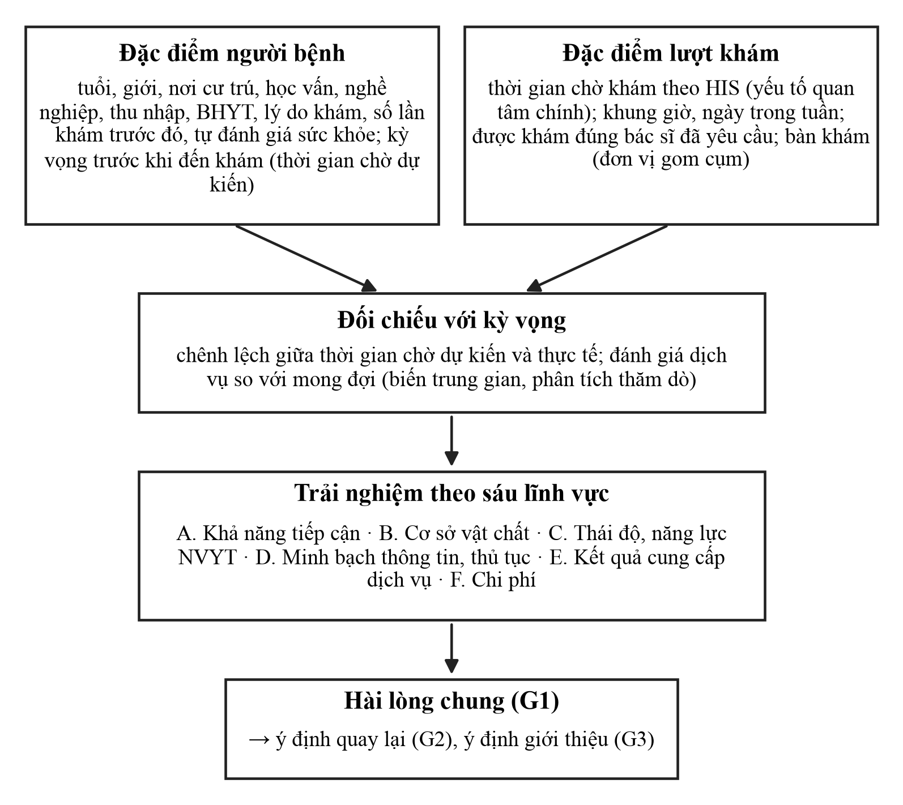
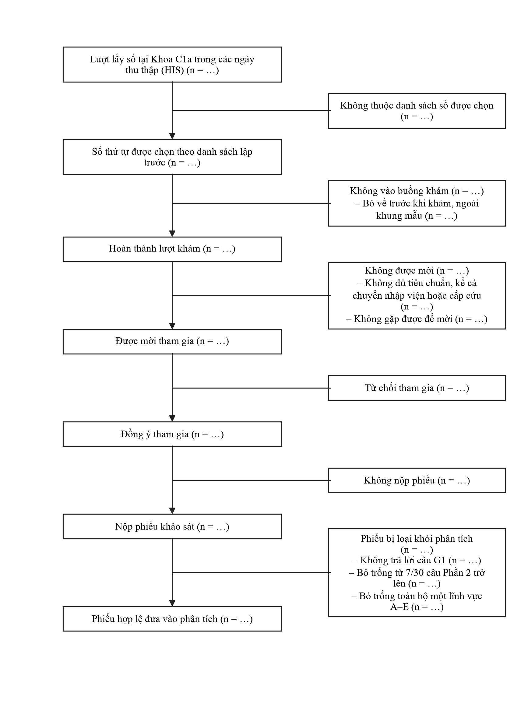
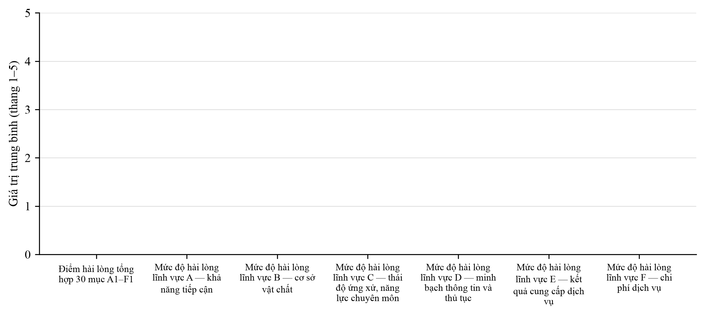
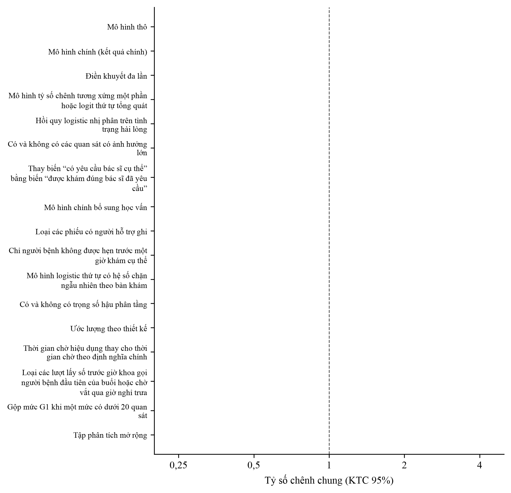

**BỘ QUỐC PHÒNG**
**BỆNH VIỆN QUÂN Y 175**
**TRUNG TÂM KHÁM BỆNH VÀ ĐIỀU TRỊ THEO YÊU CẦU C1**
**KHOA KHÁM BỆNH C1a**

**ĐỀ CƯƠNG NGHIÊN CỨU**

**ĐỀ TÀI KHOA HỌC VÀ CÔNG NGHỆ CẤP BỆNH VIỆN**

**ĐÁNH GIÁ SỰ HÀI LÒNG CỦA BỆNH NHÂN TRONG HOẠT ĐỘNG KHÁM CHỮA BỆNH TẠI KHOA KHÁM BỆNH C1a, TRUNG TÂM KHÁM BỆNH VÀ ĐIỀU TRỊ THEO YÊU CẦU C1, BỆNH VIỆN QUÂN Y 175**

**Chủ nhiệm đề tài: BS.CKI Nguyễn Hà Luân**

**Phiên bản đề cương:** 1.0, ngày ……/……/2026

**THÀNH PHỐ HỒ CHÍ MINH, 2026**

---

**BỘ QUỐC PHÒNG**
**BỆNH VIỆN QUÂN Y 175**
**TRUNG TÂM KHÁM BỆNH VÀ ĐIỀU TRỊ THEO YÊU CẦU C1**
**KHOA KHÁM BỆNH C1a**

**ĐỀ CƯƠNG NGHIÊN CỨU**

**ĐỀ TÀI KHOA HỌC VÀ CÔNG NGHỆ CẤP BỆNH VIỆN**

**ĐÁNH GIÁ SỰ HÀI LÒNG CỦA BỆNH NHÂN TRONG HOẠT ĐỘNG KHÁM CHỮA BỆNH TẠI KHOA KHÁM BỆNH C1a, TRUNG TÂM KHÁM BỆNH VÀ ĐIỀU TRỊ THEO YÊU CẦU C1, BỆNH VIỆN QUÂN Y 175**

**Phiên bản đề cương:** 1.0, ngày ……/……/2026

**CHỦ NHIỆM ĐỀ TÀI**

(Họ tên và chữ ký)

**CHỦ NHIỆM KHOA**

(Họ tên và chữ ký)

**GIÁM ĐỐC TRUNG TÂM**

(Họ tên và chữ ký)

**THÀNH PHỐ HỒ CHÍ MINH, 2026**

---

# DANH SÁCH CÁC CÁN BỘ THAM GIA THỰC HIỆN ĐỀ TÀI

| STT | Chức danh, họ và tên | Đơn vị công tác | Nhiệm vụ trong đề tài |
|---|---|---|---|
| 1 | BS.CKI Nguyễn Hà Luân | Khoa Khám bệnh C1a, Trung tâm Khám bệnh và Điều trị theo yêu cầu C1, Bệnh viện Quân y 175, Thành phố Hồ Chí Minh | Chủ nhiệm đề tài |
| 2 | ……… | ……… | Thư ký đề tài |
| 3 | ……… | ……… | Điều tra viên |
| 4 | ……… | ……… | Người nhập liệu |
| 5 | ……… | ……… | Giám sát chất lượng |
| 6 | ……… | ……… | Nhà thống kê |
| 7 | ……… | ……… | Tổ mở hòm phiếu (2 người) |
| 8 | ……… | ……… | Tổ mã hóa câu hỏi mở (2 người và 1 người phân xử) |
| 9 | ……… | ……… | Hội đồng chuyên gia (6–10 người) |
| 10 | ……… | ……… | Phòng CNTT/QLCL |
| 11 | ……… | ……… | Người giữ dữ liệu độc lập |
| 12 | ……… | ……… | Người giám sát độc lập |

Chủ nhiệm đề tài (ký và ghi rõ họ tên): ………

Đơn vị chủ trì đề tài (ký và ghi rõ họ tên): ………

Phòng Khoa học Quân sự (ký và ghi rõ họ tên): ………

---

# MỤC LỤC

- ĐẶT VẤN ĐỀ
- MỤC TIÊU NGHIÊN CỨU
- CHƯƠNG 1. TỔNG QUAN TÀI LIỆU
- 1.1. Khái niệm sự hài lòng của người bệnh
- 1.2. Công cụ đo lường sự hài lòng của người bệnh ngoại trú
- 1.3. Thực trạng sự hài lòng và các yếu tố liên quan
- 1.4. Sự hài lòng tại khoa khám theo yêu cầu và tại bệnh viện quân y
- 1.5. Khoảng trống nghiên cứu và đóng góp của đề tài
- 1.6. Khung lý thuyết của nghiên cứu
- CHƯƠNG 2. ĐỐI TƯỢNG VÀ PHƯƠNG PHÁP NGHIÊN CỨU
- 2.1. Đối tượng nghiên cứu
- 2.2. Địa điểm và thời gian nghiên cứu
- 2.3. Thiết kế nghiên cứu
- 2.4. Câu hỏi và giả thuyết nghiên cứu
- 2.5. Cỡ mẫu và phương pháp chọn mẫu
- 2.6. Phương pháp nghiên cứu
- 2.7. Đạo đức trong nghiên cứu
- CHƯƠNG 3. DỰ KIẾN KẾT QUẢ VÀ BÀN LUẬN
- 3.1. Đặc điểm đối tượng nghiên cứu
- 3.2. Kết quả theo mục tiêu 1: Mức độ hài lòng của người bệnh
- 3.3. Kết quả theo mục tiêu 2: Một số yếu tố liên quan đến mức độ hài lòng
- 3.4. Phân tích độ nhạy, tỷ lệ đáp ứng và dữ liệu thiếu
- 3.5. Dự kiến bàn luận
- 3.6. Hạn chế của nghiên cứu và phạm vi suy rộng kết quả
- TÀI LIỆU THAM KHẢO
- PHỤ LỤC A. TÓM TẮT KẾ HOẠCH PHÂN TÍCH THỐNG KÊ
- PHỤ LỤC B. BẢN THÔNG TIN VÀ PHIẾU ĐỒNG Ý THAM GIA NGHIÊN CỨU
- PHỤ LỤC B1. BẢN THÔNG TIN, PHIẾU ĐỒNG Ý VÀ THỎA THUẬN THAM GIA PHA PHÁT TRIỂN BỘ CÂU HỎI
- PHỤ LỤC C. PHIẾU KHẢO SÁT Ý KIẾN NGƯỜI BỆNH NGOẠI TRÚ
- PHỤ LỤC D. SƠ ĐỒ NHÂN QUẢ (DAG) LỰA CHỌN BIẾN HIỆU CHỈNH CHO MÔ HÌNH CHÍNH
- PHỤ LỤC E. BẢNG BIẾN SỐ VÀ MÃ HÓA
- PHỤ LỤC F. KẾ HOẠCH THỰC HIỆN
- Nhân lực và phân công nhiệm vụ
- Tiến độ thực hiện
- Dự trù kinh phí
- Quản lý rủi ro
- Kế hoạch quản lý dữ liệu
- Kế hoạch phổ biến và ứng dụng kết quả
- PHỤ LỤC G. THÔNG TIN CHUNG VỀ ĐỀ TÀI

---

# DANH MỤC CÁC CHỮ VIẾT TẮT

| Chữ viết tắt | Nghĩa đầy đủ |
|---|---|
| AES | Chuẩn mã hóa nâng cao (Advanced Encryption Standard) |
| AGReMA | Hướng dẫn báo cáo phân tích trung gian (A Guideline for Reporting Mediation Analyses) |
| ANOVA | Phân tích phương sai (analysis of variance) |
| BHYT | Bảo hiểm y tế |
| CFI, TLI | Chỉ số phù hợp so sánh (Comparative Fit Index), chỉ số Tucker–Lewis (Tucker–Lewis Index) |
| CIOMS | Hội đồng các Tổ chức Quốc tế về Khoa học Y học (Council for International Organizations of Medical Sciences) |
| CNTT | Công nghệ thông tin |
| COSMIN | Hướng dẫn chọn lựa công cụ đo lường sức khỏe dựa trên đồng thuận (COnsensus-based Standards for the selection of health Measurement INstruments) |
| CROSS | Bảng kiểm báo cáo nghiên cứu khảo sát (Consensus-Based Checklist for Reporting of Survey Studies) |
| CV | Hệ số biến thiên (coefficient of variation) |
| CVI | Chỉ số giá trị nội dung (Content Validity Index); I-CVI: cấp từng câu, S-CVI: cấp toàn thang |
| DAG | Sơ đồ nhân quả có hướng không chu trình (Directed Acyclic Graph) |
| DE | Hiệu ứng thiết kế (Design Effect) |
| HC3 | Sai số chuẩn vững với phương sai không đồng nhất, loại 3 (heteroskedasticity-consistent) |
| HIS | Hệ thống thông tin bệnh viện (Hospital Information System) |
| ICC | Hệ số tương quan nội cụm (Intraclass Correlation Coefficient) |
| ICH | Hội đồng Quốc tế về hài hòa các yêu cầu kỹ thuật đối với dược phẩm dùng cho người (International Council for Harmonisation) |
| ICTRP | Nền tảng đăng ký thử nghiệm lâm sàng quốc tế của WHO (International Clinical Trials Registry Platform) |
| KSD | Không sử dụng (dịch vụ được hỏi) |
| KTC 95% | Khoảng tin cậy 95% |
| KTV | Kỹ thuật viên |
| NVYT | Nhân viên y tế |
| OR | Tỷ số chênh (Odds Ratio); aOR: tỷ số chênh hiệu chỉnh |
| OSF | Open Science Framework |
| PREM | Thước đo trải nghiệm do người bệnh báo cáo (patient-reported experience measure) |
| QĐ-BYT | Quyết định của Bộ trưởng Bộ Y tế |
| QLCL | Quản lý chất lượng |
| RECORD | Hướng dẫn báo cáo nghiên cứu dùng dữ liệu y tế thu thập thường quy (REporting of studies Conducted using Observational Routinely-collected health Data) |
| RMSEA | Căn bậc hai sai số xấp xỉ trung bình (Root Mean Square Error of Approximation) |
| SRMR | Căn bậc hai phần dư chuẩn hóa trung bình (Standardized Root Mean Square Residual) |
| STROBE | Hướng dẫn báo cáo nghiên cứu quan sát (Strengthening the Reporting of Observational Studies in Epidemiology) |
| TB ± ĐLC | Trung bình ± độ lệch chuẩn |
| THCS | Trung học cơ sở |
| THPT | Trung học phổ thông |
| VIF, GVIF | Hệ số phóng đại phương sai (Variance Inflation Factor), dạng tổng quát (Generalized VIF) |
| VNĐ | Đồng Việt Nam |
| WHO | Tổ chức Y tế Thế giới (World Health Organization) |
| WLSMV | Bình phương tối thiểu có trọng số, hiệu chỉnh trung bình và phương sai (Weighted Least Squares Mean and Variance adjusted) |

---

# DANH MỤC CÁC BẢNG, BIỂU ĐỒ, HÌNH

| Số thứ tự | Tên bảng, biểu đồ, hình |
|---|---|
| Bảng 1.1 | Chiến lược tìm kiếm tài liệu |
| Hình 1.1 | Khung lý thuyết của nghiên cứu |
| Bảng 2.1 | Nửa độ rộng khoảng tin cậy 95% của tỷ lệ hài lòng (p = 0,5; n = 1.000; trung bình 20 phiếu/bàn khám) |
| Bảng 2.2 | Tỷ số chênh nhỏ nhất phát hiện được cho mỗi 15 phút chờ thêm (n = 1.000) |
| Bảng 2.3 | Tiêu chí khả thi của buổi chạy thử |
| Bảng 2.4 | Biện pháp hạn chế sai lệch do mong muốn xã hội |
| Bảng 2.5 | Biến kết cục |
| Bảng 2.6 | Biến độc lập và vai trò trong phân tích Mục tiêu 2 |
| Bảng 2.7 | Các nguồn sai lệch và biện pháp khống chế |
| Bảng 2.8 | Biện pháp quản lý xung đột lợi ích |
| Hình 3.1 | Sơ đồ tuyển chọn đối tượng nghiên cứu (theo STROBE) |
| Bảng 3.1 | Đặc điểm chung của đối tượng nghiên cứu (n = 1.000) |
| Bảng 3.2 | Mức độ hài lòng theo lĩnh vực và hài lòng chung (Mục tiêu 1) |
| Biểu đồ 3.1 | Giá trị trung bình các chỉ số chính kèm khoảng tin cậy 95% (Mục tiêu 1) |
| Bảng 3.3 | Phân tích đơn biến các yếu tố liên quan đến mức hài lòng chung G1 (Mục tiêu 2) |
| Bảng 3.4 | Mối liên quan giữa thời gian chờ khám và mức hài lòng chung G1 cùng các phân tích thăm dò xác định trước (Mục tiêu 2) |
| Biểu đồ 3.2 | Tỷ số chênh chung của thời gian chờ khám (mỗi 15 phút) và KTC 95% trong mô hình chính và các kịch bản độ nhạy (Mục tiêu 2) |
| Bảng 3.5 | Kết quả phân tích độ nhạy |
| Bảng 3.6 | Tỷ lệ đáp ứng và dữ liệu thiếu |
| Bảng 3.7 | Hạn chế dự kiến và chiều hướng sai lệch |
| Bảng E.1 | Danh mục biến số, mã biến và cách mã hóa (dùng cho phiếu thu thập điện tử và phân tích) |
| Bảng F.1 | Phân công nhiệm vụ |
| Bảng F.2 | Tiến độ dự kiến (các mốc sau ngày phê duyệt được điều chỉnh theo ngày Hội đồng phê duyệt thực tế) |
| Bảng F.3 | Dự trù kinh phí |
| Bảng F.4 | Rủi ro dự kiến và biện pháp xử lý |

---

# ĐẶT VẤN ĐỀ

Sự hài lòng của người bệnh phản ánh mức độ dịch vụ y tế đáp ứng được mong đợi của người sử dụng và là một trong những chỉ số cốt lõi đánh giá chất lượng khám chữa bệnh. Tại Việt Nam, đo lường sự hài lòng của người bệnh là nội dung bắt buộc trong quản lý chất lượng bệnh viện; Bộ Y tế đã ban hành phương pháp đo lường thống nhất cho giai đoạn 2024–2030 [2].

Khám chữa bệnh theo yêu cầu là một mô hình đặc thù trong bệnh viện công: người bệnh tự chi trả phần chênh lệch để được lựa chọn bác sĩ, rút ngắn thời gian chờ và hưởng điều kiện phục vụ tốt hơn. Nhóm nghiên cứu giả định rằng vì vậy kỳ vọng của nhóm người bệnh này cao hơn; giả định này mới có bằng chứng gián tiếp [49] và được xem xét qua các câu hỏi về kỳ vọng trong phiếu khảo sát (mục 2.6.1.1). Khoa Khám bệnh C1a thuộc Trung tâm Khám bệnh và Điều trị theo yêu cầu C1, Bệnh viện Quân y 175 – bệnh viện quân y tuyến cuối tại Thành phố Hồ Chí Minh – vận hành theo mô hình này với 50 bàn khám; theo số liệu của chủ nhiệm đề tài, mỗi bàn khám tiếp nhận khoảng 60–100 lượt người bệnh mỗi ngày (mục 2.5.1).

Trong y văn trong nước, thời gian chờ là lĩnh vực có điểm hài lòng thấp nhất ở người bệnh tim mạch ngoại trú [28]; ở người bệnh điều trị HIV ngoại trú, lĩnh vực có tỷ lệ hoàn toàn hài lòng thấp nhất được tác giả gắn với thời gian chờ và thủ tục hành chính [53]; người chờ lâu hơn ít hài lòng hơn [42]; trong một khảo sát tại Hà Nội, giá dịch vụ là nội dung có tỷ lệ hoàn toàn hài lòng thấp nhất [49]. Sự hài lòng đã được khảo sát tại khoa khám theo yêu cầu của một số bệnh viện [1, 4, 7], tại các bệnh viện quân y [6, 10, 11] và tại Khoa Y học cổ truyền của chính Bệnh viện Quân y 175 [5, 9]. Một khảo sát tại Hà Nội còn ghi nhận nhóm sử dụng dịch vụ theo yêu cầu và nhóm đến từ tỉnh khác có mức hài lòng thấp hơn [49]; theo nhận định của nhóm nghiên cứu, điều này gợi ý kỳ vọng của người bệnh có thể ảnh hưởng đến mức hài lòng. Tuy vậy, trong phạm vi đã tra cứu, chưa có nghiên cứu công bố nào tại khối khám ngoại trú theo yêu cầu của Bệnh viện Quân y 175. Bên cạnh đó, trong các nghiên cứu trong nước đã tra (PubMed, Europe PMC và Crossref, tháng 8–10/2026; Bảng 1.1), thời gian chờ lấy từ phần mềm quản lý bệnh viện chưa được gắn với mức hài lòng [54], còn các nghiên cứu gắn thời gian chờ với mức hài lòng dùng thời gian chờ thu thập qua phỏng vấn người bệnh trong khảo sát cơ sở y tế quốc gia năm 2015 [42] hoặc đo trực tiếp [8]; phân tích đa mức mới ở cấp cơ sở y tế và tỉnh [42], chưa tính đến sự tương quan giữa những người bệnh được khám tại cùng một bàn khám. Bộ phiếu khảo sát của Bộ Y tế được thiết kế cho người bệnh ngoại trú nói chung, không có lĩnh vực riêng về chi phí dịch vụ theo yêu cầu [2].

Xuất phát từ nhu cầu có số liệu nền tại chỗ để Trung tâm C1 và Khoa C1a cải tiến chất lượng dịch vụ, chúng tôi tiến hành đề tài “**Đánh giá sự hài lòng của bệnh nhân trong hoạt động khám chữa bệnh tại Khoa Khám bệnh C1a, Trung tâm Khám bệnh và Điều trị theo yêu cầu C1, Bệnh viện Quân y 175**” với hai mục tiêu trình bày dưới đây. Đề tài cung cấp dữ liệu về mức độ hài lòng và các yếu tố liên quan trong bối cảnh khám theo yêu cầu tại một bệnh viện quân y tuyến cuối; đề tài không được thiết kế để so sánh trực tiếp mô hình khám theo yêu cầu với mô hình khám thông thường.

## MỤC TIÊU NGHIÊN CỨU

1. ***Xác định mức độ hài lòng của bệnh nhân trong hoạt động khám chữa bệnh tại Khoa Khám bệnh C1a, Trung tâm Khám bệnh và Điều trị theo yêu cầu C1, Bệnh viện Quân y 175.***
2. ***Đánh giá một số yếu tố liên quan đến mức độ hài lòng của bệnh nhân trong hoạt động khám chữa bệnh tại Khoa Khám bệnh C1a, Trung tâm Khám bệnh và Điều trị theo yêu cầu C1, Bệnh viện Quân y 175.***

---

# CHƯƠNG 1. TỔNG QUAN TÀI LIỆU

## 1.1. Khái niệm sự hài lòng của người bệnh

Trong đề tài này, sự hài lòng của người bệnh được hiểu là mức độ mà trải nghiệm dịch vụ y tế đáp ứng được kỳ vọng của người bệnh; đây là định nghĩa làm việc của nhóm nghiên cứu, làm nền cho khung lý thuyết ở mục 1.6. Đề tài phân biệt sự hài lòng với trải nghiệm người bệnh: sự hài lòng là đánh giá chủ quan khi người bệnh đối chiếu những gì nhận được với kỳ vọng, còn trải nghiệm người bệnh là việc người bệnh thuật lại những gì đã thực sự diễn ra trong lượt khám, được đo bằng nhóm thước đo trải nghiệm người bệnh (patient-reported experience measures – PREM). Sự hài lòng là một thước đo do người bệnh tự báo cáo, phản ánh nhiều khía cạnh của chất lượng dịch vụ: khả năng tiếp cận, sự minh bạch thông tin và thủ tục, cơ sở vật chất, thái độ ứng xử và năng lực chuyên môn của nhân viên y tế, và kết quả cung cấp dịch vụ [2]. Một tổng quan hệ thống 88 bộ công cụ đo trải nghiệm người bệnh cho thấy 7 trong 10 tiêu chí về độ tin cậy và giá trị chưa được kiểm định ở ít nhất một nửa số bộ công cụ [19]. Vì vậy, khi sử dụng một bộ câu hỏi tự xây dựng, nghiên cứu cần chủ động đánh giá độ tin cậy và giá trị của công cụ trong chính mẫu nghiên cứu (mục 2.6.1.3).

## 1.2. Công cụ đo lường sự hài lòng của người bệnh ngoại trú

### 1.2.1. Khung đo lường của Bộ Y tế

Quyết định số 3869/QĐ-BYT ngày 28/8/2019 ban hành các mẫu phiếu khảo sát sự hài lòng của người bệnh và nhân viên y tế [3]; các mẫu phiếu dành cho người bệnh nội trú và ngoại trú của quyết định này đã được thay thế bởi Quyết định số 56/QĐ-BYT ngày 08/01/2024 hướng dẫn phương pháp đo lường sự hài lòng của người dân đối với dịch vụ y tế công giai đoạn 2024–2030 [2]. Phiếu khảo sát người bệnh ngoại trú (Mẫu số 2) áp dụng cho người bệnh từ đủ 18 tuổi, đủ sức khỏe và tỉnh táo để trả lời, được khảo sát sau khi đã cơ bản hoàn thành quy trình khám; phiếu gồm năm lĩnh vực: (1) khả năng tiếp cận; (2) sự minh bạch thông tin và thủ tục khám bệnh, điều trị; (3) cơ sở vật chất và phương tiện phục vụ người bệnh; (4) thái độ ứng xử, năng lực chuyên môn của nhân viên y tế; (5) kết quả cung cấp dịch vụ; sử dụng thang Likert 5 mức.

Một khảo sát đa trung tâm ở 2.500 người bệnh ngoại trú tại năm cơ sở y tế sử dụng bộ phiếu chuẩn quốc gia năm 2024 cho thấy bộ phiếu đạt độ tin cậy và độ phù hợp cấu trúc tốt; hai lĩnh vực gắn mạnh nhất với hài lòng chung là nhân viên y tế (β = 0,43) và khả năng tiếp cận (β = 0,30) [21]. Một khảo sát tại một phòng khám đa khoa ở Hà Nội dùng thang đo theo năm lĩnh vực của Bộ Y tế ghi nhận cấu trúc năm nhân tố qua phân tích nhân tố khám phá và độ tin cậy nội tại cao [23].

Đề tài không sử dụng nguyên văn Mẫu số 2 làm công cụ thu thập, vì hai lý do. Thứ nhất, khung chung không tách riêng lĩnh vực chi phí dịch vụ – khía cạnh đặc trưng của khối khám theo yêu cầu do người bệnh tự chi trả phần chênh lệch. Thứ hai, đề tài cần một câu hỏi hài lòng chung độc lập với các lĩnh vực chi tiết để làm kết cục chính, tránh hiện tượng kết cục chứa chính biến phơi nhiễm (mục 2.6.1.2). Bộ câu hỏi của đề tài vì vậy giữ năm lĩnh vực tương thích về khái niệm với Mẫu số 2, bổ sung lĩnh vực chi phí dịch vụ và một câu hỏi hài lòng chung (mục 2.6.1.1). Quyết định 56/QĐ-BYT được dùng làm khung tham chiếu khái niệm và để đối chiếu khi bàn luận.

### 1.2.2. Các thang đo quốc tế

**SERVQUAL** đo khoảng cách giữa kỳ vọng và cảm nhận về chất lượng dịch vụ theo năm khía cạnh: tin cậy, đáp ứng, bảo đảm, cảm thông và hữu hình. Các biến thể của SERVQUAL đã được dùng tại Việt Nam, như khảo sát hài lòng với khâu cấp phát thuốc bảo hiểm y tế ngoại trú [38]; biến thể SERVPERF (chỉ đo cảm nhận) gần đây được dùng tại bệnh viện tuyến huyện [51]. Nhược điểm của SERVQUAL khi tự điền tại phòng khám đông người là phải hỏi hai lượt (kỳ vọng và cảm nhận), làm tăng gánh nặng trả lời.

**PSQ-18** (bản rút gọn 18 câu của bộ câu hỏi hài lòng người bệnh PSQ-III) đo bảy khía cạnh: hài lòng chung, chất lượng kỹ thuật, giao tiếp liên cá nhân, trao đổi thông tin, khía cạnh tài chính, thời gian dành cho người bệnh, và khả năng tiếp cận – thuận tiện. Công cụ này đã được chuyển ngữ và kiểm định ở nhiều ngôn ngữ [29, 45]; một thư gửi tòa soạn đã tổng hợp kinh nghiệm sử dụng PSQ-18 trong nhiều bối cảnh [52]. Chiến lược tìm kiếm của đề tài (Bảng 1.1) không có truy vấn riêng cho PSQ-18 hay SERVQUAL, nên đề tài không đưa ra nhận định về việc đã có hay chưa có bản tiếng Việt đã được kiểm định của PSQ-18.

SERVQUAL và PSQ-18 chỉ được dùng làm khung đối chiếu khi bàn luận; đề tài không lồng các thang đo này vào phiếu khảo sát.

## 1.3. Thực trạng sự hài lòng và các yếu tố liên quan

**Trên thế giới.** Một tổng quan hệ thống 35 nghiên cứu tại các bệnh viện tuyến ba ở Trung Quốc cho thấy người bệnh ngoại trú hài lòng nhất với bác sĩ và điều dưỡng, kém hài lòng nhất với vệ sinh bệnh viện và quy trình khám, đặc biệt là thời gian chờ dài; các đặc điểm như tuổi, tình trạng hôn nhân, thu nhập và học vấn có liên quan đến mức hài lòng, và phần lớn nghiên cứu sử dụng bộ câu hỏi tự xây dựng [32]. Một tổng quan hệ thống và phân tích gộp tại các bệnh viện công ở Ethiopia ước tính tỷ lệ hài lòng gộp với khoa khám bệnh là 61,95% (KTC 95%: 53,00–70,90), với các yếu tố liên quan gồm được tư vấn phòng tái phát, sẵn có thuốc được kê và được tôn trọng sự riêng tư [55]. Tại năm cơ sở chăm sóc ban đầu ở Sierra Leone, học vấn cao hơn (aOR 0,53; KTC 95%: 0,28–0,98), khoảng cách xa hơn (aOR 0,40; KTC 95%: 0,18–0,87) và thời gian chờ dài hơn (aOR 0,41; KTC 95%: 0,22–0,76) đi kèm khả năng hài lòng thấp hơn [22]. Một khảo sát 1.298 người bệnh ngoại trú tại bệnh viện tuyến ba ở Ấn Độ ghi nhận thời gian chờ và giao tiếp là những điểm cần cải thiện [35]. Các nghiên cứu quốc tế nêu trên được thực hiện tại bệnh viện tuyến ba, bệnh viện công hoặc cơ sở chăm sóc ban đầu [22, 32, 35, 55]; chiến lược tìm kiếm của đề tài (Bảng 1.1) chưa có truy vấn riêng cho dịch vụ ngoại trú do người bệnh trả thêm phí, như khu dịch vụ hay phòng khám tư nhân. Vì vậy, đề tài chưa có số liệu quốc tế để đối chiếu trực tiếp với bối cảnh khám theo yêu cầu, và phần đối chiếu cho bối cảnh này dựa vào các nghiên cứu trong nước tại khoa khám theo yêu cầu [1, 4, 7].

**Tại Việt Nam.** Phân tích số liệu khảo sát cơ sở y tế quốc gia năm 2015 (4.372 người bệnh ngoại trú) cho thấy tỷ lệ hài lòng khoảng 85% tại trạm y tế xã và 73% tại bệnh viện huyện, và sau khi hiệu chỉnh đặc điểm cá nhân, người chờ lâu hơn có khả năng hài lòng thấp hơn [42]. Ở người bệnh tim mạch tại một bệnh viện chuyên khoa ở Hà Nội, người bệnh ngoại trú hài lòng thấp hơn người bệnh nội trú và thời gian chờ là khía cạnh có điểm thấp nhất [28]. Ở người bệnh điều trị HIV tại các phòng khám ngoại trú, lĩnh vực “chất lượng và sự thuận tiện của dịch vụ”, được tác giả gắn với thời gian chờ và thủ tục hành chính, có tỷ lệ hoàn toàn hài lòng thấp nhất [53]. Tại một phòng khám đa khoa ở Hà Nội, người có BHYT hài lòng cao hơn người không có BHYT [23], trong khi ở người bệnh tim mạch tại Hà Nội, người không có BHYT lại hài lòng cao hơn [28]; khảo sát đa trung tâm năm 2024–2025 cũng ghi nhận có BHYT, cư trú ở nông thôn và tái khám nhiều lần đi kèm mức hài lòng cao hơn [21]. Ở người bệnh nội trú, khảo sát toàn quốc ở 10.143 người bệnh tại 69 bệnh viện công cho thấy người cao tuổi, thu nhập thấp, nữ, học vấn thấp và sống ở nông thôn báo cáo mức hài lòng chung cao hơn [39].

Thời gian chờ đã được đo khách quan từ phần mềm quản lý bệnh viện ở quy mô lớn: tại một bệnh viện ngoại khoa tuyến trung ương, thời gian chờ trung bình từ khi đăng ký đến khi được chẩn đoán sơ bộ là 50,41 phút (năm 2014) và 42,05 phút (năm 2015), dài hơn vào buổi sáng và ở người có BHYT; nghiên cứu này không đo sự hài lòng [54]. Tại Khoa Khám bệnh, Bệnh viện Mắt Nghệ An năm 2025, thời gian chờ được đo trực tiếp tăng theo số dịch vụ cận lâm sàng; tỷ lệ người bệnh chưa hài lòng hoặc đánh giá ở mức bình thường cao hơn ở nhóm có tổng thời gian khám từ 60 phút trở lên so với nhóm dưới 60 phút (34,4% so với 14,1%) [8].

**Tổng hợp các yếu tố liên quan.** Từ y văn trên, các yếu tố được xem xét cho Mục tiêu 2 gồm: (1) thời gian chờ – liên quan nghịch với hài lòng khá nhất quán [8, 22, 42]; (2) nơi cư trú và khoảng cách đến cơ sở y tế [10, 21, 22, 49]; (3) BHYT và hình thức chi trả – chiều liên quan chưa nhất quán giữa các nghiên cứu [21, 23, 28]; (4) học vấn – học vấn cao hơn đi kèm mức hài lòng thấp hơn ở một số bối cảnh [22, 39], còn ở người bệnh ngoại trú trong nước, một nghiên cứu tại bệnh viện quân y ghi nhận mức hài lòng khác biệt theo học vấn [10]; (5) số lần khám trước đó [21]; (6) giới, thu nhập và nghề nghiệp – ở người bệnh ngoại trú trong nước, mức hài lòng khác biệt theo nghề nghiệp [1, 10], theo giới và thu nhập [11]. Trong mô hình chính, giới được hiệu chỉnh bắt buộc vì nằm trên đường gây nhiễu đã xác định trong sơ đồ nhân quả (Phụ lục D); học vấn được xếp vào nhóm thăm dò vì có 7 mức, làm tăng số tham số của mô hình, còn nghề nghiệp và thu nhập hộ gia đình không được xác định là biến gây nhiễu trong sơ đồ nhân quả nên cũng chỉ được phân tích thăm dò (Phụ lục D, Bảng 2.6); học vấn, thu nhập hộ gia đình, nơi cư trú, khoảng cách, BHYT và số lần khám có mô hình thăm dò riêng cho từng yếu tố (mục 2.6.6). Do chiều liên quan của một số yếu tố chưa thống nhất hoặc chưa đủ bằng chứng, đề tài kiểm định hai phía.

## 1.4. Sự hài lòng tại khoa khám theo yêu cầu và tại bệnh viện quân y

**Khoa khám theo yêu cầu.** Tại Khoa Khám bệnh, Bệnh viện Đa khoa tỉnh Thái Bình (309 người bệnh khám theo yêu cầu, năm 2022), hài lòng chung liên quan với nghề nghiệp, ngày khám (OR = 2,59; KTC 95%: 1,3–5,1) và mức hài lòng với thời gian chờ trong từng phân đoạn khám (OR = 29,5; KTC 95%: 12,9–67,2) [1]. Tại Bệnh viện Đa khoa Đống Đa Hà Nội năm 2023, tỷ lệ hài lòng chung với dịch vụ khám theo yêu cầu chỉ đạt 62,3% [4]. Tại Khoa Khám bệnh theo yêu cầu, Bệnh viện Trung ương Quân đội 108 (445 người bệnh, năm 2025), hình thức đăng ký khám trực tuyến chiếm 48,1% và nhóm đăng ký trực tuyến hài lòng cao hơn nhóm đăng ký truyền thống, nhưng 21% người bệnh gặp khó khăn khi sử dụng [7]. Một khảo sát tại ba bệnh viện ở Hà Nội ghi nhận nhóm sử dụng dịch vụ theo yêu cầu và nhóm đến từ tỉnh khác có mức hài lòng thấp hơn, tuy cỡ mẫu nhỏ (108 người) [49].

**Bệnh viện quân y.** Tại Khoa Khám bệnh đa khoa, Bệnh viện Trung ương Quân đội 108 (433 người bệnh, năm 2022), điểm hài lòng chung là 3,54 ± 0,54 trên thang 5 mức, thời gian chờ khám chỉ đạt mức chấp nhận được, và mức hài lòng khác biệt theo học vấn, nghề nghiệp và khoảng cách đến bệnh viện [10]. Tại khu khám AB của cùng bệnh viện (303 người bệnh, năm 2024), tỷ lệ hài lòng tổng thể là 85,86%, thấp nhất ở thời gian chờ làm và chờ trả kết quả xét nghiệm (63,03% và 61,05%) [6]. Tại Bệnh viện Quân dân y 16 năm 2023 (147 người bệnh), tỷ lệ hài lòng là 78,9%, liên quan với giới nữ, có BHYT và thu nhập bình quân cá nhân từ 5 triệu đồng/tháng trở lên [11]. Một nghiên cứu tại Bệnh viện Trung ương Quân đội 108 đã xây dựng và kiểm định bộ câu hỏi 22 câu, 4 nhân tố về hài lòng với dịch vụ dược [50].

**Tại Bệnh viện Quân y 175.** Hai khảo sát tại Khoa Y học cổ truyền ghi nhận: ở người bệnh nội trú năm 2020 (165 người), điểm trung bình năm tiêu chí của Bộ Y tế là 4,79, mức không hài lòng tập trung ở cơ sở vật chất (nhà vệ sinh) và chi phí dịch vụ [5]; ở người bệnh sử dụng dịch vụ đông y năm 2024 (340 người), tỷ lệ hài lòng chung là 85,59%, thấp nhất ở khía cạnh minh bạch thông tin và thủ tục (75,59%) [9]. Đây là các khảo sát tại khoa điều trị, không phải tại khối khám ngoại trú theo yêu cầu.

## 1.5. Khoảng trống nghiên cứu và đóng góp của đề tài

**Chiến lược tìm kiếm tài liệu.** Việc tra cứu được thực hiện và ghi lại như sau để người đọc kiểm chứng được phạm vi của các nhận định về khoảng trống:

**Bảng 1.1. Chiến lược tìm kiếm tài liệu**

| Nguồn | Câu tìm kiếm chính | Ngày tra cứu | Ghi chú |
|---|---|---|---|
| PubMed/MEDLINE | `patient satisfaction outpatient Vietnam` | 30/08/2026 | 26 kết quả; sàng lọc theo tiêu đề và tóm tắt |
| PubMed/MEDLINE | `("Patient Satisfaction"[Mesh] OR satisf*[tiab] OR "patient experience"[tiab]) AND ("Outpatients"[Mesh] OR "Ambulatory Care"[Mesh] OR outpatient*[tiab] OR ambulatory[tiab]) AND ("Vietnam"[Mesh] OR vietnam*[tiab] OR "viet nam"[tiab])` | 14/10/2026 | 16 kết quả; kết hợp tra theo danh mục tài liệu tham khảo của các bài đã chọn |
| PubMed/MEDLINE | `patient satisfaction[Title] AND military hospital AND outpatient` | 30/08/2026 | 4 kết quả, không bài nào cùng bối cảnh |
| Europe PMC | `(satisfaction OR "patient experience") AND (outpatient* OR ambulatory OR "out-patient") AND (Vietnam OR "Viet Nam")` | 14/10/2026 | Bổ sung các bài PubMed không bắt được |
| Crossref (tạp chí trong nước) | “hài lòng người bệnh ngoại trú khoa khám bệnh theo yêu cầu bệnh viện quân y”; “sự hài lòng người bệnh Bệnh viện Quân y 175” | 11/10/2026 | Xét 20 và 15 kết quả đầu, xếp theo mức độ liên quan |
| PubMed/MEDLINE | `("waiting time"[tiab] OR "wait time"[tiab] OR "waiting times"[tiab] OR "Waiting Lists"[Mesh]) AND ("Patient Satisfaction"[Mesh] OR satisf*[tiab]) AND ("Outpatients"[Mesh] OR "Ambulatory Care"[Mesh] OR outpatient[tiab] OR outpatients[tiab] OR ambulatory[tiab]) AND ("Vietnam"[Mesh] OR vietnam[tiab] OR "viet nam"[tiab])` | 17/10/2026 | 4 kết quả; tìm nhắm đúng thời gian chờ gắn với hài lòng |
| PubMed/MEDLINE | `("intraclass correlation"[tiab] OR ICC[tiab] OR multilevel[tiab] OR hierarchical[tiab] OR "Multilevel Analysis"[Mesh] OR clustering[tiab]) AND ("Patient Satisfaction"[Mesh] OR satisf*[tiab]) AND ("Vietnam"[Mesh] OR vietnam[tiab])` (chuỗi đầy đủ lưu trong hồ sơ tra cứu) | 17/10/2026 | 31 kết quả; tìm nhắm đúng hệ số tương quan nội cụm và phân tích đa mức |
| Europe PMC | `("waiting time" OR "wait time") AND (satisfaction) AND (outpatient OR ambulatory) AND (Vietnam OR "Viet Nam")` | 17/10/2026 | Xét 50 kết quả đầu (tìm cả toàn văn) |
| Crossref (tạp chí trong nước) | “thời gian chờ khám bệnh hài lòng người bệnh ngoại trú”; “phần mềm quản lý bệnh viện thời gian chờ khám bệnh” | 17/10/2026 | Xét 20 kết quả đầu mỗi câu |
| ClinicalTrials.gov | Hài lòng người bệnh ngoại trú tại Việt Nam | 14/10/2026 | Không có nghiên cứu đăng ký trùng câu hỏi |
| WHO ICTRP | Tra thủ công | 11/10/2026 | Không thấy nghiên cứu trùng |

Giới hạn của chiến lược tìm kiếm: luận văn, đề tài cấp cơ sở và kỷ yếu hội nghị không có định danh DOI chưa được tra cứu có hệ thống; vì vậy các nhận định về khoảng trống dưới đây được giới hạn trong phạm vi đã tra cứu.

**Khoảng trống.** Sự hài lòng của người bệnh ngoại trú đã được khảo sát tại Việt Nam, kể cả tại khoa khám theo yêu cầu của một số bệnh viện [1, 4, 7], tại các bệnh viện quân y [6, 10, 11] và tại Khoa Y học cổ truyền của Bệnh viện Quân y 175 [5, 9] (mục 1.3–1.4). Khoảng trống của đề tài vì vậy không nằm ở chủ đề, mà ở ba điểm: (1) chưa có số liệu công bố tại khối khám ngoại trú theo yêu cầu của Bệnh viện Quân y 175; (2) thời gian chờ đã được lấy từ phần mềm quản lý bệnh viện ở nghiên cứu trong nước [54] nhưng không gắn với mức hài lòng, còn các nghiên cứu gắn thời gian chờ với hài lòng dùng thời gian chờ thu thập qua phỏng vấn người bệnh trong khảo sát cơ sở y tế quốc gia năm 2015 [42] hoặc đo trực tiếp [8] – chưa thấy nghiên cứu gắn mức hài lòng với thời gian chờ lấy từ mốc thời gian của HIS; (3) đã có phân tích đa mức sự hài lòng ngoại trú ở cấp cơ sở y tế và tỉnh [42], nhưng trong y văn trong nước đã tra chưa thấy ước lượng hệ số tương quan nội cụm của mức hài lòng theo bàn khám trong một khoa; vì truy vấn về hệ số tương quan nội cụm ở Bảng 1.1 giới hạn ở Việt Nam, khoảng trống này chỉ được xác định trong phạm vi y văn trong nước, còn y văn quốc tế về mức gom cụm của sự hài lòng hay trải nghiệm người bệnh theo bác sĩ hoặc phòng khám chưa được tra có hệ thống. Ngoài ra, bộ phiếu chuẩn của Bộ Y tế không có lĩnh vực riêng về chi phí dịch vụ theo yêu cầu.

**Đóng góp của đề tài.** Đề tài lặp lại một câu hỏi đã được nghiên cứu nhưng áp dụng vào một bối cảnh chưa có số liệu, với các điểm thiết kế sau: kết cục giữ nguyên dạng thứ bậc thay vì nhị phân hóa như phân tích đa mức trong nước [42], thời gian chờ đo bằng mốc HIS thay vì thu thập qua phỏng vấn, kế hoạch phân tích được khóa trước khi có dữ liệu, và có xử lý hiện tượng gom cụm theo bàn khám. Đóng góp cụ thể gồm: (1) số liệu nền tại Khoa C1a để đối chiếu với các kỳ khảo sát sau và làm căn cứ cải tiến chất lượng; (2) ước lượng hệ số tương quan nội cụm của mức hài lòng theo bàn khám tại một khoa khám theo yêu cầu ở Việt Nam – thông số mà cỡ mẫu của đề tài hiện phải lập kế hoạch dựa trên các nghiên cứu về hệ số tương quan nội cụm ở chăm sóc ban đầu và chăm sóc thứ cấp [13, 20] (mục 2.5.1), và có thể dùng khi tính cỡ mẫu cho các nghiên cứu hài lòng tương tự trong nước về sau; (3) kiểm định thực nghiệm cấu trúc năm lĩnh vực A–E của bộ câu hỏi (lĩnh vực chi phí là chỉ số đơn câu) bằng phân tích nhân tố khám phá và khẳng định trên hai nửa mẫu độc lập (mục 2.6.1.3).

## 1.6. Khung lý thuyết của nghiên cứu

Khung lý thuyết của đề tài dựa trên năm lĩnh vực hài lòng của người bệnh ngoại trú trong Mẫu số 2, Quyết định 56/QĐ-BYT [2], bổ sung lĩnh vực chi phí dịch vụ phù hợp với khối khám theo yêu cầu. Sự hài lòng chung được xem là kết quả tổng hợp của trải nghiệm qua sáu lĩnh vực, chịu ảnh hưởng của đặc điểm người bệnh, đặc điểm lượt khám và kỳ vọng trước khi đến khám:

**Hình 1.1. Khung lý thuyết của nghiên cứu**

Khung lý thuyết dùng để tổ chức bộ câu hỏi và diễn giải kết quả. Việc lựa chọn biến hiệu chỉnh trong mô hình đa biến dựa trên sơ đồ nhân quả trình bày ở Phụ lục D; mũi tên trong khung chỉ biểu thị giả định về mối liên quan, không hàm ý đã chứng minh quan hệ nhân quả.

---

# CHƯƠNG 2. ĐỐI TƯỢNG VÀ PHƯƠNG PHÁP NGHIÊN CỨU

## 2.1. Đối tượng nghiên cứu

**Quần thể đích:** các lượt khám ngoại trú của người bệnh từ đủ 18 tuổi đã hoàn thành tại Khoa Khám bệnh C1a trong thời gian nghiên cứu. Khả năng suy rộng kết quả sang các cơ sở khám theo yêu cầu khác được bàn ở mục 3.6.

**Quần thể nghiên cứu:** người bệnh đến khám tại Khoa Khám bệnh C1a trong thời gian thu thập số liệu, thỏa mãn tiêu chuẩn lựa chọn và không thuộc tiêu chuẩn loại trừ.

**Đơn vị quan sát:** một lượt khám của một người bệnh; mỗi người bệnh chỉ tham gia nghiên cứu một lần. Do người bệnh được chọn từ dòng lượt khám đã hoàn thành, các tỷ lệ ước lượng được là tỷ lệ tính theo lượt khám: người bệnh khám nhiều lần trong thời gian nghiên cứu có xác suất được chọn cao hơn người chỉ khám một lần, nên ý kiến của nhóm khám nhiều lần có thể chiếm tỷ trọng trong mẫu lớn hơn tỷ trọng của họ trong tổng số người bệnh của khoa. Quy tắc chống trùng lặp (mục 2.5.2) chỉ bảo đảm mỗi người được tính một lần trong mẫu, không loại bỏ chênh lệch xác suất được chọn này.

### 2.1.1. Tiêu chuẩn lựa chọn

- Người bệnh khám ngoại trú tại Khoa C1a, từ đủ 18 tuổi (bao gồm cả phụ nữ mang thai);
- Đủ sức khỏe, tỉnh táo và đủ khả năng nhận thức, ngôn ngữ để trả lời phiếu;
- Đã cơ bản hoàn thành quy trình khám tại Khoa C1a (đang chờ thanh toán, nhận thuốc hoặc nhận lại thẻ BHYT), để đánh giá được trọn vẹn lượt khám;
- Đồng ý tham gia nghiên cứu một cách tự nguyện sau khi được giải thích.

Tiêu chuẩn lựa chọn tương thích với đối tượng khảo sát của Mẫu số 2, Quyết định 56/QĐ-BYT [2].

### 2.1.2. Tiêu chuẩn loại trừ

- Người bệnh từ chối tham gia;
- Không đủ khả năng trả lời (tình trạng cấp cứu, suy giảm nhận thức, rào cản ngôn ngữ không khắc phục được);
- Nhân viên y tế của Khoa C1a hoặc của Bệnh viện đến khám (nguy cơ xung đột lợi ích và sai lệch đánh giá);
- Đã tham gia nghiên cứu trước đó (kể cả phỏng vấn nhận thức hoặc khảo sát thử ở pha phát triển bộ câu hỏi).

**Tiêu chuẩn loại phiếu khỏi phân tích (xác định trước).** Một phiếu bị loại khỏi phân tích khi có ít nhất một trong ba điều kiện:

1. Không trả lời câu hài lòng chung G1 – kết cục chính của cả hai mục tiêu;
2. Bỏ trống trên 20% số câu của Phần 2, tức từ 7/30 câu trở lên;
3. Bỏ trống toàn bộ một lĩnh vực trong năm lĩnh vực nhiều câu A–E.

Phiếu không bị loại chỉ vì thiếu thông tin nền (tuổi, học vấn, thu nhập…), không ghép được thời gian chờ từ HIS hoặc bỏ trống câu F1. Lĩnh vực F chỉ có một câu về chi phí và người tham gia được bỏ qua câu hỏi về khả năng chi trả (mục 2.7), nên điều kiện 3 chỉ áp cho năm lĩnh vực nhiều câu A–E; F1 bỏ trống được tính là thiếu (mã 9) của chỉ số đơn câu và vẫn được đếm vào điều kiện 2. Các trường hợp này được xử lý theo kế hoạch xử lý dữ liệu thiếu (mục 2.6.6). Ảnh hưởng của điều kiện 2 và 3 lên kết quả được đánh giá bằng phân tích độ nhạy trên mọi phiếu có trả lời G1 (mục 2.6.6). Số phiếu bị loại theo từng điều kiện được báo cáo riêng trong sơ đồ tuyển chọn (Chương 3).

## 2.2. Địa điểm và thời gian nghiên cứu

**Địa điểm:** Khoa Khám bệnh C1a, Trung tâm Khám bệnh và Điều trị theo yêu cầu C1, Bệnh viện Quân y 175, Thành phố Hồ Chí Minh.

**Thời gian:** từ tháng 12/2026 đến tháng 12/2028 (tiến độ chi tiết ở Phụ lục F). Việc thu thập số liệu mẫu chính chỉ bắt đầu sau khi: (1) đề tài được Hội đồng Y đức và lãnh đạo Bệnh viện Quân y 175 phê duyệt; (2) đề tài đã được đăng ký công khai trên OSF Registries; (3) hoàn thành pha phát triển và kiểm định bộ câu hỏi; (4) buổi chạy thử quy trình đạt các tiêu chí khả thi (mục 2.5.2). Thời gian thu thập kéo dài liên tục đủ để phủ đều các ngày trong tuần và các khung giờ khám, nhằm hạn chế sai lệch do thời điểm thu thập.

## 2.3. Thiết kế nghiên cứu

Nghiên cứu mô tả cắt ngang có phân tích. Kết quả được báo cáo theo hướng dẫn STROBE cho nghiên cứu cắt ngang [58]; vì số liệu được thu thập bằng bộ câu hỏi tự điền, đề tài áp dụng đồng thời bảng kiểm CROSS cho nghiên cứu khảo sát [44]. Hai hướng dẫn bổ sung cho nhau: STROBE bao quát các nội dung dịch tễ học quan sát (nguồn mẫu, biến số, kiểm soát nhiễu, phân tích), còn CROSS bao quát các nội dung đặc thù của khảo sát (phát triển và thử nghiệm bộ câu hỏi, cách phát phiếu, cách tính tỷ lệ đáp ứng, xử lý câu trả lời thiếu). Riêng phần số liệu khai thác từ HIS/eHospital (mốc thời gian chờ khám và số liệu tổng hợp người bệnh bỏ về, mục 2.6.4.3), đề tài áp dụng thêm RECORD – phần mở rộng của STROBE cho nghiên cứu dùng dữ liệu y tế thu thập thường quy [15]: mô tả nguồn dữ liệu, cách trích mốc thời gian, cách ghép với phiếu khảo sát và kiểm tra chất lượng dữ liệu.

Thiết kế cắt ngang phù hợp với cả hai mục tiêu: với Mục tiêu 1, đây là thiết kế chuẩn để ước lượng tỷ lệ của một trạng thái (hài lòng) trong quần thể; với Mục tiêu 2, thiết kế cho phép đo đồng thời các yếu tố và kết cục để ước lượng mối liên quan. Do phơi nhiễm và kết cục được đo cùng thời điểm, thiết kế không xác lập được trình tự thời gian và không cho phép suy diễn nhân quả. Các thiết kế khác đã được cân nhắc và không lựa chọn: thiết kế thuần tập vượt quá nhu cầu của câu hỏi nghiên cứu và không khả thi về nguồn lực trong phạm vi một khoa; thiết kế bệnh – chứng không phù hợp với mục tiêu ước lượng tỷ lệ. Vì không có can thiệp, đề tài không áp dụng chính thức hướng dẫn ICH E9(R1); đề tài chỉ mượn cấu trúc năm thành phần của khung ước lượng đích (estimand) trong hướng dẫn này để xác định đại lượng cần ước lượng của Mục tiêu 2 (mục 2.6.6).

## 2.4. Câu hỏi và giả thuyết nghiên cứu

### 2.4.1. Câu hỏi nghiên cứu

Mức độ hài lòng của người bệnh ngoại trú tại Khoa Khám bệnh C1a là bao nhiêu, và những yếu tố nào liên quan đến mức độ hài lòng đó?

### 2.4.2. Giả thuyết nghiên cứu

Mục tiêu 1 là mục tiêu mô tả, không đặt giả thuyết kiểm định. Với Mục tiêu 2, yếu tố được quan tâm chính là thời gian chờ khám đo theo mốc thời gian của HIS:

- **Giả thuyết H₀:** ở người bệnh ngoại trú Khoa C1a, sau khi hiệu chỉnh các yếu tố gây nhiễu đã xác định trước theo sơ đồ nhân quả (Phụ lục D), thời gian chờ khám (tính theo mỗi 15 phút) không liên quan với mức hài lòng chung: tỷ số chênh chung bằng 1.
- **Giả thuyết H₁:** tỷ số chênh chung khác 1 (kiểm định hai phía, α = 0,05).

Chiều liên quan dự kiến, dựa trên bằng chứng gián tiếp từ người bệnh ngoại trú tại Việt Nam [42], là thời gian chờ dài hơn đi kèm mức hài lòng chung thấp hơn; trong mô hình chính, chiều này tương ứng với tỷ số chênh chung cho mức hài lòng cao hơn, ứng với mỗi 15 phút chờ thêm, nhỏ hơn 1. Do thiết kế cắt ngang, kết quả kiểm định chỉ cho phép kết luận về mối liên quan, không cho phép suy diễn quan hệ nhân quả.

## 2.5. Cỡ mẫu và phương pháp chọn mẫu

### 2.5.1. Cỡ mẫu

**Cỡ mẫu cho Mục tiêu 1.** Áp dụng công thức ước lượng một tỷ lệ với độ chính xác tuyệt đối [34]:

n₀ = Z²₁₋α/₂ × p × (1 − p) / d²

Trong đó: Z₁₋α/₂ = 1,96 (độ tin cậy 95%); p = 0,5 – tỷ lệ hài lòng ước đoán, chọn giá trị cho cỡ mẫu lớn nhất vì chưa có số liệu tại Khoa C1a; d = 0,05 – sai số tuyệt đối cho phép. Kết quả n₀ = 385.

**Hiệu chỉnh theo hiện tượng gom cụm.** Người bệnh được khám tại cùng một bàn khám có thể đánh giá tương tự nhau, nên các quan sát có thể không hoàn toàn độc lập. Khoa C1a có 50 bàn khám; với cỡ mẫu 1.000, mỗi bàn đóng góp trung bình 20 phiếu, nhưng số phiếu thực tế ở từng bàn sẽ không đều nhau vì lưu lượng người bệnh giữa các bàn khác nhau. Hiệu ứng thiết kế được tính theo công thức có tính đến cỡ cụm không đều [24]:

DE = 1 + [(CV² + 1) × m − 1] × ICC

Trong đó: m = 20 – số phiếu trung bình mỗi bàn khám; ICC = 0,02 – hệ số tương quan nội cụm dùng để lập kế hoạch, chọn thận trọng dựa trên phân bố ICC trong các nghiên cứu tại cơ sở chăm sóc ban đầu (trung vị 0,010; khoảng tứ phân vị 0–0,032) [13] và nhận định rằng ICC của biến kết cục ở chăm sóc thứ cấp cao hơn ở chăm sóc ban đầu [20]; CV ≈ 0,14 – hệ số biến thiên của số phiếu giữa các bàn khám, ước từ lưu lượng mỗi bàn khám 60–100 lượt người bệnh/ngày (thứ Hai đến thứ Sáu, 5 giờ–11 giờ 30 và 13 giờ–16 giờ 30) theo số liệu của chủ nhiệm đề tài, coi số lượt phân bố đều trong khoảng này (trung bình 80, độ lệch chuẩn khoảng 11,5). Kết quả DE = 1,39, cỡ mẫu cần thiết là 385 × 1,39 = 535; dự phòng 15% phiếu không đáp ứng hoặc không hợp lệ, cỡ mẫu tối thiểu là 535/0,85 = **630**. Với giả định thận trọng CV = 1,0 (phân tích độ nhạy), DE = 1,78 và cỡ mẫu tối thiểu là 808.

**Cỡ mẫu của đề tài là 1.000 phiếu hợp lệ**, tương ứng 50 bàn khám với trung bình 20 phiếu mỗi bàn, lớn hơn cỡ mẫu tối thiểu và thống nhất với thuyết minh đề tài đã nộp Bệnh viện (thuyết minh tính theo d = 0,031 khi chưa hiệu chỉnh gom cụm, cho n = 1.000). Với các giả định trên, cỡ mẫu này vẫn đủ ngay cả khi tính thận trọng 1.000 là số phiếu thu về (trước khi trừ phiếu không hợp lệ) và hệ số biến thiên giữa các bàn lên tới khoảng 1,43. Hệ số biến thiên thực tế sẽ được tính từ số liệu lưu lượng theo bàn khám trên HIS (đối chiếu với giá trị lập kế hoạch 0,14) và tỷ lệ không đáp ứng thực tế được đối chiếu ở khảo sát thử; khi các số này khác giả định, kế hoạch phân tích được cập nhật theo thủ tục sửa đổi (Phụ lục A). Với CV ≈ 0,14 và ICC = 0,02, nửa độ rộng khoảng tin cậy 95% của tỷ lệ hài lòng là ±3,7% khi đủ 1.000 phiếu hợp lệ và ±4,0% nếu chỉ còn 850 phiếu (1.000 phiếu thu về trừ 15% không hợp lệ); độ chính xác ±5% vẫn đạt khi ICC thực tế không vượt quá khoảng 0,083 (1.000 phiếu) hoặc 0,063 (850 phiếu). Độ chính xác dự kiến của ước lượng tỷ lệ hài lòng với n = 1.000 được trình bày ở Bảng 2.1.

**Bảng 2.1. Nửa độ rộng khoảng tin cậy 95% của tỷ lệ hài lòng (p = 0,5; n = 1.000; trung bình 20 phiếu/bàn khám)**

| Hệ số tương quan nội cụm (ICC) | CV = 0 (số phiếu đều giữa các bàn) | CV ≈ 0,14 (giá trị lập kế hoạch) | CV = 0,5 | CV = 1,0 |
|---|---|---|---|---|
| 0,01 | ±3,4% | ±3,4% | ±3,5% | ±3,7% |
| 0,02 | ±3,6% | ±3,7% | ±3,8% | ±4,1% |
| 0,05 | ±4,3% | ±4,3% | ±4,6% | ±5,3% |

**Cỡ mẫu cho Mục tiêu 2 (mô hình chính).** Kết cục chính G1 là biến thứ bậc 5 mức, phân tích bằng hồi quy logistic thứ tự. Đề tài sử dụng công thức của Whitehead dành cho dữ liệu thứ bậc dưới giả định tỷ số chênh tương xứng [59]:

n = 3 × (Z₁₋α/₂ + Z₁₋β)² / [(1 − Σpᵢ³) × β² × Var(X) × (1 − R²)]

Trong đó pᵢ là tỷ lệ người bệnh ở mức thứ i của G1; β = ln(OR) ứng với mỗi 15 phút chờ thêm; Var(X) = (ĐLC thời gian chờ/15)²; R² là hệ số xác định khi hồi quy thời gian chờ theo các biến hiệu chỉnh. Với α = 0,05 (hai phía), lực thống kê 80%, R² = 0,20 và ba giả định về phân bố của G1, tỷ số chênh nhỏ nhất phát hiện được với n = 1.000 trình bày ở Bảng 2.2.

**Bảng 2.2. Tỷ số chênh nhỏ nhất phát hiện được cho mỗi 15 phút chờ thêm (n = 1.000)**

| Giả định phân bố G1 (mức 1 → 5) | 1 − Σpᵢ³ | ĐLC thời gian chờ 20 phút | 30 phút | 40 phút |
|---|---|---|---|---|
| Lệch về phía hài lòng mạnh: 1/3/11/40/45% | 0,844 | 1,150 | 1,098 | 1,073 |
| Lệch vừa: 2/5/18/45/30% | 0,876 | 1,147 | 1,096 | 1,071 |
| Lệch nhẹ: 3/7/25/42/23% | 0,898 | 1,145 | 1,095 | 1,070 |

Như vậy, với n = 1.000, nghiên cứu phát hiện được tỷ số chênh khoảng 1,07–1,15 cho mỗi 15 phút chờ thêm, tùy độ phân tán thực tế của thời gian chờ (ví dụ, với ĐLC 30 phút, OR 1,098 cho mỗi 15 phút tương đương OR khoảng 1,45 cho mỗi giờ chờ thêm). Do chiều liên quan dự kiến là tỷ số chênh nhỏ hơn 1, các giá trị tương ứng là khoảng 0,87–0,93 cho mỗi 15 phút. Bảng 2.2 chưa tính hiệu ứng thiết kế do gom cụm. Khi hiệu chỉnh – trừ 15% phiếu dự phòng hỏng và chia cho hệ số thiết kế 1,39 của kết cục chính (CV ≈ 0,14), tức cỡ mẫu hiệu dụng khoảng 612 người – tỷ số chênh nhỏ nhất phát hiện được là 1,09–1,20 cho mỗi 15 phút chờ thêm (0,84–0,92 theo chiều giảm); với giả định thận trọng CV = 1,0 (hệ số thiết kế 1,78, cỡ mẫu hiệu dụng khoảng 478 người), các giá trị này là 1,10–1,22 (0,82–0,91 theo chiều giảm). Đây là chặn trên của mức hiệu chỉnh: với yếu tố đo ở cấp cá nhân như thời gian chờ, mức phóng đại phương sai của hệ số hồi quy không vượt quá hệ số thiết kế của kết cục và sẽ được ước lượng lại từ hệ số tương quan nội cụm thực tế của thời gian chờ. Phân bố của G1, độ lệch chuẩn của thời gian chờ và R² là giả định; nhà thống kê sẽ tính lại khi có số liệu khảo sát thử và số liệu HIS, trước khi tiếp cận số liệu mẫu chính, theo thủ tục sửa đổi kế hoạch phân tích (Phụ lục A). Bộ biến hiệu chỉnh có hai biến có thể liên quan chặt với thời gian chờ (được hẹn trước một giờ khám cụ thể và được xếp diện ưu tiên thứ tự khám, mục 2.6.6) nên R² có thể cao hơn giả định; với R² = 0,30, tỷ số chênh nhỏ nhất phát hiện được ở cỡ mẫu hiệu dụng khoảng 612 người là 1,10–1,21 cho mỗi 15 phút chờ thêm (0,83–0,91 theo chiều giảm), cỡ mẫu không đổi.

**Kết cục nhị phân thứ cấp và phân tích độ nhạy.** Hồi quy logistic nhị phân trên kết cục “hài lòng” (G1 ≥ 4) dùng cùng bộ biến hiệu chỉnh của mô hình chính, không rút gọn bộ biến theo số liệu ngoài quy tắc bỏ biến thưa đã định trước (mục 2.6.6). Mô hình chính (thời gian chờ và mười một biến hiệu chỉnh bắt buộc; tự đánh giá sức khỏe đưa vào dạng số, ngày trong tuần gồm năm ngày làm việc; có yêu cầu bác sĩ cụ thể, được hẹn trước một giờ khám cụ thể và được xếp diện ưu tiên thứ tự khám mỗi biến một tham số) tương ứng 20 tham số; nếu biến được hẹn trước một giờ khám cụ thể hoặc biến được xếp diện ưu tiên thứ tự khám được bỏ theo quy tắc biến thưa (mục 2.6.6), mô hình còn 19 hoặc 18 tham số. Khi số trường hợp “chưa hài lòng” đạt từ 10 trường hợp cho mỗi tham số trở lên [40], tức từ 200 trường hợp với mô hình 20 tham số (190 hoặc 180 trường hợp khi mô hình còn 19 hoặc 18 tham số), mô hình nhị phân được ước lượng bằng hợp lý cực đại thông thường; khi dưới ngưỡng này, mô hình được ước lượng bằng hợp lý cực đại có hiệu chỉnh Firth, khoảng tin cậy tính theo hợp lý có phạt [26], vì bằng chứng ủng hộ ngưỡng 10 trường hợp mỗi tham số còn yếu và hiệu chỉnh Firth cải thiện độ chính xác của hệ số hồi quy [57]; số trường hợp mỗi tham số thực tế được báo cáo kèm kết quả. Nếu mô hình có hiệu chỉnh Firth không ước lượng được, chỉ trình bày tỷ lệ kèm khoảng tin cậy 95%. Theo tỷ lệ hài lòng chung đã ghi nhận tại các khoa khám trong nước, từ 62,3% [4] đến 85,86% [6], tỷ lệ chưa hài lòng dự kiến khoảng 14–38%, tương ứng khoảng 7,1–18,9 trường hợp cho mỗi tham số với mô hình 20 tham số; vì định nghĩa “hài lòng” ở các nghiên cứu này không hoàn toàn trùng với ngưỡng G1 ≥ 4, đây chỉ là ước tính tham khảo. Phân tích độ nhạy bằng hồi quy tuyến tính cần tối thiểu n ≥ 104 + số tham số [25], thấp hơn nhiều so với cỡ mẫu của đề tài.

### 2.5.2. Phương pháp chọn mẫu

Áp dụng phương pháp **chọn mẫu hệ thống phân tầng** trên khung mẫu là các lượt khám hoàn thành tại Khoa C1a, sắp theo số thứ tự cấp khi người bệnh hoàn tất đăng ký, lấy số tại khoa – cùng mốc bắt đầu của thời gian chờ (mục 2.6.4.3). Tầng được xác định theo ngày trong tuần × khung giờ lấy số trên HIS: năm ngày làm việc (thứ Hai đến thứ Sáu) × bốn khung giờ (sáng sớm, cuối buổi sáng, đầu buổi chiều, cuối buổi chiều; ranh giới ở Bảng 3.1) = 20 tầng. Cùng một định nghĩa tầng được dùng cho phân bổ cỡ mẫu, cho Nₕ và nₕ, cho trọng số hậu phân tầng và cho biến khung giờ khám trong mô hình. Người được chọn được xác định từ số thứ tự – mã cũng được dùng để ghép thời gian chờ (mục 2.6.3, bước 9) – nên việc chọn không phụ thuộc thứ tự người bệnh hoàn thành lượt khám hay nơi người bệnh rời khoa; cách chọn này loại bỏ việc điều tra viên tự chọn người trả lời – nguồn sai lệch khó kiểm soát nhất trong khảo sát hài lòng tại phòng khám.

- **Số người cần mời:** với 1.000 phiếu hợp lệ và tỷ lệ không đáp ứng dự kiến 15%, cần mời khoảng 1.180–1.250 người bệnh trong toàn đợt.
- **Phân bổ theo tầng:** số người cần mời trong mỗi tầng (nₕ) được phân bổ theo tỷ lệ lưu lượng người bệnh của tầng đó (Nₕ), ước tính từ số liệu lưu lượng của Khoa C1a trên HIS.
- **Khoảng cách mẫu và danh sách số được chọn:** kₕ = Nₕ/nₕ. Do nₕ được phân bổ theo tỷ lệ Nₕ, kₕ bằng nhau ở mọi tầng và bằng k = N/n (N: tổng số lượt khám ước tính trong các ngày thu thập; n: tổng số người cần mời), làm tròn xuống số nguyên. Trước mỗi ngày thu thập, người chuyên trách chọn ngẫu nhiên một điểm bắt đầu trong khoảng 1 đến k và lập sẵn danh sách số thứ tự được chọn (điểm bắt đầu, điểm bắt đầu + k, điểm bắt đầu + 2k…), đếm liên tục qua ranh giới các khung giờ trong ngày. Nếu khoa cấp nhiều dãy số thứ tự song song (ví dụ theo quầy hoặc theo kênh đăng ký), mỗi dãy được chọn riêng với cùng k và điểm bắt đầu ngẫu nhiên riêng, nên mọi lượt khám có cùng xác suất được chọn 1/k. Chỉ tính số thứ tự cấp khi người bệnh hoàn tất đăng ký, lấy số tại Khoa C1a; số cấp lại khi người bệnh quay lại sau cận lâm sàng không được tính. Tầng của từng người được chọn được xác định sau, từ giờ lấy số trên HIS khi ghép số liệu, nên người chọn mẫu không cần biết giờ lấy số tại chỗ; phân bổ thực tế theo tầng được kiểm tra bằng quy tắc lệch 20% ở mục 2.6.6.
- **Số phiếu theo bàn khám:** đề tài không đặt chỉ tiêu bằng nhau cho từng bàn khám. Vì người bệnh được chọn theo dòng người bệnh của cả khoa, số phiếu ở mỗi bàn sẽ tỷ lệ với lưu lượng thực tế của bàn đó; sự chênh lệch này đã được tính trong hiệu ứng thiết kế (mục 2.5.1) và được xử lý trong phân tích (mục 2.6.6).
- **Người được chọn từ chối, không đủ tiêu chuẩn hoặc không gặp được:** ghi mã kết quả vào sổ theo dõi, không thay bằng người có số liền kề; các số tiếp theo vẫn theo danh sách đã lập. Nếu đến cuối đợt chưa đủ cỡ mẫu, kéo dài thời gian thu thập theo đúng quy trình này.
- **Chống trùng lặp:** trước khi mời, điều tra viên hỏi người bệnh đã tham gia khảo sát này chưa; nếu đã tham gia thì không mời lại.
- **Phân công:** một người chuyên trách lập danh sách số được chọn của mỗi ngày, theo dõi lượt gọi khám của các số này và báo cho điều tra viên khi người có số được chọn hoàn thành lượt khám; người này không kiêm nhiệm việc phát và thu phiếu và không cho nhân viên y tế của khoa biết người bệnh nào được chọn, để việc được chọn không làm thay đổi cách người bệnh được phục vụ. Cách tìm người được chọn khi họ hoàn thành lượt khám – theo hệ thống gọi số của khoa, tại một điểm mà mọi người hoàn thành lượt khám đều đi qua, hoặc theo danh sách lượt khám kết thúc trên HIS nếu Phòng CNTT/QLCL cung cấp được – được chọn và thử ở buổi chạy thử, đánh giá bằng tiêu chí 6 của Bảng 2.3, rồi áp dụng thống nhất cho cả đợt; khi lưu lượng vượt khả năng theo dõi của một người, bố trí thêm người theo dõi theo cùng danh sách. Điều tra viên được tập huấn theo kịch bản mời thống nhất.
- **Sổ theo dõi chọn mẫu và từ chối:** mỗi số trong danh sách số được chọn được ghi một mã kết quả: đồng ý tham gia; từ chối; không đủ tiêu chuẩn (kể cả chuyển nhập viện hoặc cấp cứu); không vào buồng khám (bỏ về trước khi khám – ngoài khung mẫu); đã hoàn thành lượt khám nhưng không gặp được để mời. Số được chọn có được gọi vào buồng khám hay không được xác định theo hệ thống gọi số của khoa; nếu không theo dõi được tại chỗ, Phòng CNTT/QLCL đối chiếu với HIS và chỉ trả lại số đếm tổng hợp, như số liệu tổng hợp về người bỏ về (mục 2.6.4.3). Danh sách số được chọn kèm mã kết quả được niêm phong cùng phiếu ghép cuối mỗi buổi và bàn giao cho Phòng CNTT/QLCL (mục 2.6.3, bước 9); sổ của nhóm nghiên cứu chỉ ghi số đếm theo từng mã kết quả của mỗi buổi. Với người từ chối chỉ ghi bốn thông tin quan sát được, không định danh và không kèm số thứ tự: ngày và khung giờ; nhóm tuổi ước lượng (dưới 40, 40–59, từ 60 trở lên); giới; lý do từ chối nếu người bệnh tự nêu (không hỏi thêm). Sổ này dùng để tính tỷ lệ đáp ứng và so sánh người từ chối với người tham gia.

**Buổi chạy thử quy trình.** Trước khi thu thập chính thức, nhóm nghiên cứu tổ chức chạy thử toàn bộ quy trình (lập danh sách số được chọn và tìm người được chọn khi họ hoàn thành lượt khám, mời tham gia, ký đồng ý, phát và thu phiếu, quản lý hòm phiếu, ghép thời gian chờ) tại khu vực khảo sát trong điều kiện lưu lượng thực, với tối thiểu 40 lượt mời trải trên ít nhất 4 tầng. Buổi chạy thử được đánh giá theo sáu tiêu chí xác định trước (Bảng 2.3).

**Bảng 2.3. Tiêu chí khả thi của buổi chạy thử**

| # | Tiêu chí | Ngưỡng không khả thi | Nguồn số liệu |
|---|---|---|---|
| 1 | Mời đúng người có số thứ tự trong danh sách số được chọn lập trước | < 80% số lượt mời | Danh sách số được chọn; giám sát chất lượng đối chiếu tại chỗ |
| 2 | Tỷ lệ đồng ý tham gia | < 60% số người được mời | Sổ theo dõi chọn mẫu và từ chối |
| 3 | Ghép được thời gian chờ từ HIS | < 90% số phiếu thu được | Đối chiếu mã nghiên cứu với bản trích HIS |
| 4 | Thời gian hoàn thành phiếu | Trung vị > 20 phút | Bấm giờ tại chỗ |
| 5 | Mức độ rõ nghĩa của câu hỏi | ≥ 3 câu có ≥ 20% người trả lời hiểu sai hoặc phải hỏi lại | Biên bản phỏng vấn nhận thức |
| 6 | Không gặp được người được chọn đã hoàn thành lượt khám để mời | > 10% số người được chọn đã hoàn thành lượt khám | Danh sách số được chọn kèm mã kết quả của từng số |

Đạt cả sáu tiêu chí thì bắt đầu thu thập chính thức. Không đạt tiêu chí 4 hoặc 5 thì chỉnh sửa bộ câu hỏi và chạy thử lại. Không đạt tiêu chí 1, 2, 3 hoặc 6 là vấn đề về thiết kế hoặc vận hành: đề tài tạm dừng trước khi thu thập chính thức, chỉnh sửa quy trình chọn mẫu và nếu cần thay đổi thiết kế thì trình Hội đồng phê duyệt sửa đổi đề cương; toàn bộ đợt thu thập chỉ áp dụng một phương pháp chọn mẫu duy nhất.

### 2.5.3. Liên hệ với thuyết minh đề tài đã nộp

Thuyết minh đề tài đã nộp Bệnh viện ghi phương pháp chọn mẫu là chọn mẫu thuận tiện, lấy liên tục người bệnh đủ tiêu chuẩn cho đến khi đủ cỡ mẫu. Đề cương này cụ thể hóa phương pháp đó bằng khung phân tầng theo ngày và khung giờ, theo hướng chặt chẽ hơn: cách lấy liên tục có thể làm mẫu dồn vào giai đoạn đầu và không phủ đều các khung giờ, trong khi thời gian chờ – yếu tố quan tâm chính – thay đổi mạnh theo ngày và giờ khám. Cỡ mẫu giữ nguyên n = 1.000 như thuyết minh. Mô hình “hồi quy logistic hoặc mô hình tương đương” trong thuyết minh được cụ thể hóa thành hồi quy logistic thứ tự, phù hợp với kết cục thứ bậc 5 mức.

## 2.6. Phương pháp nghiên cứu

### 2.6.1. Công cụ thu thập số liệu

#### 2.6.1.1. Bộ câu hỏi

Công cụ thu thập là **Phiếu khảo sát ý kiến người bệnh ngoại trú** do nhóm nghiên cứu xây dựng riêng cho đề tài (toàn văn ở Phụ lục C). Phiếu gồm 4 phần, 60 câu:

- **Phần 1 – Thông tin chung (26 câu):** cách hoàn thành phiếu; tuổi, giới, học vấn, nghề nghiệp, hôn nhân, nơi cư trú, thu nhập hộ gia đình, BHYT, lý do khám, số lần khám trong 12 tháng, khoảng cách và phương tiện đến bệnh viện, nguồn thông tin biết đến bệnh viện; kỳ vọng trước khi đến khám (thời gian chờ dự kiến, so sánh dịch vụ với mong đợi, lý do chọn khám theo yêu cầu); đặc thù khám theo yêu cầu (yêu cầu bác sĩ cụ thể, được khám đúng bác sĩ đã yêu cầu, kênh đăng ký khám, được hẹn trước một giờ khám cụ thể, được xếp diện ưu tiên thứ tự khám khi lấy số, đăng ký, sử dụng gói khám, mức riêng tư khi khám); tự đánh giá sức khỏe; hoãn hoặc không thực hiện dịch vụ được chỉ định vì chi phí.
- **Phần 2 – Mức độ hài lòng theo lĩnh vực** (30 câu, thang Likert 5 mức: 1 = rất không hài lòng; 2 = không hài lòng; 3 = bình thường/không ý kiến; 4 = hài lòng; 5 = rất hài lòng): A. Khả năng tiếp cận (6 câu); B. Cơ sở vật chất và phương tiện phục vụ (8 câu); C. Thái độ ứng xử và năng lực chuyên môn của nhân viên y tế (10 câu); D. Minh bạch thông tin và thủ tục khám bệnh (3 câu); E. Kết quả cung cấp dịch vụ (2 câu); F. Chi phí dịch vụ (1 câu).
- **Phần 3 – Đánh giá chung (3 câu):** G1 – hài lòng chung với lần khám (kết cục chính); G2 – ý định quay lại; G3 – ý định giới thiệu cho người khác.
- **Phần 4 – Ý kiến đóng góp (1 câu hỏi mở).**

Năm lĩnh vực A–E tương thích về khái niệm với năm lĩnh vực của Mẫu số 2, Quyết định 56/QĐ-BYT [2]; lĩnh vực F là phần bổ sung phù hợp với khối khám theo yêu cầu. Các câu về kỳ vọng giúp phân biệt mức hài lòng thấp do dịch vụ chưa tốt với mức hài lòng thấp do kỳ vọng cao; câu tự đánh giá sức khỏe được xử lý như yếu tố gây nhiễu cần hiệu chỉnh: ở người bệnh tim mạch khám ngoại trú, người có đau, khó chịu hoặc lo âu, trầm cảm có điểm hài lòng chung thấp hơn [28], còn việc tình trạng sức khỏe liên quan đến độ phức tạp của lượt khám và qua đó đến thời gian chờ là giả định của nhóm nghiên cứu (Phụ lục D); câu về hoãn dịch vụ vì chi phí giúp nhận diện rào cản tài chính trong mô hình tự chi trả. Các câu bổ sung này không thuộc sáu lĩnh vực A–F và không được tính vào điểm lĩnh vực. Ở câu hỏi về lý do đến khám, phương án “chủ động chọn khám với một bác sĩ/chuyên khoa cụ thể theo yêu cầu riêng” chỉ ghi nhận lý do đến khám theo cách người bệnh tự mô tả; vì Khoa C1a không tổ chức khám tách riêng theo chuyên khoa (mục 2.6.4.2), câu trả lời này không được dùng như một biến chuyên khoa.

Phiếu chỉ mang mã nghiên cứu, không có ô ghi họ tên, chữ ký, số hồ sơ bệnh án, số thẻ BHYT, số điện thoại hay địa chỉ. Phiếu đồng ý tham gia là tài liệu riêng (Phụ lục B).

Nếu thời gian hoàn thành phiếu vượt ngưỡng ở buổi chạy thử, các câu được rút bớt theo thứ tự ưu tiên xác định trước: rút trước các câu chỉ phục vụ mô tả hoặc phân tích thăm dò và không có trong các bảng kết quả định trước – sử dụng gói khám (câu 17), mức riêng tư khi khám (câu 18), phương tiện đến bệnh viện (câu 21), nguồn thông tin biết đến bệnh viện (câu 22); giữ đến cùng các câu là biến hiệu chỉnh bắt buộc của mô hình chính (trong đó có câu yêu cầu bác sĩ cụ thể, câu được hẹn trước một giờ khám cụ thể và câu được xếp diện ưu tiên thứ tự khám), câu được khám đúng bác sĩ đã yêu cầu (biến của kịch bản độ nhạy (8)), các câu về kỳ vọng (biến của phân tích trung gian và phân tích tương tác xác định trước) và câu kênh đăng ký khám (dùng để mô tả nhóm có hẹn và đối chiếu với câu 25).

**Pha phát triển và kiểm định bộ câu hỏi.** Vì đây là bộ câu hỏi tự xây dựng, sử dụng lần đầu, một pha phát triển và kiểm định được thực hiện sau khi có phê duyệt của Hội đồng và trước khi thu thập mẫu chính, gồm bốn bước theo trình tự:

1. **Bảng truy xuất nguồn gốc câu hỏi:** ghi rõ nguồn gốc và lý do đưa vào của từng câu (tương ứng với lĩnh vực nào của Mẫu số 2, hay là câu bổ sung riêng của đề tài).
2. **Thẩm định nội dung bởi hội đồng chuyên gia:** 6–10 thành viên, gồm chuyên gia lâm sàng, quản lý chất lượng bệnh viện, phương pháp nghiên cứu – thống kê và ít nhất 2 đại diện người bệnh; không quá 2 thành viên thuộc Khoa C1a. Đại diện người bệnh là người bệnh hoặc người nhà đi cùng người bệnh, từ đủ 18 tuổi, đã từng khám tại Khoa C1a và không phải nhân viên Bệnh viện; họ được một người không thuộc Khoa C1a mời, không do bác sĩ đang điều trị cho họ mời. Trước khi nhận bộ câu hỏi dự thảo, mọi thành viên hội đồng ký thỏa thuận tham gia và cam kết bảo mật (Phụ lục B1, phần III); phiếu chấm được lưu theo mã thành viên. Mỗi thành viên chấm mức độ liên quan của từng câu theo thang 4 điểm; câu đạt khi I-CVI ≥ 0,78, toàn thang đạt khi S-CVI/Ave ≥ 0,90 [41]. Theo COSMIN, giá trị nội dung là mức độ nội dung của bộ câu hỏi phản ánh thỏa đáng khái niệm cần đo [37] và gồm tính liên quan, tính bao phủ, tính dễ hiểu [48]. Polit và cộng sự khuyến nghị hỏi ý kiến hội đồng chuyên gia về việc có cần bổ sung câu hỏi để bao quát đầy đủ khái niệm cần đo hay không [41]; vì vậy phiếu chấm có thêm hai câu hỏi mở về những khía cạnh quan trọng mà bộ câu hỏi chưa đề cập, và chủ nhiệm đề tài phản hồi từng đề xuất. Hội đồng cũng quyết định việc tách câu C6 (điều dưỡng và kỹ thuật viên/nhân viên y tế khác) và câu C9 (bảo vệ và nhân viên hướng dẫn, tiếp đón) thành các câu riêng cho từng nhóm nhân viên.
3. **Phỏng vấn nhận thức:** 10–15 người bệnh khám theo yêu cầu, sử dụng kỹ thuật nói to suy nghĩ và hỏi thăm dò, để kiểm tra người trả lời hiểu đúng ý định đo lường của từng câu, ước lượng thời gian điền phiếu và phát hiện nội dung còn thiếu từ góc nhìn người bệnh. Người phỏng vấn và người ghi chép đều không thuộc Khoa C1a và đã được tập huấn; người bệnh chỉ được phỏng vấn sau khi hoàn thành lượt khám và ký đồng ý theo bản thông tin riêng của pha này (Phụ lục B1). Mỗi buổi phỏng vấn diễn ra tại khu vực riêng, tách khỏi buồng khám, không quá 60 phút; buổi phỏng vấn không ghi âm, không ghi hình, người ghi chép ghi nhận xét về từng câu hỏi vào biên bản có cấu trúc và không ghi họ tên hay thông tin nhận diện người tham gia. Riêng câu tự đánh giá sức khỏe (câu 23) được hỏi sau lượt khám nên câu trả lời có thể đã chịu ảnh hưởng của kết quả khám, lời tư vấn hoặc trải nghiệm chờ; phỏng vấn nhận thức thử thêm cách hỏi neo về thời điểm trước khi đến khám hôm nay, ghi nhận người trả lời dựa vào mốc thời gian nào khi trả lời, và cách hỏi được chọn được ghi trong biên bản trước khi khóa phiên bản cuối của bộ câu hỏi.
4. **Khảo sát thử:** 50–100 người bệnh tại Khoa C1a, tách biệt và không gộp vào mẫu chính, nhằm kiểm tra lần cuối câu chữ trong điều kiện thực, ước lượng phân bố điểm, tỷ lệ điểm sàn – điểm trần và tỷ lệ không đáp ứng. Người tham gia khảo sát thử ký đồng ý theo Phụ lục B1; phiếu khảo sát thử khuyết danh, được thu bằng hòm phiếu kín và không ghép với số liệu trích từ HIS.

Sau bốn bước, phiên bản cuối của bộ câu hỏi được khóa (ghi số phiên bản và ngày khóa) và không thay đổi câu chữ trong suốt quá trình thu thập mẫu chính. Các tài liệu của pha này (bảng truy xuất, biên bản hội đồng chuyên gia kèm chỉ số CVI, biên bản phỏng vấn nhận thức, báo cáo khảo sát thử) được lưu trong hồ sơ đề tài.

#### 2.6.1.2. Cách tính điểm và định nghĩa “hài lòng”

- **Điểm lĩnh vực:** trung bình cộng các câu có điểm hợp lệ (1–5) trong lĩnh vực, giữ thang 1–5. Câu không áp dụng (mã 7) được loại khỏi cả tử số và mẫu số; câu “không biết/không nhớ” (mã 8) và “không trả lời” (mã 9) được loại khỏi tử số và tính là thiếu. Điểm lĩnh vực chỉ được tính khi ít nhất 80% số câu áp dụng của lĩnh vực có điểm hợp lệ. Lĩnh vực F chỉ có 1 câu nên được trình bày như một chỉ số đơn câu; lĩnh vực E có 2 câu nên độ tin cậy nội tại cần diễn giải thận trọng.
- **Kết cục chính – mức hài lòng chung (câu G1):** câu hỏi trực tiếp “Nói chung, Ông/Bà hài lòng ở mức độ nào với tất cả các dịch vụ đã nhận được tại Khoa Khám bệnh trong lần khám này?”, giữ nguyên thang thứ bậc 1–5. G1 không được tính từ điểm các lĩnh vực vì lĩnh vực A có 4 câu hỏi trực tiếp về mức hài lòng với thời gian chờ; nếu dùng điểm trung bình các lĩnh vực làm kết cục, thời gian chờ vừa là yếu tố phơi nhiễm vừa góp phần tạo nên kết cục, gây sai lệch do kết cục chứa phơi nhiễm. Dùng câu G1 độc lập loại bỏ được nguy cơ này ngay từ thiết kế.
- **Tỷ lệ hài lòng (kết cục thứ cấp):** người bệnh được xem là hài lòng khi G1 ≥ 4 (chọn mức “hài lòng” hoặc “rất hài lòng”). Ngưỡng này được xác định trước, không thay đổi sau khi xem số liệu. Tỷ lệ hài lòng theo từng câu và từng lĩnh vực dùng cùng ngưỡng ≥ 4.
- **Điểm hài lòng tổng hợp (kết cục đối chiếu):** trung bình cộng các câu hợp lệ trong 30 câu A–F; dùng để đánh giá giá trị hội tụ với G1 theo giả thuyết định trước ở mục 2.6.1.3 và trong phân tích độ nhạy, không thay thế kết cục chính.
- **Kết cục thứ cấp xác định trước:** ý định quay lại (G2) và ý định giới thiệu (G3).

#### 2.6.1.3. Đánh giá đặc tính đo lường của bộ câu hỏi trong mẫu nghiên cứu

1. **Phân bố điểm** của từng lĩnh vực, của G1 và điểm tổng hợp: TB ± ĐLC, trung vị [khoảng tứ phân vị], độ lệch, độ nhọn và biểu đồ phân bố.
2. **Độ tin cậy nội tại** theo hệ số Cronbach's alpha cho các lĩnh vực A, B, C, D; lĩnh vực E báo cáo kèm cảnh báo và hệ số tương quan Spearman giữa hai câu; lĩnh vực F không tính. Hệ số alpha và omega được tính cho cụm ba câu G1–G3.
3. **Hiệu ứng sàn – trần:** tỷ lệ người bệnh đạt điểm thấp nhất và cao nhất ở mỗi lĩnh vực và ở G1; tỷ lệ trên 15% được ghi nhận là hạn chế đo lường [47].
4. **Giá trị cấu trúc:** sau khi khóa dữ liệu, mẫu được chia ngẫu nhiên thành hai nửa (phân tầng theo khung giờ và bàn khám, với hạt giống ngẫu nhiên ghi trong kế hoạch phân tích). Nửa thứ nhất dùng cho phân tích nhân tố khám phá trên 29 câu thuộc lĩnh vực A–E (ma trận tương quan polychoric, xác định số nhân tố bằng phân tích song song, phép xoay xiên); nửa thứ hai dùng cho phân tích nhân tố khẳng định mô hình năm nhân tố tương ứng lĩnh vực A–E trên cùng 29 câu (phương pháp ước lượng WLSMV); lĩnh vực F được trình bày như một chỉ số đơn câu. Mô hình phù hợp tốt khi CFI ≥ 0,95, TLI ≥ 0,95, RMSEA ≤ 0,06 và SRMR ≤ 0,08 [27]; chấp nhận được khi CFI và TLI ≥ 0,90 (ngưỡng quy ước) [17] và RMSEA ≤ 0,08 [18]. Mỗi nửa mẫu có khoảng 500 quan sát, tương đương khoảng 17 quan sát cho mỗi câu. Nếu mô hình không đạt, đề tài vẫn báo cáo đầy đủ kết quả, ưu tiên trình bày kết quả theo từng câu, trình bày cấu trúc tìm được ở nửa thứ nhất như một phát hiện cần kiểm định thêm, và không điều chỉnh mô hình theo chỉ số hiệu chỉnh rồi báo cáo như mô hình xác định trước. Kết cục chính G1 là một câu độc lập nên kết quả phân tích nhân tố không ảnh hưởng đến hiệu lực của hai mục tiêu.
5. **Giá trị hội tụ (kiểm định giả thuyết định trước):** điểm hài lòng tổng hợp và câu G1 cùng đo sự hài lòng của người bệnh với lần khám, nên giả thuyết định trước là hai điểm tương quan thuận với hệ số tương quan hạng Spearman ρ > 0,50, ngưỡng thường dùng khi đối chiếu với một công cụ đo cùng khái niệm [12]. Hệ số ρ được ước lượng kèm khoảng tin cậy 95%. Theo COSMIN, giả thuyết phải được nêu trước khi phân tích, kèm chiều và độ lớn kỳ vọng của tương quan [47]. Nếu kết quả không phù hợp giả thuyết, đề tài vẫn báo cáo đầy đủ và bàn luận các nguyên nhân có thể: bộ câu hỏi, câu đối chiếu G1 chỉ là một câu, hoặc giả định về liên hệ giữa hai điểm [12].

Độ tin cậy lặp lại, sai số đo lường và mức thay đổi tối thiểu có ý nghĩa không thuộc phạm vi đề tài vì cần thiết kế đo lặp lại.

### 2.6.2. Kỹ thuật thu thập số liệu

Các thang đo trải nghiệm người bệnh thường có hiệu ứng trần, một phần do sai lệch do mong muốn xã hội [14]; tâm lý ngại phê bình người vừa phục vụ mình cũng có thể làm điểm dồn về mức cao và che khuất những điểm cần cải tiến. Đề tài áp dụng hình thức tự điền khuyết danh kết hợp hòm phiếu kín thay cho phỏng vấn trực tiếp bởi nhân viên khoa.

**Bảng 2.4. Biện pháp hạn chế sai lệch do mong muốn xã hội**

| Biện pháp | Cách thực hiện |
|---|---|
| Tự điền khuyết danh | Phiếu không có ô ghi thông tin định danh |
| Hòm phiếu kín | Hòm niêm phong đặt ở vị trí kín đáo, không có nhân viên y tế đứng cạnh |
| Điều tra viên độc lập | Người phát và thu phiếu không thuộc Khoa C1a, đã được tập huấn |
| Tách khỏi buồng khám | Người bệnh điền phiếu tại khu vực chờ sau khi rời buồng khám |
| Cam kết rõ ràng | Đầu phiếu nêu rõ tính khuyết danh, tự nguyện và không ảnh hưởng đến quyền lợi khám chữa bệnh |
| Hỗ trợ trung lập | Với người khó tự điền, người nhà hoặc điều tra viên ghi đúng nguyên văn lời người bệnh, không gợi ý, không giải thích thay đáp án; không cho phép người khác trả lời thay người bệnh; cách hoàn thành phiếu được ghi nhận để phân tích độ nhạy |

### 2.6.3. Quy trình nghiên cứu

1. **Chuẩn bị:** đăng ký đề tài trên OSF Registries; trình Hội đồng Y đức hồ sơ đạo đức cho toàn bộ đề cương, bao gồm cả pha phát triển bộ câu hỏi (có tiếp xúc người bệnh) và mẫu chính.
2. **Phát triển và kiểm định bộ câu hỏi** (sau khi được phê duyệt): bảng truy xuất nguồn gốc câu hỏi, hội đồng chuyên gia, phỏng vấn nhận thức, khảo sát thử; khóa phiên bản cuối của phiếu (mục 2.6.1.1).
3. **Chuẩn bị thu thập:** in phiếu đồng ý tham gia và phiếu khảo sát thành hai tài liệu riêng; tập huấn điều tra viên; đề nghị Phòng CNTT/QLCL cấp mã bàn khám giả danh và xác nhận quy trình trích xuất; tổ chức buổi chạy thử và đánh giá theo sáu tiêu chí khả thi (mục 2.5.2); sửa đổi kế hoạch phân tích thống kê (đã khóa, phiên bản 1.5) theo kết quả chạy thử nếu cần, theo thủ tục ở Phụ lục A.
4. **Xác định người bệnh được chọn:** trước mỗi ngày thu thập, người chuyên trách lập danh sách số thứ tự được chọn theo khoảng cách mẫu và điểm bắt đầu ngẫu nhiên (mục 2.5.2); trong ngày, người chuyên trách theo dõi lượt gọi khám của các số này và báo cho điều tra viên mời người bệnh khi người đó đã hoàn thành lượt khám.
5. **Sàng lọc:** đối chiếu tiêu chuẩn lựa chọn, loại trừ và kiểm tra chống trùng lặp.
6. **Giải thích và lấy đồng ý:** điều tra viên giải thích theo Bản thông tin (Phụ lục B); người bệnh đồng ý thì ký tên (hoặc điểm chỉ) trên phiếu đồng ý. Phiếu đồng ý được thu và lưu riêng, không gắn với mã nghiên cứu của phiếu khảo sát.
7. **Phát phiếu khảo sát:** chỉ phát cho người đã ký đồng ý; người bệnh tự điền tại khu vực chờ, tách khỏi buồng khám; ghi nhận cách hoàn thành phiếu.
8. **Thu phiếu:** người bệnh bỏ phiếu khảo sát vào hòm phiếu kín; điều tra viên ghi sổ theo dõi chọn mẫu và từ chối. Hòm phiếu do tổ hai người (một điều tra viên ngoài khoa và một đại diện Phòng Kế hoạch tổng hợp hoặc Phòng QLCL) mở và lập biên bản; chủ nhiệm đề tài không mở hòm phiếu một mình.
9. **Ghép thời gian chờ:** khi phát phiếu khảo sát, điều tra viên ghi mã nghiên cứu của phiếu cùng số thứ tự khám, ngày khám của người bệnh và giờ phát phiếu lên một phiếu ghép riêng; phiếu ghép không gắn với phiếu khảo sát hay phiếu đồng ý, điều tra viên chỉ ghi từng phiếu ghép rời, không lập danh sách, không giữ bản sao và không lập hay tiếp cận bảng đối chiếu nêu ở mục 2.6.4.3. Để người biết mã nghiên cứu ứng với số thứ tự khám nào không đồng thời tiếp cận các phiếu đã điền, điều tra viên không tham gia mở các hòm phiếu chứa phiếu do mình phát và không nhập liệu; nhân sự Phòng CNTT/QLCL nhận phiếu ghép và giữ bảng đối chiếu không tham gia tổ mở hòm phiếu và không tiếp cận phiếu khảo sát đã điền. Cuối mỗi buổi thu thập, các phiếu ghép được cho vào phong bì niêm phong, ghi số lượng và bàn giao trực tiếp cho nhân sự được ủy quyền của Phòng CNTT/QLCL, có ký nhận; phiếu ghép không chuyển qua chủ nhiệm đề tài, người nhập liệu hay nhà thống kê. Phòng CNTT/QLCL lập bảng đối chiếu từ các phiếu ghép và thực hiện ghép theo quy trình ở mục 2.6.4.3. Chất lượng ghép được đánh giá bằng một bước kiểm tra tính hợp lý xác định trước cho từng cặp ghép: giờ gọi vào buồng khám của lượt khám được ghép trên HIS phải sớm hơn giờ phát phiếu ghi trên phiếu ghép, vì phiếu chỉ được phát sau khi người bệnh hoàn thành lượt khám; cặp không thỏa điều kiện này được xử lý như phiếu không ghép được thời gian chờ từ HIS, tức theo kế hoạch xử lý dữ liệu thiếu (mục 2.6.6). Khi trình bày tỷ lệ không ghép được thời gian chờ từ HIS (Bảng 3.6), số cặp bị loại vì không hợp lý được nêu riêng. Bước kiểm tra này không phát hiện được trường hợp chép sai số thứ tự mà lượt khám bị ghép nhầm cũng được gọi trước giờ phát phiếu; vì phiếu ghép được ghi trước khi người bệnh điền phiếu khảo sát, sai sót này nếu có không phụ thuộc mức hài lòng và có xu hướng làm mối liên quan giữa thời gian chờ và hài lòng bị ước lượng thấp, điểm này được nêu là một hạn chế khi bàn luận. Phòng CNTT/QLCL hủy phiếu ghép, danh sách số được chọn và bảng đối chiếu trong vòng 30 ngày.
10. **Giám sát chất lượng:** kiểm tra ngẫu nhiên việc tuân thủ quy trình chọn mẫu, phát và thu phiếu.
11. **Nhập và làm sạch số liệu:** nhập kép toàn bộ phiếu với luật kiểm tra khoảng giá trị và logic; phiếu đồng ý không được nhập vào cơ sở dữ liệu phân tích. Câu hỏi mở do hai người ngoài Khoa C1a mã hóa độc lập.
12. **Khóa cơ sở dữ liệu** sau khi hoàn tất làm sạch và đối chiếu với sổ theo dõi chọn mẫu.
13. **Phân tích số liệu** theo kế hoạch đã khóa (mục 2.6.6, Phụ lục A).
14. **Viết báo cáo, nghiệm thu và công bố** theo hướng dẫn STROBE, CROSS và RECORD.

### 2.6.4. Biến số nghiên cứu

Đề tài đo trải nghiệm dịch vụ, không đo tình trạng bệnh lý, nên không thu thập biến lâm sàng, cận lâm sàng hay chẩn đoán. Danh mục đầy đủ các biến kèm mã biến và cách mã hóa được trình bày ở Phụ lục E.

#### 2.6.4.1. Biến kết cục

**Bảng 2.5. Biến kết cục**

| Biến | Loại biến | Định nghĩa và cách đo |
|---|---|---|
| Mức hài lòng chung (G1) – kết cục chính | Thứ bậc (5 mức) | Câu G1, Phần 3; giữ thang thứ bậc trong mô hình chính |
| Điểm từng câu thuộc lĩnh vực A–F | Thứ bậc (5 mức) | 30 câu Phần 2; mã 7, 8, 9 cho câu không áp dụng, không biết, không trả lời |
| Điểm lĩnh vực A–F | Định lượng (biến tính toán) | Trung bình các câu hợp lệ của lĩnh vực (mục 2.6.1.2) |
| Tình trạng hài lòng chung | Nhị phân | Hài lòng khi G1 ≥ 4; chưa hài lòng khi G1 ≤ 3 |
| Điểm hài lòng tổng hợp | Định lượng (biến tính toán) | Trung bình các câu hợp lệ trong 30 câu A–F; dùng để đối chiếu |
| Ý định quay lại (G2), ý định giới thiệu (G3) | Thứ bậc (5 mức) | Câu G2, G3, Phần 3 |
| Ý kiến đóng góp | Định tính | Câu hỏi mở Phần 4; mã hóa theo chủ đề |

#### 2.6.4.2. Biến độc lập

**Bảng 2.6. Biến độc lập và vai trò trong phân tích Mục tiêu 2**

| Nhóm | Biến | Loại biến | Nguồn | Vai trò trong phân tích |
|---|---|---|---|---|
| Yếu tố quan tâm chính | Thời gian chờ khám (phút) | Định lượng | HIS | Phơi nhiễm chính; tính theo mỗi 15 phút |
| | Thời gian chờ hiệu dụng (phút); chỉ báo lấy số trước giờ khoa gọi người bệnh đầu tiên của buổi; chỉ báo chờ vắt qua giờ nghỉ trưa | Định lượng/nhị phân | HIS | Mô tả và phân tích độ nhạy của phơi nhiễm chính; không thay phơi nhiễm chính |
| Đặc điểm nhân khẩu | Tuổi (năm) | Định lượng | Phiếu | Hiệu chỉnh bắt buộc |
| | Giới | Nhị phân | Phiếu | Hiệu chỉnh bắt buộc |
| | Nơi cư trú (thành thị/nông thôn) | Nhị phân | Phiếu | Hiệu chỉnh bắt buộc |
| | Học vấn, nghề nghiệp, hôn nhân, thu nhập hộ gia đình | Thứ bậc/danh định | Phiếu | Thăm dò |
| Chi trả và lượt khám | Có thẻ BHYT còn hiệu lực | Nhị phân | Phiếu | Hiệu chỉnh bắt buộc |
| | Lý do khám (lần đầu, tái khám theo hẹn, khám sức khỏe định kỳ, chủ động chọn bác sĩ/chuyên khoa, khác) | Danh định | Phiếu | Hiệu chỉnh bắt buộc |
| | Được xếp diện ưu tiên thứ tự khám khi lấy số, đăng ký (câu 26) | Nhị phân | Phiếu | Hiệu chỉnh bắt buộc (bỏ khỏi mô hình nếu một nhóm có dưới 20 phiếu hợp lệ) |
| | Số lần khám tại khoa trong 12 tháng | Thứ bậc | Phiếu | Thăm dò |
| | Khoảng cách, phương tiện đến bệnh viện, nguồn thông tin | Thứ bậc/danh định | Phiếu | Thăm dò |
| Thời điểm khám | Khung giờ khám (4 khung) | Danh định | HIS | Hiệu chỉnh bắt buộc |
| | Ngày trong tuần | Danh định | HIS | Hiệu chỉnh bắt buộc |
| Sức khỏe | Tự đánh giá sức khỏe (5 mức) | Thứ bậc | Phiếu | Hiệu chỉnh bắt buộc (yếu tố gây nhiễu) |
| Đặc thù khám theo yêu cầu | Có yêu cầu bác sĩ cụ thể | Nhị phân | Phiếu | Hiệu chỉnh bắt buộc (yếu tố gây nhiễu, xác định khi đăng ký, trước phơi nhiễm) |
| | Được khám đúng bác sĩ đã yêu cầu | Danh định | Phiếu | Không hiệu chỉnh trong mô hình chính (có thể chịu ảnh hưởng của thời gian chờ); chỉ dùng trong kịch bản độ nhạy (8), mục 2.6.6 |
| | Được hẹn trước một giờ khám cụ thể (câu 25) | Nhị phân | Phiếu | Hiệu chỉnh bắt buộc (bỏ khỏi mô hình nếu một nhóm có dưới 20 phiếu hợp lệ) |
| | Kênh đăng ký khám; sử dụng gói khám; mức riêng tư khi khám | Nhị phân/danh định/thứ bậc | Phiếu | Thăm dò |
| Kỳ vọng trước khi đến khám | Thời gian chờ dự kiến; lý do chọn khám theo yêu cầu | Định lượng/danh định | Phiếu | Thăm dò (xảy ra trước phơi nhiễm); thời gian chờ dự kiến có phân tích tương tác thăm dò với thời gian chờ thực tế (mục 2.6.6) |
| Đối chiếu với kỳ vọng | Dịch vụ so với mong đợi | Thứ bậc | Phiếu | Biến trung gian – không hiệu chỉnh trong mô hình chính; phân tích trung gian thăm dò riêng |
| | Chênh lệch giữa thời gian chờ dự kiến và thực tế | Định lượng (biến tính toán) | Phiếu, HIS | Chỉ mô tả; không dùng làm biến trung gian vì là hiệu số của thời gian chờ dự kiến và thời gian chờ thực tế (mục 2.6.6) |
| Diễn biến sau khi vào khám | Có làm cận lâm sàng; số quầy phải qua | Nhị phân/rời rạc | HIS | Không hiệu chỉnh (xảy ra sau phơi nhiễm); chỉ mô tả |
| Rào cản tài chính | Hoãn hoặc không thực hiện dịch vụ được chỉ định vì chi phí | Danh định | Phiếu | Mô tả tỷ lệ |
| Đơn vị gom cụm | Mã bàn khám (đã giả danh) | Danh định | HIS | Xử lý gom cụm; tính ICC |
| Vận hành phiếu | Cách hoàn thành phiếu (tự điền; người nhà ghi hộ; điều tra viên ghi hộ) | Danh định | Phiếu | Phân tích độ nhạy |

Vai trò của từng biến được xác định trước theo sơ đồ nhân quả (Phụ lục D), không dựa vào kết quả kiểm định đơn biến. Ngoài vai trò trong mô hình chính, nơi cư trú, khoảng cách, học vấn, thu nhập hộ gia đình, BHYT và số lần khám có mô hình thăm dò riêng cho từng yếu tố (mục 2.6.6; Phụ lục D, mục D.5). Khoa C1a không tổ chức khám tách riêng theo chuyên khoa nên đề tài không thu thập biến chuyên khoa. Đề tài không hỏi người bệnh là quân nhân, thân nhân quân nhân hay dân sự. Theo sơ đồ nhân quả (Phụ lục D), các nhóm đối tượng có thể được ưu tiên trong quy trình khám (quân nhân, đối tượng chính sách, người có công, người cao tuổi, phụ nữ có thai, người khuyết tật) liên quan đến thời gian chờ qua việc được xếp ưu tiên thứ tự khám; đường gây nhiễu này được chặn bằng biến “được xếp diện ưu tiên thứ tự khám khi lấy số, đăng ký” (câu 26) cùng tuổi và BHYT trong bộ hiệu chỉnh bắt buộc, mà không cần thu thông tin về đối tượng. Phần ảnh hưởng còn lại của nhóm đối tượng, nếu có, thuộc nhiễu tồn dư (Bảng 3.7).

**Mã bàn khám.** Mức hài lòng được giả định có gom cụm theo bàn khám; hệ số tương quan nội cụm dùng để lập kế hoạch được chọn dựa trên y văn về hệ số tương quan nội cụm ở chăm sóc ban đầu và chăm sóc thứ cấp [13, 20] (mục 2.5.1). Mức gom cụm thực tế, kể cả riêng cho lĩnh vực C (thái độ và năng lực nhân viên y tế), chưa biết trước và được ước lượng từ số liệu (mục 2.6.6). Nếu bỏ qua hiện tượng gom cụm, sai số chuẩn sẽ nhỏ hơn thực tế và khoảng tin cậy hẹp giả tạo. Mã bàn khám phải có ngay từ phiếu đầu tiên, vì thiếu biến này thì không thể hiệu chỉnh về sau. Mã bàn khám được lấy từ HIS cùng lúc với thời gian chờ, dưới dạng mã giả danh (BK01, BK02…) do Phòng CNTT/QLCL cấp; nhóm nghiên cứu không giữ bảng đối chiếu mã với danh tính nhân viên. Nếu HIS không ghi nhận bàn khám cho từng lượt khám, Phòng CNTT/QLCL cấp trước danh mục mã giả danh và điều tra viên ghi mã tương ứng khi phát phiếu; phương án này được chốt trước ngày thu thập đầu tiên.

**Bảo vệ nhân viên được đánh giá.** Số liệu theo bàn khám không được dùng để xếp hạng, bình xét thi đua, khen thưởng hay xử lý kỷ luật bất kỳ nhân viên nào; không công bố số liệu của bàn khám có dưới 10 phiếu và không xếp thứ tự các bàn khám trong bất kỳ bảng nào. Nhân viên khoa được thông báo về nghiên cứu và các cam kết này trước khi thu thập.

#### 2.6.4.3. Định nghĩa và cách đo thời gian chờ khám

**Định nghĩa:** thời gian chờ khám là khoảng thời gian (phút) từ khi người bệnh hoàn tất đăng ký, lấy số tại Khoa C1a đến khi được gọi vào buồng khám gặp bác sĩ; không bao gồm thời gian chờ làm cận lâm sàng, chờ thanh toán và chờ nhận thuốc.

**Thời gian chờ hiệu dụng (biến cho mô tả và phân tích độ nhạy).** Thời gian chờ theo định nghĩa trên là khoảng người bệnh thực sự chờ và được giữ nguyên làm phơi nhiễm chính. Khoảng này có thể gồm phần chờ do cấu trúc giờ làm việc chứ không do quá trình phục vụ: lấy số trước khi khoa bắt đầu gọi người bệnh vào khám, lấy số trước giờ hẹn, hoặc chờ qua khoảng nghỉ giữa hai buổi khám 11 giờ 30–13 giờ (mục 2.5.1). Vì vậy Phòng CNTT/QLCL tính thêm từ HIS ba biến theo quy tắc xác định trước: (1) thời gian chờ hiệu dụng (phút) bằng giờ gọi vào buồng khám trừ mốc muộn nhất trong ba mốc – giờ lấy số; giờ khoa gọi người bệnh đầu tiên vào buồng khám trong buổi ứng với giờ lấy số (buổi sáng nếu lấy số trước 11 giờ 30, buổi chiều nếu lấy số từ 11 giờ 30); giờ hẹn khám nếu HIS có ghi – rồi trừ thêm thời lượng nghỉ trưa với lượt lấy số trước 11 giờ 30 và được gọi vào buồng khám từ 13 giờ; giá trị âm được ghi là 0; (2) chỉ báo lượt lấy số trước giờ khoa gọi người bệnh đầu tiên của buổi; (3) chỉ báo lượt chờ vắt qua giờ nghỉ trưa (lấy số trước 11 giờ 30, được gọi từ 13 giờ). Ở buổi chạy thử, nhóm nghiên cứu cùng Phòng CNTT/QLCL đối chiếu khoảng nghỉ trưa theo lịch làm việc với các mốc gọi khám trên HIS và xác định HIS có ghi giờ hẹn hay không; quy tắc tính được chốt bằng văn bản trước ngày thu thập chính thức và áp dụng thống nhất cho cả đợt. Ba biến này không thay phơi nhiễm chính; chúng được mô tả ở Bảng 3.1 và dùng cho các phân tích độ nhạy (10) và (11) ở mục 2.6.6.

**Nguồn số liệu:** hai mốc thời gian ghi nhận trên HIS (giờ lấy số và giờ gọi vào buồng khám), trích xuất theo quy trình giả danh hóa có kiểm soát:

1. Mỗi phiếu khảo sát được gán một mã nghiên cứu ngẫu nhiên (không dùng số thứ tự khám). Danh sách mã do người giữ dữ liệu độc lập (mục 2.7.1, Bảng 2.8) sinh ngẫu nhiên bằng phần mềm và in sẵn lên phiếu trước khi thu thập; mã không mang thông tin về ngày, khung giờ hay bàn khám.
2. Liên kết giữa mã nghiên cứu và lượt khám chỉ được tạo tại thời điểm phát phiếu: điều tra viên ghi mã nghiên cứu, số thứ tự khám, ngày khám và giờ phát phiếu lên từng phiếu ghép rời theo bước 9 (mục 2.6.3), niêm phong và bàn giao cuối mỗi buổi thu thập; điều tra viên không lập danh sách, không giữ bản sao, không mở hòm phiếu chứa phiếu do mình phát, không nhập liệu và không có quyền truy cập cơ sở dữ liệu nghiên cứu, nên không người nào vừa biết người nhận mã vừa tiếp cận được phiếu đã điền. Bảng đối chiếu tạm thời giữa mã nghiên cứu và lượt khám (số thứ tự, ngày khám) do nhân sự được ủy quyền của Phòng CNTT/QLCL lập từ các phiếu ghép và giữ; ngoài việc ghi phiếu ghép nói trên, nhóm nghiên cứu không giữ và không tiếp cận bảng này.
3. Nhân sự được ủy quyền trích xuất và chuyển cho nhóm nghiên cứu, kèm mã nghiên cứu: thời gian chờ (phút), thời gian chờ hiệu dụng (phút) và hai chỉ báo nêu trên, mã bàn khám giả danh, ngày và khung giờ khám, có làm cận lâm sàng hay không và số quầy phải qua; cùng với số liệu tổng hợp không định danh về nhóm người bệnh bỏ về trước khi vào buồng khám (số lượt, tỷ lệ, thời gian chờ trung vị). Trong danh mục trên, ngày khám được chuyển dưới dạng ngày trong tuần, không chuyển ngày khám theo lịch. Ngày khám theo lịch chỉ có trên phiếu ghép và bảng đối chiếu do Phòng CNTT/QLCL giữ và hủy theo bước 5; phân tích chỉ cần ngày trong tuần và khung giờ khám để xác định tầng chọn mẫu và tính trọng số hậu phân tầng (mục 2.5.2, Phụ lục E).
4. Nhóm nghiên cứu không nhận số liệu HIS thô, không nhận thông tin bệnh án, chẩn đoán hay kết quả khám.
5. Bảng đối chiếu được hủy trong vòng 30 ngày sau khi hoàn tất đối chiếu và làm sạch số liệu, có biên bản hủy (ngày, người thực hiện); không sao lưu bảng đối chiếu vào máy tính của nhóm nghiên cứu. Bảng khóa giữa bàn khám thực và mã bàn khám giả danh do Phòng CNTT/QLCL giữ, không chuyển cho nhóm nghiên cứu và được hủy cùng bảng đối chiếu của lượt trích xuất cuối cùng, có biên bản.

Nội dung phiếu khảo sát là khuyết danh; riêng khâu ghép thời gian chờ là giả danh hóa có kiểm soát. Bộ số liệu nhóm nghiên cứu nhận không chứa thông tin định danh trực tiếp nhưng chưa phải dữ liệu đã khử nhận dạng theo Luật Bảo vệ dữ liệu cá nhân số 91/2025/QH15 (Điều 2 khoản 11), vì thời gian chờ tính bằng phút cùng ngày trong tuần, khung giờ và bàn khám vẫn có thể được đối chiếu với HIS hoặc lịch phân công nhân sự; vì vậy bộ số liệu này là dữ liệu cá nhân đã giả danh hóa và được bảo vệ như dữ liệu cá nhân (mục 2.7, Phụ lục F).

**Nguồn dự phòng:** nếu buổi chạy thử cho thấy không ghép được thời gian chờ từ HIS (tiêu chí khả thi số 3, mục 2.5.2), nhóm nghiên cứu bổ sung vào phiếu một câu hỏi về thời gian đã chờ theo cảm nhận của người bệnh và trình Hội đồng phê duyệt sửa đổi trước khi thu thập chính thức; biến này được gọi đúng tên là “thời gian chờ theo cảm nhận của người bệnh”. Người bệnh có thể ước lượng thời gian chờ dài hơn thực tế, và mối liên quan giữa thời gian chờ theo cảm nhận với thời gian chờ thực tế chưa được hiểu rõ [42]; vì vậy hai nguồn số liệu được phân tích tách biệt, không gộp chung trong một biến.

### 2.6.5. Sai số và biện pháp khống chế sai số

**Bảng 2.7. Các nguồn sai lệch và biện pháp khống chế**

| Nguồn sai lệch | Biểu hiện | Biện pháp khống chế |
|---|---|---|
| Sai lệch chọn mẫu | Điều tra viên chọn người dễ tính; mẫu dồn vào một số khung giờ; người được chọn không được tìm thấy khi hoàn thành lượt khám | Chọn mẫu hệ thống phân tầng theo danh sách số thứ tự lập trước, điểm bắt đầu ngẫu nhiên; nhân viên y tế của khoa không biết người được chọn; sổ theo dõi chọn mẫu và từ chối; báo cáo tỷ lệ không gặp được và tỷ lệ đáp ứng |
| Sai lệch do người bỏ về trước khi khám | Người chờ lâu nhất bỏ về, không vào được mẫu, làm ước lượng thấp mối liên quan giữa thời gian chờ và hài lòng | Định lượng nhóm bỏ về từ HIS (số lượt, tỷ lệ, thời gian chờ) và trình bày thành nhánh riêng trong sơ đồ tuyển chọn; phân tích giới hạn định trước cho Mục tiêu 1 và so sánh thời gian chờ của nhóm bỏ về với nhóm được khám cho Mục tiêu 2 (mục 2.6.6) |
| Sai lệch nhớ lại | Quên chi tiết trải nghiệm | Khảo sát ngay sau khi hoàn thành lượt khám, trong cùng ngày |
| Sai lệch do điều tra viên | Gợi ý hoặc giải thích đáp án | Tập huấn, kịch bản thống nhất, ưu tiên tự điền, giám sát chất lượng |
| Sai lệch đo lường | Câu hỏi khó hiểu; công cụ chưa được kiểm định | Pha phát triển và kiểm định bộ câu hỏi; đánh giá đặc tính đo lường trong mẫu (mục 2.6.1.3) |
| Sai lệch đo thời gian chờ | Thời gian chờ tự báo cáo có thể dài hơn thực tế [42] | Ưu tiên mốc HIS; nếu dùng tự báo cáo thì phân tích tách biệt |
| Sai lệch do mong muốn xã hội | Điểm dồn về mức cao | Các biện pháp ở Bảng 2.4; báo cáo tỷ lệ điểm trần |
| Nhiễu | Các yếu tố đồng thời liên quan đến thời gian chờ và mức hài lòng | Chọn biến hiệu chỉnh theo sơ đồ nhân quả; hồi quy đa biến; không hiệu chỉnh biến trung gian và biến xảy ra sau phơi nhiễm |
| Nhiễu do tình trạng sức khỏe và kỳ vọng | Người mệt, lo lắng hoặc có kỳ vọng cao có thể đánh giá thấp hơn | Thu thập và hiệu chỉnh tự đánh giá sức khỏe; đo kỳ vọng và phân tích thăm dò riêng |
| Gom cụm theo bàn khám | Khoảng tin cậy hẹp giả tạo | Thu mã bàn khám; sai số chuẩn vững theo cụm; báo cáo ICC |
| Dữ liệu thiếu | Bỏ trống câu hỏi | Phiếu rõ ràng; điều tra viên nhắc người bệnh rà lại phiếu trước khi bỏ vào hòm; tiêu chuẩn loại phiếu xác định trước; kế hoạch xử lý dữ liệu thiếu |

### 2.6.6. Xử lý và phân tích số liệu

Kế hoạch phân tích được tóm tắt dưới đây và trình bày chi tiết trong Kế hoạch phân tích thống kê (Phụ lục A); kế hoạch được khóa (ký, ghi ngày) trước khi tiếp cận số liệu mẫu chính và không thay đổi kết cục chính, ngưỡng định nghĩa hài lòng và mô hình chính sau khi khóa.

**Phần mềm:** R phiên bản 4.3 trở lên.

**Nguyên tắc chung:** mức ý nghĩa α = 0,05 hai phía; mọi ước lượng được trình bày kèm khoảng tin cậy 95%; giá trị p không được trình bày đơn độc mà luôn kèm độ lớn của mối liên quan. Phân tích phát sinh sau khi xem số liệu được ghi rõ là phân tích thăm dò.

**Mục tiêu 1.** Biến định lượng trình bày bằng TB ± ĐLC hoặc trung vị [khoảng tứ phân vị] tùy phân bố; điểm hài lòng trình bày cả hai cách. Biến định tính trình bày bằng tần số và tỷ lệ phần trăm. Tỷ lệ hài lòng chung và theo từng lĩnh vực được ước lượng kèm khoảng tin cậy 95% theo phương pháp Wilson, tính trên cỡ mẫu hiệu dụng (cỡ mẫu chia cho hiệu ứng thiết kế ước lượng từ chính số liệu theo bàn khám bằng phương sai tuyến tính hóa, không nhỏ hơn 1; ICC thực tế được báo cáo kèm để đối chiếu với giả định lập kế hoạch) để tính đến gom cụm theo bàn khám. Báo cáo tỷ lệ điểm sàn – điểm trần của từng lĩnh vực.

**Quần thể ước lượng và người bệnh bỏ về trước khi khám.** Quần thể ước lượng của cả hai mục tiêu là người bệnh ngoại trú đã hoàn thành lượt khám tại Khoa C1a (mục 2.1); người bỏ về trước khi vào buồng khám không thuộc khung mẫu. Ảnh hưởng của nhóm này được đánh giá bằng hai phân tích bổ sung xác định trước, không thay thế ước lượng chính: (1) với Mục tiêu 1, tỷ lệ hài lòng được báo cáo kèm khoảng giới hạn trên toàn bộ lượt lấy số [p̂·(1 − f); p̂·(1 − f) + f], trong đó p̂ là tỷ lệ hài lòng ước lượng từ mẫu và f là tỷ lệ người bệnh bỏ về theo HIS (số lượt bỏ về chia cho tổng số lượt lấy số trong kỳ thu thập, Bảng 3.6); giới hạn dưới tương ứng giả định mọi người bỏ về đều chưa hài lòng, giới hạn trên tương ứng giả định mọi người bỏ về đều hài lòng; (2) với Mục tiêu 2, trung vị [khoảng tứ phân vị] thời gian chờ của nhóm bỏ về được so sánh với nhóm được khám để bàn luận chiều và độ lớn của sai lệch chọn lọc đối với tỷ số chênh của thời gian chờ; vì HIS chỉ cung cấp số liệu tổng hợp của nhóm bỏ về, phần so sánh này dừng ở mức mô tả.

**Mục tiêu 2 – đại lượng cần ước lượng.** Đại lượng cần ước lượng (estimand) của Mục tiêu 2 được xác định trước gồm năm thành phần: (1) quần thể là người bệnh ngoại trú đã hoàn thành lượt khám tại Khoa C1a (mục 2.1); (2) biến kết cục là mức hài lòng chung G1, giữ nguyên 5 mức thứ bậc; (3) phơi nhiễm là thời gian chờ khám đo theo mốc HIS/eHospital, tính theo mỗi 15 phút chờ thêm; (4) thước đo tóm tắt là tỷ số chênh chung hiệu chỉnh của mô hình hồi quy logistic thứ tự; (5) sự kiện đi kèm là người bệnh bỏ về trước khi vào buồng khám – nhóm này nằm ngoài quần thể ước lượng và ảnh hưởng của nhóm được đánh giá bằng phân tích bổ sung (2) nêu trên.

**Mục tiêu 2 – phân tích đơn biến.** Mô tả mối liên quan thô giữa từng yếu tố và kết cục (với G1: kiểm định Mann–Whitney, Kruskal–Wallis hoặc tương quan Spearman; với điểm lĩnh vực: kiểm định t, ANOVA hoặc tương quan Pearson/Spearman tùy phân bố; với kết cục nhị phân thứ cấp: kiểm định khi bình phương hoặc Fisher), luôn kèm độ lớn mối liên quan và khoảng tin cậy 95%. Bảng đơn biến chỉ có vai trò mô tả, không dùng để chọn biến đưa vào mô hình đa biến.

**Mục tiêu 2 – mô hình chính.** Mô hình này dùng để kiểm định giả thuyết ở mục 2.4.2 (H₀: tỷ số chênh chung của thời gian chờ bằng 1; kiểm định hai phía, α = 0,05). Hồi quy logistic thứ tự (mô hình tỷ số chênh tương xứng – proportional odds) đa biến với kết cục G1 giữ nguyên 5 mức; kết quả trình bày bằng tỷ số chênh chung hiệu chỉnh kèm khoảng tin cậy 95%. Thời gian chờ được đưa vào mô hình dưới dạng liên tục, trình bày theo mỗi 15 phút; dạng phi tuyến được kiểm tra bằng hàm spline bậc ba giới hạn 3 nút hoặc phân tích theo nhóm tứ phân vị. Các biến hiệu chỉnh bắt buộc được đưa đồng thời vào mô hình: tuổi, giới, nơi cư trú, BHYT, lý do khám, khung giờ khám, ngày trong tuần, tự đánh giá sức khỏe (dạng số, thang 1–5), có yêu cầu bác sĩ cụ thể (câu 14), được hẹn trước một giờ khám cụ thể (câu 25) và được xếp diện ưu tiên thứ tự khám khi lấy số, đăng ký (câu 26). Hai biến sau không đưa vào mô hình nếu nhóm “Có” hoặc nhóm “Không” có dưới 20 phiếu hợp lệ; việc kiểm tra chỉ dựa trên phân bố của chính biến đó, thực hiện trước khi xem kết cục, với cùng ngưỡng 20 quan sát của quy tắc gộp mức G1. Biến “được khám đúng bác sĩ đã yêu cầu” (câu 15) không được hiệu chỉnh vì có thể chịu ảnh hưởng của chính thời gian chờ (Phụ lục D, mục D.1). Không chọn biến theo ngưỡng p đơn biến, không dùng phương pháp chọn biến từng bước. Giả định tỷ số chênh tương xứng được kiểm định (kiểm định Brant hoặc so sánh log-likelihood) trước khi diễn giải; nếu vi phạm (kiểm định Brant cho biến đó có p < 0,05), dùng mô hình tỷ số chênh tương xứng một phần [16] hoặc mô hình logit thứ tự tổng quát và trình bày hệ số theo từng ngưỡng cắt cho biến vi phạm. Đa cộng tuyến được kiểm tra bằng hệ số phóng đại phương sai (VIF/GVIF).

**Mục tiêu 2 – mô hình thăm dò cho từng yếu tố khác.** Tỷ số chênh của một biến hiệu chỉnh trong mô hình chính không phải mối liên quan toàn phần của biến đó với mức hài lòng, nên không dùng để trả lời câu hỏi về các yếu tố khác. Với sáu yếu tố đã xác định từ tổng quan (mục 1.3) – nơi cư trú, khoảng cách từ nhà đến bệnh viện, học vấn, thu nhập hộ gia đình, BHYT và số lần khám tại khoa trong 12 tháng – mỗi yếu tố được ước lượng trong một mô hình hồi quy logistic thứ tự riêng với kết cục G1, chỉ hiệu chỉnh bộ biến xác định trước theo sơ đồ nhân quả (Phụ lục D, mục D.5), không hiệu chỉnh thời gian chờ và các biến nằm trên đường từ yếu tố đó đến hài lòng. Các mô hình này dùng cùng quy tắc của mô hình chính về sai số chuẩn vững theo cụm bàn khám, kiểm định giả định tỷ số chênh tương xứng và dữ liệu thiếu. Mức của học vấn có dưới 20 quan sát được gộp với mức liền kề (mù chữ/chưa đi học vào tiểu học, sau đại học vào đại học), mức của nghề nghiệp có dưới 20 quan sát được gộp vào nhóm “khác”; quyết định gộp chỉ dựa trên phân bố của chính biến đó, thực hiện trước khi xem kết cục. Mô hình của học vấn có 8 tham số, mô hình lớn nhất (BHYT) có 21 tham số trước khi gộp mức, đều ước lượng trên toàn bộ năm mức của G1. Đây là phân tích thăm dò xác định trước: kết quả trình bày bằng tỷ số chênh chung hiệu chỉnh kèm khoảng tin cậy 95% (Bảng 3.4, phần B), không hiệu chỉnh đa so sánh và không dùng để kết luận. Với giới, không có biến đo được nào xảy ra trước giới nên mối liên quan thô ở Bảng 3.3 đã là ước lượng mối liên quan toàn phần theo sơ đồ nhân quả; các yếu tố còn lại chỉ có phân tích đơn biến mô tả.

**Xử lý gom cụm theo bàn khám.** Mô hình chính sử dụng sai số chuẩn vững theo cụm (cụm là bàn khám). Phân tích độ nhạy sử dụng mô hình hồi quy logistic thứ tự có hệ số chặn ngẫu nhiên theo bàn khám. Hệ số tương quan nội cụm được ước lượng và báo cáo cho G1 và cho từng lĩnh vực. Nếu số bàn khám thực tế có số liệu dưới 15, mô hình có hệ số chặn ngẫu nhiên trở thành phân tích chính.

**Trọng số theo thiết kế chọn mẫu.** Phân bổ cỡ mẫu theo tỷ lệ lưu lượng của từng tầng làm cho mẫu tự cân bằng, không cần trọng số. Nếu sau khi thu thập, tỷ lệ mẫu của bất kỳ tầng nào lệch quá 20% so với tỷ lệ lưu lượng thực, các ước lượng mô tả của Mục tiêu 1 (tỷ lệ, phân bố) dùng trọng số hậu phân tầng wₕ = (Nₕ/N) ÷ (nₕ/n) làm phân tích chính [33]; với mô hình của Mục tiêu 2, ngày trong tuần và khung giờ đã là biến hiệu chỉnh bắt buộc nên mô hình chính không dùng trọng số và mô hình có trọng số là phân tích độ nhạy. Việc kiểm tra độ lệch chỉ dựa trên số phiếu và lưu lượng của từng tầng, thực hiện trước khi xem kết cục. Kết quả có và không có trọng số đều được báo cáo.

**Quy tắc gộp mức khi phân bố lệch về phía hài lòng.** Nếu một mức của G1 có dưới 20 quan sát, mức đó được gộp với mức liền kề về phía giữa thang (mức 1 gộp vào mức 2; nếu vẫn dưới 20 thì gộp tiếp vào mức 3); không gộp mức 5 và không gộp xuống dưới 3 mức. Việc gộp chỉ áp dụng cho mô hình; bảng mô tả vẫn trình bày đủ 5 mức gốc. Với hồi quy logistic nhị phân thứ cấp, nếu xảy ra hiện tượng tách biệt hoàn toàn, sử dụng hồi quy có hiệu chỉnh Firth [26] dù số trường hợp mỗi tham số là bao nhiêu; với mô hình thứ tự, ô thưa được xử lý bằng quy tắc gộp mức nêu trên.

**Phân tích thứ cấp.** Hồi quy logistic nhị phân trên tình trạng hài lòng (G1 ≥ 4), cùng bộ biến hiệu chỉnh của mô hình chính, trình bày aOR kèm khoảng tin cậy 95%, ước lượng theo quy tắc ở mục 2.5.1: hợp lý cực đại khi có từ 10 trường hợp chưa hài lòng cho mỗi tham số, hiệu chỉnh Firth khi dưới ngưỡng này, chỉ trình bày tỷ lệ và khoảng tin cậy 95% khi mô hình có hiệu chỉnh Firth không ước lượng được. Tương quan giữa G1 và điểm hài lòng tổng hợp được tính để đánh giá sự hội tụ. Ý định quay lại (G2) và ý định giới thiệu (G3) được mô tả bằng phân bố 5 mức và tỷ lệ có ý định (mức 4–5, cùng ngưỡng với G1) kèm khoảng tin cậy 95% Wilson hiệu chỉnh gom cụm theo bàn khám; không kiểm định giả thuyết. Phân tích vai trò trung gian của đánh giá dịch vụ so với mong đợi (câu 12) là phân tích thăm dò xác định trước, trình bày riêng: dùng phương pháp trung gian nhân quả dựa trên hồi quy theo khung phản thực [30], với mô hình cho biến trung gian và mô hình kết cục cùng là logistic thứ tự, cùng bộ biến hiệu chỉnh của mô hình chính, ước lượng tác động gián tiếp và trực tiếp kèm khoảng tin cậy 95%, có phân tích độ nhạy với nhiễu chưa đo giữa biến trung gian và kết cục [56]. Chênh lệch giữa thời gian chờ dự kiến và thực tế không được dùng làm biến trung gian: biến này bằng thời gian chờ dự kiến trừ thời gian chờ thực tế, nên khi đã cố định thời gian chờ thực tế thì biến chỉ còn thay đổi theo thời gian chờ dự kiến – một biến xảy ra trước phơi nhiễm (Phụ lục D, mục D.3) – và “tác động gián tiếp” ước lượng qua biến này thực chất là mối liên quan của thời gian chờ dự kiến với hài lòng, không phải một cơ chế trung gian. Vai trò của kỳ vọng về thời gian chờ được đánh giá bằng phân tích tương tác thăm dò xác định trước: mô hình chính bổ sung thời gian chờ dự kiến (mỗi 15 phút) và tích số giữa thời gian chờ thực tế và thời gian chờ dự kiến; kết quả trình bày bằng hệ số tương tác kèm khoảng tin cậy 95% và tỷ số chênh chung của thời gian chờ thực tế tại tứ phân vị thứ nhất, trung vị và tứ phân vị thứ ba của thời gian chờ dự kiến (Bảng 3.4, phần C); phiếu ghi “không nghĩ tới/không ước lượng được” thời gian chờ dự kiến không đưa vào phân tích này và số phiếu đó được báo cáo. Do số liệu cắt ngang không xác lập được trình tự thời gian, ước lượng trung gian có thể sai lệch đáng kể [36] nên kết quả chỉ được diễn giải là thăm dò và được báo cáo theo bản rút gọn của hướng dẫn AGReMA [31].

**Phân tích độ nhạy (xác định trước):** (1) hồi quy tuyến tính trên G1 coi là biến liên tục, sai số chuẩn vững HC3; (2) điền khuyết đa lần cho biến nền và biến phơi nhiễm; (3) mô hình có hệ số chặn ngẫu nhiên theo bàn khám; (4) loại các phiếu có người hỗ trợ ghi, chỉ giữ phiếu người bệnh tự điền; (5) ước lượng theo thiết kế với cụm là bàn khám và tầng ngày × khung giờ đưa vào bằng hậu phân tầng (bàn khám không lồng trong tầng nên không khai tầng như một bậc chọn mẫu); (6) có và không có các quan sát có ảnh hưởng lớn (khoảng cách Cook lớn hơn 4/n trong hồi quy tuyến tính tương ứng); (7) mô hình với thời gian chờ ở dạng spline hoặc theo nhóm tứ phân vị; (8) mô hình thay biến “có yêu cầu bác sĩ cụ thể” bằng biến “được khám đúng bác sĩ đã yêu cầu” – đặc tả mô hình chính của kế hoạch phân tích phiên bản 1.5 – để thấy mức thay đổi của tỷ số chênh khi hiệu chỉnh một biến có thể chịu ảnh hưởng của thời gian chờ; (9) mô hình chính bổ sung học vấn, biến có đường gây nhiễu hợp lý nhưng không thuộc bộ hiệu chỉnh bắt buộc (Phụ lục D, mục D.2), học vấn được gộp mức theo quy tắc ở mô hình thăm dò cho từng yếu tố; (10) thay thời gian chờ bằng thời gian chờ hiệu dụng (mục 2.6.4.3); (11) loại các lượt lấy số trước giờ khoa gọi người bệnh đầu tiên của buổi hoặc chờ vắt qua giờ nghỉ trưa; (12) chỉ giữ người bệnh không được hẹn trước một giờ khám cụ thể (câu 25), nhóm mà khoảng từ lấy số đến khi vào khám đúng là thời gian chờ người bệnh trải nghiệm; (13) tập phân tích mở rộng gồm mọi phiếu có trả lời G1, không áp tiêu chuẩn loại phiếu 2 và 3 (mục 2.1.2), cho cả tỷ lệ hài lòng chung của Mục tiêu 1 và mô hình chính của Mục tiêu 2. Ngoài kịch bản (8), (9) và kịch bản (12) – trong nhóm này biến được hẹn trước một giờ khám cụ thể không thay đổi nên được bỏ khỏi mô hình – mọi kịch bản giữ nguyên bộ biến hiệu chỉnh của mô hình chính; ngoài quy tắc bỏ biến thưa đã định trước ở đoạn mô hình chính, đề tài không dùng mô hình rút gọn bộ biến theo số liệu.

**Dữ liệu thiếu.** Mô tả tỷ lệ và kiểu dữ liệu thiếu theo từng biến, so sánh đặc điểm nhóm có và không có dữ liệu thiếu, đánh giá tính hợp lý của giả định thiếu ngẫu nhiên [46]. Phân tích chính thực hiện trên các trường hợp đủ dữ liệu (dự kiến tỷ lệ thiếu dưới 5%). Điền khuyết đa lần bằng phương trình chuỗi với ít nhất 20 bộ dữ liệu, gộp kết quả theo quy tắc Rubin [43], là phân tích độ nhạy cho biến nền và biến phơi nhiễm khi giả định thiếu ngẫu nhiên hợp lý; nếu tỷ lệ thiếu ở biến phơi nhiễm từ 5% trở lên, kết quả của hai cách được trình bày song song và bàn luận; kết cục G1 được đưa vào mô hình điền khuyết như một biến dự báo nhưng không được điền khuyết. Không thay giá trị thiếu bằng giá trị trung bình.

**Đa so sánh.** Đề tài có một kết cục chính duy nhất (G1) với α = 0,05; không hiệu chỉnh đa so sánh cho bảng đơn biến vì bảng này không dùng để kết luận.

**Câu hỏi mở.** Hai người mã hóa độc lập, không thuộc Khoa C1a, đọc toàn bộ ý kiến, xây dựng bộ mã chủ đề theo hướng quy nạp, mã hóa độc lập rồi thống nhất; bất đồng do người thứ ba phân xử. Kết quả trình bày bằng tần suất chủ đề kèm trích dẫn minh họa đã loại bỏ chi tiết có thể nhận diện người trả lời.

## 2.7. Đạo đức trong nghiên cứu

Nghiên cứu tuân thủ Tuyên ngôn Helsinki của Hiệp hội Y khoa Thế giới (bản sửa đổi năm 2024), Hướng dẫn đạo đức quốc tế cho nghiên cứu liên quan đến sức khỏe có sự tham gia của con người của CIOMS (2016), Thông tư số 43/2024/TT-BYT về Hội đồng đạo đức trong nghiên cứu y sinh học, Luật Khám bệnh, chữa bệnh số 15/2023/QH15, Luật Bảo vệ dữ liệu cá nhân số 91/2025/QH15 và Nghị định số 356/2025/NĐ-CP.

**Phê duyệt đạo đức.** Đề tài chỉ được tiến hành sau khi có quyết định phê duyệt của Hội đồng Y đức Bệnh viện Quân y 175 và sự đồng ý của lãnh đạo Bệnh viện. Phạm vi phê duyệt bao gồm cả pha phát triển bộ câu hỏi và thu thập mẫu chính. Mọi thay đổi đề cương sau khi được phê duyệt đều được trình Hội đồng xem xét trước khi áp dụng. Số quyết định phê duyệt: ……………… ngày ……/……/………

**Đăng ký nghiên cứu.** Đề tài là nghiên cứu quan sát, không thuộc diện bắt buộc đăng ký thử nghiệm lâm sàng; tuy vậy, theo tinh thần của Tuyên ngôn Helsinki (2024) về đăng ký công khai nghiên cứu y học có người tham gia, đề tài được đăng ký trên OSF Registries trước khi tuyển người tham gia đầu tiên.

**Tự nguyện và đồng ý tham gia.** Người bệnh được giải thích đầy đủ mục đích, cách thức, lợi ích và nguy cơ của nghiên cứu (Phụ lục B). Việc tham gia hoàn toàn tự nguyện; từ chối hoặc dừng giữa chừng không ảnh hưởng đến việc khám chữa bệnh và mọi quyền lợi của người bệnh. Phiếu đồng ý tham gia là tài liệu riêng, được ký trước khi nhận phiếu khảo sát, thu và lưu tách biệt, không gắn với mã nghiên cứu của phiếu khảo sát. Người tham gia có thể dừng bất cứ lúc nào trước khi bỏ phiếu vào hòm; sau khi đã bỏ phiếu, do phiếu khuyết danh nên không thể xác định và rút riêng phiếu của một người – điều này được nêu rõ trong Bản thông tin. Người tham gia được bỏ qua các câu hỏi không muốn trả lời, đặc biệt là câu hỏi về khả năng chi trả. Người bệnh tham gia phỏng vấn nhận thức và khảo sát thử ở pha phát triển bộ câu hỏi được điều tra viên không thuộc Khoa C1a giải thích và ký đồng ý theo bản thông tin và phiếu đồng ý riêng của pha này (Phụ lục B1, phần I và II), trong đó nêu rõ thời lượng, việc không ghi âm, không ghi hình và cách lưu giữ biên bản; thành viên hội đồng chuyên gia, kể cả đại diện người bệnh, ký thỏa thuận tham gia và cam kết bảo mật (Phụ lục B1, phần III); người đã tham gia pha này không được mời vào mẫu chính.

**Bảo mật thông tin.** Phiếu khảo sát không thu thập họ tên, số hồ sơ bệnh án, số căn cước công dân, số thẻ BHYT, số điện thoại hay địa chỉ. Thời gian chờ được ghép theo quy trình giả danh hóa có kiểm soát do Phòng CNTT/QLCL thực hiện (mục 2.6.4.3); nhóm nghiên cứu chỉ nhận số liệu không chứa thông tin định danh trực tiếp. Vì bộ số liệu này vẫn có thể được suy ngược về từng lượt khám khi đối chiếu với HIS hoặc lịch phân công nhân sự, nhóm nghiên cứu coi đây là dữ liệu cá nhân đã giả danh hóa và bảo vệ như dữ liệu cá nhân trong suốt thời gian lưu trữ. Số liệu được lưu trữ an toàn ngoài Khoa C1a, do người giữ dữ liệu độc lập quản lý (Phụ lục F); trong thời gian thực hiện đề tài chỉ những người được phân quyền trong nhóm nghiên cứu được truy cập, chủ nhiệm đề tài chỉ nhận kết quả tổng hợp, sau khi kết quả được công bố chỉ được chia sẻ có kiểm soát theo kế hoạch quản lý dữ liệu (Phụ lục F) và đúng nội dung đã thông báo trong bản thông tin (Phụ lục B); kết quả chỉ công bố dưới dạng số liệu tổng hợp, không công bố nhóm có dưới 5 người.

**Nguy cơ và lợi ích.** Đây là nghiên cứu quan sát, không can thiệp, nguy cơ tối thiểu. Các nguy cơ có thể gặp gồm: lộ thông tin (rất thấp, do phiếu khuyết danh và phiếu đồng ý lưu riêng); mất khoảng 15–20 phút để điền phiếu (thực hiện một lần, ngay trong lượt khám, có thể dừng bất cứ lúc nào); ngại nhận xét về nhân viên y tế (được hạn chế bằng hình thức khuyết danh, hòm phiếu kín và điều tra viên ngoài khoa). Người tham gia không có lợi ích trực tiếp về y khoa; ý kiến của họ góp phần cải tiến chất lượng dịch vụ cho chính họ và những người bệnh sau. Nghiên cứu không phát sinh chi phí cho người tham gia và không có khoản bồi dưỡng.

### 2.7.1. Xung đột lợi ích và biện pháp quản lý

Theo Thông tư số 43/2024/TT-BYT (Điều 2 khoản 1), xung đột lợi ích là tình huống lợi ích cá nhân của nghiên cứu viên có nguy cơ đối lập với nghĩa vụ, trách nhiệm của nghiên cứu viên và có thể ảnh hưởng đến tính khách quan của nghiên cứu. Rà soát toàn bộ hồ sơ đề tài xác định bốn tình huống xung đột lợi ích cần quản lý:

1. **Xung đột lợi ích cơ cấu:** chủ nhiệm đề tài là bác sĩ của chính Khoa C1a – đơn vị được đánh giá; người bệnh được mời là người bệnh của khoa, và người được người bệnh nhận xét là đồng nghiệp của chủ nhiệm. Xung đột này không thể loại bỏ vì hiểu biết về quy trình của khoa là điều kiện để thiết kế nghiên cứu, nhưng được quản lý công khai.
2. **Quản lý và tiếp cận số liệu:** nếu cơ sở dữ liệu lưu tại khoa và chủ nhiệm cấp quyền truy cập, người có lợi ích có thể tiếp cận số liệu cấp cá nhân có mã bàn khám, từ đó suy ra ý kiến của người bệnh về từng bàn khám hay từng nhân viên.
3. **Quan hệ kinh phí:** đề tài không nhận tài trợ bên ngoài và không có nhà tài trợ công nghiệp; kinh phí do chủ nhiệm đề tài tự chi trả (Phụ lục F), nên các vai trò cần độc lập (điều tra viên, người nhập liệu, giám sát chất lượng, nhà thống kê) nhận thù lao từ kinh phí của người có xung đột lợi ích.
4. **Diễn giải và báo cáo kết quả:** chủ nhiệm đề tài chủ trì viết báo cáo, bàn luận và bài báo.

Vì không có nhà tài trợ, đề tài không có xung đột lợi ích tài chính phát sinh từ tài trợ. Quan hệ tài chính và phi tài chính cá nhân của chủ nhiệm và từng thành viên nhóm nghiên cứu với tổ chức hoặc cá nhân có lợi ích liên quan đến kết quả đề tài do chính người đó tự khai và ký trong bản khai báo xung đột lợi ích nộp kèm hồ sơ trình Hội đồng Y đức.

Nguyên tắc quản lý là tách người có lợi ích khỏi mọi khâu mà phán đoán chủ quan có thể làm thay đổi kết quả hoặc làm lộ ý kiến của người bệnh về từng nhân viên; biện pháp tương xứng với mức độ của từng xung đột, được công khai với Hội đồng Y đức, với người tham gia và với người đọc kết quả, và có người độc lập giám sát việc thực hiện (Hướng dẫn 25 của CIOMS 2016; Tuyên ngôn Helsinki bản sửa đổi năm 2024, đoạn 22, 26 và 36). Biện pháp cho từng khâu được nêu ở Bảng 2.8:

**Bảng 2.8. Biện pháp quản lý xung đột lợi ích**

| Khâu | Người thực hiện | Ràng buộc |
|---|---|---|
| Mời tham gia, giải thích và lấy đồng ý, phát và thu phiếu, phỏng vấn nhận thức (cả mẫu chính và pha phát triển bộ câu hỏi) | Điều tra viên không thuộc Khoa C1a | Chủ nhiệm đề tài và nhân viên khoa không mời người bệnh, không lấy đồng ý, không phỏng vấn và không tiếp xúc với phiếu đã điền, để người bệnh không chịu áp lực từ người đang phục vụ mình |
| Mở hòm phiếu | Tổ hai người: một điều tra viên ngoài khoa và một đại diện Phòng Kế hoạch tổng hợp hoặc Phòng QLCL | Lập biên bản (ngày, số phiếu); chủ nhiệm không mở hòm một mình |
| Nhập liệu | Người nhập liệu không thuộc Khoa C1a | Nhập kép toàn bộ phiếu |
| Sinh mã nghiên cứu; lưu trữ cơ sở dữ liệu, phiếu đã điền và bản sao lưu; cấp quyền truy cập | Người giữ dữ liệu độc lập: một nhân sự của Phòng CNTT hoặc Phòng QLCL được đơn vị cử bằng văn bản, không thuộc Khoa C1a, không tham gia thu thập số liệu và khác nhân sự giữ phiếu ghép, bảng đối chiếu | Cơ sở dữ liệu lưu ngoài Khoa C1a; quyền truy cập cấp đúng bảng phân quyền đã được Hội đồng Y đức phê duyệt (Phụ lục F), mọi thay đổi trình Hội đồng trước khi áp dụng; chủ nhiệm đề tài không có tài khoản truy cập số liệu cấp cá nhân |
| Chi trả thù lao cho các vai trò cần độc lập | Chủ nhiệm đề tài (kinh phí tự túc) | Mức thù lao theo định mức hiện hành của đơn vị (Bảng F.3), ghi trong văn bản giao việc ký trước khi thu thập, trả theo khối lượng công việc và không phụ thuộc vào kết quả nghiên cứu |
| Mã hóa câu hỏi mở | Hai người mã hóa độc lập, không thuộc Khoa C1a | Bất đồng do người thứ ba ngoài khoa phân xử; chủ nhiệm không tham gia, chỉ nhận bảng chủ đề và trích dẫn minh họa đã lược bỏ tên người và chi tiết nhận diện |
| Phân tích thống kê | Nhà thống kê độc lập với người thu thập số liệu | Theo kế hoạch đã khóa trước khi tiếp cận số liệu; chỉ chuyển cho chủ nhiệm đề tài kết quả tổng hợp theo các bảng, biểu đồ đã định trước; không tạo và không chuyển kết quả theo từng bàn khám hay từng nhân viên |
| Thẩm định nội dung bộ câu hỏi | Hội đồng 6–10 chuyên gia | Không quá 2 thành viên thuộc Khoa C1a; ít nhất 2 đại diện người bệnh do người không thuộc Khoa C1a mời; mọi thành viên ký thỏa thuận tham gia, cam kết bảo mật và khai quan hệ có thể ảnh hưởng đến việc chấm điểm (Phụ lục B1, phần III); đề xuất thêm, bớt câu và phản hồi của chủ nhiệm được ghi vào biên bản gửi lại các thành viên |
| Diễn giải và viết báo cáo, bài báo | Chủ nhiệm đề tài | Báo cáo đầy đủ mọi kết cục đã định trước, cả kết quả bất lợi, và mọi khác biệt so với kế hoạch đã khóa; không lược bỏ kết quả sau khi đã có số liệu; trước khi nộp báo cáo nghiệm thu hay bản thảo, người giám sát độc lập đối chiếu bảng, số liệu và kết luận với kết quả do nhà thống kê xuất, lập biên bản |
| Giám sát thực hiện kế hoạch quản lý xung đột lợi ích | Người giám sát độc lập do Phòng Khoa học Quân sự hoặc Phòng QLCL cử bằng văn bản; không thuộc Khoa C1a, không thuộc nhóm nghiên cứu, khác người giữ dữ liệu | Kiểm tra và lập biên bản tại ba thời điểm: trước khi thu thập, giữa đợt thu thập mẫu chính và trước khi nộp báo cáo nghiệm thu; gửi biên bản cho Hội đồng Y đức cùng báo cáo tiến độ |

**Khai báo, giám sát và báo cáo.** Xung đột lợi ích cơ cấu, nguồn kinh phí và các biện pháp ở Bảng 2.8 được công khai ở bốn nơi: đề cương (mục này); hồ sơ trình Hội đồng Y đức, gồm đơn đề nghị và bản khai báo xung đột lợi ích của chủ nhiệm và của từng thành viên nhóm nghiên cứu, kể cả nhà thống kê và người giữ dữ liệu, ký trước khi nhận nhiệm vụ; bản thông tin cho người tham gia (Phụ lục B, Phụ lục B1); báo cáo nghiệm thu và bài báo, trong đó nguồn kinh phí, đơn vị công tác, xung đột lợi ích của từng tác giả và việc tác giả nào được tiếp cận số liệu cấp cá nhân được khai theo Tuyên ngôn Helsinki bản sửa đổi năm 2024 (đoạn 36) và Mục II.B khuyến nghị của Ủy ban Quốc tế các Tổng biên tập Tạp chí Y khoa (International Committee of Medical Journal Editors, bản cập nhật tháng 1 năm 2026). Người giám sát độc lập kiểm tra theo danh mục cố định: điều tra viên và người phỏng vấn không thuộc Khoa C1a; biên bản mở hòm phiếu đủ hai người; cơ sở dữ liệu và phiếu đã điền lưu ngoài khoa; nhật ký truy cập không có tài khoản của chủ nhiệm đề tài hay nhân viên Khoa C1a vào số liệu cấp cá nhân; văn bản giao việc và mức thù lao đã ký trước khi thu thập; báo cáo, bản thảo khớp kết quả do nhà thống kê xuất. Kết quả giám sát được đưa vào báo cáo tiến độ hằng năm gửi Hội đồng Y đức Bệnh viện Quân y 175 (Thông tư số 43/2024/TT-BYT, Phụ lục I, mục 6, khoản 4) và vào báo cáo kết thúc nghiên cứu (Tuyên ngôn Helsinki bản sửa đổi năm 2024, đoạn 23); xung đột lợi ích mới phát sinh, sai lệch so với biện pháp đã duyệt hoặc thay đổi bảng phân quyền truy cập được báo cáo bằng văn bản để Hội đồng xem xét trước khi áp dụng (Thông tư số 43/2024/TT-BYT, Phụ lục I, mục 6, khoản 3). Nếu chủ nhiệm đề tài hoặc thành viên nhóm nghiên cứu là thành viên Hội đồng Y đức, người đó không tham gia thẩm định đề tài này (Thông tư số 43/2024/TT-BYT, Điều 16 khoản 7). Đề tài không tạo và không cung cấp kết quả theo từng bàn khám hay từng nhân viên y tế, nên kết quả không thể dùng để đánh giá, xếp loại cá nhân.

---

# CHƯƠNG 3. DỰ KIẾN KẾT QUẢ VÀ BÀN LUẬN

Kết quả được trình bày theo thứ tự đặc điểm đối tượng nghiên cứu, rồi lần lượt theo từng mục tiêu nghiên cứu. Các bảng, hình và biểu đồ dưới đây là khung trình bày đã xác định trước theo kế hoạch phân tích; số liệu được điền sau khi phân tích.

Quy ước trình bày: biến định lượng mô tả bằng trung bình ± độ lệch chuẩn khi phân phối gần chuẩn, ngược lại bằng trung vị [khoảng tứ phân vị]; biến định tính bằng tần số và tỷ lệ phần trăm, ghi rõ mẫu số khi khác cỡ mẫu chung; tỷ lệ và các ước lượng hiệu ứng kèm khoảng tin cậy 95%; giá trị p ghi ba chữ số thập phân (p < 0,001 khi nhỏ hơn). Tên bảng đặt phía trên bảng, tên hình và biểu đồ đặt phía dưới; chữ viết tắt được giải thích ngay dưới mỗi bảng.

## 3.1. Đặc điểm đối tượng nghiên cứu

**Hình 3.1. Sơ đồ tuyển chọn đối tượng nghiên cứu (theo STROBE)**

*Ghi chú:* Số lượng ở từng bước và lý do loại được ghi đầy đủ khi kết thúc thu thập số liệu. Các lý do loại và ra khỏi nghiên cứu được ghi nhận: không thuộc danh sách số được chọn; bỏ về trước khi khám, ngoài khung mẫu; không đủ tiêu chuẩn, kể cả chuyển nhập viện hoặc cấp cứu; không gặp được để mời; từ chối tham gia; không nộp phiếu; không trả lời câu G1; bỏ trống từ 7/30 câu Phần 2 trở lên; bỏ trống toàn bộ một lĩnh vực A–E. Ô có nhiều lý do: mỗi trường hợp được tính một lần, theo lý do đầu tiên mà trường hợp đó gặp.

**Bảng 3.1. Đặc điểm chung của đối tượng nghiên cứu (n = 1.000)**

| Đặc điểm | n (%) hoặc TB ± ĐLC | Số thiếu, n (%) |
|---|---|---|
| Tuổi (năm), TB ± ĐLC hoặc trung vị [KTPV] | … ± … | … (…) |
| Nhóm tuổi, n (%) | | … (…) |
| – Dưới 30 | … (…) | |
| – 30–44 | … (…) | |
| – 45–59 | … (…) | |
| – Từ 60 trở lên | … (…) | |
| Giới: nữ, n (%) | … (…) | … (…) |
| Trình độ học vấn, n (%) | | … (…) |
| – Mù chữ/chưa đi học | … (…) | |
| – Tiểu học | … (…) | |
| – Trung học cơ sở | … (…) | |
| – Trung học phổ thông | … (…) | |
| – Trung cấp/cao đẳng | … (…) | |
| – Đại học | … (…) | |
| – Sau đại học | … (…) | |
| Nghề nghiệp, n (%) | | … (…) |
| – Cán bộ, công chức, viên chức | … (…) | |
| – Nông, lâm, ngư nghiệp | … (…) | |
| – Công nhân, lao động chân tay | … (…) | |
| – Lao động tự do, kinh doanh nhỏ | … (…) | |
| – Hưu trí | … (…) | |
| – Nội trợ | … (…) | |
| – Học sinh, sinh viên | … (…) | |
| – Thất nghiệp/chưa có việc làm | … (…) | |
| – Khác | … (…) | |
| Tình trạng hôn nhân, n (%) | | … (…) |
| – Độc thân/chưa kết hôn | … (…) | |
| – Đã kết hôn/chung sống | … (…) | |
| – Ly hôn/ly thân | … (…) | |
| – Góa | … (…) | |
| Nơi cư trú: nông thôn, n (%) | … (…) | … (…) |
| Khoảng cách từ nhà đến bệnh viện, n (%) | | … (…) |
| – Dưới 5 km | … (…) | |
| – 5–10 km | … (…) | |
| – Trên 10 km | … (…) | |
| Thu nhập hộ gia đình/tháng, n (%) | | … (…) |
| – Dưới 5 triệu đồng | … (…) | |
| – Từ 5 đến dưới 10 triệu đồng | … (…) | |
| – Từ 10 đến dưới 20 triệu đồng | … (…) | |
| – Từ 20 triệu đồng trở lên | … (…) | |
| Có thẻ BHYT còn hiệu lực, n (%) | … (…) | … (…) |
| Lý do khám, n (%) | | … (…) |
| – Khám bệnh lần đầu | … (…) | |
| – Tái khám theo lịch hẹn | … (…) | |
| – Khám sức khỏe định kỳ/tổng quát | … (…) | |
| – Chủ động chọn bác sĩ/chuyên khoa theo yêu cầu riêng | … (…) | |
| – Khác | … (…) | |
| Số lần khám tại khoa trong 12 tháng, n (%) | | … (…) |
| – 0 lần | … (…) | |
| – 1–2 lần | … (…) | |
| – Từ 3 lần trở lên | … (…) | |
| Được xếp diện ưu tiên thứ tự khám khi lấy số, đăng ký, n (%) | … (…) | … (…) |
| Tự đánh giá sức khỏe, n (%) | | … (…) |
| – Rất kém | … (…) | |
| – Kém | … (…) | |
| – Trung bình | … (…) | |
| – Tốt | … (…) | |
| – Rất tốt | … (…) | |
| Có yêu cầu khám với một bác sĩ cụ thể, n (%) | … (…) | … (…) |
| Được khám đúng bác sĩ đã yêu cầu, n (%) | | … (…) |
| – Có | … (…) | |
| – Không | … (…) | |
| – Không áp dụng (không yêu cầu bác sĩ nào) | … (…) | |
| Được hẹn trước một giờ khám cụ thể, n (%) | … (…) | … (…) |
| Thời gian chờ dự kiến trước khi đến khám (phút), TB ± ĐLC hoặc trung vị [KTPV]; phiếu ghi “không nghĩ tới/không ước lượng được” tính vào số thiếu | … ± … | … (…) |
| Chờ lâu hơn thời gian dự kiến (chênh lệch thời gian chờ dự kiến – thực tế dưới 0), n (%) | … (…) | … (…) |
| Thời gian chờ khám (phút, theo HIS), TB ± ĐLC hoặc trung vị [KTPV] | … ± … | … (…) |
| Thời gian chờ hiệu dụng (phút, theo HIS), TB ± ĐLC hoặc trung vị [KTPV] | … ± … | … (…) |
| Lấy số trước giờ khoa gọi người bệnh đầu tiên của buổi, n (%) | … (…) | … (…) |
| Thời gian chờ vắt qua giờ nghỉ trưa, n (%) | … (…) | … (…) |
| Khung giờ khám, n (%) | | … (…) |
| – Sáng sớm (lấy số trước 08:15) | … (…) | |
| – Cuối buổi sáng (lấy số từ 08:15 đến trước 11:30) | … (…) | |
| – Đầu buổi chiều (lấy số từ 11:30 đến trước 14:45) | … (…) | |
| – Cuối buổi chiều (lấy số từ 14:45) | … (…) | |
| Ngày trong tuần, n (%) | | … (…) |
| – Thứ Hai | … (…) | |
| – Thứ Ba | … (…) | |
| – Thứ Tư | … (…) | |
| – Thứ Năm | … (…) | |
| – Thứ Sáu | … (…) | |
| Cách hoàn thành phiếu, n (%) | | … (…) |
| – Người bệnh tự điền | … (…) | |
| – Người nhà/người chăm sóc ghi hộ | … (…) | |
| – Điều tra viên ghi hộ | … (…) | |

*Ghi chú:* Chữ viết tắt — TB: trung bình; ĐLC: độ lệch chuẩn; KTPV: khoảng tứ phân vị; BHYT: bảo hiểm y tế; HIS: hệ thống thông tin bệnh viện. Biến định lượng trình bày TB ± ĐLC khi phân phối gần chuẩn, ngược lại trung vị [KTPV]. Các mức của từng biến theo đúng phiếu khảo sát (Phụ lục C); Khoa khám từ thứ Hai đến thứ Sáu.

## 3.2. Kết quả theo mục tiêu 1: Mức độ hài lòng của người bệnh

**Bảng 3.2. Mức độ hài lòng theo lĩnh vực và hài lòng chung (Mục tiêu 1)**

| Lĩnh vực | Số câu | TB ± ĐLC | Trung vị [KTPV] | Điểm sàn, % | Điểm trần, % | Tỷ lệ hài lòng, % (KTC 95%) |
|---|---|---|---|---|---|---|
| A. Khả năng tiếp cận | 6 | … ± … | … [… – …] | … | … | … (… – …) |
| B. Cơ sở vật chất và phương tiện phục vụ | 8 | … ± … | … [… – …] | … | … | … (… – …) |
| C. Thái độ ứng xử và năng lực chuyên môn của NVYT | 10 | … ± … | … [… – …] | … | … | … (… – …) |
| D. Minh bạch thông tin và thủ tục khám bệnh | 3 | … ± … | … [… – …] | … | … | … (… – …) |
| E. Kết quả cung cấp dịch vụ | 2 | … ± … | … [… – …] | … | … | … (… – …) |
| F. Chi phí dịch vụ | 1 | … ± … | … [… – …] | … | … | … (… – …) |
| Hài lòng chung (G1) – kết cục chính | 1 | … ± … | … [… – …] | … | … | … (… – …) |
| Điểm hài lòng tổng hợp (30 câu A–F) | 30 | … ± … | … [… – …] | … | … | … (… – …) |

*Ghi chú:* Chữ viết tắt — TB: trung bình; ĐLC: độ lệch chuẩn; KTPV: khoảng tứ phân vị; KTC: khoảng tin cậy; NVYT: nhân viên y tế. Điểm theo thang 1–5; hài lòng khi điểm ≥ 4. Tỷ lệ hài lòng kèm KTC 95% theo phương pháp Wilson có hiệu chỉnh gom cụm theo bàn khám (mục 2.6.6). Phân bố đầy đủ 5 mức của G1 và của từng câu được trình bày kèm theo.

**Biểu đồ 3.1. Giá trị trung bình các chỉ số chính kèm khoảng tin cậy 95% (Mục tiêu 1)**

*Ghi chú:* Cột là ước lượng điểm; thanh sai số là KTC 95%.

## 3.3. Kết quả theo mục tiêu 2: Một số yếu tố liên quan đến mức độ hài lòng

**Bảng 3.3. Phân tích đơn biến các yếu tố liên quan đến mức hài lòng chung G1 (Mục tiêu 2)**

| Yếu tố | Phân nhóm / đơn vị | Hài lòng chung (G1 ≥ 4), n (%) | Mối liên quan thô (KTC 95%) | p |
|---|---|---|---|---|
| Thời gian chờ khám | Mỗi 15 phút | — | … (… – …) | … |
| Tuổi | Mỗi năm | — | … (… – …) | … |
| Giới | Nam | … (…) | 1 (nhóm tham chiếu) | |
| | Nữ | … (…) | … (… – …) | … |
| Nơi cư trú | Thành thị | … (…) | 1 (nhóm tham chiếu) | |
| | Nông thôn | … (…) | … (… – …) | … |
| Trình độ học vấn | Mù chữ/chưa đi học | … (…) | 1 (nhóm tham chiếu) | |
| | Tiểu học | … (…) | … (… – …) | … |
| | Trung học cơ sở | … (…) | … (… – …) | … |
| | Trung học phổ thông | … (…) | … (… – …) | … |
| | Trung cấp/cao đẳng | … (…) | … (… – …) | … |
| | Đại học | … (…) | … (… – …) | … |
| | Sau đại học | … (…) | … (… – …) | … |
| Thu nhập hộ gia đình/tháng | Dưới 5 triệu đồng | … (…) | 1 (nhóm tham chiếu) | |
| | Từ 5 đến dưới 10 triệu đồng | … (…) | … (… – …) | … |
| | Từ 10 đến dưới 20 triệu đồng | … (…) | … (… – …) | … |
| | Từ 20 triệu đồng trở lên | … (…) | … (… – …) | … |
| Khoảng cách từ nhà đến bệnh viện | Dưới 5 km | … (…) | 1 (nhóm tham chiếu) | |
| | 5–10 km | … (…) | … (… – …) | … |
| | Trên 10 km | … (…) | … (… – …) | … |
| Có thẻ BHYT còn hiệu lực | Không | … (…) | 1 (nhóm tham chiếu) | |
| | Có | … (…) | … (… – …) | … |
| Lý do khám | Khám bệnh lần đầu | … (…) | 1 (nhóm tham chiếu) | |
| | Tái khám theo lịch hẹn | … (…) | … (… – …) | … |
| | Khám sức khỏe định kỳ/tổng quát | … (…) | … (… – …) | … |
| | Chủ động chọn bác sĩ/chuyên khoa theo yêu cầu riêng | … (…) | … (… – …) | … |
| | Khác | … (…) | … (… – …) | … |
| Số lần khám tại khoa trong 12 tháng | 0 lần | … (…) | 1 (nhóm tham chiếu) | |
| | 1–2 lần | … (…) | … (… – …) | … |
| | Từ 3 lần trở lên | … (…) | … (… – …) | … |
| Được xếp diện ưu tiên thứ tự khám | Không | … (…) | 1 (nhóm tham chiếu) | |
| | Có | … (…) | … (… – …) | … |
| Khung giờ khám | Sáng sớm | … (…) | 1 (nhóm tham chiếu) | |
| | Cuối buổi sáng | … (…) | … (… – …) | … |
| | Đầu buổi chiều | … (…) | … (… – …) | … |
| | Cuối buổi chiều | … (…) | … (… – …) | … |
| Ngày trong tuần | Thứ Hai | … (…) | 1 (nhóm tham chiếu) | |
| | Thứ Ba | … (…) | … (… – …) | … |
| | Thứ Tư | … (…) | … (… – …) | … |
| | Thứ Năm | … (…) | … (… – …) | … |
| | Thứ Sáu | … (…) | … (… – …) | … |
| Tự đánh giá sức khỏe | Mỗi mức tăng (thang 1–5) | — | … (… – …) | … |
| Có yêu cầu bác sĩ cụ thể | Không | … (…) | 1 (nhóm tham chiếu) | |
| | Có | … (…) | … (… – …) | … |
| Được khám đúng bác sĩ đã yêu cầu | Không | … (…) | 1 (nhóm tham chiếu) | |
| | Có | … (…) | … (… – …) | … |
| | Không áp dụng | … (…) | … (… – …) | … |
| Được hẹn trước một giờ khám cụ thể | Không | … (…) | 1 (nhóm tham chiếu) | |
| | Có | … (…) | … (… – …) | … |

*Ghi chú:* Chữ viết tắt — KTC: khoảng tin cậy; BHYT: bảo hiểm y tế. Cột “Hài lòng chung” ghi n (%) theo hàng của từng phân nhóm; biến định lượng không có cột này (—). Mối liên quan thô và giá trị p theo phương pháp ở mục 2.6.6; bảng chỉ mô tả, không dùng để chọn biến đưa vào mô hình đa biến.

**Bảng 3.4. Mối liên quan giữa thời gian chờ khám và mức hài lòng chung G1 cùng các phân tích thăm dò xác định trước (Mục tiêu 2)**

| Yếu tố | Phân nhóm / đơn vị | Bộ biến hiệu chỉnh | Ước lượng (KTC 95%), ca đủ dữ liệu | p | Ước lượng (KTC 95%), điền khuyết đa lần |
|---|---|---|---|---|---|
| **Phần A. Thời gian chờ khám – phân tích chính** | | | | | |
| Thời gian chờ khám, mô hình thô | Mỗi 15 phút | Không hiệu chỉnh | … (… – …) | … | — |
| **Thời gian chờ khám, mô hình chính (kết quả chính)** | **Mỗi 15 phút** | **Mười một biến hiệu chỉnh bắt buộc (ghi chú)** | **… (… – …)** | **…** | **… (… – …)** |
| **Phần B. Các yếu tố khác – mỗi yếu tố một mô hình riêng (thăm dò)** | | | | | |
| Nơi cư trú | Thành thị | Tuổi, giới | 1 (nhóm tham chiếu) | | 1 (nhóm tham chiếu) |
| | Nông thôn | | … (… – …) | … | … (… – …) |
| Khoảng cách từ nhà đến bệnh viện | Dưới 5 km | Tuổi, giới, nơi cư trú | 1 (nhóm tham chiếu) | | 1 (nhóm tham chiếu) |
| | 5–10 km | | … (… – …) | … | … (… – …) |
| | Trên 10 km | | … (… – …) | … | … (… – …) |
| Trình độ học vấn | Mù chữ/chưa đi học | Tuổi, giới | 1 (nhóm tham chiếu) | | 1 (nhóm tham chiếu) |
| | Tiểu học | | … (… – …) | … | … (… – …) |
| | Trung học cơ sở | | … (… – …) | … | … (… – …) |
| | Trung học phổ thông | | … (… – …) | … | … (… – …) |
| | Trung cấp/cao đẳng | | … (… – …) | … | … (… – …) |
| | Đại học | | … (… – …) | … | … (… – …) |
| | Sau đại học | | … (… – …) | … | … (… – …) |
| Thu nhập hộ gia đình/tháng | Dưới 5 triệu đồng | Tuổi, giới, nơi cư trú, học vấn, nghề nghiệp | 1 (nhóm tham chiếu) | | 1 (nhóm tham chiếu) |
| | Từ 5 đến dưới 10 triệu đồng | | … (… – …) | … | … (… – …) |
| | Từ 10 đến dưới 20 triệu đồng | | … (… – …) | … | … (… – …) |
| | Từ 20 triệu đồng trở lên | | … (… – …) | … | … (… – …) |
| Có thẻ BHYT còn hiệu lực | Không | Tuổi, giới, nơi cư trú, học vấn, nghề nghiệp, thu nhập hộ gia đình | 1 (nhóm tham chiếu) | | 1 (nhóm tham chiếu) |
| | Có | | … (… – …) | … | … (… – …) |
| Số lần khám tại khoa trong 12 tháng | 0 lần | Tuổi, giới, nơi cư trú, khoảng cách, BHYT, tự đánh giá sức khỏe | 1 (nhóm tham chiếu) | | 1 (nhóm tham chiếu) |
| | 1–2 lần | | … (… – …) | … | … (… – …) |
| | Từ 3 lần trở lên | | … (… – …) | … | … (… – …) |
| **Phần C. Kỳ vọng của người bệnh (thăm dò)** | | | | | |
| Trung gian qua đánh giá dịch vụ so với mong đợi (câu 12) | Tác động gián tiếp | Mười một biến hiệu chỉnh bắt buộc | … (… – …) | | — |
| | Tác động trực tiếp | | … (… – …) | | — |
| Tương tác giữa thời gian chờ thực tế và thời gian chờ dự kiến | Hệ số tương tác | Mười một biến hiệu chỉnh bắt buộc và thời gian chờ dự kiến | … (… – …) | … | — |
| | Tỷ số chênh chung của thời gian chờ thực tế (mỗi 15 phút) khi thời gian chờ dự kiến ở tứ phân vị thứ nhất | | … (… – …) | | — |
| | Như trên, khi thời gian chờ dự kiến ở trung vị | | … (… – …) | | — |
| | Như trên, khi thời gian chờ dự kiến ở tứ phân vị thứ ba | | … (… – …) | | — |

*Ghi chú:* Chữ viết tắt — KTC: khoảng tin cậy; BHYT: bảo hiểm y tế. Mô hình hồi quy logistic thứ tự, sai số chuẩn vững theo cụm bàn khám; ước lượng ở phần A và phần B là tỷ số chênh chung. Phần A: kết quả chính là tỷ số chênh chung hiệu chỉnh của thời gian chờ trong mô hình chính; mười một biến hiệu chỉnh bắt buộc là tuổi, giới, nơi cư trú, BHYT, lý do khám, khung giờ khám, ngày trong tuần, tự đánh giá sức khỏe, có yêu cầu bác sĩ cụ thể, được hẹn trước một giờ khám cụ thể và được xếp diện ưu tiên thứ tự khám (hai biến sau được bỏ khỏi mô hình nếu một nhóm có dưới 20 phiếu hợp lệ, mục 2.6.6), được chọn theo sơ đồ nhân quả vì là yếu tố gây nhiễu của mối liên quan giữa thời gian chờ và hài lòng (Phụ lục D, mục D.1). Tỷ số chênh của các biến hiệu chỉnh này không được trình bày như các yếu tố liên quan, vì chúng chỉ phản ánh vai trò kiểm soát nhiễu và mô hình chính đã hiệu chỉnh cả những biến nằm trên đường từ chính các biến đó đến hài lòng (ví dụ thời gian chờ nằm trên đường BHYT → thời gian chờ → hài lòng); toàn bộ hệ số của mô hình được lưu trong kết quả phân tích. Phân tích chính trên các trường hợp đủ dữ liệu; cột cuối là phân tích độ nhạy điền khuyết đa lần (20 bộ dữ liệu, mục 2.6.6). Kèm theo: kết quả kiểm định giả định tỷ số chênh tương xứng, hệ số tương quan nội cụm theo bàn khám và số quan sát đưa vào từng mô hình. Phần B: mỗi yếu tố được ước lượng trong một mô hình riêng, chỉ hiệu chỉnh các biến ghi ở cột thứ ba (Phụ lục D, mục D.5); nhóm tham chiếu là mức có mã nhỏ nhất (với biến có/không là “Không”) sau khi gộp các mức có dưới 20 quan sát (mục 2.6.6). Phần C: tác động gián tiếp và trực tiếp ước lượng theo phương pháp trung gian nhân quả ở mục 2.6.6, kèm phân tích độ nhạy với nhiễu chưa đo; số phiếu ghi “không nghĩ tới/không ước lượng được” thời gian chờ dự kiến, không đưa vào phân tích tương tác, được báo cáo kèm. Phần B và phần C là phân tích thăm dò, không hiệu chỉnh đa so sánh và chỉ được xem là gợi ý cho nghiên cứu sau.

**Biểu đồ 3.2. Tỷ số chênh chung của thời gian chờ khám (mỗi 15 phút) và KTC 95% trong mô hình chính và các kịch bản độ nhạy (Mục tiêu 2)**

*Ghi chú:* Mỗi dòng là một mô hình: mô hình thô, mô hình chính (phần A Bảng 3.4) và các kịch bản độ nhạy ở Bảng 3.5 ước lượng tỷ số chênh của thời gian chờ cho mỗi 15 phút (không gồm hồi quy tuyến tính, dạng phi tuyến và phân tích giới hạn cho người bỏ về). Điểm là tỷ số chênh (OR), đoạn ngang là KTC 95%; đường dọc tại 1,0 là không có liên quan; trục hoành theo thang log. Biểu đồ không trình bày tỷ số chênh của các biến hiệu chỉnh. Chữ viết tắt — OR: tỷ số chênh; KTC: khoảng tin cậy.

## 3.4. Phân tích độ nhạy, tỷ lệ đáp ứng và dữ liệu thiếu

**Bảng 3.5. Kết quả phân tích độ nhạy**

| Phân tích | n | Ước lượng (KTC 95%) | So với phân tích chính |
|---|---|---|---|
| Điền khuyết đa lần (20 bộ dữ liệu) cho biến nền và biến phơi nhiễm | … | … (… – …) | cùng chiều / khác chiều |
| Hồi quy tuyến tính trên G1 coi là biến liên tục, sai số chuẩn vững HC3 | … | … (… – …) | cùng chiều / khác chiều |
| Mô hình tỷ số chênh tương xứng một phần hoặc logit thứ tự tổng quát (khi vi phạm giả định tỷ số chênh tương xứng) | … | … (… – …) | cùng chiều / khác chiều |
| Hồi quy logistic nhị phân trên tình trạng hài lòng (G1 ≥ 4), cùng bộ biến hiệu chỉnh của mô hình chính; hiệu chỉnh Firth khi dưới 10 trường hợp chưa hài lòng mỗi tham số hoặc khi xảy ra tách biệt hoàn toàn | … | … (… – …) | cùng chiều / khác chiều |
| Có và không có các quan sát có ảnh hưởng lớn | … | … (… – …) | cùng chiều / khác chiều |
| Thay biến “có yêu cầu bác sĩ cụ thể” bằng biến “được khám đúng bác sĩ đã yêu cầu” (đặc tả mô hình chính của kế hoạch phân tích phiên bản 1.5) | … | … (… – …) | cùng chiều / khác chiều |
| Mô hình chính bổ sung học vấn | … | … (… – …) | cùng chiều / khác chiều |
| Loại các phiếu có người hỗ trợ ghi (câu 1, mã 2 hoặc 3), chỉ giữ phiếu người bệnh tự điền | … | … (… – …) | cùng chiều / khác chiều |
| Chỉ người bệnh không được hẹn trước một giờ khám cụ thể (câu 25) | … | … (… – …) | cùng chiều / khác chiều |
| Mô hình logistic thứ tự có hệ số chặn ngẫu nhiên theo bàn khám | … | … (… – …) | cùng chiều / khác chiều |
| Có và không có trọng số hậu phân tầng | … | … (… – …) | cùng chiều / khác chiều |
| Ước lượng theo thiết kế: cụm là bàn khám, hậu phân tầng theo ngày × khung giờ | … | … (… – …) | cùng chiều / khác chiều |
| Thời gian chờ dạng phi tuyến: spline bậc ba giới hạn 3 nút hoặc theo nhóm tứ phân vị | … | … (… – …) | cùng chiều / khác chiều |
| Thời gian chờ hiệu dụng thay cho thời gian chờ theo định nghĩa chính (mục 2.6.4.3) | … | … (… – …) | cùng chiều / khác chiều |
| Loại các lượt lấy số trước giờ khoa gọi người bệnh đầu tiên của buổi hoặc chờ vắt qua giờ nghỉ trưa | … | … (… – …) | cùng chiều / khác chiều |
| Gộp mức G1 khi một mức có dưới 20 quan sát | … | … (… – …) | cùng chiều / khác chiều |
| Tập phân tích mở rộng: mọi phiếu có trả lời G1, không áp tiêu chuẩn loại phiếu 2 và 3 (kèm tỷ lệ hài lòng chung của Mục tiêu 1) | … | … (… – …) | cùng chiều / khác chiều |
| Phân tích giới hạn cho người bỏ về trước khi khám (Mục tiêu 1) | … | … (… – …) | — |

*Ghi chú:* Chữ viết tắt — KTC: khoảng tin cậy; HC3: sai số chuẩn vững với phương sai không đồng nhất, loại 3. Các phân tích đã định trước trong kế hoạch phân tích (mục 2.6.6, Phụ lục A). Mỗi dòng trình bày ước lượng của thời gian chờ (mỗi 15 phút) kèm KTC 95% trong kịch bản tương ứng — tỷ số chênh chung, hệ số hồi quy với mô hình tuyến tính, hoặc tỷ số chênh với mô hình nhị phân — và so sánh chiều, độ lớn với mô hình chính; riêng phân tích giới hạn trình bày khoảng giới hạn của tỷ lệ hài lòng chung.

**Bảng 3.6. Tỷ lệ đáp ứng và dữ liệu thiếu**

| Chỉ số | Cách tính | Kết quả |
|---|---|---|
| Tỷ lệ không gặp được người được chọn | Số người được chọn đã hoàn thành lượt khám nhưng không gặp được để mời / số người được chọn đã hoàn thành lượt khám | … |
| Người được chọn không vào buồng khám hoặc không đủ tiêu chuẩn | Số đếm theo từng lý do: bỏ về trước khi vào buồng khám (ngoài khung mẫu); chuyển nhập viện hoặc cấp cứu; không đủ tiêu chuẩn khác | … |
| Tỷ lệ đồng ý tham gia | Số đồng ý / số được mời | … |
| Tỷ lệ hoàn thành phiếu | Số phiếu nộp / số đồng ý | … |
| Tỷ lệ phiếu hợp lệ | Số phiếu hợp lệ / số phiếu nộp | … |
| Tỷ lệ đáp ứng chung | Số phiếu hợp lệ / tổng số được mời và số không gặp được để mời | … |
| Tỷ lệ người bệnh bỏ về trước khi vào buồng khám (HIS) | Số lượt bỏ về / tổng số lượt lấy số | … |
| Thời gian chờ của nhóm bỏ về so với nhóm được khám | Trung vị [KTPV] | … |
| So sánh người từ chối với người tham gia | Nhóm tuổi, giới, khung giờ | … |
| Tỷ lệ câu không áp dụng / không biết / không trả lời | Theo từng câu | … |
| Tỷ lệ không ghép được thời gian chờ từ HIS | Số phiếu không ghép được / số phiếu hợp lệ | … |

*Ghi chú:* Chữ viết tắt — HIS: hệ thống thông tin bệnh viện; KTPV: khoảng tứ phân vị. Tỷ lệ trình bày dạng n/N (%).

## 3.5. Dự kiến bàn luận

### 3.5.1. Bàn luận theo mục tiêu 1

Bàn luận lần lượt các kết quả trả lời mục tiêu 1 (Bảng 3.2, Biểu đồ 3.1): so sánh với các nghiên cứu trong nước và quốc tế đã tổng quan ở Chương 1, nêu điểm giống, điểm khác và lý giải sự khác biệt; diễn giải ý nghĩa của kết quả đối với thực hành tại đơn vị. Các ý bàn luận chính dự kiến như sau.

Thứ nhất, tỷ lệ hài lòng chung và theo từng lĩnh vực được đối chiếu với các khảo sát tại khoa khám theo yêu cầu của các bệnh viện khác [1, 4], tại các bệnh viện quân y [6, 10, 11] và tại Khoa Y học cổ truyền của Bệnh viện Quân y 175 [5, 9]. Khảo sát tại Khoa Khám bệnh theo yêu cầu, Bệnh viện Trung ương Quân đội 108 chỉ so sánh mức hài lòng giữa nhóm đăng ký khám trực tuyến và nhóm đăng ký theo cách truyền thống, không đo theo các lĩnh vực của bộ phiếu Bộ Y tế [7], nên chỉ được dùng để đối chiếu với các câu về thủ tục đăng ký khám. Khi đối chiếu, nhóm nghiên cứu nêu rõ khác biệt về bộ câu hỏi, ngưỡng định nghĩa “hài lòng”, đối tượng khảo sát (nội trú hay ngoại trú, khám theo yêu cầu hay khám thông thường) và thời điểm khảo sát, vì các khác biệt này có thể giải thích một phần chênh lệch giữa các nghiên cứu.

Thứ hai, lĩnh vực có tỷ lệ hài lòng thấp nhất được đặt cạnh các nghiên cứu ghi nhận các khía cạnh về thời gian chờ có mức hài lòng thấp nhất [6, 28] và các nghiên cứu ghi nhận chi phí, giá dịch vụ là nội dung kém hài lòng [5, 49]. Lĩnh vực chi phí dịch vụ được bàn luận như một chỉ số đơn câu, vì bộ phiếu chuẩn của Bộ Y tế không có lĩnh vực riêng về chi phí dịch vụ theo yêu cầu để đối chiếu [2].

Thứ ba, do đề tài không dùng nguyên văn Mẫu số 2 của Quyết định 56/QĐ-BYT, việc so sánh với các khảo sát thường quy và chỉ tiêu quốc gia chỉ dừng ở mức tương thích về khái niệm của năm lĩnh vực A–E [2]; hạn chế này được nêu rõ khi bàn luận (Bảng 3.7).

Thứ tư, tỷ lệ hài lòng được bàn luận cùng khoảng giới hạn có tính đến người bệnh bỏ về trước khi vào buồng khám và cùng tỷ lệ điểm trần của từng lĩnh vực (mục 2.6.6), để người đọc thấy mức ảnh hưởng có thể có của sai lệch chọn lọc và sai lệch do mong muốn xã hội (Bảng 3.7).

Cuối cùng, các câu hỏi và lĩnh vực có tỷ lệ hài lòng thấp, cùng các chủ đề từ câu hỏi mở, được tổng hợp thành danh sách vấn đề ưu tiên cải tiến, báo cáo cho Ban Giám đốc, Phòng Quản lý chất lượng và Trung tâm C1 theo kế hoạch phổ biến và ứng dụng kết quả (Phụ lục F); số liệu theo bàn khám không được dùng để đánh giá cá nhân nhân viên (mục 2.6.4.2).

### 3.5.2. Bàn luận theo mục tiêu 2

Bàn luận lần lượt các kết quả trả lời mục tiêu 2 (Bảng 3.3, Bảng 3.4, Biểu đồ 3.2): so sánh với các nghiên cứu trong nước và quốc tế đã tổng quan ở Chương 1, nêu điểm giống, điểm khác và lý giải sự khác biệt; diễn giải ý nghĩa của kết quả đối với thực hành tại đơn vị. Mô hình chính được xây dựng theo sơ đồ nhân quả (Phụ lục D) để ước lượng mối liên quan giữa thời gian chờ và mức hài lòng chung G1; vì vậy kết quả chính của Bảng 3.4 và Biểu đồ 3.2 là tỷ số chênh chung hiệu chỉnh của thời gian chờ. Tỷ số chênh của các biến hiệu chỉnh trong cùng mô hình chỉ phản ánh vai trò kiểm soát nhiễu; mô hình không xác định bộ biến hiệu chỉnh riêng cho từng biến này, nên các tỷ số chênh đó không được diễn giải là mối liên quan độc lập hay tác động toàn phần của từng yếu tố. Với sáu yếu tố khác đã xác định trước (nơi cư trú, khoảng cách, học vấn, thu nhập hộ gia đình, BHYT và số lần khám), bàn luận dựa trên mô hình riêng của từng yếu tố ở phần B Bảng 3.4, là phân tích thăm dò; các yếu tố còn lại dừng ở phân tích đơn biến mô tả. Các ý bàn luận chính dự kiến như sau.

Thứ nhất, chiều và độ lớn của tỷ số chênh chung hiệu chỉnh của thời gian chờ được đối chiếu với các nghiên cứu ghi nhận người chờ lâu hơn ít hài lòng hơn ở người bệnh ngoại trú trong nước [8, 42] và ở cơ sở chăm sóc ban đầu tại Sierra Leone [22]. Khi đối chiếu, nhóm nghiên cứu nêu khác biệt về cách đo thời gian chờ (mốc HIS so với thời gian chờ thu thập qua phỏng vấn trong khảo sát cơ sở y tế quốc gia [42] hoặc đo trực tiếp [8]), về khoảng thời gian được đo và về cách xử lý kết cục (thang thứ bậc so với nhị phân hóa trong phân tích đa mức [42]). Nghiên cứu tại Bệnh viện Mắt Nghệ An đo thời gian chờ qua các bước của quy trình khám, so sánh mức hài lòng theo thời gian khám, phân nhóm tại mốc 60 phút, và ghi nhận thời gian chờ tăng theo số dịch vụ cận lâm sàng [8]; còn đề tài đo thời gian chờ từ khi lấy số đến khi được gọi vào buồng khám, không gồm thời gian chờ làm cận lâm sàng (mục 2.6.4.3), và đưa biến này vào mô hình dưới dạng liên tục (mục 2.6.6). Vì hai đại lượng không tương đương, kết quả của nghiên cứu tại Bệnh viện Mắt Nghệ An [8] chỉ được dùng để đối chiếu chiều liên quan, không đối chiếu độ lớn.

Thứ hai, nếu mối liên quan yếu hơn y văn hoặc không có ý nghĩa thống kê, các giải thích đã xác định trước được xem xét lần lượt: người chờ lâu nhất có thể đã bỏ về trước khi vào buồng khám, làm ước lượng thấp mối liên quan (đối chiếu thời gian chờ của nhóm bỏ về với nhóm được khám, mục 2.6.6); sai số của mốc thời gian trên HIS; điểm dồn về mức cao do mong muốn xã hội (Bảng 3.7).

Thứ ba, tỷ số chênh hiệu chỉnh của các yếu tố khác, mỗi yếu tố lấy từ mô hình riêng (phần B Bảng 3.4), được đặt cạnh y văn: BHYT [21, 23, 28], nơi cư trú và khoảng cách [10, 21, 22, 49], học vấn [10, 22, 39], thu nhập [11, 39] và số lần khám trước đó [21]. Hệ số của các biến hiệu chỉnh trong mô hình chính không được diễn giải như ước lượng mối liên quan riêng của từng yếu tố; kết quả của các mô hình riêng là phân tích thăm dò và chỉ được xem là gợi ý cho nghiên cứu sau.

Thứ tư, kết quả phân tích trung gian thăm dò qua đánh giá dịch vụ so với mong đợi và phân tích tương tác giữa thời gian chờ thực tế và thời gian chờ dự kiến (mục 2.6.6; Bảng 3.4, phần C) được bàn luận cùng ghi nhận của một khảo sát tại Hà Nội rằng nhóm sử dụng dịch vụ theo yêu cầu có mức hài lòng thấp hơn [49]. Đây chỉ là bằng chứng gián tiếp từ một mẫu nhỏ [49]; việc gắn ghi nhận này với kỳ vọng của người bệnh là nhận định của nhóm nghiên cứu. Khi bàn luận, nhóm nghiên cứu cũng lưu ý rằng ước lượng trung gian trên số liệu cắt ngang có thể sai lệch [36]. Hệ số tương quan nội cụm theo bàn khám được đối chiếu với giá trị đã dùng để lập kế hoạch cỡ mẫu [13, 20].

Mọi kết quả được diễn giải ở mức mối liên quan, không suy diễn nhân quả. Đề xuất cải tiến quy trình cho Trung tâm C1 và Khoa C1a chỉ dựa trên các kết quả đã định trước: phân bố thời gian chờ chung (Bảng 3.1), tỷ lệ người bệnh bỏ về trước khi vào buồng khám (Bảng 3.6), tỷ số chênh chung hiệu chỉnh của thời gian chờ (Bảng 3.4) và các lĩnh vực, câu hỏi có tỷ lệ hài lòng thấp (Bảng 3.2); đề xuất được chuyển theo kế hoạch phổ biến và ứng dụng kết quả (Phụ lục F). Đề tài không trình bày thời gian chờ theo từng khung giờ hay từng ngày trong tuần, còn tỷ số chênh của khung giờ khám và ngày trong tuần trong mô hình chính chỉ phản ánh vai trò kiểm soát nhiễu, nên đề tài không đưa ra đề xuất cải tiến riêng cho từng khung giờ hay từng ngày.

## 3.6. Hạn chế của nghiên cứu và phạm vi suy rộng kết quả

**Bảng 3.7. Hạn chế dự kiến và chiều hướng sai lệch**

| Hạn chế | Chiều hướng sai lệch dự kiến | Biện pháp đã áp dụng |
|---|---|---|
| Thiết kế cắt ngang | Không xác lập trình tự thời gian; không suy diễn nhân quả | Diễn giải ở mức mối liên quan; sơ đồ nhân quả chỉ dùng để chọn biến hiệu chỉnh |
| Chỉ khảo sát người đã được khám | Người chờ lâu nhất có thể bỏ về trước khi khám; nếu nhóm này kém hài lòng hơn người ở lại, mức hài lòng bị ước lượng cao và mối liên quan giữa thời gian chờ và hài lòng bị ước lượng thấp | Định lượng nhóm bỏ về từ HIS và trình bày thành nhánh riêng; phân tích giới hạn và so sánh thời gian chờ xác định trước (mục 2.6.6) |
| Sai lệch do mong muốn xã hội | Điểm dồn về mức cao; giảm khả năng phát hiện mối liên quan | Tự điền khuyết danh, hòm kín, điều tra viên ngoài khoa; báo cáo tỷ lệ điểm trần |
| Nhiễu tồn dư | Các yếu tố đồng thời liên quan đến thời gian chờ và mức hài lòng nhưng không đo được hoặc đo chưa chính xác vẫn có thể làm lệch ước lượng mối liên quan | Chọn biến hiệu chỉnh theo sơ đồ nhân quả; hồi quy đa biến; không hiệu chỉnh biến trung gian và biến xảy ra sau phơi nhiễm; diễn giải ở mức mối liên quan |
| Tình trạng sức khỏe và kỳ vọng của người bệnh | Người mệt, lo lắng hoặc có kỳ vọng cao có thể đánh giá thấp hơn | Thu thập và hiệu chỉnh tự đánh giá sức khỏe; đo kỳ vọng và phân tích thăm dò riêng (mục 2.6.6) |
| Tự đánh giá sức khỏe được hỏi sau lượt khám | Câu trả lời có thể đã chịu ảnh hưởng của kết quả khám, lời tư vấn hoặc trải nghiệm chờ, nên biến hiệu chỉnh này không hoàn toàn xảy ra trước phơi nhiễm; nếu thời gian chờ ảnh hưởng đến câu trả lời rồi qua đó ảnh hưởng đến mức hài lòng, biến này đóng vai trò biến trung gian và việc hiệu chỉnh có thể chặn một phần mối liên quan cần ước lượng, kéo tỷ số chênh của thời gian chờ về phía 1 với mức độ tùy phần mối liên quan đi qua câu trả lời này; nếu trải nghiệm khám hay chính mức hài lòng cũng ảnh hưởng đến câu trả lời, biến này là hậu quả chung của thời gian chờ và kết cục, khi đó việc hiệu chỉnh gây sai lệch do điều kiện hóa biến va chạm (collider), với chiều và độ lớn không xác định được trước | Phỏng vấn nhận thức thử cách hỏi neo về thời điểm trước khi đến khám (mục 2.6.1.1); diễn giải ở mức mối liên quan |
| Bộ câu hỏi tự xây dựng, dùng lần đầu | Sai số đo lường chưa rõ chiều hướng | Pha phát triển và kiểm định trước mẫu chính; phân tích nhân tố trên hai nửa mẫu |
| Không dùng nguyên văn Mẫu số 2 | Khó so sánh trực tiếp với khảo sát thường quy và chỉ tiêu quốc gia | Năm lĩnh vực A–E tương thích về khái niệm; đối chiếu khi bàn luận |
| Chủ nhiệm đề tài công tác tại khoa được đánh giá | Có thể diễn giải theo hướng có lợi cho khoa | Biện pháp quản lý xung đột lợi ích (mục 2.7.1); kế hoạch phân tích khóa trước |
| Mốc thời gian trên HIS được ghi cho mục đích quản lý lượt khám, không phải cho nghiên cứu | Giờ gọi vào buồng khám có thể lệch với thời điểm người bệnh thực sự gặp bác sĩ, gây phân loại sai thời gian chờ; nếu sai số này không phụ thuộc mức hài lòng, mối liên quan giữa thời gian chờ và hài lòng có xu hướng bị ước lượng thấp | Định nghĩa thời gian chờ bằng hai mốc cố định trên HIS (mục 2.6.4.3); buổi chạy thử kiểm tra khả năng ghép mốc HIS; báo cáo tỷ lệ không ghép được thời gian chờ (mục 3.4) |
| Thời gian chờ theo định nghĩa chính gồm cả phần chờ do cấu trúc giờ làm việc (lấy số trước giờ khoa bắt đầu gọi khám, trước giờ hẹn hoặc qua giờ nghỉ trưa) | Nếu người bệnh cảm nhận phần chờ này khác với phần chờ do quá trình phục vụ, mối liên quan giữa thời gian chờ và hài lòng có thể bị ước lượng thấp và khác nhau giữa các khung giờ | Giữ định nghĩa chính; tính thêm thời gian chờ hiệu dụng và hai chỉ báo từ HIS (mục 2.6.4.3); báo cáo tỷ lệ lượt bị ảnh hưởng (Bảng 3.1) và phân tích độ nhạy (10)–(12) ở mục 2.6.6 |
| Mức độ gom cụm theo bàn khám chưa biết trước | Khoảng tin cậy có thể rộng hơn dự kiến | Thu mã bàn khám, báo cáo ICC ước lượng được |

**Phạm vi suy rộng kết quả.** Kết quả áp dụng cho người bệnh ngoại trú từ đủ 18 tuổi đã hoàn thành lượt khám tại Khoa Khám bệnh C1a trong thời gian nghiên cứu. Nghiên cứu thực hiện tại một khoa của một bệnh viện quân y tuyến cuối tại đô thị lớn, nên kết quả không đại diện cho toàn bộ khối khám theo yêu cầu trong cả nước, cho các khoa khác trong Bệnh viện hay cho người bệnh nội trú, và không cho phép so sánh mô hình khám theo yêu cầu với mô hình khám thông thường.

---

# TÀI LIỆU THAM KHẢO

**Tài liệu tiếng Việt**

1. Lương Thị Mai Anh, Nguyễn Văn Thăng, Nguyễn Thu Huyền, Phạm Đức Minh. Một số yếu tố liên quan đến sự hài lòng của người bệnh về dịch vụ khám bệnh yêu cầu tại Khoa Khám bệnh, Bệnh viện Đa khoa tỉnh Thái Bình. Tạp chí Y học Việt Nam. 2024;540(1). doi:10.51298/vmj.v540i1.10302.
2. Bộ Y tế. Quyết định số 56/QĐ-BYT ngày 08/01/2024 ban hành Hướng dẫn phương pháp đo lường sự hài lòng của người dân đối với dịch vụ y tế công giai đoạn 2024–2030. Hà Nội: Bộ Y tế; 2024.
3. Bộ Y tế. Quyết định số 3869/QĐ-BYT ngày 28/8/2019 ban hành các mẫu phiếu và hướng dẫn khảo sát hài lòng người bệnh và nhân viên y tế. Hà Nội: Bộ Y tế; 2019.
4. Dương Thị Thúy Hà, Đào Xuân Vinh, Nguyễn Thị Minh Phương, Phan Tâm Anh, Nguyễn Thị Thu Hường. Sự hài lòng của người bệnh với chất lượng dịch vụ theo yêu cầu tại Khoa Khám bệnh Bệnh viện Đa khoa Đống Đa Hà Nội năm 2023. Tạp chí Y học Cộng đồng. 2023;64(6). doi:10.52163/yhc.v64i6.841.
5. Phạm Văn Hậu, Lê Cẩm Tiên, Trần Viết Hoàng. Sự hài lòng của người bệnh về chất lượng dịch vụ y tế tại Khoa Y học cổ truyền, Bệnh viện Quân Y 175, năm 2020. Tạp chí Y học Dự phòng. 2021;31(2):83-88. doi:10.51403/0868-2836/2021/78.
6. Nguyễn Ngọc Quyền, Phùng Văn Tuấn, Nguyễn Tất Lộc, Tạ Việt Khôi, Lê Hữu Lự, Vũ Thị Hải, và cộng sự. Khảo sát sự hài lòng người bệnh ngoại trú tại khu Khám bệnh AB – Khoa Khám bệnh đa khoa Bệnh viện Trung ương Quân đội 108. Tạp chí Y học Việt Nam. 2025;549(2). doi:10.51298/vmj.v549i2.13771.
7. Lê Đình Son, Nguyễn Mạnh Hà, Phạm Văn Tư, Hoàng Văn Linh, Nguyễn Đăng Nam, Bùi Duy Tân, và cộng sự. Đánh giá hiệu quả của hệ thống đăng ký khám bệnh trực tuyến tại Khoa Khám bệnh theo yêu cầu, Bệnh viện Trung ương Quân đội 108. Tạp chí Y học Cộng đồng. 2026;67. doi:10.52163/yhc.v67icd5.5018.
8. Trần Tất Thắng, Trần Thị Thùy Dung, Nguyễn Sa Huỳnh. Thực trạng thời gian chờ khám bệnh và sự hài lòng của người bệnh tại Khoa Khám bệnh, Bệnh viện Mắt Nghệ An năm 2025. Tạp chí Y học Cộng đồng. 2026;67(7). doi:10.52163/yhc.v67i7.5934.
9. Lê Thị Cẩm Tú, Nguyễn Thanh Bình, Bùi Quốc Thắng. Hài lòng người bệnh về dịch vụ đông y tại Khoa Y học cổ truyền Bệnh viện Quân Y 175 năm 2024. Tạp chí Y học Cộng đồng. 2025;66(1). doi:10.52163/yhc.v66i1.1940.
10. Bùi Thị Thanh Vân. Sự hài lòng và mối liên quan của người bệnh đến khám bệnh tại Khoa Khám bệnh đa khoa Bệnh viện Trung ương Quân đội 108, năm 2022. Tạp chí Y học Cộng đồng. 2022;64(1). doi:10.52163/yhc.v64i1.573.
11. Nguyễn Văn Vương, Phạm Việt Cường. Đánh giá sự hài lòng của người bệnh khám ngoại trú tại khoa khám bệnh Bệnh viện Quân dân Y 16, năm 2023. Journal of Health and Development Studies. 2023;7(6):35-41. doi:10.38148/jhds.0706skpt23-064.

**Tài liệu tiếng nước ngoài**

12. Abma IL, Rovers M, van der Wees PJ. Appraising convergent validity of patient-reported outcome measures in systematic reviews: constructing hypotheses and interpreting outcomes. BMC Res Notes. 2016;9:226. doi:10.1186/s13104-016-2034-2. PMID: 27094345.
13. Adams G, Gulliford MC, Ukoumunne OC, Eldridge S, Chinn S, Campbell MJ. Patterns of intra-cluster correlation from primary care research to inform study design and analysis. J Clin Epidemiol. 2004;57(8):785-794. doi:10.1016/j.jclinepi.2003.12.013. PMID: 15485730.
14. Badejo MA, Ramtin S, Rossano A, Ring D, Koenig K, Crijns TJ. Does adjusting for social desirability reduce ceiling effects and increase variation of patient-reported experience measures? J Patient Exp. 2022;9:23743735221079144. doi:10.1177/23743735221079144. PMID: 35155757.
15. Benchimol EI, Smeeth L, Guttmann A, Harron K, Moher D, Petersen I, et al.; RECORD Working Committee. The REporting of studies Conducted using Observational Routinely-collected health Data (RECORD) statement. PLoS Med. 2015;12(10):e1001885. doi:10.1371/journal.pmed.1001885. PMID: 26440803.
16. Bender R, Grouven U. Using binary logistic regression models for ordinal data with non-proportional odds. J Clin Epidemiol. 1998;51(10):809-816. doi:10.1016/s0895-4356(98)00066-3. PMID: 9762873.
17. Bentler PM, Bonett DG. Significance tests and goodness of fit in the analysis of covariance structures. Psychol Bull. 1980;88(3):588-606. doi:10.1037/0033-2909.88.3.588.
18. Browne MW, Cudeck R. Alternative ways of assessing model fit. Sociol Methods Res. 1992;21(2):230-258. doi:10.1177/0049124192021002005.
19. Bull C, Byrnes J, Hettiarachchi R, Downes M. A systematic review of the validity and reliability of patient-reported experience measures. Health Serv Res. 2019;54(5):1023-1035. doi:10.1111/1475-6773.13187. PMID: 31218671.
20. Campbell MK, Fayers PM, Grimshaw JM. Determinants of the intracluster correlation coefficient in cluster randomized trials: the case of implementation research. Clin Trials. 2005;2(2):99-107. doi:10.1191/1740774505cn071oa. PMID: 16279131.
21. Dang KT, Quang NA, Nguyen MH, Huynh NB, Nguyen NT, Pham TT, et al. Outpatient satisfaction assessed using a nationally standardized questionnaire: a survey of five health care facilities in Vietnam. Front Health Serv. 2026;6:1844842. doi:10.3389/frhs.2026.1844842. PMID: 42625778.
22. Dibba Y, Boima F, Jerome JG, Watson SI, Chery L, Higgins J, et al. Patient satisfaction and its associated factors in selected primary healthcare facilities in Kono District, Sierra Leone: a cross-sectional study. BMJ Open. 2025;15(4):e093501. doi:10.1136/bmjopen-2024-093501. PMID: 40295132.
23. Duc Thanh N, My Anh BT, Xiem CH, Quynh Anh P, Tien PH, Thi Phuong Thanh N, et al. Patient satisfaction with healthcare service quality and its associated factors at one polyclinic in Hanoi, Vietnam. Int J Public Health. 2022;67:1605055. doi:10.3389/ijph.2022.1605055. PMID: 36439278.
24. Eldridge SM, Ashby D, Kerry S. Sample size for cluster randomized trials: effect of coefficient of variation of cluster size and analysis method. Int J Epidemiol. 2006;35(5):1292-1300. doi:10.1093/ije/dyl129.
25. Green SB. How many subjects does it take to do a regression analysis. Multivariate Behav Res. 1991;26(3):499-510. doi:10.1207/s15327906mbr2603_7. PMID: 26776715.
26. Heinze G, Schemper M. A solution to the problem of separation in logistic regression. Stat Med. 2002;21(16):2409-2419. doi:10.1002/sim.1047. PMID: 12210625.
27. Hu L, Bentler PM. Cutoff criteria for fit indexes in covariance structure analysis: conventional criteria versus new alternatives. Struct Equ Modeling. 1999;6(1):1-55. doi:10.1080/10705519909540118.
28. Hwang J, Vu GT, Tran BX, Nguyen THT, Nguyen BV, Nguyen LH, et al. Measuring satisfaction with health care services for Vietnamese patients with cardiovascular diseases. PLoS One. 2020;15(6):e0235333. doi:10.1371/journal.pone.0235333. PMID: 32584904.
29. Iglesias-Puzas Á, de Miguel-Abildúa E, Conde-Taboada A, Iglesias-Bayo L, López-Bran E. Adaptación transcultural y validación al español del Patient Satisfaction Questionnaire en dermatología (PSQ-18). J Healthc Qual Res. 2021;36(5):269-274. doi:10.1016/j.jhqr.2021.04.004. PMID: 34053882.
30. Imai K, Keele L, Tingley D. A general approach to causal mediation analysis. Psychol Methods. 2010;15(4):309-34. doi:10.1037/a0020761. PMID: 20954780.
31. Lee H, Cashin AG, Lamb SE, Hopewell S, Vansteelandt S, VanderWeele TJ, et al.; AGReMA group. A guideline for reporting mediation analyses of randomized trials and observational studies: the AGReMA statement. JAMA. 2021;326(11):1045-1056. doi:10.1001/jama.2021.14075. PMID: 34546296.
32. Li Y, Gong W, Kong X, Mueller O, Lu G. Factors associated with outpatient satisfaction in tertiary hospitals in China: a systematic review. Int J Environ Res Public Health. 2020;17(19):7070. doi:10.3390/ijerph17197070. PMID: 32992600.
33. Lumley T. Analysis of complex survey samples. J Stat Softw. 2004;9(8). doi:10.18637/jss.v009.i08.
34. Lwanga SK, Lemeshow S. Sample size determination in health studies: a practical manual. Geneva: World Health Organization; 1991.
35. Mahajan P, Anand A, Hossain S, Vishwakarma M. Exploring patient satisfaction and determinants in outpatient services: a cross-sectional study. Cureus. 2025;17(1):e77345. doi:10.7759/cureus.77345. PMID: 39944421.
36. Maxwell SE, Cole DA. Bias in cross-sectional analyses of longitudinal mediation. Psychol Methods. 2007;12(1):23-44. doi:10.1037/1082-989X.12.1.23. PMID: 17402810.
37. Mokkink LB, Terwee CB, Patrick DL, Alonso J, Stratford PW, Knol DL, et al. The COSMIN study reached international consensus on taxonomy, terminology, and definitions of measurement properties for health-related patient-reported outcomes. J Clin Epidemiol. 2010;63(7):737-745. doi:10.1016/j.jclinepi.2010.02.006. PMID: 20494804.
38. Nguyen BQ, Nguyen CTT. An assessment of outpatient satisfaction with hospital pharmacy quality and influential factors in the context of the COVID-19 pandemic. Healthcare (Basel). 2022;10(10):1945. doi:10.3390/healthcare10101945. PMID: 36292392.
39. Nguyen T, Nguyen H, Dang A. Determinants of patient satisfaction: lessons from large-scale inpatient interviews in Vietnam. PLoS One. 2020;15(9):e0239306. doi:10.1371/journal.pone.0239306. PMID: 32946537.
40. Peduzzi P, Concato J, Kemper E, Holford TR, Feinstein AR. A simulation study of the number of events per variable in logistic regression analysis. J Clin Epidemiol. 1996;49(12):1373-1379. doi:10.1016/s0895-4356(96)00236-3. PMID: 8970487.
41. Polit DF, Beck CT, Owen SV. Is the CVI an acceptable indicator of content validity? Appraisal and recommendations. Res Nurs Health. 2007;30(4):459-467. doi:10.1002/nur.20199. PMID: 17654487.
42. Quyen BTT, Ha NT, Van Minh H. Outpatient satisfaction with primary health care services in Vietnam: multilevel analysis results from The Vietnam Health Facilities Assessment 2015. Health Psychol Open. 2021;8(1):20551029211015117. doi:10.1177/20551029211015117. PMID: 34017606.
43. Rubin DB. Multiple imputation for nonresponse in surveys. New York: John Wiley & Sons; 1987. doi:10.1002/9780470316696.
44. Sharma A, Minh Duc NT, Luu Lam Thang T, Nam NH, Ng SJ, Abbas KS, et al. A Consensus-Based Checklist for Reporting of Survey Studies (CROSS). J Gen Intern Med. 2021;36(10):3179-3187. doi:10.1007/s11606-021-06737-1. PMID: 33886027.
45. Sinha S, Islam MN, Hassan MM, Karim MR, Khan AH, Kamruzzaman AKM, et al. Translation, cross-cultural adaptation and validation of short-form patient satisfaction questionnaire (PSQ-18) in Bengali. Int J Health Care Qual Assur. 2026:1-11. doi:10.1108/IJHCQA-07-2025-0100. PMID: 41645935.
46. Sterne JA, White IR, Carlin JB, Spratt M, Royston P, Kenward MG, et al. Multiple imputation for missing data in epidemiological and clinical research: potential and pitfalls. BMJ. 2009;338:b2393. doi:10.1136/bmj.b2393. PMID: 19564179.
47. Terwee CB, Bot SD, de Boer MR, van der Windt DA, Knol DL, Dekker J, et al. Quality criteria were proposed for measurement properties of health status questionnaires. J Clin Epidemiol. 2007;60(1):34-42. doi:10.1016/j.jclinepi.2006.03.012. PMID: 17161752.
48. Terwee CB, Prinsen CAC, Chiarotto A, Westerman MJ, Patrick DL, Alonso J, et al. COSMIN methodology for evaluating the content validity of patient-reported outcome measures: a Delphi study. Qual Life Res. 2018;27(5):1159-1170. doi:10.1007/s11136-018-1829-0. PMID: 29550964.
49. Thach Phuong N, Vu Hoang P, Mac Dang T, Nguyen Thi Huyen T, Ngo Thi T. Improving hospital's quality of service in Vietnam: the patient satisfaction evaluation in multiple health facilities. Hosp Top. 2023;101(2):73-83. doi:10.1080/00185868.2021.1969871. PMID: 34445940.
50. Thang DX, Tuan HA, Nguyen CTT, Phuong DT, Thuy LT, Duc TN. A cross-sectional study of patients satisfaction with the pharmacy services at the 108 Military Central Hospital: determinants and implications. Health Sci Rep. 2025;8(5):e70868. doi:10.1002/hsr2.70868. PMID: 40432693.
51. Thanh ND, Thanh TC, Nguyet HTM, Xiem CH. Perceived healthcare service quality of patients in the post COVID-19 pandemic: a cross-sectional study at a public district hospital in Vietnam. Health Sci Rep. 2026;9(8):e73018. doi:10.1002/hsr2.73018. PMID: 42582692.
52. Thayaparan AJ, Mahdi E. The Patient Satisfaction Questionnaire Short Form (PSQ-18) as an adaptable, reliable, and validated tool for use in various settings. Med Educ Online. 2013;18:21747. doi:10.3402/meo.v18i0.21747. PMID: 23883565.
53. Tran BX, Dang AK, Vu GT, Tran TT, Latkin CA, Ho CSH, et al. Patient satisfaction with HIV services in Vietnam: status, service models and association with treatment outcome. PLoS One. 2019;14(11):e0223723. doi:10.1371/journal.pone.0223723. PMID: 31703089.
54. Tran TD, Nguyen UV, Minh Nong V, Tran BX. Patient waiting time in the outpatient clinic at a central surgical hospital of Vietnam: implications for resource allocation. F1000Res. 2017;6:454. doi:10.12688/f1000research.11045.3. PMID: 28690831.
55. Tura MR, Amena N, Wondie WT, Olkaba BF, Egu LM, Tadesse B, et al. Patient satisfaction with outpatient department health service and associated factors at public hospitals in Ethiopia. Inquiry. 2025;62:469580251371387. doi:10.1177/00469580251371387. PMID: 40995744.
56. VanderWeele TJ. Mediation analysis: a practitioner's guide. Annu Rev Public Health. 2016;37:17-32. doi:10.1146/annurev-publhealth-032315-021402. PMID: 26653405.
57. van Smeden M, de Groot JA, Moons KG, Collins GS, Altman DG, Eijkemans MJ, et al. No rationale for 1 variable per 10 events criterion for binary logistic regression analysis. BMC Med Res Methodol. 2016;16(1):163. doi:10.1186/s12874-016-0267-3. PMID: 27881078.
58. von Elm E, Altman DG, Egger M, Pocock SJ, Gøtzsche PC, Vandenbroucke JP; STROBE Initiative. The Strengthening the Reporting of Observational Studies in Epidemiology (STROBE) statement: guidelines for reporting observational studies. J Clin Epidemiol. 2008;61(4):344-349. doi:10.1016/j.jclinepi.2007.11.008. PMID: 18313558.
59. Whitehead J. Sample size calculations for ordered categorical data. Stat Med. 1993;12(24):2257-2271. doi:10.1002/sim.4780122404. PMID: 8134732.

# PHỤ LỤC A. TÓM TẮT KẾ HOẠCH PHÂN TÍCH THỐNG KÊ

Kế hoạch phân tích thống kê chi tiết là tài liệu riêng, được nhà thống kê ký khóa trước khi có bất kỳ số liệu nào (phiên bản 1.3 ký ngày 17/10/2026; phiên bản 1.4 sửa đổi ngày 26/10/2026, vẫn trước khi có số liệu, để cập nhật hệ số biến thiên giữa các bàn khám, thêm phân tích giới hạn cho người bệnh bỏ về và ghi giả thuyết của Mục tiêu 2, ký khóa lại ngày 28/10/2026; phiên bản 1.5 sửa đổi ngày 15/11/2026, cũng trước khi có số liệu, để thống nhất tên đề tài, tài liệu tham khảo, tên biến, nhãn thiết kế và chuẩn báo cáo với đề cương này, bổ sung báo cáo tỷ lệ đáp ứng, đặc tính đo lường của bộ câu hỏi và phân tích thăm dò vai trò trung gian của kỳ vọng, không thay đổi kết cục chính, mô hình phân tích chính, bộ biến hay cỡ mẫu; nhà thống kê ký khóa lại ngày 19/11/2026); kế hoạch thống nhất với đề cương này về cỡ mẫu, hiệu ứng thiết kế và phương pháp tính khoảng tin cậy. Sau khảo sát thử và khi có số liệu lưu lượng từ HIS, các tham số giả định (hệ số biến thiên giữa các bàn, độ lệch chuẩn của thời gian chờ, phân bố G1, tỷ lệ không đáp ứng) được đối chiếu lại. Mọi cập nhật đi theo thủ tục sửa đổi kế hoạch phân tích: ghi rõ lý do, ngày thay đổi và người phê duyệt, được nhà thống kê cùng chủ nhiệm đề tài ký trước khi tiếp cận số liệu mẫu chính, và được trình bày minh bạch trong báo cáo. Các sửa đổi sau đã được đưa vào đề cương này nhưng chưa có trong phiên bản 1.5 và đang chờ nhà thống kê cùng chủ nhiệm đề tài ký theo thủ tục trên, trước khi tiếp cận số liệu mẫu chính: (1) bốn sửa đổi quyết định ngày 20–21/11/2026 – tự đánh giá sức khỏe đưa vào mô hình dạng số, ngày trong tuần gồm năm ngày làm việc, khoảng tỷ số chênh nhỏ nhất phát hiện được 1,10–1,22 ở giả định hệ số biến thiên cỡ cụm 1,0 và giả thuyết giá trị hội tụ ρ > 0,50; (2) các sửa đổi theo góp ý phản biện ngày 22/11/2026 – thay biến hiệu chỉnh “được khám đúng bác sĩ đã yêu cầu” bằng “có yêu cầu bác sĩ cụ thể”, thêm hai biến hiệu chỉnh bắt buộc “được hẹn trước một giờ khám cụ thể” (câu 25) và “được xếp diện ưu tiên thứ tự khám” (câu 26) kèm quy tắc bỏ biến thưa, mô hình thăm dò riêng cho sáu yếu tố khác, Bảng 3.4 và Biểu đồ 3.2 chỉ trình bày tỷ số chênh của thời gian chờ ở phân tích chính, phân tích trung gian chỉ qua đánh giá dịch vụ so với mong đợi kèm phân tích tương tác với thời gian chờ dự kiến, quy tắc ước lượng hồi quy nhị phân thứ cấp, tầng chọn mẫu và Nₕ xác định theo giờ lấy số trên HIS kèm mã kết quả của từng số được chọn và tỷ lệ không gặp được, tiêu chuẩn loại phiếu 3 chỉ áp cho năm lĩnh vực nhiều câu A–E, thời gian chờ hiệu dụng cùng hai chỉ báo cấu trúc giờ làm việc và sáu kịch bản độ nhạy bổ sung (8)–(13). Cho tới khi được ký, phiên bản 1.5 là phiên bản có hiệu lực.

| Nội dung | Kế hoạch |
|---|---|
| Quần thể phân tích | Toàn bộ phiếu hợp lệ (không vi phạm ba tiêu chuẩn loại phiếu ở mục 2.1.2); quần thể ước lượng là người bệnh đã hoàn thành lượt khám |
| Giả thuyết Mục tiêu 2 | H₀: tỷ số chênh chung của thời gian chờ (mỗi 15 phút) bằng 1; H₁: khác 1, hai phía, α = 0,05 (mục 2.4.2); Mục tiêu 1 ước lượng theo độ chính xác, không kiểm định giả thuyết |
| Người bệnh bỏ về trước khi khám | Mục tiêu 1: khoảng giới hạn [p̂·(1 − f); p̂·(1 − f) + f], f = tỷ lệ bỏ về theo HIS; Mục tiêu 2: so sánh mô tả trung vị thời gian chờ của nhóm bỏ về với nhóm được khám (mục 2.6.6) |
| Kết cục chính | Mức hài lòng chung G1, thang thứ bậc 1–5 |
| Kết cục thứ cấp | Tình trạng hài lòng (G1 ≥ 4); điểm sáu lĩnh vực A–F; điểm hài lòng tổng hợp; ý định quay lại (G2) và giới thiệu (G3) |
| Thống kê mô tả | TB ± ĐLC và trung vị [khoảng tứ phân vị]; tần số, tỷ lệ; tỷ lệ hài lòng kèm KTC 95% Wilson trên cỡ mẫu hiệu dụng (tính đến gom cụm); tỷ lệ điểm sàn – trần |
| Phân tích chính (Mục tiêu 2) | Hồi quy logistic thứ tự đa biến; phơi nhiễm chính là thời gian chờ (mỗi 15 phút), kiểm tra dạng phi tuyến; sai số chuẩn vững theo cụm bàn khám |
| Biến hiệu chỉnh bắt buộc | Tuổi, giới, nơi cư trú, BHYT, lý do khám, khung giờ khám, ngày trong tuần, tự đánh giá sức khỏe, có yêu cầu bác sĩ cụ thể, được hẹn trước một giờ khám cụ thể, được xếp diện ưu tiên thứ tự khám khi lấy số, đăng ký (hai biến sau bỏ khỏi mô hình nếu một nhóm có dưới 20 phiếu hợp lệ) |
| Biến không hiệu chỉnh | Biến trung gian (dịch vụ so với mong đợi); biến có thể chịu ảnh hưởng của thời gian chờ (được khám đúng bác sĩ đã yêu cầu, chỉ dùng ở một kịch bản độ nhạy); biến xảy ra sau phơi nhiễm (cận lâm sàng, số quầy); biến tính toán chỉ dùng để mô tả (chênh lệch thời gian chờ dự kiến – thực tế) |
| Phân tích thăm dò xác định trước (Mục tiêu 2) | Mô hình riêng cho sáu yếu tố khác (nơi cư trú, khoảng cách, học vấn, thu nhập hộ gia đình, BHYT, số lần khám), mỗi mô hình có bộ biến hiệu chỉnh ở Phụ lục D, mục D.5; phân tích trung gian qua đánh giá dịch vụ so với mong đợi; tương tác giữa thời gian chờ thực tế và thời gian chờ dự kiến |
| Kiểm định giả định | Tỷ số chênh tương xứng (Brant hoặc so sánh log-likelihood); đa cộng tuyến (VIF/GVIF); dạng phi tuyến của thời gian chờ |
| Phân nhóm | Không có phân tích phân nhóm xác định trước; có một tương tác thăm dò xác định trước (thời gian chờ thực tế × thời gian chờ dự kiến, mục 2.6.6); mọi phân tích phân nhóm hoặc tương tác khác phát sinh là phân tích thăm dò |
| Dữ liệu thiếu | Phân tích chính trên trường hợp đủ dữ liệu; điền khuyết đa lần (≥ 20 bộ) cho biến nền và phơi nhiễm là phân tích độ nhạy; không điền khuyết kết cục |
| Đa so sánh | Một kết cục chính, α = 0,05; không hiệu chỉnh đa so sánh cho bảng đơn biến |
| Phân tích độ nhạy | Mười ba kịch bản ở mục 2.6.6 cùng các phân tích có điều kiện đã định trước (mô hình tỷ số chênh tương xứng một phần, hồi quy nhị phân thứ cấp với hiệu chỉnh Firth khi dưới 10 trường hợp chưa hài lòng mỗi tham số hoặc khi tách biệt hoàn toàn, gộp mức G1, trọng số hậu phân tầng, phân tích giới hạn cho người bỏ về); không dùng mô hình rút gọn bộ biến ngoài quy tắc bỏ biến thưa đã định trước của hai biến được hẹn trước một giờ khám cụ thể và được xếp diện ưu tiên thứ tự khám; tổng hợp ở Bảng 3.5 |
| Đặc tính đo lường | Cronbach's alpha, omega; tỷ lệ điểm sàn – trần; phân tích nhân tố khám phá và khẳng định năm nhân tố A–E trên hai nửa mẫu |
| Phần mềm | R ≥ 4.3 (các gói stats, MASS, ordinal, rms, brant, VGAM, car, logistf, mice; sandwich cho sai số chuẩn vững theo cụm và survey cho ước lượng theo thiết kế); hạt giống ngẫu nhiên do nhà thống kê ấn định khi khóa kế hoạch |
| Khung bảng kết quả | Theo Chương 3 |

---

# PHỤ LỤC B. BẢN THÔNG TIN VÀ PHIẾU ĐỒNG Ý THAM GIA NGHIÊN CỨU

*(Tài liệu riêng, in tách khỏi phiếu khảo sát. Phiên bản 1.0, ngày ……/……/2026.)*

**BẢN THÔNG TIN DÀNH CHO NGƯỜI THAM GIA NGHIÊN CỨU**

**Tên đề tài:** Đánh giá sự hài lòng của bệnh nhân trong hoạt động khám chữa bệnh tại Khoa Khám bệnh C1a, Trung tâm Khám bệnh và Điều trị theo yêu cầu C1, Bệnh viện Quân y 175.

**Đơn vị thực hiện:** Khoa Khám bệnh C1a, Trung tâm Khám bệnh và Điều trị theo yêu cầu C1, Bệnh viện Quân y 175.

**Chủ nhiệm đề tài:** BS.CKI Nguyễn Hà Luân.

Kính gửi Ông/Bà,

Chúng tôi trân trọng mời Ông/Bà tham gia một nghiên cứu về sự hài lòng của người bệnh tại Khoa Khám bệnh C1a. Xin Ông/Bà vui lòng đọc kỹ thông tin dưới đây (hoặc nghe điều tra viên đọc) trước khi quyết định. Ông/Bà có thể đặt bất kỳ câu hỏi nào.

**1. Mục đích của nghiên cứu.** Nghiên cứu nhằm tìm hiểu mức độ hài lòng của người bệnh đối với lần khám tại Khoa Khám bệnh C1a – từ khâu đăng ký, thời gian chờ, cơ sở vật chất, thái độ và năng lực của nhân viên y tế, chi phí đến kết quả khám – và các yếu tố liên quan, để Bệnh viện cải tiến chất lượng phục vụ. Nghiên cứu dự kiến có khoảng 1.000 người bệnh tham gia. Nghiên cứu không có tài trợ bên ngoài; kinh phí do chủ nhiệm đề tài tự chi trả. Chủ nhiệm đề tài là bác sĩ của chính Khoa Khám bệnh C1a, đơn vị được đánh giá; vì vậy việc mời tham gia, phát và thu phiếu, mở hòm phiếu, nhập liệu, lưu giữ số liệu và mã hóa ý kiến đều do người không thuộc Khoa C1a thực hiện, và chủ nhiệm đề tài không xem phiếu cũng như số liệu riêng của từng người, chỉ nhận kết quả tổng hợp. Kết quả chung của nghiên cứu được cập nhật trên trang đăng ký công khai của nghiên cứu (OSF Registries) sau khi công bố.

**2. Vì sao Ông/Bà được mời.** Ông/Bà là người bệnh từ đủ 18 tuổi, vừa hoàn thành lượt khám tại Khoa Khám bệnh C1a và được chọn ngẫu nhiên theo quy trình chọn mẫu của nghiên cứu.

**3. Nếu đồng ý tham gia, Ông/Bà sẽ:**
- Ký tên (hoặc điểm chỉ) vào phiếu đồng ý này;
- Tự điền một phiếu khảo sát khuyết danh (không ghi họ tên) tại khu vực chờ, mất khoảng 15–20 phút, một lần duy nhất ngay trong lượt khám hôm nay;
- Bỏ phiếu khảo sát vào hòm phiếu kín.

Ông/Bà không phải đến bệnh viện thêm lần nào và không phải làm thêm bất kỳ xét nghiệm hay thủ thuật nào.

**4. Thông tin thời gian chờ khám.** Phiếu khảo sát chỉ mang một mã nghiên cứu. Khi phát phiếu, điều tra viên ghi mã này cùng số thứ tự khám, ngày khám của Ông/Bà và giờ phát phiếu lên một phiếu ghép riêng, không ghi họ tên; cuối buổi, phiếu ghép được niêm phong và giao cho nhân viên được ủy quyền của Phòng Công nghệ thông tin/Quản lý chất lượng. Điều tra viên không giữ bản sao phiếu ghép, không tham gia mở hòm chứa phiếu do mình phát và không nhập số liệu. Nhân viên được ủy quyền của Phòng Công nghệ thông tin/Quản lý chất lượng sẽ dùng mã này để lấy từ hệ thống thông tin bệnh viện một số thông tin về lượt khám của Ông/Bà: số phút chờ khám (tính từ lúc lấy số, và tính lại sau khi trừ khoảng thời gian trước giờ khoa bắt đầu gọi khám, trước giờ hẹn khám nếu có và giờ nghỉ trưa, kèm ghi nhận lượt chờ có rơi vào các khoảng này hay không), bàn khám (dưới dạng mã), ngày trong tuần và khung giờ khám (không chuyển ngày khám cụ thể), có làm xét nghiệm/chẩn đoán hình ảnh hay không và số quầy phải qua; chỉ các thông tin này được chuyển cho nhóm nghiên cứu, kèm mã nghiên cứu. Nhóm nghiên cứu không nhận họ tên, số hồ sơ bệnh án hay thông tin về bệnh của Ông/Bà. Phiếu ghép và bảng đối chiếu do Phòng Công nghệ thông tin/Quản lý chất lượng giữ và hủy trong vòng 30 ngày; nhân viên giữ bảng đối chiếu không tham gia mở hòm phiếu và không xem phiếu khảo sát đã điền.

**5. Nguy cơ và bất tiện có thể gặp.** Nghiên cứu chỉ hỏi ý kiến, không can thiệp vào việc khám chữa bệnh. Bất tiện chủ yếu là mất khoảng 15–20 phút để điền phiếu; Ông/Bà có thể dừng bất cứ lúc nào. Một số câu hỏi về thu nhập hoặc chi phí có thể khiến Ông/Bà ngại trả lời – Ông/Bà có thể bỏ qua bất kỳ câu nào không muốn trả lời.

**6. Lợi ích.** Ông/Bà không nhận được lợi ích trực tiếp về y khoa. Ý kiến của Ông/Bà sẽ giúp Bệnh viện cải tiến chất lượng phục vụ cho chính Ông/Bà và những người bệnh khác. Ông/Bà không phải trả bất kỳ chi phí nào và không nhận khoản bồi dưỡng nào khi tham gia.

**7. Bảo mật thông tin.** Phiếu khảo sát không ghi họ tên, số điện thoại, địa chỉ, số thẻ bảo hiểm y tế hay số hồ sơ bệnh án. Phiếu đồng ý có chữ ký của Ông/Bà được cất giữ riêng, không gắn với phiếu khảo sát. Số liệu được lưu trữ an toàn, trong thời gian thực hiện nghiên cứu chỉ nhóm nghiên cứu được tiếp cận, lưu trong 2 năm sau khi kết thúc nghiên cứu rồi hủy. Sau khi kết quả đã được công bố và trong thời gian lưu trữ nói trên, bộ số liệu không có họ tên hay thông tin nhận diện trực tiếp có thể được chia sẻ cho nhà nghiên cứu khác có mục đích nghiên cứu hợp lý, chỉ khi được Hội đồng Y đức Bệnh viện Quân y 175 cho phép và bên nhận ký cam kết không tìm cách nhận diện người tham gia, dùng số liệu đúng mục đích đã được cho phép, không chuyển số liệu cho người khác và hủy số liệu khi đã dùng xong, chậm nhất khi hết thời hạn lưu trữ 2 năm nói trên. Kết quả chỉ được công bố dưới dạng số liệu tổng hợp, không ai có thể nhận ra câu trả lời của Ông/Bà. Thông tin cá nhân được bảo vệ theo Luật Bảo vệ dữ liệu cá nhân số 91/2025/QH15.

**8. Quyền tự nguyện và quyền rút lui.** Việc tham gia hoàn toàn tự nguyện. Nếu Ông/Bà không tham gia hoặc dừng giữa chừng, việc khám chữa bệnh và mọi quyền lợi của Ông/Bà tại Bệnh viện không bị ảnh hưởng. Ông/Bà có thể dừng bất cứ lúc nào trước khi bỏ phiếu vào hòm, không cần giải thích lý do. Sau khi phiếu đã được bỏ vào hòm, vì phiếu không ghi tên nên không thể tìm lại để rút riêng phiếu của Ông/Bà.

**9. Thông tin liên hệ.**
- Thắc mắc về nghiên cứu: BS.CKI Nguyễn Hà Luân, Khoa Khám bệnh C1a – Điện thoại: ……………………
- Thắc mắc về quyền của người tham gia nghiên cứu: Hội đồng Y đức Bệnh viện Quân y 175 – Điện thoại: ……………………

Nghiên cứu đã được Hội đồng Y đức Bệnh viện Quân y 175 phê duyệt theo Quyết định số ……………… ngày ……/……/………

**PHIẾU ĐỒNG Ý THAM GIA NGHIÊN CỨU**

Tôi đã đọc (hoặc được đọc cho nghe) và hiểu các thông tin trên, đã có cơ hội đặt câu hỏi và được trả lời thỏa đáng. Tôi tự nguyện đồng ý tham gia nghiên cứu.

| | Họ và tên | Chữ ký (hoặc điểm chỉ) | Ngày |
|---|---|---|---|
| Người tham gia | | | ……/……/……… |
| Người làm chứng (trường hợp người tham gia không đọc, viết được) | | | ……/……/……… |
| Người giải thích và lấy đồng ý | | | ……/……/……… |

---

# PHỤ LỤC B1. BẢN THÔNG TIN, PHIẾU ĐỒNG Ý VÀ THỎA THUẬN THAM GIA PHA PHÁT TRIỂN BỘ CÂU HỎI

*(Tài liệu riêng của pha phát triển và kiểm định bộ câu hỏi, in tách khỏi phiếu khảo sát. Phiên bản 1.0, ngày ……/……/2026.)*

**I. BẢN THÔNG TIN DÀNH CHO NGƯỜI THAM GIA PHỎNG VẤN NHẬN THỨC HOẶC KHẢO SÁT THỬ**

**Tên đề tài:** Đánh giá sự hài lòng của bệnh nhân trong hoạt động khám chữa bệnh tại Khoa Khám bệnh C1a, Trung tâm Khám bệnh và Điều trị theo yêu cầu C1, Bệnh viện Quân y 175.

**Đơn vị thực hiện:** Khoa Khám bệnh C1a, Trung tâm Khám bệnh và Điều trị theo yêu cầu C1, Bệnh viện Quân y 175.

**Chủ nhiệm đề tài:** BS.CKI Nguyễn Hà Luân.

Kính gửi Ông/Bà,

Trước khi khảo sát chính thức khoảng 1.000 người bệnh, nhóm nghiên cứu cần thử bộ câu hỏi để bảo đảm người bệnh hiểu đúng từng câu. Chúng tôi trân trọng mời Ông/Bà tham gia một trong hai hoạt động dưới đây; điều tra viên sẽ cho Ông/Bà biết Ông/Bà được mời vào hoạt động nào. Xin Ông/Bà vui lòng đọc kỹ thông tin dưới đây (hoặc nghe điều tra viên đọc) trước khi quyết định. Ông/Bà có thể đặt bất kỳ câu hỏi nào.

**1. Mục đích.** Kiểm tra câu chữ, cách hiểu và thời gian điền của bộ câu hỏi khảo sát sự hài lòng của người bệnh tại Khoa Khám bệnh C1a. Câu trả lời của Ông/Bà ở giai đoạn này chỉ dùng để sửa bộ câu hỏi, không được gộp vào số liệu của khảo sát chính thức.

**2. Vì sao Ông/Bà được mời.** Ông/Bà là người bệnh từ đủ 18 tuổi, vừa hoàn thành lượt khám theo yêu cầu tại Khoa Khám bệnh C1a. Người mời Ông/Bà là điều tra viên không thuộc Khoa C1a.

**3. Nếu đồng ý tham gia, Ông/Bà sẽ:**
- *Phỏng vấn nhận thức* (khoảng 10–15 người bệnh): đọc to từng câu hỏi, vừa trả lời vừa nói ra suy nghĩ của mình; người phỏng vấn hỏi thêm Ông/Bà hiểu câu hỏi như thế nào, câu nào khó hiểu và còn điều gì quan trọng mà bộ câu hỏi chưa hỏi. Buổi phỏng vấn diễn ra tại một khu vực riêng, tách khỏi buồng khám, ngay sau lượt khám hôm nay và không quá 60 phút. Buổi phỏng vấn không ghi âm, không ghi hình; một người ghi chép ghi nhận xét về từng câu hỏi vào biên bản, không ghi họ tên hay thông tin nhận diện Ông/Bà.
- *Khảo sát thử* (khoảng 50–100 người bệnh): tự điền một phiếu khảo sát không ghi họ tên tại khu vực chờ, ước tính khoảng 15–20 phút, rồi bỏ phiếu vào hòm phiếu kín. Phiếu khảo sát thử không được ghép với bất kỳ thông tin nào từ hệ thống thông tin bệnh viện.

Ông/Bà chỉ tham gia một lần, không phải đến bệnh viện thêm lần nào và không phải làm thêm bất kỳ xét nghiệm hay thủ thuật nào.

**4. Nguy cơ và bất tiện có thể gặp.** Nghiên cứu chỉ hỏi ý kiến, không can thiệp vào việc khám chữa bệnh. Bất tiện chủ yếu là mất thời gian như nêu trên. Ông/Bà có thể ngại nhận xét về nhân viên y tế hoặc ngại trả lời câu hỏi về thu nhập, chi phí; Ông/Bà có thể bỏ qua bất kỳ câu nào và dừng bất cứ lúc nào.

**5. Lợi ích.** Ông/Bà không nhận được lợi ích trực tiếp về y khoa. Ý kiến của Ông/Bà giúp bộ câu hỏi dễ hiểu hơn và phản ánh đúng hơn trải nghiệm của người bệnh. Ông/Bà không phải trả bất kỳ chi phí nào và không nhận khoản bồi dưỡng nào khi tham gia.

**6. Nguồn kinh phí và xung đột lợi ích.** Nghiên cứu không có tài trợ bên ngoài; kinh phí do chủ nhiệm đề tài tự chi trả. Chủ nhiệm đề tài là bác sĩ của chính Khoa Khám bệnh C1a, đơn vị được đánh giá; vì vậy việc mời tham gia, phỏng vấn, phát và thu phiếu, mở hòm phiếu, nhập liệu, lưu giữ số liệu và mã hóa ý kiến đều do người không thuộc Khoa C1a thực hiện, và chủ nhiệm đề tài không xem phiếu cũng như số liệu riêng của từng người, chỉ nhận kết quả tổng hợp.

**7. Bảo mật thông tin.** Biên bản phỏng vấn và phiếu khảo sát thử không ghi họ tên, số điện thoại, địa chỉ, số thẻ bảo hiểm y tế hay số hồ sơ bệnh án. Phiếu đồng ý có chữ ký của Ông/Bà được cất giữ riêng, không gắn với biên bản hay phiếu khảo sát. Biên bản và số liệu khảo sát thử do người giữ dữ liệu không thuộc Khoa C1a lưu giữ, chỉ những người được phân quyền trong nhóm nghiên cứu được tiếp cận, lưu 2 năm sau khi kết thúc nghiên cứu rồi hủy. Kết quả chỉ được trình bày dưới dạng số liệu tổng hợp hoặc nhận xét về câu chữ của bộ câu hỏi, không kèm thông tin có thể nhận ra Ông/Bà. Thông tin cá nhân được bảo vệ theo Luật Bảo vệ dữ liệu cá nhân số 91/2025/QH15.

**8. Quyền tự nguyện và quyền rút lui.** Việc tham gia hoàn toàn tự nguyện. Nếu Ông/Bà không tham gia hoặc dừng giữa chừng, việc khám chữa bệnh và mọi quyền lợi của Ông/Bà tại Bệnh viện không bị ảnh hưởng. Với phỏng vấn nhận thức, Ông/Bà có thể dừng bất cứ lúc nào; nếu Ông/Bà yêu cầu trước khi rời khu vực phỏng vấn, biên bản của buổi phỏng vấn đó được hủy tại chỗ; sau đó, vì biên bản không ghi tên nên không thể tìm lại để hủy riêng. Với khảo sát thử, Ông/Bà có thể dừng bất cứ lúc nào trước khi bỏ phiếu vào hòm; sau khi phiếu đã được bỏ vào hòm, vì phiếu không ghi tên nên không thể tìm lại để rút riêng phiếu của Ông/Bà. Người đã tham gia giai đoạn này sẽ không được mời vào khảo sát chính thức.

**9. Thông tin liên hệ.**
- Thắc mắc về nghiên cứu: BS.CKI Nguyễn Hà Luân, Khoa Khám bệnh C1a – Điện thoại: ……………………
- Thắc mắc về quyền của người tham gia nghiên cứu: Hội đồng Y đức Bệnh viện Quân y 175 – Điện thoại: ……………………

Nghiên cứu đã được Hội đồng Y đức Bệnh viện Quân y 175 phê duyệt theo Quyết định số ……………… ngày ……/……/………

**II. PHIẾU ĐỒNG Ý THAM GIA PHA PHÁT TRIỂN BỘ CÂU HỎI**

Tôi đã đọc (hoặc được đọc cho nghe) và hiểu các thông tin trên, đã có cơ hội đặt câu hỏi và được trả lời thỏa đáng. Tôi tự nguyện đồng ý tham gia hoạt động được đánh dấu dưới đây:

☐ Phỏng vấn nhận thức     ☐ Khảo sát thử

| | Họ và tên | Chữ ký (hoặc điểm chỉ) | Ngày |
|---|---|---|---|
| Người tham gia | | | ……/……/……… |
| Người làm chứng (trường hợp người tham gia không đọc, viết được) | | | ……/……/……… |
| Người giải thích và lấy đồng ý | | | ……/……/……… |

**III. THỎA THUẬN THAM GIA VÀ CAM KẾT BẢO MẬT CỦA THÀNH VIÊN HỘI ĐỒNG CHUYÊN GIA**

Họ và tên: …………………… Đơn vị công tác (nếu có): ……………………

Vai trò trong hội đồng: ☐ Chuyên gia lâm sàng ☐ Quản lý chất lượng bệnh viện ☐ Phương pháp nghiên cứu – thống kê ☐ Đại diện người bệnh

Thuộc Khoa C1a: ☐ Có ☐ Không

Tôi đồng ý tham gia hội đồng chuyên gia thẩm định nội dung bộ câu hỏi của đề tài nêu trên và cam kết:

1. Chấm mức độ liên quan của từng câu hỏi một cách độc lập, theo hiểu biết của mình, và trả lời các câu hỏi mở về những khía cạnh bộ câu hỏi còn thiếu.
2. Giữ kín bộ câu hỏi dự thảo, phiếu chấm và ý kiến của các thành viên khác; không sao chép hay chia sẻ cho người ngoài hội đồng trước khi bộ câu hỏi được khóa phiên bản cuối.
3. Giữ kín mọi thông tin về người bệnh hoặc nhân viên y tế mà tôi biết được khi tham gia, kể cả sau khi đề tài kết thúc.
4. Khai với chủ nhiệm đề tài và người giám sát độc lập của đề tài bất kỳ quan hệ hay lợi ích nào của tôi có thể ảnh hưởng đến việc chấm điểm.

Nhóm nghiên cứu cam kết: phiếu chấm được lưu theo mã thành viên; họ tên thành viên chỉ được nêu trong phần cảm ơn của báo cáo hoặc bài báo khi thành viên đồng ý ở ô dưới đây; với đại diện người bệnh, việc tham gia hay không tham gia và mọi ý kiến đưa ra không ảnh hưởng đến việc khám chữa bệnh. Thành viên có thể rút khỏi hội đồng bất cứ lúc nào; phiếu chấm đã nộp được giữ lại để tính chỉ số giá trị nội dung, trừ khi thành viên đề nghị không sử dụng.

☐ Tôi đồng ý được nêu họ tên trong phần cảm ơn của báo cáo, bài báo.

| | Họ và tên | Chữ ký | Ngày |
|---|---|---|---|
| Thành viên hội đồng chuyên gia | | | ……/……/……… |
| Đại diện nhóm nghiên cứu | | | ……/……/……… |

---

# PHỤ LỤC C. PHIẾU KHẢO SÁT Ý KIẾN NGƯỜI BỆNH NGOẠI TRÚ

*(Phiên bản dùng cho pha phát triển và kiểm định bộ câu hỏi, xây dựng từ phiếu khảo sát gốc của nhóm nghiên cứu. Phiên bản cuối được khóa sau khi hoàn thành thẩm định nội dung, phỏng vấn nhận thức và khảo sát thử – mục 2.6.1.1.)*

**BỘ QUỐC PHÒNG – BỆNH VIỆN QUÂN Y 175**

**PHIẾU KHẢO SÁT Ý KIẾN NGƯỜI BỆNH NGOẠI TRÚ**

*(Đánh giá sự hài lòng của bệnh nhân trong hoạt động khám chữa bệnh tại Khoa Khám bệnh C1a, Trung tâm Khám bệnh và Điều trị theo yêu cầu C1, Bệnh viện Quân y 175)*

Mã phiếu: ……………… *(mã nghiên cứu, không phải số thứ tự khám)*

Kính gửi Ông/Bà,

Chúng tôi là nhóm nghiên cứu thuộc Khoa Khám bệnh C1a, Trung tâm Khám bệnh và Điều trị theo yêu cầu C1, Bệnh viện Quân y 175, đang thực hiện đề tài nêu trên. Mục tiêu của nghiên cứu là thu thập ý kiến người bệnh về mức độ hài lòng đối với các dịch vụ tại Khoa Khám bệnh, làm cơ sở đề xuất các giải pháp cải tiến chất lượng khám chữa bệnh.

Việc tham gia nghiên cứu là hoàn toàn tự nguyện. Ông/Bà có thể bỏ qua những câu hỏi không muốn trả lời và có thể dừng bất cứ lúc nào mà không ảnh hưởng đến việc khám chữa bệnh, quyền lợi bảo hiểm y tế, chi phí khám chữa bệnh hoặc cách thức nhân viên y tế phục vụ. Thời gian trả lời phiếu dự kiến khoảng 15–20 phút. Ông/Bà không phải trả thêm chi phí và không nhận thù lao khi tham gia.

Phiếu không ghi họ tên. Tất cả thông tin thu thập được sẽ được mã hóa, bảo mật và chỉ sử dụng cho mục đích nghiên cứu; kết quả được trình bày dưới dạng tổng hợp, không sử dụng tên riêng hay thông tin nhận diện cá nhân của Ông/Bà. Sau khi hoàn thành, xin Ông/Bà bỏ phiếu vào hòm phiếu kín.

Xin Ông/Bà vui lòng đọc kỹ các hướng dẫn và đánh dấu (X) hoặc ghi câu trả lời phù hợp vào từng mục dưới đây. Xin chân thành cảm ơn sự hợp tác của Ông/Bà.

**PHẦN 1. THÔNG TIN CHUNG CỦA NGƯỜI BỆNH/NGƯỜI TRẢ LỜI**

*(Đánh dấu X vào ô phù hợp hoặc ghi thông tin vào chỗ trống)*

1. Phiếu này được hoàn thành như thế nào? ☐ 1. Người bệnh tự điền ☐ 2. Người bệnh trả lời, người nhà/người chăm sóc ghi lại đúng nguyên văn ☐ 3. Người bệnh trả lời, điều tra viên ghi lại đúng nguyên văn. *Lưu ý: phiếu chỉ ghi nhận ý kiến của người bệnh; người hỗ trợ chỉ ghi đúng ý kiến của người bệnh, không trả lời thay.*
2. Tuổi của Ông/Bà: ………. tuổi
3. Giới tính: ☐ 1. Nam ☐ 2. Nữ
4. Trình độ học vấn cao nhất: ☐ 1. Mù chữ/Chưa đi học ☐ 2. Tiểu học ☐ 3. THCS ☐ 4. THPT ☐ 5. Trung cấp/Cao đẳng ☐ 6. Đại học ☐ 7. Sau đại học
5. Nghề nghiệp chính hiện tại: ☐ 1. Cán bộ công chức/viên chức ☐ 2. Nông dân/Lâm/Ngư nghiệp ☐ 3. Công nhân/Lao động chân tay ☐ 4. Lao động tự do/Kinh doanh nhỏ ☐ 5. Hưu trí ☐ 6. Nội trợ ☐ 7. Học sinh/Sinh viên ☐ 8. Thất nghiệp/Chưa có việc làm ☐ 9. Khác: ……………
6. Tình trạng hôn nhân: ☐ 1. Độc thân/Chưa kết hôn ☐ 2. Đã kết hôn/Chung sống ☐ 3. Ly hôn/Ly thân ☐ 4. Góa bụa
7. Nơi cư trú chính: ☐ 1. Thành thị ☐ 2. Nông thôn
8. Thu nhập trung bình hàng tháng của hộ gia đình: ☐ 1. Dưới 5 triệu VNĐ ☐ 2. Từ 5 đến dưới 10 triệu VNĐ ☐ 3. Từ 10 đến dưới 20 triệu VNĐ ☐ 4. Từ 20 triệu VNĐ trở lên
9. Ông/Bà có thẻ bảo hiểm y tế (BHYT) còn hiệu lực không? ☐ 1. Có ☐ 2. Không
10. Lý do chính đến khám lần này: ☐ 1. Khám bệnh lần đầu ☐ 2. Tái khám theo lịch hẹn ☐ 3. Khám sức khỏe định kỳ/tổng quát ☐ 4. Chủ động chọn khám với một bác sĩ/chuyên khoa cụ thể theo yêu cầu riêng ☐ 5. Khác: ……………
11. Trước khi đến khám hôm nay, Ông/Bà nghĩ mình sẽ phải chờ khoảng bao lâu tính từ lúc lấy số đến lúc được vào phòng khám? ………. phút ☐ Không nghĩ tới/không ước lượng được
12. So với mong đợi của Ông/Bà trước khi đến, dịch vụ khám bệnh hôm nay như thế nào? ☐ 1. Kém hơn nhiều ☐ 2. Kém hơn một chút ☐ 3. Đúng như mong đợi ☐ 4. Tốt hơn một chút ☐ 5. Tốt hơn nhiều
13. Lý do chính khiến Ông/Bà chọn khám theo yêu cầu thay vì khám thường là gì? *(chọn tối đa 2)* ☐ 1. Được chọn bác sĩ ☐ 2. Chờ ít hơn ☐ 3. Cơ sở vật chất tốt hơn ☐ 4. Thái độ phục vụ tốt hơn ☐ 5. Thuận tiện giờ giấc ☐ 6. Có bảo hiểm/đơn vị chi trả ☐ 7. Người quen giới thiệu ☐ 8. Khác: ……………
14. Lần khám này, Ông/Bà có yêu cầu khám với một bác sĩ cụ thể không? ☐ 1. Có ☐ 2. Không
15. Nếu có yêu cầu, Ông/Bà có được khám đúng bác sĩ đã yêu cầu không? ☐ 1. Có ☐ 2. Không ☐ Không áp dụng (không yêu cầu bác sĩ nào)
16. Ông/Bà đăng ký khám lần này bằng cách nào? ☐ 1. Đến trực tiếp lấy số ☐ 2. Gọi tổng đài ☐ 3. Ứng dụng/website ☐ 4. Qua người quen trong viện ☐ Không nhớ
17. Lần khám này Ông/Bà có sử dụng gói khám (khám sức khỏe tổng quát, gói tầm soát…) không? ☐ 1. Có ☐ 2. Không ☐ Không biết
18. Mức độ riêng tư khi Ông/Bà trao đổi với bác sĩ trong phòng khám hôm nay (1 = Rất không riêng tư … 5 = Rất riêng tư): ☐ 1 ☐ 2 ☐ 3 ☐ 4 ☐ 5
19. Trong 12 tháng qua (không tính lần này), Ông/Bà đã khám tại Khoa Khám bệnh này bao nhiêu lần? ☐ 1. 0 lần ☐ 2. 1–2 lần ☐ 3. 3 lần trở lên
20. Khoảng cách ước lượng từ nhà đến bệnh viện: ☐ 1. Dưới 5 km ☐ 2. Từ 5 đến 10 km ☐ 3. Trên 10 km
21. Phương tiện di chuyển chính: ☐ 1. Xe máy tự đi hoặc người nhà đưa bằng xe máy ☐ 2. Ô tô cá nhân hoặc người nhà đưa đón ☐ 3. Xe buýt/Phương tiện công cộng ☐ 4. Taxi/Xe công nghệ ☐ 5. Xe khách/Xe dịch vụ/Xe hợp đồng ☐ 6. Khác: ……………
22. Ông/Bà biết đến Khoa Khám bệnh/Bệnh viện chủ yếu qua nguồn nào? ☐ 1. Người thân/bạn bè/đồng nghiệp giới thiệu ☐ 2. Tự tìm hiểu qua Internet ☐ 3. Bác sĩ/NVYT cơ sở khác giới thiệu ☐ 4. Đã từng khám/điều trị tại đây trước đó ☐ 5. Phương tiện truyền thông ☐ 6. Khác: ……………
23. Nói chung, Ông/Bà tự đánh giá sức khỏe của mình hiện nay như thế nào? ☐ 1. Rất kém ☐ 2. Kém ☐ 3. Trung bình ☐ 4. Tốt ☐ 5. Rất tốt
24. Trong lần khám này, có dịch vụ nào (xét nghiệm, chẩn đoán hình ảnh, thuốc…) bác sĩ chỉ định mà Ông/Bà đã hoãn lại hoặc không làm vì lý do chi phí không? ☐ 1. Có ☐ 2. Không ☐ Không nhớ ☐ Không muốn trả lời
25. Lần khám này, Ông/Bà có được hẹn trước một giờ khám cụ thể không (ví dụ đặt lịch qua tổng đài, ứng dụng/website hoặc được bác sĩ hẹn tái khám có ghi giờ)? ☐ 1. Có ☐ 2. Không
26. Khi lấy số, đăng ký khám lần này, Ông/Bà có được xếp vào diện ưu tiên về thứ tự khám không (ví dụ người cao tuổi, phụ nữ mang thai, người khuyết tật, người có công với cách mạng, quân nhân hoặc đối tượng chính sách được ưu tiên)? ☐ 1. Có ☐ 2. Không

**PHẦN 2. ĐÁNH GIÁ MỨC ĐỘ HÀI LÒNG VỀ CÁC KHÍA CẠNH DỊCH VỤ**

Xin Ông/Bà cho biết mức độ hài lòng đối với từng nội dung dưới đây bằng cách đánh dấu (X) vào một ô phù hợp theo thang điểm từ 1 đến 5.

**Quy ước thang điểm: 1 = Rất không hài lòng; 2 = Không hài lòng; 3 = Bình thường/Không ý kiến; 4 = Hài lòng; 5 = Rất hài lòng.** Ở các câu có ô **KSD**, đánh dấu KSD nếu Ông/Bà không sử dụng dịch vụ đó trong lần khám này.

| Mã | Nội dung đánh giá | 1 | 2 | 3 | 4 | 5 | KSD |
|---|---|---|---|---|---|---|---|
| **A** | **KHẢ NĂNG TIẾP CẬN DỊCH VỤ** | | | | | | |
| A1 | Thời gian chờ đợi để làm thủ tục đăng ký khám | ☐ | ☐ | ☐ | ☐ | ☐ | |
| A2 | Thời gian chờ đợi để được vào gặp bác sĩ khám | ☐ | ☐ | ☐ | ☐ | ☐ | |
| A3 | Thời gian chờ đợi để thực hiện các dịch vụ cận lâm sàng | ☐ | ☐ | ☐ | ☐ | ☐ | ☐ |
| A4 | Thời gian chờ đợi để nhận kết quả cận lâm sàng | ☐ | ☐ | ☐ | ☐ | ☐ | ☐ |
| A5 | Sự dễ dàng và thuận tiện của thủ tục đăng ký khám bệnh | ☐ | ☐ | ☐ | ☐ | ☐ | |
| A6 | Sự rõ ràng và đầy đủ của việc được hướng dẫn về quy trình khám bệnh | ☐ | ☐ | ☐ | ☐ | ☐ | |
| **B** | **CƠ SỞ VẬT CHẤT VÀ PHƯƠNG TIỆN PHỤC VỤ** | | | | | | |
| B1 | Sự sạch sẽ, vệ sinh của khu vực chờ khám | ☐ | ☐ | ☐ | ☐ | ☐ | |
| B2 | Sự sạch sẽ, vệ sinh của phòng khám bác sĩ | ☐ | ☐ | ☐ | ☐ | ☐ | |
| B3 | Sự sạch sẽ, vệ sinh của nhà vệ sinh dành cho người bệnh | ☐ | ☐ | ☐ | ☐ | ☐ | |
| B4 | Sự đầy đủ và tiện nghi của ghế ngồi chờ | ☐ | ☐ | ☐ | ☐ | ☐ | |
| B5 | Điều kiện không khí tại khu vực chờ | ☐ | ☐ | ☐ | ☐ | ☐ | |
| B6 | Sự sẵn có của nước uống phục vụ người bệnh | ☐ | ☐ | ☐ | ☐ | ☐ | |
| B7 | Sự rõ ràng, dễ thấy của các biển báo, sơ đồ chỉ dẫn trong khoa | ☐ | ☐ | ☐ | ☐ | ☐ | |
| B8 | Cảm nhận về sự hiện đại, đầy đủ của trang thiết bị y tế được sử dụng | ☐ | ☐ | ☐ | ☐ | ☐ | |
| **C** | **THÁI ĐỘ ỨNG XỬ VÀ NĂNG LỰC CHUYÊN MÔN CỦA NHÂN VIÊN Y TẾ** | | | | | | |
| C1 | Thái độ ân cần, tôn trọng, lịch sự của bác sĩ | ☐ | ☐ | ☐ | ☐ | ☐ | |
| C2 | Sự giải thích của bác sĩ về tình trạng bệnh (rõ ràng, dễ hiểu) | ☐ | ☐ | ☐ | ☐ | ☐ | |
| C3 | Sự giải thích của bác sĩ về phương pháp điều trị/xét nghiệm (rõ ràng, dễ hiểu) | ☐ | ☐ | ☐ | ☐ | ☐ | |
| C4 | Thời gian bác sĩ dành để khám và tư vấn | ☐ | ☐ | ☐ | ☐ | ☐ | |
| C5 | Sự tin tưởng vào năng lực chuyên môn của bác sĩ | ☐ | ☐ | ☐ | ☐ | ☐ | |
| C6 | Thái độ niềm nở, nhiệt tình, sẵn sàng giúp đỡ của điều dưỡng/KTV/NVYT khác ¹ | ☐ | ☐ | ☐ | ☐ | ☐ | |
| C7 | Sự hướng dẫn rõ ràng, cụ thể về các thủ tục | ☐ | ☐ | ☐ | ☐ | ☐ | |
| C8 | Sự cẩn thận, nhẹ nhàng và tôn trọng sự riêng tư của nhân viên khi thực hiện thủ thuật/y lệnh (nếu có) ² | ☐ | ☐ | ☐ | ☐ | ☐ | ☐ |
| C9 | Thái độ lịch sự, thân thiện của nhân viên bảo vệ/hướng dẫn/tiếp đón ¹ | ☐ | ☐ | ☐ | ☐ | ☐ | |
| C10 | Sự sẵn sàng chỉ dẫn, giúp đỡ khi cần | ☐ | ☐ | ☐ | ☐ | ☐ | |
| **D** | **MINH BẠCH THÔNG TIN VÀ THỦ TỤC KHÁM BỆNH** | | | | | | |
| D1 | Sự công khai, rõ ràng về giá các dịch vụ y tế | ☐ | ☐ | ☐ | ☐ | ☐ | |
| D2 | Sự giải thích về các khoản chi phí phải trả (nếu Ông/Bà có thắc mắc) | ☐ | ☐ | ☐ | ☐ | ☐ | ☐ |
| D3 | Sự hướng dẫn rõ ràng, đầy đủ về cách sử dụng thuốc | ☐ | ☐ | ☐ | ☐ | ☐ | ☐ |
| **E** | **KẾT QUẢ CUNG CẤP DỊCH VỤ** | | | | | | |
| E1 | Mức độ đáp ứng nhu cầu khám chữa bệnh của Ông/Bà | ☐ | ☐ | ☐ | ☐ | ☐ | |
| E2 | Sự tin tưởng vào kết quả chẩn đoán và điều trị tại khoa | ☐ | ☐ | ☐ | ☐ | ☐ | |
| **F** | **CHI PHÍ DỊCH VỤ** | | | | | | |
| F1 | Sự phù hợp của chi phí khám chữa bệnh so với chất lượng dịch vụ Ông/Bà nhận được | ☐ | ☐ | ☐ | ☐ | ☐ | |

*¹ Câu C6 và C9 có thể được tách thành hai câu riêng cho từng nhóm nhân viên theo kết luận của hội đồng chuyên gia (mục 2.6.1.1). ² Câu C8 đã được viết lại so với phiếu gốc (“Kỹ năng thực hiện các y lệnh, thủ thuật”) vì người bệnh quan sát được sự cẩn thận và tôn trọng riêng tư, không đánh giá được kỹ năng chuyên môn kỹ thuật.*

**PHẦN 3. ĐÁNH GIÁ SỰ HÀI LÒNG CHUNG**

| Mã | Nội dung đánh giá | 1 | 2 | 3 | 4 | 5 |
|---|---|---|---|---|---|---|
| G1 | Nói chung, Ông/Bà hài lòng ở mức độ nào với tất cả các dịch vụ đã nhận được tại Khoa Khám bệnh trong lần khám này? | ☐ | ☐ | ☐ | ☐ | ☐ |

*(Thang điểm như Phần 2: 1 = Rất không hài lòng … 5 = Rất hài lòng.)*

| Mã | Nội dung (1 = Chắc chắn không … 5 = Chắc chắn có) | 1 | 2 | 3 | 4 | 5 |
|---|---|---|---|---|---|---|
| G2 | Nếu lần sau cần khám bệnh, Ông/Bà có quay lại Khoa Khám bệnh này không? | ☐ | ☐ | ☐ | ☐ | ☐ |
| G3 | Ông/Bà có giới thiệu Khoa Khám bệnh này cho người thân, bạn bè không? | ☐ | ☐ | ☐ | ☐ | ☐ |

**PHẦN 4. Ý KIẾN ĐÓNG GÓP KHÁC**

Ông/Bà có đề xuất hoặc góp ý gì thêm để Khoa Khám bệnh và Bệnh viện có thể cải thiện chất lượng dịch vụ tốt hơn không?

……………………………………………………………………………………………………………

……………………………………………………………………………………………………………

*Xin chân thành cảm ơn sự hợp tác của Ông/Bà. Xin Ông/Bà vui lòng bỏ phiếu vào hòm phiếu.*

---

# PHỤ LỤC D. SƠ ĐỒ NHÂN QUẢ (DAG) LỰA CHỌN BIẾN HIỆU CHỈNH CHO MÔ HÌNH CHÍNH

**Phơi nhiễm:** thời gian chờ khám (từ khi lấy số đến khi vào buồng khám).
**Kết cục:** mức hài lòng chung (G1).

**D.1. Các đường gây nhiễu (biến được hiệu chỉnh bắt buộc):**
- Tuổi, giới, nơi cư trú → BHYT → thời gian chờ → hài lòng; đồng thời tuổi, giới, nơi cư trú → hài lòng.
- BHYT → thời gian chờ (thời gian chờ dài hơn ở người có BHYT [54]) và BHYT → hài lòng (y văn ghi nhận liên quan nhưng chiều chưa nhất quán [21, 23, 28]); vì vậy BHYT là biến gây nhiễu và được hiệu chỉnh bắt buộc.
- Được xếp diện ưu tiên thứ tự khám khi lấy số, đăng ký → thời gian chờ (người được ưu tiên được gọi trước); đồng thời việc được ưu tiên và các nhóm đối tượng thường được ưu tiên (người cao tuổi, người có công, quân nhân, đối tượng chính sách, phụ nữ có thai, người khuyết tật) → hài lòng. Biến được hỏi về thời điểm lấy số, đăng ký nên xảy ra trước phơi nhiễm. Hiệu chỉnh biến này cùng tuổi và BHYT chặn đường gây nhiễu của nhóm đối tượng đi qua thứ tự khám, nên đề tài không hỏi riêng đối tượng quân nhân hay dân sự (mục 2.6.4.2). Nếu Khoa C1a không vận hành luồng ưu tiên, biến gần như không đổi giữa người bệnh và được bỏ khỏi mô hình theo quy tắc ở mục 2.6.6.
- Lý do khám (lần đầu, tái khám, khám định kỳ, chủ động chọn bác sĩ) → kỳ vọng → hài lòng; đồng thời lý do khám → thời gian chờ (người tái khám quen quy trình hơn).
- Được hẹn trước một giờ khám cụ thể → thời gian chờ (người có hẹn được gọi theo giờ hẹn; người đến sớm hơn giờ hẹn có khoảng từ lấy số đến giờ hẹn dài một cách tự nguyện) và → hài lòng (cách đăng ký liên quan với mức hài lòng: tại Khoa Khám bệnh theo yêu cầu, Bệnh viện Trung ương Quân đội 108, nhóm đăng ký trực tuyến hài lòng cao hơn nhóm đăng ký truyền thống [7]). Biến xảy ra trước phơi nhiễm và được hiệu chỉnh bắt buộc; ảnh hưởng của cách đo thời gian chờ ở người có hẹn được đánh giá bằng phân tích độ nhạy (10) và (12) ở mục 2.6.6.
- Khung giờ khám, ngày trong tuần → lưu lượng người bệnh → thời gian chờ → hài lòng; đồng thời khung giờ và ngày có thể liên quan đến hài lòng qua kênh khác (nhân lực theo ca).
- Tự đánh giá sức khỏe → hài lòng (ở người bệnh tim mạch khám ngoại trú, người có đau, khó chịu hoặc lo âu, trầm cảm có điểm hài lòng chung thấp hơn [28]); đồng thời tình trạng sức khỏe có thể liên quan đến việc chọn bác sĩ cụ thể và thời điểm đến khám, qua đó liên quan đến thời gian chờ.
- Yêu cầu khám với bác sĩ cụ thể → phải chờ đúng bác sĩ đó (thời gian chờ dài hơn) và → hài lòng. Yêu cầu này được đưa ra khi đăng ký, trước khi bắt đầu chờ, nên mô hình chính hiệu chỉnh biến “có yêu cầu bác sĩ cụ thể” (câu 14). Biến “được khám đúng bác sĩ đã yêu cầu” (câu 15) không được hiệu chỉnh trong mô hình chính: biến này có thể chịu ảnh hưởng của chính thời gian chờ (người bệnh đổi sang bác sĩ khác khi phải chờ lâu), và hiệu chỉnh một biến chịu ảnh hưởng của phơi nhiễm có thể chặn một phần mối liên quan cần ước lượng. Mô hình dùng biến này thay cho biến “có yêu cầu bác sĩ cụ thể”, vốn là đặc tả mô hình chính của kế hoạch phân tích phiên bản 1.5, được giữ làm kịch bản độ nhạy (8) ở mục 2.6.6. Mức “chủ động chọn bác sĩ/chuyên khoa” của lý do khám có thể tương quan với biến “có yêu cầu bác sĩ cụ thể”; đa cộng tuyến được kiểm tra bằng GVIF (mục 2.6.6).

**D.2. Biến có đường gây nhiễu hợp lý nhưng chủ động đưa vào nhóm thăm dò:** học vấn (→ thời gian chờ và → hài lòng). Học vấn có 7 mức, làm tăng đáng kể số tham số của mô hình; đề tài lựa chọn có chủ ý đưa biến này vào nhóm thăm dò. Ảnh hưởng của việc không hiệu chỉnh học vấn được đánh giá bằng kịch bản độ nhạy (9) – mô hình chính bổ sung học vấn (mục 2.6.6); học vấn cũng có mô hình thăm dò riêng (mục D.5).

**D.3. Biến không hiệu chỉnh trong mô hình chính:**
- *Biến trung gian:* đánh giá dịch vụ so với mong đợi – nằm trên đường từ thời gian chờ đến hài lòng; hiệu chỉnh biến này sẽ làm sai lệch ước lượng mối liên quan chính. Chênh lệch giữa thời gian chờ dự kiến và thực tế không được xếp là biến trung gian vì bằng thời gian chờ dự kiến trừ thời gian chờ thực tế; biến này chỉ dùng để mô tả.
- *Biến có thể chịu ảnh hưởng của phơi nhiễm:* được khám đúng bác sĩ đã yêu cầu – người bệnh có thể đổi sang bác sĩ khác khi phải chờ lâu; biến chỉ dùng trong kịch bản độ nhạy (8) (mục D.1).
- *Biến xảy ra trước phơi nhiễm, để ở nhóm thăm dò:* thời gian chờ dự kiến trước khi đến khám, lý do chọn khám theo yêu cầu. Thời gian chờ dự kiến được đánh giá như yếu tố có thể điều chỉnh mối liên quan giữa thời gian chờ thực tế và hài lòng (phân tích tương tác thăm dò, mục 2.6.6).
- *Biến xảy ra sau phơi nhiễm:* có làm cận lâm sàng, số quầy phải qua sau khi vào khám – là hệ quả của quy trình khám, không phải yếu tố xảy ra trước thời gian chờ.

**D.4. Diễn giải.** Mô hình chính chỉ hiệu chỉnh các biến ở mục D.1, nhằm ước lượng mối liên quan giữa thời gian chờ và mức hài lòng chung sau khi đã loại trừ ảnh hưởng của các yếu tố gây nhiễu đã xác định. Do thiết kế cắt ngang, kết quả được diễn giải là mối liên quan, không phải tác động nhân quả.

**D.5. Bộ biến hiệu chỉnh của các mô hình thăm dò cho từng yếu tố khác (Mục tiêu 2).** Trong mô hình chính, một biến hiệu chỉnh có thể đã được hiệu chỉnh cùng những biến nằm trên đường từ chính nó đến hài lòng (ví dụ thời gian chờ nằm trên đường BHYT → thời gian chờ → hài lòng ở mục D.1), nên tỷ số chênh của biến đó không phải mối liên quan toàn phần. Mỗi yếu tố dưới đây vì vậy có một mô hình riêng, chỉ hiệu chỉnh các biến được giả định xảy ra trước yếu tố đó và có thể đồng thời liên quan đến yếu tố và hài lòng; không hiệu chỉnh thời gian chờ và các biến nằm trên đường từ yếu tố đến hài lòng. Trình tự giả định giữa các đặc điểm: tuổi, giới → nơi cư trú, học vấn → nghề nghiệp → thu nhập hộ gia đình → BHYT; nơi cư trú → khoảng cách.
- *Nơi cư trú:* hiệu chỉnh tuổi, giới. Không hiệu chỉnh học vấn vì nơi cư trú hiện tại và học vấn có thể ảnh hưởng qua lại.
- *Khoảng cách từ nhà đến bệnh viện:* hiệu chỉnh tuổi, giới, nơi cư trú. Không hiệu chỉnh phương tiện đến bệnh viện và khung giờ khám vì có thể chịu ảnh hưởng của khoảng cách.
- *Học vấn:* hiệu chỉnh tuổi, giới. Không hiệu chỉnh nơi cư trú (lý do như trên), nghề nghiệp, thu nhập và BHYT vì nằm sau học vấn.
- *Thu nhập hộ gia đình:* hiệu chỉnh tuổi, giới, nơi cư trú, học vấn, nghề nghiệp. Không hiệu chỉnh BHYT.
- *BHYT:* hiệu chỉnh tuổi, giới, nơi cư trú, học vấn, nghề nghiệp, thu nhập hộ gia đình. Không hiệu chỉnh lý do khám.
- *Số lần khám tại khoa trong 12 tháng:* hiệu chỉnh tuổi, giới, nơi cư trú, khoảng cách, BHYT, tự đánh giá sức khỏe. Không hiệu chỉnh lý do khám vì tái khám là hệ quả của các lần khám trước. Người hài lòng với lần khám trước có thể quay lại nhiều hơn, nên số liệu cắt ngang không xác định được chiều của mối liên quan này.

Các bộ biến dựa trên trình tự giả định nêu trên; kết quả chỉ được diễn giải là mối liên quan thăm dò.

---

# PHỤ LỤC E. BẢNG BIẾN SỐ VÀ MÃ HÓA

**Bảng E.1. Danh mục biến số, mã biến và cách mã hóa (dùng cho phiếu thu thập điện tử và phân tích)**

| Mã biến | Nội dung | Loại biến | Mã hóa / đơn vị | Nguồn |
|---|---|---|---|---|
| ID | Mã nghiên cứu của phiếu | Danh định | Mã ngẫu nhiên, không phải số thứ tự khám | Phiếu |
| mode_tra_loi | Cách hoàn thành phiếu | Danh định | 1 = tự điền; 2 = người nhà ghi hộ nguyên văn; 3 = điều tra viên ghi hộ nguyên văn | Phiếu – câu 1 |
| Tuoi | Tuổi | Định lượng | Năm | Phiếu – câu 2 |
| GioiTinh | Giới | Nhị phân | 1 = nam; 2 = nữ | Phiếu – câu 3 |
| TrinhDoHocVan | Học vấn | Thứ bậc | 1 = chưa đi học … 7 = sau đại học | Phiếu – câu 4 |
| NgheNghiep | Nghề nghiệp | Danh định | 1–9 (9 = khác, ghi rõ) | Phiếu – câu 5 |
| TinhTrangHonNhan | Tình trạng hôn nhân | Danh định | 1 = độc thân; 2 = đã kết hôn/chung sống; 3 = ly hôn/ly thân; 4 = góa | Phiếu – câu 6 |
| NoiCuTru | Nơi cư trú | Nhị phân | 1 = thành thị; 2 = nông thôn | Phiếu – câu 7 |
| ThuNhapHoGD | Thu nhập hộ gia đình/tháng | Thứ bậc | 1 = < 5 triệu; 2 = 5 – < 10 triệu; 3 = 10 – < 20 triệu; 4 = ≥ 20 triệu đồng | Phiếu – câu 8 |
| CoBHYT | Có thẻ BHYT còn hiệu lực | Nhị phân | 1 = có; 2 = không | Phiếu – câu 9 |
| LyDoKham | Lý do khám | Danh định | 1 = lần đầu; 2 = tái khám theo hẹn; 3 = khám sức khỏe định kỳ; 4 = chủ động chọn bác sĩ/chuyên khoa; 5 = khác | Phiếu – câu 10 |
| kyvong_thoigiancho | Thời gian chờ dự kiến | Định lượng | Phút; 998 = không nghĩ tới/không ước lượng được (mã nằm ngoài miền giá trị, loại khỏi tính toán) | Phiếu – câu 11 |
| xacnhan_kyvong | Dịch vụ so với mong đợi | Thứ bậc | 1 = kém hơn nhiều … 5 = tốt hơn nhiều | Phiếu – câu 12 |
| lydo_chon_theoyeucau | Lý do chọn khám theo yêu cầu | Danh định, nhiều lựa chọn | 1–8 (tối đa 2 lựa chọn) | Phiếu – câu 13 |
| co_yeucau_bacsi | Có yêu cầu bác sĩ cụ thể | Nhị phân | 1 = có; 2 = không | Phiếu – câu 14 |
| duoc_dung_bacsi | Được khám đúng bác sĩ đã yêu cầu | Danh định | 1 = có; 2 = không; 7 = không áp dụng | Phiếu – câu 15 |
| kenh_datlich | Kênh đăng ký khám | Danh định | 1 = trực tiếp; 2 = tổng đài; 3 = ứng dụng/trang web; 4 = qua người quen; 8 = không nhớ | Phiếu – câu 16 |
| co_goikham | Sử dụng gói khám | Danh định | 1 = có; 2 = không; 8 = không biết | Phiếu – câu 17 |
| rieng_tu | Mức riêng tư khi khám | Thứ bậc | 1 = rất không riêng tư … 5 = rất riêng tư | Phiếu – câu 18 |
| SoLanKham12Thang | Số lần khám tại khoa trong 12 tháng | Thứ bậc | 1 = 0 lần; 2 = 1–2 lần; 3 = ≥ 3 lần | Phiếu – câu 19 |
| KhoangCachNhaBV | Khoảng cách từ nhà đến bệnh viện | Thứ bậc | 1 = < 5 km; 2 = 5–10 km; 3 = > 10 km | Phiếu – câu 20 |
| PhuongTienDiChuyen | Phương tiện đến bệnh viện | Danh định | 1–6 (6 = khác, ghi rõ) | Phiếu – câu 21 |
| NguonThongTinbv | Nguồn thông tin biết đến bệnh viện | Danh định | 1–6 (6 = khác, ghi rõ) | Phiếu – câu 22 |
| suckhoe_tudanhgia | Tự đánh giá sức khỏe | Thứ bậc | 1 = rất kém … 5 = rất tốt | Phiếu – câu 23 |
| hoan_vi_chiphi | Hoãn/không thực hiện dịch vụ vì chi phí | Danh định | 1 = có; 2 = không; 8 = không nhớ; 9 = không muốn trả lời | Phiếu – câu 24 |
| co_hen_gio | Được hẹn trước một giờ khám cụ thể | Nhị phân | 1 = có; 2 = không | Phiếu – câu 25 |
| uu_tien_kham | Được xếp diện ưu tiên về thứ tự khám khi lấy số, đăng ký | Nhị phân | 1 = có; 2 = không | Phiếu – câu 26 |
| A1–A6, B1–B8, C1–C10, D1–D3, E1–E2, F1 | Mức hài lòng từng câu (30 câu) | Thứ bậc | 1–5; 7 = không sử dụng dịch vụ – ô KSD (chỉ A3, A4, C8, D2, D3); 8 = không biết/không nhớ (người bệnh ghi chú); 9 = bỏ trống | Phiếu – Phần 2 |
| G1 | Hài lòng chung (kết cục chính) | Thứ bậc | 1–5 | Phiếu – Phần 3 |
| G2 | Ý định quay lại | Thứ bậc | 1–5 | Phiếu – Phần 3 |
| G3 | Ý định giới thiệu | Thứ bậc | 1–5 | Phiếu – Phần 3 |
| Ykiendonggop | Ý kiến đóng góp | Định tính | Văn bản, mã hóa theo chủ đề | Phiếu – Phần 4 |
| thoigian_cho | Thời gian chờ khám | Định lượng | Phút (từ lấy số đến vào buồng khám) | HIS |
| thoigian_cho_hieudung | Thời gian chờ hiệu dụng | Định lượng | Phút; giờ gọi vào buồng khám trừ mốc muộn nhất của giờ lấy số, giờ khoa gọi người bệnh đầu tiên của buổi và giờ hẹn nếu HIS có ghi, trừ thời lượng nghỉ trưa với lượt chờ vắt qua (mục 2.6.4.3); giá trị âm ghi 0 | HIS |
| layso_truoc_giokham | Lấy số trước giờ khoa gọi người bệnh đầu tiên của buổi | Nhị phân | 1 = có; 0 = không | HIS |
| cho_qua_nghitrua | Thời gian chờ vắt qua giờ nghỉ trưa | Nhị phân | 1 = có (lấy số trước 11 giờ 30 và được gọi từ 13 giờ); 0 = không | HIS |
| khunggio_kham | Khung giờ khám | Danh định | 1 = sáng sớm; 2 = cuối buổi sáng; 3 = đầu buổi chiều; 4 = cuối buổi chiều | HIS |
| ngay_trong_tuan | Ngày trong tuần | Danh định | 1 = thứ Hai … 7 = Chủ nhật | HIS |
| ma_ban_kham | Mã bàn khám (giả danh) | Danh định | BK01, BK02… | HIS / Phòng CNTT-QLCL |
| co_cls | Có làm cận lâm sàng | Nhị phân | 1 = có; 0 = không | HIS |
| so_quay_buoc | Số quầy phải qua | Rời rạc | Số quầy | HIS |
| A_Mean … F_Mean | Điểm lĩnh vực A–F | Định lượng (tính toán) | Trung bình các câu hợp lệ; chỉ tính khi ≥ 80% số câu áp dụng có điểm | Tính toán |
| SHLNBChung_TinhToan | Điểm hài lòng tổng hợp | Định lượng (tính toán) | Trung bình các câu hợp lệ trong 30 câu A–F | Tính toán |
| SHLNBChung_NhiPhan | Tình trạng hài lòng chung | Nhị phân (tính toán) | 1 = hài lòng (G1 ≥ 4); 0 = chưa hài lòng | Tính toán |
| chenh_kyvong | Chênh lệch thời gian chờ dự kiến – thực tế | Định lượng (tính toán) | Phút = kyvong_thoigiancho − thoigian_cho; chỉ dùng để mô tả, không dùng làm biến trung gian | Tính toán |
| PhieuHopLe | Phiếu hợp lệ | Nhị phân (tính toán) | 1 = hợp lệ; 0 = bị loại (mục 2.1.2) | Tính toán |
---

# PHỤ LỤC F. KẾ HOẠCH THỰC HIỆN

## Nhân lực và phân công nhiệm vụ

**Bảng F.1. Phân công nhiệm vụ**

| Vai trò | Nhiệm vụ chính | Yêu cầu độc lập |
|---|---|---|
| Chủ nhiệm đề tài | Chịu trách nhiệm chung; định hướng khoa học; duyệt đề cương, kế hoạch phân tích và kinh phí; ký hồ sơ đạo đức; chủ trì viết báo cáo và nghiệm thu | – |
| Thư ký đề tài | Quản lý hồ sơ, tiến độ và sổ rủi ro | Không có quyền truy cập cơ sở dữ liệu |
| Điều tra viên | Mời người bệnh theo quy trình chọn mẫu; giải thích và lấy đồng ý; phát và thu phiếu; hỗ trợ trung lập; ghi sổ theo dõi | Không thuộc Khoa C1a |
| Người chuyên trách chọn mẫu | Lập danh sách số thứ tự được chọn mỗi ngày; theo dõi lượt gọi khám của các số này và báo điều tra viên mời; ghi mã kết quả của từng số | Không thuộc Khoa C1a; không kiêm phát và thu phiếu; không cho nhân viên khoa biết người được chọn |
| Người nhập liệu | Nhập kép toàn bộ phiếu theo từ điển dữ liệu | Không thuộc Khoa C1a; khác điều tra viên |
| Điều tra viên ở pha phát triển bộ câu hỏi (người phỏng vấn, người ghi chép) | Mời và lấy đồng ý theo Phụ lục B1; phỏng vấn nhận thức (một người phỏng vấn, một người ghi chép biên bản có cấu trúc); phát và thu phiếu khảo sát thử | Không thuộc Khoa C1a; không ghi âm, không ghi hình; không nhập liệu, không có quyền truy cập cơ sở dữ liệu |
| Giám sát chất lượng | Kiểm tra ngẫu nhiên phiếu, nhập liệu và việc tuân thủ quy trình chọn mẫu | Độc lập với điều tra viên |
| Nhà thống kê | Tham gia tính cỡ mẫu; soạn và khóa kế hoạch phân tích; phân tích số liệu | Độc lập với người thu thập số liệu |
| Tổ mở hòm phiếu (2 người) | Mở hòm, kiểm đếm, lập biên bản, bàn giao cho người nhập liệu | Một điều tra viên ngoài khoa và một đại diện Phòng Kế hoạch tổng hợp hoặc Phòng QLCL |
| Tổ mã hóa câu hỏi mở (2 người và 1 người phân xử) | Mã hóa độc lập ý kiến đóng góp | Cả ba không thuộc Khoa C1a |
| Hội đồng chuyên gia (6–10 người) | Thẩm định nội dung bộ câu hỏi | Ít nhất 2 đại diện người bệnh; không quá 2 người thuộc Khoa C1a |
| Phòng CNTT/QLCL | Cấp mã bàn khám giả danh; trích xuất thời gian chờ và số liệu tổng hợp về người bệnh bỏ về; giữ và hủy bảng đối chiếu và bảng khóa mã bàn khám | Ngoài nhóm nghiên cứu |
| Người giữ dữ liệu độc lập | Sinh danh sách mã nghiên cứu; lưu trữ cơ sở dữ liệu, phiếu khảo sát đã điền và bản sao lưu; cấp quyền truy cập theo bảng phân quyền; lưu nhật ký truy cập; bàn giao cơ sở dữ liệu đã khóa cho nhà thống kê; hủy số liệu khi hết thời hạn lưu trữ | Nhân sự Phòng CNTT hoặc Phòng QLCL được đơn vị cử bằng văn bản; không thuộc Khoa C1a, không tham gia thu thập số liệu, khác nhân sự giữ phiếu ghép và bảng đối chiếu |
| Người giám sát độc lập | Giám sát việc thực hiện kế hoạch quản lý xung đột lợi ích (mục 2.7.1); đối chiếu báo cáo, bản thảo với kết quả do nhà thống kê xuất; gửi biên bản giám sát cho Hội đồng Y đức | Do Phòng Khoa học Quân sự hoặc Phòng QLCL cử bằng văn bản; không thuộc Khoa C1a, không thuộc nhóm nghiên cứu, khác người giữ dữ liệu |

Số người cụ thể cho mỗi vai trò do chủ nhiệm đề tài bố trí theo cỡ mẫu và lưu lượng khám của Khoa; người giữ dữ liệu độc lập và người giám sát độc lập do đơn vị của họ cử bằng văn bản, không do chủ nhiệm đề tài chọn.

## Tiến độ thực hiện

**Bảng F.2. Tiến độ dự kiến (các mốc sau ngày phê duyệt được điều chỉnh theo ngày Hội đồng phê duyệt thực tế)**

| # | Nội dung công việc | Thời gian dự kiến | Sản phẩm |
|---|---|---|---|
| 1 | Hoàn thiện đề cương; đăng ký OSF Registries; nộp hồ sơ Hội đồng Y đức | Trước 12/2026 (chuẩn bị) | Đề cương, hồ sơ đạo đức, mã đăng ký |
| 2 | Hội đồng Y đức và lãnh đạo Bệnh viện phê duyệt | 12/2026 | Quyết định phê duyệt |
| 3 | Phát triển và kiểm định bộ câu hỏi (hội đồng chuyên gia, phỏng vấn nhận thức, khảo sát thử) | 01–03/2027 | Biên bản, chỉ số CVI, báo cáo khảo sát thử, phiếu phiên bản cuối |
| 4 | Tập huấn điều tra viên; chạy thử quy trình; sửa đổi kế hoạch phân tích thống kê theo kết quả chạy thử (nếu cần) | 04/2027 | Biên bản chạy thử; bản sửa đổi kế hoạch phân tích đã ký (nếu có) |
| 5 | Thu thập số liệu mẫu chính (1.000 phiếu hợp lệ) | 05–10/2027 | Phiếu khảo sát, sổ theo dõi |
| 6 | Ghép thời gian chờ từ HIS; nhập kép, làm sạch và khóa cơ sở dữ liệu | 05–12/2027 (cuốn chiếu) | Cơ sở dữ liệu đã khóa |
| 7 | Phân tích số liệu | 01–03/2028 | Kết quả phân tích |
| 8 | Viết báo cáo tổng kết và bài báo | 04–08/2028 | Báo cáo, bản thảo bài báo |
| 9 | Nghiệm thu, báo cáo kết quả và công bố | 09–12/2028 | Biên bản nghiệm thu, bài báo |

Hai nguyên tắc không thay đổi: không thu thập số liệu trước khi được Hội đồng phê duyệt; không phân tích số liệu mẫu chính trước khi kế hoạch phân tích và cơ sở dữ liệu đã được khóa.

## Dự trù kinh phí

Nguồn kinh phí: tự túc (chủ nhiệm đề tài tự chi trả). Đơn giá áp dụng theo định mức hiện hành của đơn vị.

**Bảng F.3. Dự trù kinh phí**

| # | Nội dung chi | Số lượng | Đơn giá (đồng) | Thành tiền (đồng) |
|---|---|---|---|---|
| 1 | In phiếu khảo sát phiên bản cuối (kể cả dự phòng) | ≈ 1.300 bản | ……… | ……… |
| 2 | In bản thông tin và phiếu đồng ý tham gia | ≈ 1.300 bản | ……… | ……… |
| 3 | Pha phát triển bộ câu hỏi: hội đồng chuyên gia, phỏng vấn nhận thức (10–15 người), khảo sát thử (50–100 người) | 1 đợt | ……… | ……… |
| 4 | Thù lao điều tra viên | ……… công | ……… | ……… |
| 5 | Thù lao giám sát chất lượng | ……… công | ……… | ……… |
| 6 | Nhập liệu kép | ≈ 2.000 lượt nhập | ……… | ……… |
| 7 | Thù lao nhà thống kê | ……… công | ……… | ……… |
| 8 | Phần mềm thống kê (R – miễn phí) | – | 0 | 0 |
| 9 | Văn phòng phẩm, hòm phiếu, vật tư | Theo nhu cầu | ……… | ……… |
| 10 | Phí công bố bài báo (nếu có) | 1 bài | ……… | ……… |
| 11 | Dự phòng | – | – | ……… |
| | **Tổng cộng** | | | **………** |

## Quản lý rủi ro

**Bảng F.4. Rủi ro dự kiến và biện pháp xử lý**

| # | Rủi ro | Mức độ | Biện pháp phòng ngừa | Biện pháp xử lý |
|---|---|---|---|---|
| 1 | Tỷ lệ từ chối cao (nếu tỷ lệ đồng ý chỉ khoảng 60% – ngưỡng tối thiểu của buổi chạy thử – cần khoảng 1.700 lượt mời) | Cao | Phiếu khuyết danh; giải thích rõ không ảnh hưởng quyền lợi; kịch bản mời thống nhất | Kéo dài thời gian thu thập; bổ sung điều tra viên; in bổ sung phiếu |
| 2 | Thiếu điều tra viên | Trung bình – cao | Tuyển và tập huấn dự phòng | Điều động điều tra viên dự phòng |
| 3 | Lưu lượng người bệnh biến động theo mùa | Trung bình | Ước tính lưu lượng theo mùa khi lập kế hoạch phân bổ theo tầng | Kéo dài thời gian thu thập; nếu chọn mẫu không khả thi thì tạm dừng và trình Hội đồng sửa đổi đề cương |
| 4 | Sai lệch do mong muốn xã hội, hiệu ứng trần | Cao | Tự điền khuyết danh, hòm kín, điều tra viên ngoài khoa | Phân tích độ nhạy; báo cáo tỷ lệ điểm trần |
| 5 | Thời gian chờ phê duyệt kéo dài | Cao | Chuẩn bị hồ sơ đầy đủ sớm | Điều chỉnh tiến độ theo ngày phê duyệt |
| 6 | Lộ thông tin cá nhân | Thấp (hậu quả lớn) | Phiếu khuyết danh; phiếu đồng ý lưu riêng; giả danh hóa có kiểm soát khi ghép HIS | Kiểm tra cơ sở dữ liệu không chứa thông tin định danh trước khi phân tích; xử lý sự cố theo quy định |
| 7 | Không trích xuất được thời gian chờ từ HIS | Trung bình | Thống nhất quy trình với Phòng CNTT/QLCL; kiểm tra ở buổi chạy thử | Bổ sung câu hỏi về thời gian chờ theo cảm nhận (trình Hội đồng sửa đổi đề cương); phân tích tách biệt |
| 8 | Dữ liệu thiếu | Trung bình | Phiếu rõ ràng; nhắc người bệnh rà lại phiếu | Xử lý theo kế hoạch phân tích |
| 9 | Người bệnh tham gia trùng lặp | Thấp – trung bình | Hỏi chống trùng trước khi mời | Loại bản ghi trùng khi làm sạch số liệu |

## Kế hoạch quản lý dữ liệu

Kế hoạch quản lý dữ liệu tuân thủ Luật Bảo vệ dữ liệu cá nhân số 91/2025/QH15 và Nghị định số 356/2025/NĐ-CP; cơ sở dữ liệu của nhóm nghiên cứu không chứa thông tin định danh trực tiếp (họ tên, số hồ sơ bệnh án, số căn cước công dân, số thẻ BHYT, số điện thoại, địa chỉ) nhưng vẫn là dữ liệu cá nhân đã giả danh hóa, vì có thể được suy ngược khi đối chiếu với HIS hoặc lịch phân công nhân sự, nên được bảo vệ như dữ liệu cá nhân trong suốt thời gian lưu trữ.

- **Cơ sở xử lý dữ liệu:** sự đồng ý bằng văn bản của người tham gia (Phụ lục B); dữ liệu chỉ được xử lý cho mục đích nghiên cứu đã nêu trong bản thông tin.
- **Dữ liệu về sức khỏe:** tự đánh giá sức khỏe trên phiếu và thông tin có làm cận lâm sàng trích từ HIS là thông tin về sức khỏe của người tham gia; các biến này được áp dụng mức bảo vệ dành cho dữ liệu cá nhân nhạy cảm.
- **Quyền của người tham gia và giới hạn:** người tham gia được thông tin về việc xử lý dữ liệu trước khi đồng ý (Phụ lục B); được từ chối hoặc dừng bất cứ lúc nào trước khi bỏ phiếu vào hòm mà không ảnh hưởng đến việc khám chữa bệnh; được bỏ qua câu hỏi không muốn trả lời; được liên hệ chủ nhiệm đề tài hoặc Hội đồng Y đức Bệnh viện Quân y 175 khi có thắc mắc hay khiếu nại. Sau khi phiếu đã được bỏ vào hòm, do phiếu không ghi tên và phiếu đồng ý không gắn với mã nghiên cứu, không thể xác định để cung cấp, chỉnh sửa hay xóa riêng dữ liệu của một người; giới hạn này được nêu rõ trong bản thông tin.
- **Đánh giá tác động xử lý dữ liệu cá nhân:** trước khi thu thập, chủ nhiệm đề tài đề nghị bộ phận pháp chế của Bệnh viện xác định đề tài có thuộc trường hợp phải lập hồ sơ đánh giá tác động xử lý dữ liệu cá nhân hay không; nếu có, hồ sơ được lập và lưu cùng hồ sơ đề tài.

- **Phiếu giấy:** phiếu khảo sát đã điền được niêm phong theo từng biên bản mở hòm, chỉ người nhập liệu và giám sát chất lượng được mở niêm phong; phiếu đồng ý lưu riêng. Hai loại phiếu được bảo quản trong tủ có khóa ở hai vị trí riêng biệt ngoài Khoa C1a, chìa khóa tủ phiếu khảo sát do người giữ dữ liệu độc lập quản lý; chủ nhiệm đề tài không tiếp cận phiếu khảo sát đã điền.
- **Nhập liệu:** sử dụng REDCap (dự phòng: EpiData với các luật kiểm tra tương đương); nhập kép toàn bộ phiếu, có luật kiểm tra khoảng giá trị và logic, có nhật ký thay đổi. Phiếu đồng ý không được nhập vào cơ sở dữ liệu.
- **Định danh duy nhất:** mã nghiên cứu của phiếu. Số hồ sơ bệnh án không xuất hiện trong bất kỳ hệ thống nào của nhóm nghiên cứu; việc đối chiếu với HIS do Phòng CNTT/QLCL thực hiện (mục 2.6.4.3).
- **Phân quyền truy cập:** quyền truy cập được cấp theo bảng phân quyền cố định trong đề cương này, do người giữ dữ liệu độc lập (mục 2.7.1, Bảng 2.8) thực hiện; chủ nhiệm đề tài không cấp, không phê duyệt quyền truy cập và không có tài khoản truy cập số liệu cấp cá nhân, chỉ nhận kết quả tổng hợp do nhà thống kê xuất theo kế hoạch phân tích; người nhập liệu chỉ nhập, không xem kết quả phân tích; giám sát chất lượng chỉ xem để đối chiếu; tổ mã hóa câu hỏi mở chỉ xem phần trả lời câu hỏi mở; nhà thống kê chỉ tiếp cận cơ sở dữ liệu đã khóa; điều tra viên, thư ký đề tài và nhân viên Khoa C1a không có quyền truy cập cơ sở dữ liệu. Mọi thay đổi bảng phân quyền được trình Hội đồng Y đức xem xét trước khi áp dụng; người giữ dữ liệu lưu nhật ký cấp quyền và nhật ký truy cập để người giám sát độc lập kiểm tra.
- **Lưu trữ và bảo mật:** cơ sở dữ liệu điện tử và bản sao lưu được lưu ngoài Khoa C1a: trên máy chủ của Bệnh viện do Phòng CNTT quản lý, hoặc trên ổ đĩa mã hóa AES-256 đặt tại Phòng QLCL nếu Phòng CNTT không bố trí được máy chủ; trong cả hai trường hợp, người giữ dữ liệu độc lập quản lý, dữ liệu được mã hóa AES-256, đặt mật khẩu theo từng người dùng, truy cập từ xa qua mạng riêng ảo nếu cần; không lưu bản sao số liệu cấp cá nhân trên máy tính hay thiết bị của Khoa C1a; sao lưu hằng tuần thành hai bản độc lập do người giữ dữ liệu độc lập quản lý. Văn bản cử người giữ dữ liệu và văn bản đồng ý tiếp nhận lưu trữ của đơn vị lưu giữ được nộp kèm hồ sơ trình Hội đồng Y đức.
- **Nhật ký:** ghi lại mọi truy vấn và chỉnh sửa dữ liệu sau khi khóa cơ sở dữ liệu.
- **Khả năng tiếp cận tài liệu:** đề cương, kế hoạch phân tích thống kê đã khóa và mã phân tích được lưu trong hồ sơ đề tài; sau khi kết quả đã được công bố, bộ dữ liệu không chứa thông tin định danh trực tiếp, trong đó mã bàn khám được gán lại ngẫu nhiên, kèm từ điển biến, chỉ được chia sẻ khi có yêu cầu với mục đích nghiên cứu hợp lý gửi chủ nhiệm đề tài, được Hội đồng Y đức Bệnh viện Quân y 175 cho phép và bên nhận ký thỏa thuận sử dụng dữ liệu cam kết không tìm cách nhận diện người tham gia hay nhân viên y tế; việc chia sẻ chỉ thực hiện trong thời hạn lưu trữ nêu dưới đây và đã được thông báo cho người tham gia trong bản thông tin (Phụ lục B). Thỏa thuận sử dụng dữ liệu đồng thời buộc bên nhận chỉ dùng bộ dữ liệu cho mục đích đã được Hội đồng Y đức Bệnh viện Quân y 175 cho phép, không chia sẻ tiếp cho bên thứ ba và hủy mọi bản sao khi hoàn thành mục đích đó, chậm nhất vào ngày hết thời hạn lưu trữ của đề tài, có văn bản xác nhận hủy gửi chủ nhiệm đề tài.
- **Công bố:** chỉ công bố số liệu tổng hợp; nhóm có dưới 5 người được gộp trước khi công bố.
- **Thời hạn lưu trữ và hủy:** số liệu giấy và điện tử được lưu 2 năm sau khi kết thúc nghiên cứu, sau đó phiếu giấy được hủy bằng máy hủy tài liệu và tệp điện tử được xóa an toàn, có biên bản.
- **Trách nhiệm:** chủ nhiệm đề tài là bên kiểm soát dữ liệu của đề tài, chịu trách nhiệm xử lý và báo cáo khi có sự cố về dữ liệu theo quy định. Người giữ dữ liệu độc lập báo ngay cho chủ nhiệm đề tài và người giám sát độc lập khi phát hiện sự cố; việc thông báo vi phạm thực hiện theo Điều 23 Luật Bảo vệ dữ liệu cá nhân số 91/2025/QH15.

## Kế hoạch phổ biến và ứng dụng kết quả

- Báo cáo kết quả cho Ban Giám đốc, Phòng Quản lý chất lượng và Trung tâm Khám bệnh và Điều trị theo yêu cầu C1 làm căn cứ cải tiến chất lượng dịch vụ.
- Trình bày tại hội nghị khoa học của Bệnh viện Quân y 175.
- Gửi đăng một bài báo trên tạp chí y học có bình duyệt.
- Cập nhật kết quả lên bản đăng ký trên OSF Registries.
- Chỉ công bố số liệu tổng hợp, không công bố thông tin có thể nhận diện người tham gia hay nhân viên y tế.

---

# PHỤ LỤC G. THÔNG TIN CHUNG VỀ ĐỀ TÀI

| Mục | Nội dung |
|---|---|
| Tên đề tài | Đánh giá sự hài lòng của bệnh nhân trong hoạt động khám chữa bệnh tại Khoa Khám bệnh C1a, Trung tâm Khám bệnh và Điều trị theo yêu cầu C1, Bệnh viện Quân y 175 |
| Chủ nhiệm đề tài | BS.CKI Nguyễn Hà Luân – Khoa Khám bệnh C1a, Trung tâm Khám bệnh và Điều trị theo yêu cầu C1, Bệnh viện Quân y 175 |
| Đơn vị chủ trì | Khoa Khám bệnh C1a, Trung tâm Khám bệnh và Điều trị theo yêu cầu C1, Bệnh viện Quân y 175, Thành phố Hồ Chí Minh |
| Loại hình nghiên cứu | Nghiên cứu quan sát, mô tả cắt ngang có phân tích |
| Chuẩn báo cáo áp dụng | STROBE (nghiên cứu cắt ngang), CROSS (nghiên cứu khảo sát) và RECORD (phần số liệu trích từ HIS) |
| Cỡ mẫu | 1.000 người bệnh (phiếu hợp lệ) |
| Thời gian thực hiện | Từ tháng 12/2026 đến tháng 12/2028 |
| Kinh phí | Tự túc (chủ nhiệm đề tài tự chi trả); không có tài trợ bên ngoài |
| Hội đồng thẩm định đạo đức | Hội đồng Y đức Bệnh viện Quân y 175 |
| Đăng ký nghiên cứu | OSF Registries – đăng ký trước khi tuyển người tham gia đầu tiên; mã đăng ký: ……………… |
| Phiên bản đề cương | 1.0 – ngày ……/……/2026 (bản trình Hội đồng) |
